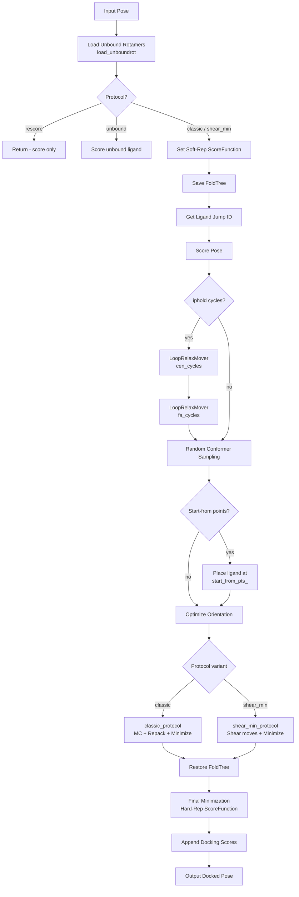

Rosetta's ligand docking subsystem provides a multi-layered framework for predicting how small molecules bind to protein targets. It spans from grid-accelerated genetic algorithm search to high-resolution Monte Carlo refinement, with a rich ecosystem of filters, scoring utilities, and integration points for enzyme design constraints. This page dissects the two primary docking paradigms — the classic `LigandDockProtocol` and the genetic-algorithm-driven `GALigandDock` — alongside the shared infrastructure that supports pose preparation, interface detection, and scoring.

Sources: [LigandDockProtocol.hh](source/src/protocols/ligand_docking/LigandDockProtocol.hh#L48-L64), [GALigandDock.hh](source/src/protocols/ligand_docking/GALigandDock/GALigandDock.hh#L1-L66)

## Architectural Overview

The ligand docking system is organized around two complementary docking engines, unified by a shared layer of utility functions, interface analysis, and filter movers. The architecture follows Rosetta's Mover/Filter paradigm, enabling seamless composition within RosettaScripts pipelines and JD2 job distribution.

```mermaid
graph TB
    subgraph "Application Layer"
        LDM[LigandDockMain<br/>ligand_dock_impl]
        RXML[RosettaScripts<br/>XML Pipeline]
    end

    subgraph "Docking Engines"
        LDP[LigandDockProtocol<br/>Classic MC Docking]
        GAL[GALigandDock<br/>GA-Based Docking]
    end

    subgraph "GALigandDock Subsystem"
        GA[GAOptimizer<br/>Genetic Algorithm]
        GS[GridScorer<br/>Grid-Based Scoring]
        LC[LigandConformer<br/>Gene Representation]
        TS[TorsionSampler]
        LA[LigandAligner / MCSAligner]
    end

    subgraph "Modular Movers"
        HRD[HighResDocker]
        ML[MinimizeLigand]
        MB[MinimizeBackbone]
        TL[TetherLigand]
        TF[Transform / Translate / Rotate]
        SF[StartFrom / SlideTogether]
        RC[RandomConformerMover]
    end

    subgraph "Scoring & Analysis"
        LS[ligand_scores<br/>Interface Deltas]
        GF[grid_functions<br/>Fast Grid Scoring]
        LF[ligand_functions<br/>Torsion Constraints]
        RDF[ComputeLigandRDF]
        IE[InterfaceScoreCalculator]
        MMB[MoveMapBuilder]
    end

    subgraph "Interface Detection"
        INT[Interface<br/>InterfaceInfo]
        ID[interface_distance_functions]
    end

    subgraph "Filters"
        F_ACF[AtomCountFilter]
        F_CEF[ChainExistsFilter]
        F_CCF[CompleteConnectionsFilter]
        F_HBD[HBondDonorFilter]
        F_HBA[HBondAcceptorFilter]
        F_HAF[HeavyAtomFilter]
        F_MMF[MolecularMassFilter]
    end

    subgraph "Chemical Layer"
        SDF[SDF Parser<br/>V2000/V3000]
        RDK[RDKit Integration]
        CHEM[MutableResidueType]
    end

    subgraph "Rosetta Core"
        SFN[ScoreFunction]
        MC[MonteCarlo]
        PS[Pose / Conformation]
    end

    LDM --> LDP
    RXML --> LDP
    RXML --> HRD
    RXML --> GAL

    LDP --> HRD
    LDP --> ML
    LDP --> TL
    LDP --> RC
    LDP --> TF
    LDP --> LS
    LDP --> GF
    LDP --> LF

    GAL --> GA
    GAL --> GS
    GAL --> LC
    GAL --> TS
    GAL --> LA
    GA --> GS
    GA --> LC

    HRD --> ML
    HRD --> MMB
    HRD --> INT
    HRD --> TL

    GS --> PS
    LS --> SFN
    LF --> PS
    INT --> ID
    MMB --> PS
    RC --> PS

    LDM --> F_ACF
    LDM --> F_CEF
    LDM --> F_CCF
    RXML --> F_ACF
    RXML --> F_CEF

    SDF --> CHEM
    RDK --> CHEM

    style LDP fill:#4a6fa5,color:#fff
    style GAL fill:#6a994e,color:#fff
    style HRD fill:#4a6fa5,color:#fff
    style GS fill:#6a994e,color:#fff
    style LC fill:#6a994e,color:#fff
    style GA fill:#6a994e,color:#fff
```

Sources: [ligand_dock_impl.cc](source/src/protocols/ligand_docking/ligand_dock_impl.cc#L57-L80), [HighResDocker.hh](source/src/protocols/ligand_docking/HighResDocker.hh#L56-L68), [grid_functions.hh](source/src/protocols/ligand_docking/grid_functions.hh#L33-L77), [ligand_scores.hh](source/src/protocols/ligand_docking/ligand_scores.hh#L35-L67)

## Classic Docking: LigandDockProtocol

The `LigandDockProtocol` (authored by Ian W. Davis) is the traditional Monte Carlo–based docking engine. It extends `LigandBaseProtocol` and implements a multi-stage search that begins with soft repulsive scoring and transitions to hard repulsion for final refinement. The protocol orchestrates rigid-body perturbation, side-chain repacking, and ligand torsion minimization within a simulated annealing framework.

### Protocol Initialization and Parameters

The constructor accepts a comprehensive set of parameters that define docking behavior. These can be supplied programmatically or read from the option system via `-docking:ligand:*` flags.

| Parameter | Type | Description |
|-----------|------|-------------|
| `protocol` | `string` | Protocol mode: `"classic"`, `"shear_min"`, `"rescore"`, or `"unbound"` |
| `minimize_ligand` | `bool` | Whether to minimize ligand internal degrees of freedom |
| `minimize_backbone` | `bool` | Whether to minimize protein backbone near the interface |
| `tether_ligand` | `bool` | Apply harmonic tether to prevent ligand from drifting far |
| `mutate_same_name3` | `bool` | Allow ligand protonation state changes |
| `ligand_chi_stddev_deg` | `Real` | Standard deviation for harmonic torsion restraints (degrees) |
| `protein_CA_stddev_Ang` | `Real` | Standard deviation for backbone CA restraints (Å) |
| `ligand_tether_stddev_Ang` | `Real` | Tether spring constant (Å); -1 disables tether |
| `ligand_shear_moves` | `Size` | Number of ligand shear (fragment) moves per cycle |

Sources: [LigandDockProtocol.hh](source/src/protocols/ligand_docking/LigandDockProtocol.hh#L54-L64), [LigandDockProtocol.cc](source/src/protocols/ligand_docking/LigandDockProtocol.cc#L100-L136)

### Multi-Stage Docking Pipeline

The `apply()` method implements the full docking pipeline. It begins by loading unbound rotamer bonuses via `core::pack::dunbrack::load_unboundrot()`, switches between soft and hard repulsive score functions, detects the ligand jump ID, and dispatches to one of the protocol variants. The soft-rep stage enables coarse exploration while the hard-rep stage provides accurate final scoring.

Sources: [LigandDockProtocol.cc](source/src/protocols/ligand_docking/LigandDockProtocol.cc#L194-L250), [LigandDockProtocol.hh](source/src/protocols/ligand_docking/LigandDockProtocol.hh#L88-L107)

### Classic Protocol vs. Shear-Min Protocol

The two core protocol variants differ fundamentally in how they explore conformational space. The **classic protocol** uses a Monte Carlo cycle with random conformer sampling, rigid-body perturbation via `DockingInitialPerturbation`, and periodic repacking. The **shear-min protocol** (selected when `ligand_shear_moves_ > 0`) incorporates ligand fragment replacement moves that require ambiguous torsion constraints to maintain chemical validity.

The classic protocol constructs a composite mover through `make_dockmcm_mover()`, which chains together repack movers, rigid-body movers, and minimization movers under a Monte Carlo acceptance criterion. The shear-min variant replaces this with a specialized fragment insertion + minimization loop that can bridge larger torsion barriers.

Sources: [LigandDockProtocol.hh](source/src/protocols/ligand_docking/LigandDockProtocol.hh#L88-L107), [LigandDockProtocol.hh](source/src/protocols/ligand_docking/LigandDockProtocol.hh#L120-L129), [LigandDockProtocol.cc](source/src/protocols/ligand_docking/LigandDockProtocol.cc#L133-L135)

### Ligand Torsion Restraints

Torsion restraints prevent the ligand from deviating too far from energetically favorable rotamers during docking. The `ligand_functions` utility provides two mechanisms: `torsion_constraints_from_rotamers()` generates ambiguous dihedral constraints from a set of reference conformations, while `torsion_constraints_from_chi_rotamers()` derives them from the `ResidueType`'s intrinsic `chi_rotamers()` data. Both are invoked by `get_ligand_torsion_constraints()` and aggregated into `ResidueTorsionRestraints` objects managed by the protocol.

> [!TIP]
> When using shear moves, the protocol enforces that ambiguous torsion constraints must be enabled (`-docking:ligand:use_ambig_constraints true`). This is a hard requirement validated at construction time — violating it triggers `utility_exit_with_message()`.

Sources: [ligand_functions.hh](source/src/protocols/ligand_docking/ligand_functions.hh#L34-L71), [LigandDockProtocol.hh](source/src/protocols/ligand_docking/LigandDockProtocol.hh#L131-L134)

## GA-Based Docking: GALigandDock

The `GALigandDock` subsystem (authored by Hahnbeom Park and Frank DiMaio) implements a fundamentally different search strategy: a multi-stage genetic algorithm that operates on a compact **gene representation** of the docking problem. This approach trades the full-atom accuracy of the classic protocol for dramatically faster exploration of binding poses, making it particularly effective for large-scale virtual screening.

### Gene Representation: LigandConformer

The central data structure is `LigandConformer`, which encodes a complete docking solution as a compact gene. Rather than storing full Cartesian coordinates, it parameterizes the pose through:

- **Rigid body transform** (`rb_`): a 6-DOF representation (3 translational + 3 rotational) of the ligand's position and orientation relative to the receptor
- **Ligand chi angles** (`ligandchis`): internal torsion degrees of freedom
- **Receptor chi angles** (`receptorchis`): side-chain torsions of flexible residues near the binding site

This gene representation enables efficient mutation and crossover operations — the fundamental genetic algorithm operators — directly in torsion/rotation space without needing to reconstruct full atom coordinates for intermediate evaluation. Friend functions `mutate()`, `crossover()`, and `distance_fast()`/`distance_slow()` implement these operations, with the slow variant accounting for symmetric atom equivalences.

Sources: [LigandConformer.hh](source/src/protocols/ligand_docking/GALigandDock/LigandConformer.hh#L39-L99), [LigandConformer.hh](source/src/protocols/ligand_docking/GALigandDock/LigandConformer.hh#L61-L82)

### Grid-Based Scoring: GridScorer

The `GridScorer` class is the computational engine that makes the genetic algorithm tractable. Rather than evaluating the full Rosetta energy function for each candidate pose, it pre-computes a three-dimensional grid representation of the receptor's scoring potential and evaluates ligand poses by simple grid lookups. This grid encodes van der Waals interactions (via `Etable`), hydrogen bonding (`HBondDatabase`), Lennard-Jones solvation (`LK_BallEnergy`), and Coulomb electrostatics (`Coulomb`).

The grid workflow consists of three phases: `prepare_grid()` calculates the bounding box around the binding site, `get_grid_atomtypes()` determines which atom types to encode based on the ligand's chemistry, and `calculate_grid()` populates the 3D grid values. During optimization, `score()` evaluates a `LigandConformer` gene by interpolating atom positions into the pre-computed grid, while `score_init()` adds an electron density correlation term for guided initial placement.

Sources: [GridScorer.hh](source/src/protocols/ligand_docking/GALigandDock/GridScorer.hh#L58-L120)

### Multi-Stage Genetic Algorithm: GAOptimizer

The `GAOptimizer` orchestrates the evolutionary search through a configurable multi-stage protocol. Each stage is defined by `GADockStageParams`, which controls population size, mutation rate, convergence thresholds, and scoring ramping schedules.

| Stage Parameter | Type | Role |
|----------------|------|------|
| `repeats` | `Size` | Number of generations to apply this stage |
| `pool` | `Size` | Population size for this stage |
| `rmsthreshold` | `Real` | Minimum RMSD between pool members (diversity enforcement) |
| `pmut` | `Real` | Per-gene mutation probability |
| `maxiter` | `Real` | Maximum minimization iterations per evaluation |
| `packcycles` | `Real` | Side-chain packing iterations |
| `smoothing` | `Real` | Grid smoothing factor |
| `elec_scale` | `Real` | Scaling factor for electrostatic terms |
| `ramp_schedule` | `vector1<Real>` | `fa_rep` weight ramping schedule |

The algorithm proceeds through `optimize_generation()` which performs selection, mutation (`mutate` / `mutate_ft`), crossover (`crossover` / `crossover_ft`), and pool update with RMSD-based diversity filtering. The `fa_rep` ramping schedule gradually increases the repulsive weight, transitioning from permissive exploration to precise refinement within a single run.

Sources: [GAOptimizer.hh](source/src/protocols/ligand_docking/GALigandDock/GAOptimizer.hh#L28-L59), [GAOptimizer.hh](source/src/protocols/ligand_docking/GALigandDock/GAOptimizer.hh#L67-L88)

### Output Management and Scoring Metrics

The `OutputStructureStore` maintains a priority queue of the best-scoring structures, ranked by either total energy or binding enthalpy (ΔH = complex score − receptor score − ligand score). Each stored result includes per-component scores (receptor, ligand, complex), RMSD to native, and the full constraint set, enabling comprehensive post-docking analysis. The store supports resizing to retain only the top-N results.

Sources: [GALigandDock.hh](source/src/protocols/ligand_docking/GALigandDock/GALigandDock.hh#L59-L105), [GALigandDock.hh](source/src/protocols/ligand_docking/GALigandDock/GALigandDock.hh#L156-L180)

## HighResDocker: Modular Refinement Mover

The `HighResDocker` provides a composable, RosettaScripts-friendly alternative to the monolithic `LigandDockProtocol`. It encapsulates a single high-resolution refinement stage — Monte Carlo cycles alternating between rigid-body perturbation, side-chain repacking, and minimization — that can be embedded within larger XML protocols.

The mover manages three key internal workflows: `setup_ligands_to_minimize()` configures per-ligand minimization parameters, `tether_ligands()` applies harmonic spatial restraints, and `make_packer_task()` builds interface-aware packing tasks using the `Interface` analysis system. It supports both chain-based and interface-distance-based residue selection for controlling repacking scope.

Sources: [HighResDocker.hh](source/src/protocols/ligand_docking/HighResDocker.hh#L56-L120), [HighResDocker.hh](source/src/protocols/ligand_docking/HighResDocker.hh#L138-L154)

## Interface Detection and Analysis

The `Interface` class in the `ligand_options` namespace classifies every residue in the receptor according to its proximity to the ligand chain. Each residue is tagged as `non_interface`, `near_interface`, or `is_interface`, forming a partition that controls which residues are permitted to repack or minimize during docking. This classification drives the `MoveMapBuilder` and packer task construction in both `HighResDocker` and `LigandDockProtocol`.

The interface detection uses distance-based heuristics with configurable padding. The `Interface` class extends `utility::vector1<InterfaceInfo>`, providing methods like `get_interface_residues()` and `get_near_interface_residues()` for downstream consumption, plus `enforce_minimum_length()` to ensure contiguous interface regions meet a minimum window size.

Sources: [Interface.hh](source/src/protocols/ligand_docking/ligand_options/Interface.hh#L39-L91)

## Ligand Scoring Utilities

The `ligand_scores` module provides a suite of scoring functions that decompose the binding interaction into interpretable metrics. `get_interface_deltas()` computes the difference between bound and separated energy components, while `get_ligand_travel()` measures how far the ligand centroid has moved — a diagnostic for detecting docking failures where the ligand escapes the binding site. `get_ligand_grid_scores()` evaluates poses against QSAR scoring grids for pharmacophore-aware assessment, and `get_radius_of_gyration()` quantifies ligand compactness, since ligands tend to bind in extended conformations.

The `grid_functions` module offers lower-level grid-based operations: `grid_score()` evaluates a residue against a `CartGrid`, `grid_rotamer_trials()` selects the optimal rotamer by grid scoring, and `rb_grid_score_atr_rep()` separates attractive and repulsive grid contributions for rigid-body regions. These utilities underpin both the classic protocol's coarse screening and GALigandDock's fast evaluation.

Sources: [ligand_scores.hh](source/src/protocols/ligand_docking/ligand_scores.hh#L35-L118), [grid_functions.hh](source/src/protocols/ligand_docking/grid_functions.hh#L33-L95)

## Ligand Input Pipeline

Rosetta's ligand docking ingests small molecules through the chemical data layer. The `core/chemical/sdf/` subsystem provides SDF and MOL file parsers supporting both V2000 and V3000 CTAB formats, while the `core/chemical/rdkit/` integration enables conversion between RDKit molecular representations and Rosetta's `MutableResidueType` — the core abstraction for parametrized small molecules. The Gasteiger atom typer (`core/chemical/gasteiger/`) assigns partial charges, and the ring conformer system (`core/chemical/rings/`) provides enumeration of valid ring pucker states.

The function `get_ligand_seqpos()` scans a pose for all non-polymer residues, identifying which residue indices correspond to ligands — essential for any docking operation that needs to determine which chain/jump to manipulate.

Sources: [ligand_functions.hh](source/src/protocols/ligand_docking/ligand_functions.hh#L73-L77), [source/src/core/chemical/sdf/](source/src/core/chemical/sdf/), [source/src/core/chemical/rdkit/](source/src/core/chemical/rdkit/)

## Comparison of Docking Paradigms

| Feature | LigandDockProtocol | GALigandDock | HighResDocker |
|---------|-------------------|--------------|---------------|
| **Search strategy** | Monte Carlo + minimization | Multi-stage genetic algorithm | Single-stage MC refinement |
| **Scoring** | Full Rosetta energy function | Pre-computed 3D grids | Full Rosetta energy function |
| **Speed** | Moderate (~minutes/pose) | Fast (~seconds/pose for GA stage) | Moderate |
| **Ligand flexibility** | Full torsion + rigid body | Full torsion + rigid body (gene) | Configurable via MoveMap |
| **Receptor flexibility** | Backbone + side-chain (limited) | Side-chain only (flex SCs in gene) | Side-chain + backbone (configurable) |
| **Best for** | Accurate single-pose docking | High-throughput screening | Protocol composition |
| **RosettaScripts** | Via LigandDockProtocol Mover | Via GALigandDock Mover | Native support |
| **Output metrics** | Interface deltas, travel | dH, RMS, per-component scores | Standard Rosetta scores |

## Application Entry Point

The `ligand_dock_main()` function in `ligand_dock_impl.cc` serves as the application entry point. It instantiates `LigandDockMain` (a subclass of `LigandDockProtocol` that adds native pose handling and enzyme constraint support), configures AtomTreeDiff output precision for compact silent files, and delegates to the JD2 `JobDistributor`. The `LigandDockMain` override of `apply()` adds enzyme design constraints if a constraint file is specified via `-enzdes:cstfile`, automatically enabling coordinate, atom pair, angle, and dihedral constraint weights.

> [!TIP]
> The `ligand_dock` application requires `-run:preserve_header true` — without it, the application exits immediately with an error message. This preserves PDB header information critical for correct ligand parametrization across job distribution.

Sources: [ligand_dock_impl.cc](source/src/protocols/ligand_docking/ligand_dock_impl.cc#L57-L80), [ligand_dock_impl.cc](source/src/protocols/ligand_docking/ligand_dock_impl.cc#L164-L190)

## Next Steps

To deepen your understanding of the ligand docking system, explore these related topics in the catalog:

- **[Pose and Conformation](8-pose-and-conformation)** — Understand the Pose data structure that holds ligand coordinates, FoldTree jumps, and residue connections
- **[ScoreFunction Framework](9-scorefunction-framework)** — Learn how soft-rep/hard-rep score functions are composed and weighted for docking
- **[Monte Carlo Sampling](12-monte-carlo-sampling)** — Understand the simulated annealing acceptance criterion that drives classic docking
- **[Mover and Filter Hierarchy](11-mover-and-filter-hierarchy)** — See how docking movers fit into Rosetta's extensible protocol framework
- **[RosettaScripts XML Framework](14-rosettascripts-xml-framework)** — Learn how to compose docking protocols declaratively using XML
- **[PyRosetta Python Bindings](16-pyrosetta-python-bindings)** — Access docking functionality programmatically from Python
- **[Structure Relaxation](18-structure-relaxation)** — Explore post-docking refinement with FastRelax to optimize the protein-ligand interface