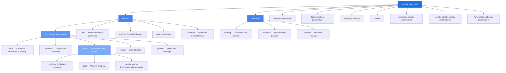

This page gets you from zero to running your first Rosetta computation as quickly as possible. Whether you prefer pre-built binaries, containerized environments, or compiling from source, Rosetta offers multiple paths to get started. By the end of this guide, you will have a working Rosetta installation and understand how to run its core applications on protein structure data.

Before proceeding, make sure you have reviewed the [Overview](1-overview) page for context on what Rosetta is, and the [Licensing Model](3-licensing-model) page for the specific license terms that govern your use of the software. Rosetta is **not** OSI Open Source — commercial use requires a paid license from the University of Washington.

## Prerequisites

The Rosetta build process has minimal host dependencies. The codebase vendors most of its runtime libraries as git submodules, so you only need a C++ compiler (g++ or clang) and Python 2.7+ installed on your system. The build system itself — SCons — is bundled with the repository, eliminating the need for a separate installation step.

| Requirement | Minimum Version | Purpose |
|---|---|---|
| C++ Compiler | GCC 4.9+ or Clang 3.5+ | Compiling Rosetta from source |
| Python | 2.7 or 3.x | Build scripting and PyRosetta |
| Git | Any recent version | Cloning the repository and submodules |
| Disk Space | ~15 GB free | Source tree, build artifacts, and runtime database |
| RAM | 8 GB+ recommended | Compilation can be memory-intensive with parallel jobs |

For PyRosetta specifically, you will also need the [Ninja](https://github.com/ninja-build/ninja) build tool and CMake, both of which are available through your system package manager or Conda.

Sources: [README.md](README.md#L1-L161), [source/readme.txt](source/readme.txt#L1-L111)

## Repository Architecture at a Glance

Understanding the top-level layout before you clone will help you navigate the codebase with confidence. Rosetta is organized into three conceptual layers: the **source tree** (compilable C++ code), the **runtime database** (parameter files loaded at execution time), and the **submodule ecosystem** (documentation, demos, scripts, and external dependencies).



A critical distinction: the `database/` directory is **not** source code — it contains parameter files that Rosetta executables load at runtime. Without it, no Rosetta application will function. The `source/src/apps/public/` directory holds all officially published protocol executables, while `source/src/apps/pilot/` contains experimental work that has not yet been released.

Sources: [README.md](README.md#L130-L161), [source/src/apps/README](source/src/apps/README#L1-L22)

## Path 1: Clone and Build from Source

This is the most flexible option and the one you need if you plan to modify Rosetta or run protocols that are not available in the pre-built packages.

### Step 1 — Clone the Repository

```bash
git clone https://github.com/RosettaCommons/rosetta.git
cd rosetta
```

The default clone does **not** pull down git submodules — the demo scripts, documentation, and example notebooks will appear as empty directories. This is intentional; the build system will automatically fetch only the submodules required for compilation. If you want all submodules (for demos and documentation), run:

```bash
git submodule update --init --recursive
```

Sources: [README.md](README.md#L42-L161)

### Step 2 — Compile with SCons

SCons is Rosetta's primary build system. It is distributed within the repository itself, so there is nothing to install. Navigate to the `source/` directory and invoke the build:

```bash
cd source
./scons.py -j<NumOfJobs> mode=release bin
```

Replace `<NumOfJobs>` with the number of CPU cores available on your machine (e.g., `-j8` for 8 cores). The `mode=release` flag is essential — without it, SCons builds in debug mode, which produces executables that are approximately **10× slower** than release builds. The `bin` target tells SCons to create executable symlinks in `source/bin/`.

**Common build variants:**

| Command | What It Does |
|---|---|
| `./scons.py -j8 mode=release bin` | Standard production build (recommended) |
| `./scons.py -j8 mode=release extras=static bin` | Statically linked binaries (more portable) |
| `./scons.py -j8 mode=release extras=mpi,serialization bin` | Build with MPI parallelism support |
| `./scons.py -j8 mode=release extras=cxx11thread bin` | Build with C++11 multi-threading |
| `./scons.py -j8 mode=release extras=tensorflow bin` | Build with TensorFlow ML integration |
| `./scons.py -j8 cat=test bin` then `python test/run.py` | Build and run the unit test suite |

The compilation of the full Rosetta source tree is substantial — expect it to take between 30 minutes and several hours depending on your hardware. The resulting executables will appear in `source/bin/` with descriptive names like `relax.linuxgccrelease`.

Sources: [source/SConstruct](source/SConstruct#L62-L206), [source/readme.txt](source/readme.txt#L1-L111)

> [!TIP]
> **Build speed tip**: Use `./scons.py --nover -j8 mode=release bin` during rapid development iterations. The `--nover` flag skips the versioning script and submodule update, preventing unnecessary recompilation of files that depend on version headers. Never use `--nover` for production builds.

### Step 3 — Verify the Build

After compilation completes, confirm that executables were produced:

```bash
ls source/bin/ | head -20
```

You should see a large number of executables. A quick smoke test:

```bash
./source/bin/relax.linuxgccrelease --help
```

If the executable prints its usage information, your build is working correctly.

## Path 2: Docker (Fastest to Get Running)

Docker provides the fastest path to a working Rosetta environment with zero compilation required. The RosettaCommons maintains official images on Docker Hub that ship with both Rosetta and PyRosetta pre-installed, including Jupyter notebook setups for interactive exploration.

Pull and run the official image:

```bash
docker pull rosettacommons/rosetta:latest
docker run -it rosettacommons/rosetta:latest /bin/bash
```

The Docker Hub repository provides several image variants:

| Image Variant | Description |
|---|---|
| `serial` | Standard single-threaded Rosetta build |
| `mpi` | MPI-enabled Rosetta build for cluster use |
| `pyrosetta` | PyRosetta with standard Python environment |
| `pyrosetta-jupyter` | PyRosetta with full Jupyter notebook setup |
| `ml` | PyRosetta with libtorch and TensorFlow integration |

If you need to customize the build environment, reference Dockerfiles are provided in the `docker/` directory of the repository. These files serve as templates showing exactly which system packages are needed — they do **not** clone or build Rosetta themselves. You mount your cloned repository into the container and run the build commands manually.

Sources: [README.md](README.md#L80-L95), [docker/README.md](docker/README.md#L1-L19), [docker/rosetta-ubuntu-22.04.dockerfile](docker/rosetta-ubuntu-22.04.dockerfile#L1-L43)

## Path 3: Conda Pre-built Binaries

For users who prefer Conda environments over Docker, Rosetta distributes pre-compiled binaries via the RosettaCommons Conda channel. All Conda binaries are built with `serialization` and `cxx11thread` extras enabled.

Configure your `~/.condarc` to point to one of the two mirror channels:

```yaml
# US West Coast (recommended default)
channels:
  - https://conda.rosettacommons.org
  - conda-forge

# US East Coast alternative
channels:
  - https://conda.graylab.jhu.edu
  - conda-forge
```

Then install:

```bash
conda create -n rosetta rosetta
conda activate rosetta
```

Sources: [README.md](README.md#L57-L75)

## Building PyRosetta from Source

If you need PyRosetta but want to build it from the source tree rather than using the Docker or Conda packages, the process requires Ninja and CMake in addition to the standard C++ compiler:

```bash
cd source/src/python/PyRosetta
python3 build.py -j<NumOfJobs> --create-package $HOME/my_pyrosetta_package
cd $HOME/my_pyrosetta_package/setup
python3 setup.py install
```

This produces a standard Python package that can be installed into your current environment. Verify the installation with:

```bash
python3 -c "import pyrosetta; pyrosetta.init()"
```

Sources: [README.md](README.md#L96-L109)

## Running Your First Rosetta Application

With a working build (or Docker/Conda installation), you can immediately run Rosetta's most commonly used protocols. All Rosetta applications follow a consistent command-line pattern: they accept PDB files as input via flags and produce structure files as output.

### Structure Relaxation

The `relax` application performs energy minimization and side-chain optimization to improve the physical realism of a protein structure:

```bash
# Using a source build
./source/bin/relax.linuxgccrelease -s input.pdb -relax:fast

# Using Docker
docker run -v $(pwd):/data rosettacommons/rosetta relax.linuxgccrelease \
  -s /data/input.pdb -relax:fast
```

Key flags: `-s` specifies the input PDB file, `-relax:fast` selects the fast (less thorough) relaxation protocol. The `-out:path:all` flag controls where output files are written.

### RosettaScripts (XML-driven Protocols)

RosettaScripts allows you to compose complex protocols from XML configuration files without writing C++ code. The `rosetta_scripts` application interprets these XML definitions:

```bash
./source/bin/rosetta_scripts.linuxgccrelease \
  -s input.pdb \
  -parser:protocol my_protocol.xml
```

XML schema files for validation (`RosettaScripts.xsd`, `RosettaScripts.rnc`) are located alongside the application source in [source/src/apps/public/rosetta_scripts/](source/src/apps/public/rosetta_scripts/).

Sources: [source/src/apps/public/relax.cc](source/src/apps/public/relax.cc#L1-L50), [source/src/apps/public/rosetta_scripts/README.txt](source/src/apps/public/rosetta_scripts/README.txt#L1-L4)

### Common Application Reference

| Application | Source File | Primary Use |
|---|---|---|
| `relax` | [relax.cc](source/src/apps/public/relax.cc) | Structure refinement and energy minimization |
| `AbinitioRelax` | [AbinitioRelax.cc](source/src/apps/public/AbinitioRelax.cc) | Ab initio folding followed by relaxation |
| `rosetta_scripts` | [rosetta_scripts.cc](source/src/apps/public/rosetta_scripts/rosetta_scripts.cc) | XML-driven protocol composition |
| `minimize` | [minimize.cc](source/src/apps/public/minimize.cc) | Pure energy minimization |
| `docking_protocol` | [docking/](source/src/apps/public/docking/) | Protein-protein docking |
| `ligand_docking` | [ligand_docking/](source/src/apps/public/ligand_docking/) | Small molecule docking |
| `fragment_picker` | [fragment_picker.cc](source/src/apps/public/fragment_picker.cc) | Fragment library generation for ab initio |
| `ddg_monomer` | [ddg/](source/src/apps/public/ddg/) | Stability change (ΔΔG) calculations |

## The Runtime Database

Every Rosetta executable requires access to the `database/` directory at runtime. This directory contains score function parameters, rotamer libraries, chemical residue definitions, and other essential data files. By default, Rosetta locates the database by searching relative to the executable's location, but you can override this with the `-database` flag:

```bash
./source/bin/relax.linuxgccrelease -database /path/to/rosetta/database -s input.pdb
```

The database directory contains 14 subdirectories covering scoring parameters, rotamer libraries, membrane protein data, symmetry definitions, and more. The [Runtime Database System](23-runtime-database-system) page explores this in depth.

Sources: [README.md](README.md#L130-L140)

## Troubleshooting Common Issues

| Problem | Likely Cause | Solution |
|---|---|---|
| `database not found` error | Executable cannot locate `database/` | Pass `-database /path/to/rosetta/database` explicitly |
| Slow executable performance | Built in debug mode instead of release | Rebuild with `mode=release` flag |
| Missing submodules (empty dirs) | Submodules not initialized | Run `git submodule update --init --recursive` |
| Compiler errors on older GCC | Advanced C++ features required | Upgrade to GCC 7+ or Clang 6+ |
| Python version errors during build | Python 2.7+ or 3.x required | Ensure a compatible Python is in your PATH |
| MPI applications not available | Built without MPI extras | Rebuild with `extras=mpi,serialization` |

For questions not covered here, the [RosettaCommons forums](https://www.rosettacommons.org/forum) are the primary support channel. For build system internals, consult `tools/build/README` within the source tree.

Sources: [source/readme.txt](source/readme.txt#L1-L111), [README.md](README.md#L42-L161)

## Contributing to Rosetta

If your Quick Start journey leads you to fix bugs or add features, Rosetta uses a **Fork-and-PR** development model. Fork the repository under your own GitHub account, develop on a branch, and open a Pull Request against the `main` branch of RosettaCommons/rosetta. Before your first contribution is accepted, you must sign the [Contributor License Agreement (CLA)](https://www.rosettacommons.org/forms/cla) — a one-time requirement that grants the RosettaCommons permission to distribute your code under the Rosetta license while you retain full rights to your original work.

Note that modifying submodule content (documentation, demos, tools) requires forking the respective submodule repository separately, not the main `rosetta` repo.

Sources: [CONTRIBUTING.md](CONTRIBUTING.md#L1-L73), [CLA.md](CLA.md#L1-L64)

## What to Explore Next

Now that you have a working Rosetta installation, your learning path depends on your goals:

- **Understand the codebase structure** → [Codebase Architecture](5-codebase-architecture) for a deep dive into how the C++ source is organized across `core/`, `protocols/`, and `apps/`.
- **Master the build system** → [SCons Build System](6-scons-build-system) for advanced build configuration and [CMake Build Configuration](7-cmake-build-configuration) for the alternative CMake-based build path.
- **Explore Docker and Conda in depth** → [Docker and Conda Setup](4-docker-and-conda-setup) for containerized workflows and environment management.
- **Learn the fundamental data model** → [Pose and Conformation](8-pose-and-conformation) to understand Rosetta's core representation of protein structures.
- **Start scripting protocols** → [RosettaScripts XML Framework](14-rosettascripts-xml-framework) for composing protocols declaratively, or [PyRosetta Python Bindings](16-pyrosetta-python-bindings) for programmatic control.
- **Run your first scientific protocol** → [Structure Relaxation](18-structure-relaxation) is the natural next step after verifying your build works.