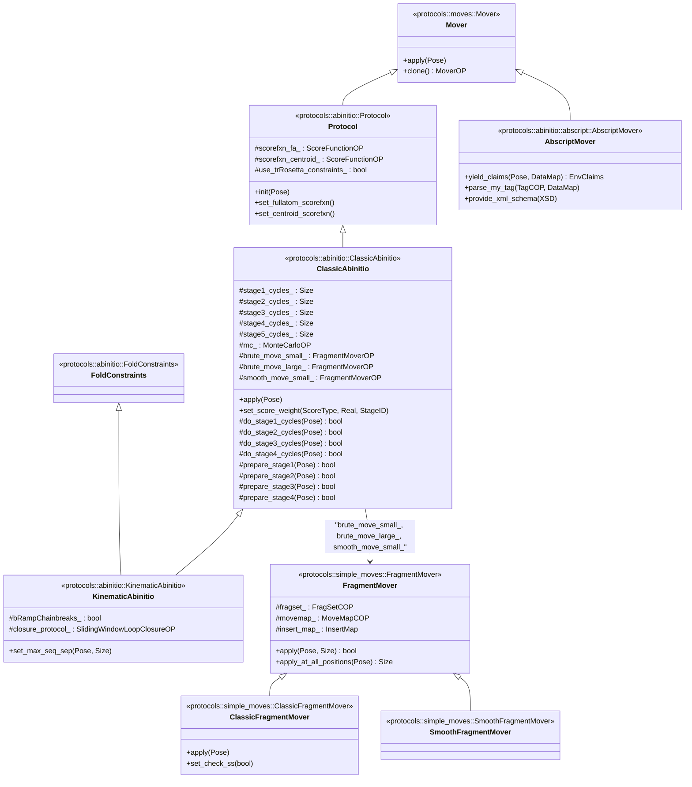
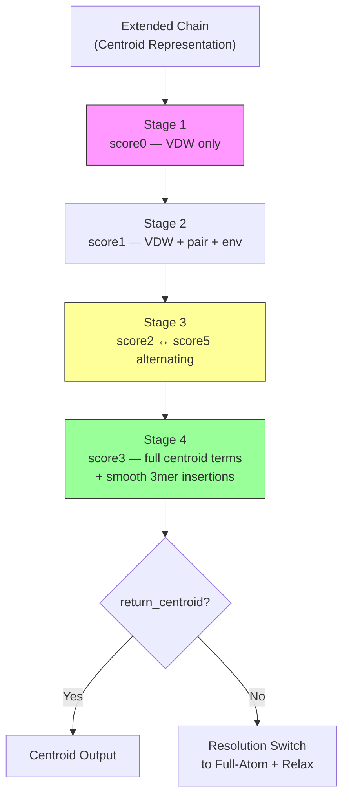
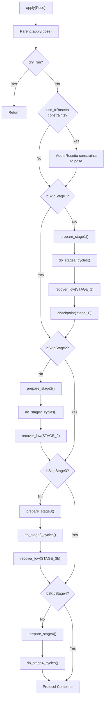

Rosetta's **ab initio folding** protocol predicts three-dimensional protein structures from amino acid sequence alone, using fragment assembly guided by a low-resolution centroid representation. The system constructs conformations by repeatedly inserting short peptide fragments (typically 3- and 9-mers) harvested from known structures, accepting or rejecting moves via Monte Carlo criteria against progressively more discriminating score functions. For developers building on or extending this pipeline, understanding the four-stage architecture and its extensible class hierarchy is essential.

## Architectural Overview

The ab initio subsystem lives primarily under `source/src/protocols/abinitio/` and operates through a deep inheritance chain rooted in Rosetta's Mover framework. The core relationship is `moves::Mover` → `Protocol` → `ClassicAbinitio` → `KinematicAbinitio`, with each level adding domain-specific behavior — evaluation hooking, staged score functions, and loop/jump closure respectively. A parallel XML-accessible pathway exists through `AbscriptMover`, which uses the environment/claims system for declarative configuration.

Sources: [ClassicAbinitio.hh](source/src/protocols/abinitio/ClassicAbinitio.hh#L80-L165), [Protocol.hh](source/src/protocols/abinitio/Protocol.hh#L1-L100), [KinematicAbinitio.hh](source/src/protocols/abinitio/KinematicAbinitio.hh#L1-L80), [AbscriptMover.hh](source/src/protocols/abinitio/abscript/AbscriptMover.hh#L1-L131)

## The Four-Stage Folding Pipeline

The `ClassicAbinitio` protocol implements a sequential, multi-stage Monte Carlo search. Each stage uses a progressively richer centroid score function and different fragment insertion strategies. The stage progression is encoded as an enum within the class itself.

Sources: [ClassicAbinitio.hh](source/src/protocols/abinitio/ClassicAbinitio.hh#L81-L96)

Each stage follows a consistent **prepare-then-cycle** pattern. The `prepare_stageN()` virtual method sets the score function and may modify the pose (e.g., applying constraints, switching weights), while `do_stageN_cycles()` executes the Monte Carlo loop. This design enables fine-grained customization — subclasses can override preparation, the mover composition within a stage, or the cycling logic independently.

Sources: [ClassicAbinitio.hh](source/src/protocols/abinitio/ClassicAbinitio.hh#L259-L326), [ClassicAbinitio.cc](source/src/protocols/abinitio/ClassicAbinitio.cc#L286-L354)

### Stage Parameters

| Stage | Score Function | Fragment Size | Default Cycles | Purpose |
|-------|---------------|---------------|----------------|---------|
| **Stage 1** | `score0` (VDW only) | 9-mer (large) | ~2000 | Rapid chain compaction from extended conformation |
| **Stage 2** | `score1` (VDW + pair + env) | 9-mer (large) | ~2000 | Early secondary structure formation |
| **Stage 3a/3b** | `score2` ↔ `score5` alternating | 3-mer + 9-mer | Tunable loops | Topology search with full centroid scoring |
| **Stage 4** | `score3` (all centroid terms) | 3-mer (smooth) | ~4000 | Refinement with GunnCost-weighted local moves |

The cycle counts are configurable at runtime via the `abinitio::increase_cycles` option and the `set_cycles()` method, which scales all stages by a multiplier. The `set_score_weight()` method allows per-stage weight overrides, where `stage == -1` applies a change globally across all stages. The `prepare_loop_in_stage3()` and `prepare_loop_in_stage4()` hooks are invoked within inner iteration loops, enabling dynamic weight ramping during a single stage.

Sources: [ClassicAbinitio.hh](source/src/protocols/abinitio/ClassicAbinitio.hh#L208-L210), [ClassicAbinitio.hh](source/src/protocols/abinitio/ClassicAbinitio.hh#L314-L326), [ClassicAbinitio.hh](source/src/protocols/abinitio/ClassicAbinitio.hh#L393-L399)

> [!TIP]
> The `recover_low()` method is called after each stage to reset the pose to the best (lowest-energy) conformation encountered during that stage's Monte Carlo trajectory. The set of stages at which recovery occurs is controlled by the `recover_low_stages_` member, configurable via the `-abinitio:recover_low_in_stages` flag. Checkpointing is integrated at stage boundaries via the `CheckPointer` system, allowing recovery from `stage_1` or `stage_2` checkpoints on restart.

Sources: [ClassicAbinitio.hh](source/src/protocols/abinitio/ClassicAbinitio.hh#L246-L247), [ClassicAbinitio.cc](source/src/protocols/abinitio/ClassicAbinitio.cc#L331-L344)

## Fragment Mover Taxonomy

The fragment movers that drive conformational sampling are defined in `source/src/protocols/simple_moves/` and are composed into the ab initio protocol through three named slots. The `FragmentMover` abstract base class manages the fragment set, move map, and insert position bookkeeping. It computes an `InsertMap` and `InsertSize` during `update_insert_map()` to track valid insertion sites, respecting the move map's mobility constraints.

Sources: [FragmentMover.hh](source/src/protocols/simple_moves/FragmentMover.hh#L50-L105)

| Mover Class | Base Class | Sampling Strategy | Typical Role |
|-------------|-----------|-------------------|--------------|
| `ClassicFragmentMover` | `FragmentMover` | Uniform random selection from frame | `brute_move_small_`, `brute_move_large_` |
| `SmoothFragmentMover` | `FragmentMover` | `GunnCost`-biased local fragment selection | `smooth_move_small_` |
| `SymmetricFragmentMover` | `ClassicFragmentMover` | Uniform + symmetry replication | Symmetric folding |
| `LoggedFragmentMover` | `ClassicFragmentMover` | Uniform + fragment logging | Debug/tracing |
| `ResTypeFragmentMover` | `FragmentMover` | Residue-type restricted insertion | Constrained folding |

The constructor in `ClassicAbinitio` selects among these implementations based on command-line flags. When `abinitio::symmetry_residue` is set, `SymmetricFragmentMover` instances are created for all three slots. When `abinitio::log_frags` is active (requires `abinitio::debug`), `LoggedFragmentMover` is used for brute-force slots. Otherwise, standard `ClassicFragmentMover` and `SmoothFragmentMover` (with `GunnCost`) are instantiated. The `end_bias` parameter, defaulting to 30.0, is applied uniformly across all three movers to penalize fragment insertions near chain termini.

Sources: [ClassicAbinitio.cc](source/src/protocols/abinitio/ClassicAbinitio.cc#L164-L219)

## The ClassicAbinitio Execution Flow

The `apply()` method in `ClassicAbinitio` orchestrates the full pipeline. After delegating to `Parent::apply()`, it optionally adds trRosetta-generated distance constraints (when compiled with TensorFlow), then proceeds through stages 1–4 sequentially. Each stage block follows an identical pattern: check skip flag → start profiler → call `prepare_stageN()` → execute `do_stageN_cycles()` → call `recover_low()` → dump MC counters → checkpoint. A `success` flag gates progression — if any stage returns failure (via `FAIL_RETRY`), the entire protocol aborts early.

Sources: [ClassicAbinitio.cc](source/src/protocols/abinitio/ClassicAbinitio.cc#L286-L354), [ClassicAbinitio.cc](source/src/protocols/abinitio/ClassicAbinitio.cc#L411-L457)

> [!TIP]
> Stage 3 is unique in that it alternates between two score functions (`score2` and `score5`) across inner loop iterations. The `prepare_loop_in_stage3()` hook — called at the start of each inner iteration — is responsible for switching the active score function. This design supports the "temperature annealing" strategy where weaker scoring (score5) permits exploration while stronger scoring (score2) enforces progressively tighter geometric constraints. The `replace_scorefxn()` virtual method provides a final opportunity to modify weight terms before each iteration begins.

Sources: [ClassicAbinitio.hh](source/src/protocols/abinitio/ClassicAbinitio.hh#L249-L250), [ClassicAbinitio.hh](source/src/protocols/abinitio/ClassicAbinitio.hh#L314-L319), [ClassicAbinitio.cc](source/src/protocols/abinitio/ClassicAbinitio.cc#L416-L452)

## KinematicAbinitio: Loop Closure and Jump Sampling

`KinematicAbinitio` extends `FoldConstraints` (which itself extends `ClassicAbinitio`) to add **kinematic loop closure** and **jump move sampling** for multi-domain or template-guided folding. The critical extensions are:

1. **Jump-aware stage movers** — `stage1_mover()`, `stage2_mover()`, `stage3_mover()`, and `stage4_mover()` are all overridden to wrap the standard fragment trial mover with jump moves via `create_jump_moves()`, which combines the jump mover with the standard backbone moves into a `SequenceMover`.

2. **Chainbreak weight ramping** — `bRampChainbreaks_` and `bOverlapChainbreaks_` flags control progressive ramping of chainbreak penalties during stages 3 and 4, ensuring that loop geometry tightens gradually as the fold matures.

3. **Loop closure protocol** — An optional `SlidingWindowLoopClosureOP` can be attached via `closure_protocol()`. When present, it is invoked during stage preparation to close kinematic loop gaps opened by jump moves.

4. **Maximum sequence separation** — The `set_max_seq_sep()` method controls the distance constraint cutoff for residue pairs, a parameter critical for contact-order-based folding. This is overridden from `FoldConstraints`.

Sources: [KinematicAbinitio.hh](source/src/protocols/abinitio/KinematicAbinitio.hh#L52-L140)

## AbscriptMover: Declarative RosettaScripts Integration

For XML-driven workflows, `AbscriptMover` provides an alternative entry point that uses Rosetta's environment/claims system. Rather than hardcoding a fixed stage sequence, `AbscriptMover` parses XML tags to dynamically register sub-movers and preparers against specific `StageID` values. The `parse_my_tag()` method processes sub-tags, while `register_submover()` and `register_preparer()` associate mover instances with stage sets and optional weights. The `calculate_iterations()` method computes the number of Monte Carlo iterations per stage based on pose properties.

`AbscriptMover` inherits from `ClientMover` (not from `ClassicAbinitio`), meaning it uses a fundamentally different coordination mechanism — environment claims and initialization gates rather than direct sequential invocation. It delegates stage execution to `AbscriptStageMover` instances stored in a `std::map<StageID, AbscriptStageMoverOP>`. This design supports fully declarative folding protocol composition, where users specify fragment sources, movers, and stage-level parameters entirely through XML without C++ intervention.

Sources: [AbscriptMover.hh](source/src/protocols/abinitio/abscript/AbscriptMover.hh#L47-L131)

## Specialized Protocol Variants

The ab initio module contains several specialized variants that extend the core pipeline for specific structural contexts:

| Variant | Purpose | Key Extension |
|---------|---------|---------------|
| `DoubleLayerKinematicAbinitio` | Two-pass folding with coarse-to-fine refinement | Dual-pass stage execution |
| `MembraneAbinitio` | Transmembrane protein folding | Membrane-specific score functions |
| `ConstraintFragmentSampler` | Folding guided by experimental constraints | External constraint integration |
| `IterativeAbrelax` | Iterative centroid ↔ full-atom switching | `IterativeBase` multi-resolution cycles |
| `FragmentSampler` | Standalone fragment sampling without full pipeline | Lightweight single-stage execution |
| `DomainAssembly` | Multi-domain assembly from individual ab initio predictions | Domain-level docking and assembly |
| `BrokeringFold` (`BrokerMain`) | Fragment broker-based conformational sampling | Constraint broker pattern for fragment selection |

Sources: [source/src/protocols/abinitio/](source/src/protocols/abinitio/)

## trRosetta Constraint Integration

When Rosetta is compiled with TensorFlow support (`extras=tensorflow`), `ClassicAbinitio` supports injecting inter-residue distance and orientation constraints predicted by the trRosetta neural network. The `Protocol` base class holds a `trRosettaConstraintGeneratorOP` and a boolean flag `use_trRosetta_constraints_`. During `apply()`, if this flag is set, constraints are generated and added to the pose before stage 1 begins, biasing the fragment assembly toward the predicted contact map. The `supports_trRosetta_constraints()` virtual method is overridden to `true` in `ClassicAbinitio`, while the base `Protocol` class returns `false` — a pattern that allows downstream protocols to opt in selectively.

Sources: [Protocol.hh](source/src/protocols/abinitio/Protocol.hh#L82-L100), [Protocol.hh](source/src/protocols/abinitio/Protocol.hh#L164-L175), [ClassicAbinitio.cc](source/src/protocols/abinitio/ClassicAbinitio.cc#L300-L311)

## Command-Line Options

`ClassicAbinitio::register_options()` exposes the key runtime-tunable parameters. These must be registered before `core::init::init()` by calling `ClassicAbinitio::register_options()` from the application's main function.

| Option Flag | Type | Purpose |
|------------|------|---------|
| `-abinitio:increase_cycles` | Real | Multiplier for all stage cycle counts |
| `-abinitio:smooth_cycles_only` | Boolean | Skip stages 1–3, run only stage 4 |
| `-abinitio:debug` | Boolean | Enable debug output and structure dumps |
| `-abinitio:skip_convergence_check` | Boolean | Disable convergence-based early termination |
| `-abinitio:log_frags` | Boolean | Enable fragment insertion logging |
| `-abinitio:only_stage1` | Boolean | Execute only stage 1 |
| `-abinitio:end_bias` | Real | Bias penalty for terminal fragment insertions (default: 30.0) |
| `-abinitio:symmetry_residue` | Integer | Enable symmetric folding with given pivot residue |
| `-abinitio:vdw_weight_stage1` | Real | Override VDW weight during stage 1 |
| `-abinitio:override_vdw_all_stages` | Real | Override VDW weight across all stages |
| `-abinitio:recover_low_in_stages` | IntegerVector | Stages at which low-energy recovery occurs |
| `-abinitio:close_chbrk` | Boolean | Enable chainbreak closure during stage 4 |

Sources: [ClassicAbinitio.cc](source/src/protocols/abinitio/ClassicAbinitio.cc#L110-L126)

## Key Extension Points for Developers

The `ClassicAbinitio` class is designed for extensibility through well-defined virtual methods organized by granularity level. Understanding which hook to override is critical for building custom folding protocols.

**Mover-level customization** — Override `stage1_mover()` through `stage4_mover()` to inject custom trial movers (e.g., backbone perturbation moves, constraint-aware movers). The `create_bb_moves()` helper in `KinematicAbinitio` demonstrates this pattern by wrapping standard fragment trials with jump perturbation moves.

**Score function customization** — Override `set_default_scores()` to change the patch files loaded for each stage, or override `replace_scorefxn()` to dynamically adjust weights during transitions. The `set_score_weight()` public API allows post-construction weight adjustments without subclassing.

**Stage lifecycle customization** — Override `prepare_stageN()` to modify pose state before sampling (e.g., adding/removing constraints, changing fold trees), or override `prepare_loop_in_stageN()` for per-iteration adjustments within a stage's inner loop.

**Full protocol replacement** — For XML-based protocols, use `AbscriptMover` with custom `AbscriptStageMover` implementations registered per-stage, avoiding C++ inheritance entirely.

For developers needing the fragment supply chain itself, the [Fragment Picking System](26-fragment-picking-system) provides the upstream machinery for generating the 3-mer and 9-mer fragment libraries consumed by these protocols. The scoring functions used at each stage are detailed in [ScoreFunction Framework](9-scorefunction-framework), and the Monte Carlo acceptance criteria governing trial evaluation are described in [Monte Carlo Sampling](12-monte-carlo-sampling). For ML-augmented folding that bypasses the classical fragment pipeline entirely, see [trRosetta Deep Learning](21-trrosetta-deep-learning).