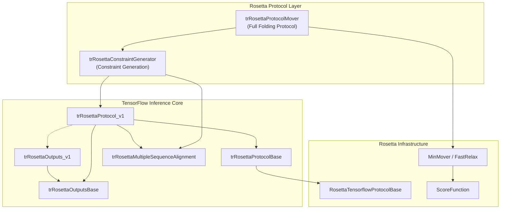
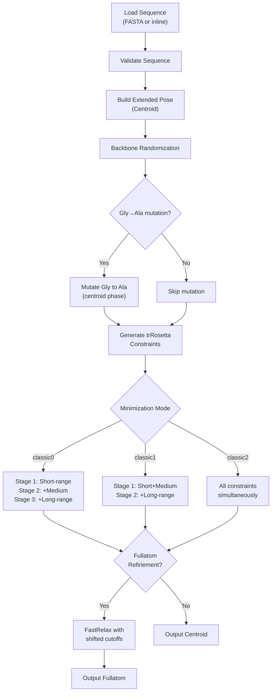

This page documents Rosetta's C++ integration of the **trRosetta** deep learning method — a transformer-based protein structure prediction pipeline originally published by Yang et al. (2020) and subsequently ported into Rosetta by Vikram K. Mulligan. The implementation wraps TensorFlow inference behind Rosetta-native abstractions, converting predicted inter-residue geometry distributions into Rosetta constraints that drive gradient-based folding. The entire subsystem is gated behind the `USE_TENSORFLOW` compile-time flag, making it an optional but deeply integrated ML extension.

Sources: [trRosettaProtocolBase.hh](source/src/protocols/trRosetta/trRosettaProtocolBase.hh#L1-L100), [trRosettaProtocolMover.hh](source/src/protocols/trRosetta_protocols/movers/trRosettaProtocolMover.hh#L10-L13)

## Architectural Overview

The trRosetta subsystem is decomposed into two logical layers: a **TensorFlow inference core** (`protocols/trRosetta/`) that encapsulates the neural network session, MSA preprocessing, and output tensor management; and a **Rosetta protocol layer** (`protocols/trRosetta_protocols/`) that exposes this functionality through Rosetta's standard `Mover` and `ConstraintGenerator` interfaces. This separation ensures that the low-level TensorFlow interaction can evolve independently of the protocol-level orchestration.

The `trRosettaProtocolMover` orchestrates the complete folding pipeline — from MSA ingestion through staged constraint-guided minimization to optional fullatom refinement — while `trRosettaConstraintGenerator` offers a modular, reusable component that can be embedded in arbitrary RosettaScripts workflows. Both consume the inference core, which is rooted in Rosetta's `RosettaTensorflowProtocolBase` abstract class.

Sources: [trRosettaProtocolBase.hh](source/src/protocols/trRosetta/trRosettaProtocolBase.hh#L37-L97), [trRosettaConstraintGenerator.hh](source/src/protocols/trRosetta_protocols/constraint_generators/trRosettaConstraintGenerator.hh#L44-L68)

## TensorFlow Inference Core

### Protocol Hierarchy

The inference core follows a versioned inheritance pattern. `trRosettaProtocolBase` extends `RosettaTensorflowProtocolBase` and declares the contract that all concrete trRosetta models must fulfill: MSA file loading, TensorFlow session initialization, and output generation. The sole concrete implementation, `trRosettaProtocol_v1`, provides the Yang et al. 2020 model.

The base class manages two key pieces of state behind `#ifdef USE_TENSORFLOW` guards: a `RosettaTensorflowSessionContainerCOP` for the live TensorFlow session, and a `trRosettaMultipleSequenceAlignmentOP` for the parsed MSA data. The `set_input_msa_file()` method triggers an immediate disk read and populates the MSA object, while `init_tensorflow_session()` is called once during construction to load the serialized model graph from disk.

Sources: [trRosettaProtocolBase.hh](source/src/protocols/trRosetta/trRosettaProtocolBase.hh#L37-L97), [trRosettaProtocol_v1.hh](source/src/protocols/trRosetta/trRosettaProtocol_v1.hh#L40-L95)

### MSA Input Processing

The `trRosettaMultipleSequenceAlignment` class is responsible for transforming a raw multiple sequence alignment file into the three-tensor input format expected by the TensorFlow model. Its constructor takes a string of file contents and produces a `vector1` of `RosettaTensorflowTensorContainer<int32_t>` containing: (1) a 1-D tensor for the number of columns (sequence length), (2) a 1-D tensor for the number of rows (number of sequences), and (3) a 2-D rows×columns tensor with one-hot encodings of each aligned residue. Lowercase characters in the alignment — which typically represent insertions relative to the query sequence — are stripped during preprocessing via the private `remove_lcase()` method.

Sources: [trRosettaMultipleSequenceAlignment.hh](source/src/protocols/trRosetta/trRosettaMultipleSequenceAlignment.hh#L36-L74)

### Output Tensor Structure

The output side mirrors the input versioning strategy. `trRosettaOutputsBase` is a minimal `VirtualBase` subclass providing only cloning semantics. `trRosettaOutputs_v1` carries the full set of geometry predictions for version 1, stored as four `RosettaTensorflowTensorContainer<float>` objects corresponding to the four predicted geometric distributions.

Sources: [trRosettaOutputsBase.hh](source/src/protocols/trRosetta/trRosettaOutputsBase.hh#L28-L43), [trRosettaOutputs_v1.hh](source/src/protocols/trRosetta/trRosettaOutputs_v1.hh#L41-L131)

## Inter-Residue Geometry Predictions

The v1 model predicts four types of inter-residue geometric probability distributions for every pair of residues in the input sequence. These are the core geometric descriptors that enable gradient-based structure prediction. Each distribution is discretized into bins, and individual bin probabilities can be accessed through 1-based index accessors.

| Distribution | Atom Definition | Symmetry | Bins | Bin Count Macro |
|---|---|---|---|---|
| **Distance** | Cβ–Cβ distance | Symmetric (dist(a,b) = dist(b,a)) | 37 | `trRosetta_v1_expected_dist_bins` |
| **Phi (ϕ)** | Angle CA₁–CB₁–CB₂ | Asymmetric (ϕ(a,b) ≠ ϕ(b,a)) | 13 | `trRosetta_v1_expected_phi_bins` |
| **Theta (θ)** | Dihedral N₁–CA₂–CB₁–CB₂ | Asymmetric (θ(a,b) ≠ θ(b,a)) | 25 | `trRosetta_v1_expected_theta_bins` |
| **Omega (ω)** | Dihedral CA₁–CB₁–CB₂–CA₂ | Symmetric (ω(a,b) = ω(b,a)) | 25 | `trRosetta_v1_expected_omega_bins` |

An important caveat: the **phi** and **omega** predicted by trRosetta are **not** the backbone dihedral torsions of the same names. They are inter-residue side-chain orientation angles. The phi distribution describes the angle at CB₂ between CA₁–CB₁ and CB₂ (with CB₂ as the vertex), while omega describes the dihedral defined by CA₁–CB₁–CB₂–CA₂. This distinction is critical when interpreting constraint outputs.

> [!TIP]
> Symmetric distributions (distance, omega) generate one constraint per residue pair, while asymmetric distributions (phi, theta) generate two constraints per pair (one for (i,j) and one for (j,i)), unless i == j which is always skipped.

Sources: [trRosettaOutputs_v1.hh](source/src/protocols/trRosetta/trRosettaOutputs_v1.hh#L34-L131), [trRosettaConstraintGenerator.hh](source/src/protocols/trRosetta_protocols/constraint_generators/trRosettaConstraintGenerator.hh#L98-L122)

## Constraint Generation

### The trRosettaConstraintGenerator

The `trRosettaConstraintGenerator` is the bridge between TensorFlow inference outputs and Rosetta's constraint system. It extends `protocols::constraint_generator::ConstraintGenerator`, making it directly usable in RosettaScripts XML as well as programmatically. Its `apply()` method takes a `Pose` and returns a `ConstraintCOPs` vector.

The generator is lazy: the neural network is only executed when `apply()` is first called (via the private `load_msa_and_run_neural_network()` method). The `reset()` method invalidates cached outputs, forcing re-execution on the next call. This design is important for workflows where the same generator might be used with different poses or settings.

Four boolean flags control which constraint types are generated, all enabled by default:

| Flag | Constraint Type | Default |
|---|---|---|
| `generate_dist_constraints_` | Cβ–Cβ atom pair distance constraints | `true` |
| `generate_omega_constraints_` | CA₁–CB₁–CB₂–CA₂ dihedral constraints | `true` |
| `generate_theta_constraints_` | N₁–CA₂–CB₁–CB₂ dihedral constraints | `true` |
| `generate_phi_constraints_` | CA₁–CB₁–CB₂ angle constraints | `true` |

Each constraint type has an independent probability cutoff that controls which predicted bins are translated into Rosetta constraints, and an independent weight that scales the constraint's contribution to the score function.

Sources: [trRosettaConstraintGenerator.hh](source/src/protocols/trRosetta_protocols/constraint_generators/trRosettaConstraintGenerator.hh#L86-L141), [trRosettaConstraintGenerator.hh](source/src/protocols/trRosetta_protocols/constraint_generators/trRosettaConstraintGenerator.hh#L293-L354)

### Probability Cutoffs and Constraint Weights

The generator uses per-distribution probability thresholds to filter noisy predictions. Only bins exceeding the cutoff are translated into constraints. The defaults are tuned to balance constraint density with prediction confidence:

| Parameter | Default | Description |
|---|---|---|
| `dist_prob_cutoff_` | 0.05 | Probability threshold for distance constraints |
| `omega_prob_cutoff_` | 0.55 | Probability threshold for omega dihedral constraints |
| `theta_prob_cutoff_` | 0.55 | Probability threshold for theta dihedral constraints |
| `phi_prob_cutoff_` | 0.65 | Probability threshold for phi angle constraints |
| `distance_constraint_weight_` | 1.0 | Weight for distance constraints in the score function |
| `omega_constraint_weight_` | 1.0 | Weight for omega dihedral constraints |
| `theta_constraint_weight_` | 1.0 | Weight for theta dihedral constraints |
| `phi_constraint_weight_` | 1.0 | Weight for phi angle constraints |

The notably lower distance cutoff (0.05 vs 0.55–0.65 for angle/dihedral constraints) reflects the larger bin count and sharper probability distributions typical of distance predictions.

Sources: [trRosettaConstraintGenerator.hh](source/src/protocols/trRosetta_protocols/constraint_generators/trRosettaConstraintGenerator.hh#L324-L354)

## Full Folding Protocol: trRosettaProtocolMover

### Protocol Phases

The `trRosettaProtocolMover` implements the complete trRosetta folding pipeline as a single Rosetta `Mover`. This is the entry point for end-to-end structure prediction. The protocol proceeds through several distinct phases, each orchestrated by private helper methods.

> [!TIP]
> The Mover defers MSA file reading to `apply()` time rather than construction time, avoiding disk I/O during mover registration. However, the `trRosettaConstraintGenerator`'s neural network execution is cached after the first `apply()` call — set a new MSA file to trigger `reset()` and re-execution.

Sources: [trRosettaProtocolMover.hh](source/src/protocols/trRosetta_protocols/movers/trRosettaProtocolMover.hh#L69-L72), [trRosettaProtocolMover.hh](source/src/protocols/trRosetta_protocols/movers/trRosettaProtocolMover.hh#L374-L499)

### Backbone Randomization Modes

The initial conformation is generated by randomizing backbone dihedrals of the extended pose. Three strategies are available, enumerated by `trRosettaProtocolBackboneRandomizationMode`:

| Mode | Enum Value | Description |
|---|---|---|
| **classic** | 1 | The original Yang et al. method. Matches the published protocol exactly. |
| **ramachandran** | 2 | Randomization biased by Ramachandran preferences of each amino acid. Supports configurable cis-probability for pre-proline and non-pre-proline positions. |
| **bins** | 3 | Randomization based on observed frequency of residue i in bin X and residue i+1 in bin Y (φ/ψ bin co-occurrence). |

The `classic` mode is the default and the one used in the original publication. The `ramachandran` and `bins` modes provide alternative sampling distributions that may improve convergence for specific protein families.

Sources: [trRosettaProtocolMover.hh](source/src/protocols/trRosetta_protocols/movers/trRosettaProtocolMover.hh#L45-L55)

### Staged Constraint-Guided Minimization

The core of the trRosetta protocol is a staged minimization where constraints are progressively added based on sequence separation. This hierarchical approach mirrors the physics of protein folding: short-range interactions form first, then medium-range, and finally long-range contacts drive the final topology.

Three minimization modes are available via `trRosettaProtocolBackboneMinimizationMode`:

| Mode | Enum Value | Constraint Stages |
|---|---|---|
| **classic0** | 1 | Stage 1: short-range only → Stage 2: +medium-range → Stage 3: +long-range |
| **classic1** | 2 | Stage 1: short+medium-range → Stage 2: +long-range |
| **classic2** | 3 | All constraints applied simultaneously in a single stage |

The `add_constraints_to_pose()` private method filters the full constraint set by sequence separation range for each stage. It also accepts a `skip_glycine_positions` flag — when enabled alongside `mutate_gly_to_ala_`, glycine constraints are excluded during the centroid phase to avoid biasing the small side chain. Each stage uses a separate `MinMover` with its own `ScoreFunction`, allowing per-stage weight tuning via `set_scorefunction_for_minimization_stage()`.

Sources: [trRosettaProtocolMover.hh](source/src/protocols/trRosetta_protocols/movers/trRosettaProtocolMover.hh#L57-L67), [trRosettaProtocolMover.hh](source/src/protocols/trRosetta_protocols/movers/trRosettaProtocolMover.hh#L474-L499)

### Fullatom Refinement

After centroid minimization, an optional fullatom refinement step applies Rosetta's `FastRelax` protocol. This step is enabled by default (`fullatom_refinement_ = true`). During refinement, the probability cutoffs are shifted by an offset parameter passed to `generate_trRosetta_constraints()`, allowing tighter constraint thresholds for the more physically accurate all-atom representation. The score function for refinement is configured separately via `set_scorefunction_for_fullatom_refinement()`, which automatically enables `atom_pair_constraint`, `dihedral_constraint`, and `angle_constraint` score terms if they are absent in the loaded weights file.

Sources: [trRosettaProtocolMover.hh](source/src/protocols/trRosetta_protocols/movers/trRosettaProtocolMover.hh#L226-L260), [trRosettaProtocolMover.hh](source/src/protocols/trRosetta_protocols/movers/trRosettaProtocolMover.hh#L384-L392)

## Build and Configuration

The entire trRosetta subsystem requires the `USE_TENSORFLOW` compile-time flag. Without it, all TensorFlow-dependent code paths are compiled out via `#ifdef` guards, and the protocol classes reduce to empty shells with stub methods. This means Rosetta can be built without TensorFlow for standard structural biology workflows while still maintaining source-level compatibility.

The TensorFlow model graphs and associated data are stored in `database/protocol_data/tensorflow_graphs/`, which serves as the repository for all TensorFlow-based protocol models in Rosetta. The trRosetta-specific model data is loaded at session initialization time by `trRosettaProtocol_v1::init_tensorflow_session()`.

Sources: [trRosettaProtocolBase.hh](source/src/protocols/trRosetta/trRosettaProtocolBase.hh#L22-L28), [tensorflow_graphs directory](database/protocol_data/tensorflow_graphs/)

## RosettaScripts Integration

Both the `trRosettaProtocolMover` and `trRosettaConstraintGenerator` support RosettaScripts XML configuration. The Mover registers itself through the standard `MoverCreator` pattern (see [trRosettaProtocolMoverCreator.hh](source/src/protocols/trRosetta_protocols/movers/trRosettaProtocolMoverCreator.hh)), while the ConstraintGenerator registers through `ConstraintGeneratorCreator` (see [trRosettaConstraintGeneratorCreator.hh](source/src/protocols/trRosetta_protocols/constraint_generators/trRosettaConstraintGeneratorCreator.hh)). Both classes implement `provide_xml_schema()` for XSD validation and `parse_my_tag()` for XML attribute parsing.

The standalone constraint generator is particularly useful in composite protocols where trRosetta predictions augment Rosetta's native constraint system without invoking the full folding pipeline. For example, it can be combined with Rosetta's ab initio or comparative modeling protocols to provide ML-guided restraints.

Sources: [trRosettaConstraintGenerator.hh](source/src/protocols/trRosetta_protocols/constraint_generators/trRosettaConstraintGenerator.hh#L70-L80), [trRosettaProtocolMover.hh](source/src/protocols/trRosetta_protocols/movers/trRosettaProtocolMover.hh#L135-L160)

## Source File Reference

| File | Role |
|---|---|
| [`trRosettaProtocolBase.hh/cc`](source/src/protocols/trRosetta/) | Abstract base for TensorFlow protocols; manages MSA and session state |
| [`trRosettaProtocol_v1.hh/cc`](source/src/protocols/trRosetta/) | Concrete v1 model; loads graph and executes inference |
| [`trRosettaOutputsBase.hh/cc`](source/src/protocols/trRosetta/) | Abstract output container |
| [`trRosettaOutputs_v1.hh/cc`](source/src/protocols/trRosetta/) | V1 output tensors (dist, phi, theta, omega) with bin accessors |
| [`trRosettaMultipleSequenceAlignment.hh/cc`](source/src/protocols/trRosetta/) | MSA parser and one-hot tensor constructor |
| [`trRosettaConstraintGenerator.hh/cc`](source/src/protocols/trRosetta_protocols/constraint_generators/) | ConstraintGenerator bridging NN outputs to Rosetta constraints |
| [`trRosettaConstraintGeneratorCreator.hh`](source/src/protocols/trRosetta_protocols/constraint_generators/) | Factory registration for RosettaScripts |
| [`trRosettaProtocolMover.hh/cc`](source/src/protocols/trRosetta_protocols/movers/) | Full folding protocol as a Rosetta Mover |
| [`trRosettaProtocolMoverCreator.hh`](source/src/protocols/trRosetta_protocols/movers/) | Factory registration for RosettaScripts |

## Next Steps

- **[RosettaScripts XML Framework](14-rosettascripts-xml-framework)** — understand how trRosetta movers and constraint generators integrate into XML-driven workflows
- **[Constraint Generator Framework](11-mover-and-filter-hierarchy)** — explore the `ConstraintGenerator` base class and how trRosetta fits into the broader constraint architecture
- **[Ab Initio Folding](20-ab-initio-folding)** — compare trRosetta's ML-guided approach with Rosetta's traditional fragment-based ab initio protocol
- **[ProteinMPNN Integration](22-proteinmpnn-integration)** — explore another ML integration in Rosetta, using a different neural network architecture for inverse folding
- **[Monte Carlo Sampling](12-monte-carlo-sampling)** — understand the stochastic sampling framework underlying the staged minimization protocol