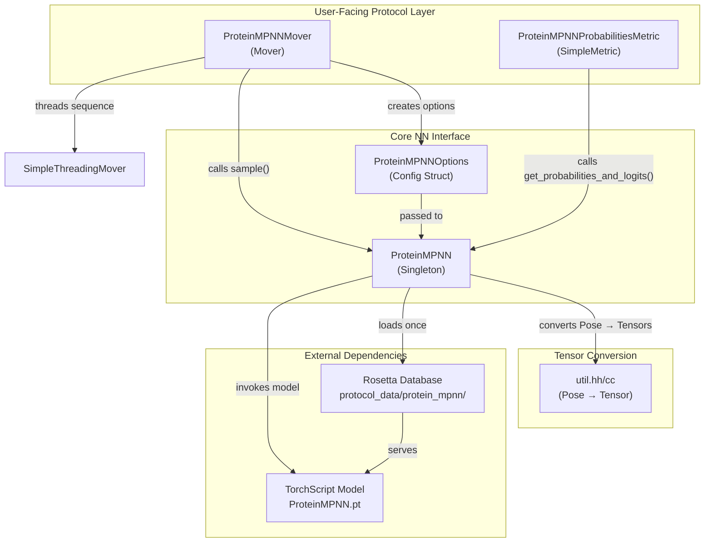
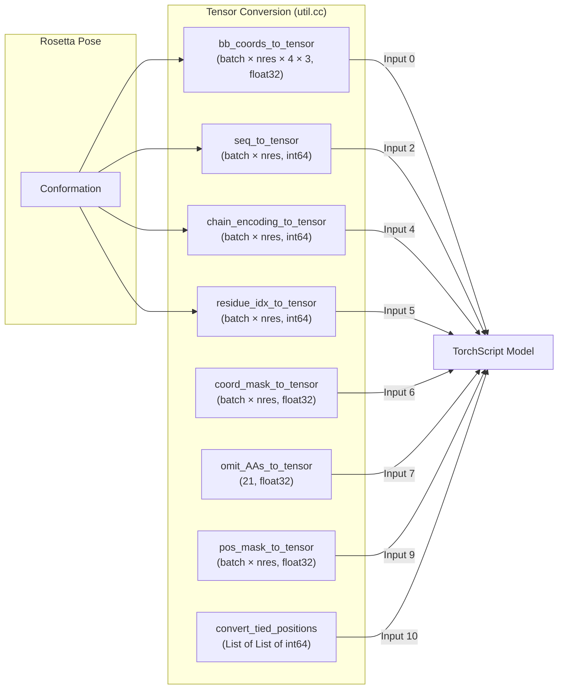

Rosetta's ProteinMPNN integration embeds the Dauparas et al. deep learning inverse folding model directly into the native C++ framework via LibTorch (PyTorch's C++ API), enabling sequence design and per-residue probability estimation as first-class protocol operations. This integration is conditionally compiled behind `#ifdef USE_TORCH` and requires building Rosetta with `extras=pytorch`.

## Architectural Overview

The integration is organized into three conceptual layers: a **core neural network interface**, a **Mover for sequence threading**, and a **SimpleMetric for probability extraction**. Together they bridge Rosetta's [Pose and Conformation](8-pose-and-conformation) data structures to the ProteinMPNN TorchScript model loaded once from the Rosetta database.



## Core Neural Network Interface: The `ProteinMPNN` Singleton

The `ProteinMPNN` class ([ProteinMPNN.hh](source/src/protocols/protein_mpnn/ProteinMPNN.hh#L87-L109)) is implemented as a `utility::SingletonBase<ProteinMPNN>`, guaranteeing that the pre-trained TorchScript model is loaded exactly once per process lifetime. The model file — `ProteinMPNN.pt` — is located in the Rosetta database at `protocol_data/protein_mpnn/` and loaded via `basic::database::full_name()` in [ProteinMPNN.cc](source/src/protocols/protein_mpnn/ProteinMPNN.cc#L213-L220).

The singleton exposes three inference methods:

| Method | Signature | Purpose |
|--------|-----------|---------|
| `sample` | `(Pose, Options) → string` | Sample a single sequence from the model |
| `sample` | `(Pose) → string` | Sample with default options (temperature 0.1, all positions designable) |
| `sample_batch` | `(Pose, Options) → vector1<string>` | Sample multiple sequences (currently batch_size=1 only) |
| `get_probabilities_and_logits` | `(Pose, Options, probs_map, logits_map) → void` | Extract per-residue probability and logit tensors |

The inference pipeline follows a precise sequence: option validation via `verify_options()`, tensor preparation via `generate_sample_inputs()` and `generate_sample_optional_inputs()`, method dispatch (choosing between `sample` and `tied_sample` based on whether tied positions exist), and output parsing from the returned dictionary containing keys `"S"` (sampled sequences) and `"probs"` (probability tensors) as shown in [ProteinMPNN.cc](source/src/protocols/protein_mpnn/ProteinMPNN.cc#L59-L113).

### The `ProteinMPNNOptions` Configuration Struct

The `ProteinMPNNOptions` struct ([ProteinMPNN.hh](source/src/protocols/protein_mpnn/ProteinMPNN.hh#L39-L82)) encapsulates all configurable inference parameters. It is **pose-dependent**: the constructor requires a `Pose` reference to initialize mask arrays with the correct dimensions. Defaults are established in the `reset()` method at [ProteinMPNN.cc](source/src/protocols/protein_mpnn/ProteinMPNN.cc#L411-L455):

| Field | Type | Default | Description |
|-------|------|---------|-------------|
| `sequence` | `string` | Pose sequence (non-protein → 'X') | Starting sequence; unrecognized residues become 'X' |
| `coord_mask` | `vector1<bool>` | All true (protein only) | Which residue coordinates to pass; non-protein residues masked to `false` |
| `chain_mask` | `vector1<bool>` | All true | Which chains to predict; indexed by chain ID (not PDB letter) |
| `pos_mask` | `vector1<bool>` | All true (protein only) | Which positions are designable |
| `omit_AAs` | `vector1<char>` | `{'X'}` | Globally disallowed amino acid types |
| `omit_AAs_pos` | `vector1<vector1<char>>` | Per-position `{'X'}` | Position-specific disallowed types |
| `bias_AAs` | `vector1<Real>` | All zeros (length 21) | Global amino acid biases |
| `temperature` | `Real` | `0.1` | MCMC sampling temperature; >1.0 triggers a warning |
| `tied_positions` | `vector1<vector1<Size>>` | Empty | Groups of residues forced to share identity |
| `batch_size` | `Size` | `1` | Currently only 1 is supported |
| `deterministic_flag` | `bool` | `false` | When true, overrides temperature for greedy decoding |

> [!TIP]
> The `AA_ALPHABET` constant in [util.hh](source/src/protocols/protein_mpnn/util.hh#L49) is defined as `"ACDEFGHIKLMNPQRSTVWYX"` — note the 21st character is the unknown residue 'X'. Every `omit_AAs` configuration **must** include 'X', which the validator enforces at [ProteinMPNN.cc](source/src/protocols/protein_mpnn/ProteinMPNN.cc#L359-L363). This prevents nonsensical predictions of unknown residue types.

## Pose-to-Tensor Conversion Pipeline

The `util.hh`/`util.cc` module ([util.hh](source/src/protocols/protein_mpnn/util.hh), [util.cc](source/src/protocols/protein_mpnn/util.cc)) contains the complete data marshaling layer that translates Rosetta's in-memory protein representation into the tensor format expected by the TorchScript model. Each conversion function produces a `torch::Tensor` with the correct shape and dtype.

The critical backbone coordinate extraction operates on the first four atom indices per residue (N, CA, C, O) as shown in [util.cc](source/src/protocols/protein_mpnn/util.cc#L43-L78):



Notably, `residue_idx_to_tensor` at [util.cc](source/src/protocols/protein_mpnn/util.cc#L118-L130) adds a 100-position offset per chain break (`residue_index + 100 * (chain_id - 1)`), mirroring the Python implementation's convention for distinguishing chain boundaries. Non-protein residues receive zero-filled coordinates and are automatically masked out of both `coord_mask` and `pos_mask` during `ProteinMPNNOptions::reset()` at [ProteinMPNN.cc](source/src/protocols/protein_mpnn/ProteinMPNN.cc#L449-L453).

## ProteinMPNNMover: Sequence Design as a Protocol Step

The `ProteinMPNNMover` ([ProteinMPNNMover.hh](source/src/protocols/protein_mpnn/ProteinMPNNMover.hh), [ProteinMPNNMover.cc](source/src/protocols/protein_mpnn/ProteinMPNNMover.cc)) integrates with Rosetta's [Mover and Filter Hierarchy](11-mover-and-filter-hierarchy) as a standard `protocols::moves::Mover`, making it directly usable in RosettaScripts XML, PyRosetta, and programmatic C++ workflows. Its `apply()` method orchestrates a multi-phase pipeline:

1. **Option construction** — Creates `ProteinMPNNOptions` from the pose
2. **ResidueSelector application** — Converts `design_selector` and `coord_selector` into boolean masks
3. **Tied position resolution** — Translates `TiedPositions` subtags (each specifying comma-separated ResidueSelectors) into residue index lists
4. **TaskOperations integration** — If a `TaskFactory` is provided, per-residue allowed types are converted to `omit_AAs_pos` constraints
5. **Symmetry handling** — For symmetric poses, automatically ties equivalent residues across subunits and replicates masks/taskops
6. **Inference** — Calls `ProteinMPNN::get_instance()->sample()`
7. **Sequence threading** — Uses `SimpleThreadingMover` with packing disabled to thread the predicted sequence onto the pose backbone

The symmetry support at [ProteinMPNNMover.cc](source/src/protocols/protein_mpnn/ProteinMPNNMover.cc#L228-L248) is particularly important: it iterates over independent residues in the asymmetric unit, collects symmetric clones across all subunits, pushes each group as a tied set, and replicates the design mask and `omit_AAs_pos` to all symmetric copies.

### RosettaScripts XML Interface

The Mover exposes the following XML attributes, defined in `provide_xml_schema()` at [ProteinMPNNMover.cc](source/src/protocols/protein_mpnn/ProteinMPNNMover.cc#L331-L371):

```xml
<ROSETTASCRIPTS>
    <RESIDUE_SELECTORS>
        <Index name="core" resnums="10-30,45-60"/>
        <Index name="surface" resnums="1-9,31-44,61-80"/>
    </RESIDUE_SELECTORS>
    <MOVERS>
        <ProteinMPNNMover name="design_mpnn"
            temperature="0.1"
            omit_AAs="XC"
            design_selector="core"
            coord_selector="surface"
            deterministic_flag="false">
            <TiedPositions residue_selectors="rs1,rs2"/>
        </ProteinMPNNMover>
    </MOVERS>
    <PROTOCOLS>
        <Add mover="design_mpnn"/>
    </PROTOCOLS>
</ROSETTASCRIPTS>
```

| XML Attribute | Type | Default | Description |
|---------------|------|---------|-------------|
| `deterministic_flag` | `bool` | `false` | Greedy decoding; overrides temperature |
| `temperature` | `Real` | `0.1` | Sampling temperature |
| `omit_AAs` | `string` | `"X"` | Globally disallowed types as concatenated single-letter codes |
| `design_selector` | `string` | (none) | ResidueSelector name for designable positions |
| `coord_selector` | `string` | (none) | ResidueSelector name for coordinate input |
| `TiedPositions` (subelement) | — | — | Repeatable; `residue_selectors` attribute takes comma-separated ResidueSelector names |

TaskOperations can also be attached via the standard `<TaskOperations>` subtags, providing fine-grained per-residue type control as an alternative to the simpler `design_selector` approach.

> [!TIP]
> When `ProteinMPNNMover` threads the predicted sequence, virtual residues and unchanged positions are replaced with `'-'` characters before calling `SimpleThreadingMover`, which instructs the threading mover to skip those positions entirely. Packing is explicitly disabled (`set_pack_neighbors(false)`, `set_pack_rounds(0)`) to preserve the ML-predicted identity without Rosetta's physics-based repacking interference. See [ProteinMPNNMover.cc](source/src/protocols/protein_mpnn/ProteinMPNNMover.cc#L263-L271).

## ProteinMPNNProbabilitiesMetric: Per-Residue Probability Analysis

The `ProteinMPNNProbabilitiesMetric` ([ProteinMPNNProbabilitiesMetric.hh](source/src/protocols/protein_mpnn/ProteinMPNNProbabilitiesMetric.hh), [ProteinMPNNProbabilitiesMetric.cc](source/src/protocols/protein_mpnn/ProteinMPNNProbabilitiesMetric.cc)) extends `core::simple_metrics::PerResidueProbabilitiesMetric`, enabling integration with Rosetta's SimpleMetrics reporting system for detailed per-residue analysis without modifying the pose sequence. Its `calculate()` method returns a `map<Size, map<AA, Real>>` — a nested map from residue position to amino acid type to predicted probability.

The metric delegates to `ProteinMPNN::get_probabilities_and_logits()` to obtain raw tensors, then converts probabilities to logits via `torch::logit()`. A static helper `fill_return_map()` maps the 21-element probability vectors (indexed by the `AA_ALPHABET` constant) into the Rosetta `chemical::AA` enum-keyed return structure.

```xml
<SIMPLE_METRICS>
    <ProteinMPNNProbabilitiesMetric name="mpnn_probs"
        residue_selector="core"
        coord_selector="all"
        deterministic_flag="true"
        write_pssm="output.pssm"/>
</SIMPLE_METRICS>
```

| XML Attribute | Type | Default | Description |
|---------------|------|---------|-------------|
| `write_pssm` | `string` | `""` | If non-empty, writes a PSI-BLAST–style PSSM file (usable with `FavorSequenceProfile`) |
| `residue_selector` | `string` | (none) | Limits returned probabilities to selected residues |
| `coord_selector` | `string` | (none) | Selects coordinates passed as input to the model |
| `sequence_mask_selector` | `string` | (none) | Masks specific positions in the input sequence |
| `deterministic_flag` | `bool` | `false` | Enables deterministic (greedy) inference |

The PSSM output option bridges ProteinMPNN predictions into Rosetta's traditional scoring pipeline — the generated PSSM file can be consumed by the `FavorSequenceProfile` score term, enabling hybrid ML-physics energy functions.

## Conditional Compilation and Build Requirements

The entire integration is gated by the `USE_TORCH` preprocessor macro. Without it, the `ProteinMPNNMover::apply()` method calls `utility_exit_with_message()` with a clear error instructing the user to recompile with `extras=pytorch` and run a binary with `pytorch` in the name (e.g., `rosetta_scripts.pytorch.linuxgccrelease`) as documented at [ProteinMPNNMover.cc](source/src/protocols/protein_mpnn/ProteinMPNNMover.cc#L102-L104). The `ProteinMPNNProbabilitiesMetric` follows the same guard pattern in its `calculate()` method.

## Relationship to Related Systems

ProteinMPNN sits alongside two related ML integrations in Rosetta. The [trRosetta Deep Learning](21-trrosetta-deep-learning) integration uses TensorFlow to predict distance/angle distributions for structure prediction — a complementary forward-folding task. The `MIFST` module in the `inverse_folding/` directory provides an alternative inverse-folding approach. ProteinMPNN differentiates itself through its message-passing neural network architecture that operates on the graph of backbone Cα coordinates, making it particularly effective for fixed-backbone sequence design within Rosetta's [De Novo Protein Design](17-de-novo-protein-design) and [Side-Chain Packing](13-side-chain-packing) workflows.

## Next Steps

- **[RosettaScripts XML Framework](14-rosettascripts-xml-framework)** — Understand the XML parsing and `MoverCreator` registration that makes `ProteinMPNNMover` available as a tag
- **[Side-Chain Packing](13-side-chain-packing)** — Compare ML-based sequence design via ProteinMPNN with Rosetta's traditional physics-based packing
- **[De Novo Protein Design](17-de-novo-protein-design)** — See how ProteinMPNN fits into end-to-end design pipelines that combine backbone generation with sequence optimization
- **[trRosetta Deep Learning](21-trrosetta-deep-learning)** — Explore the complementary TensorFlow-based distance prediction integration
