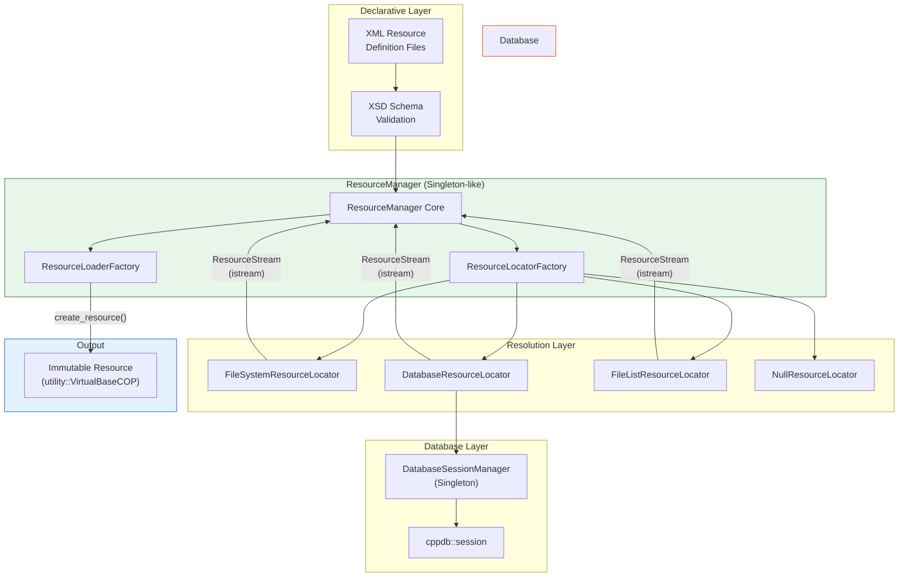
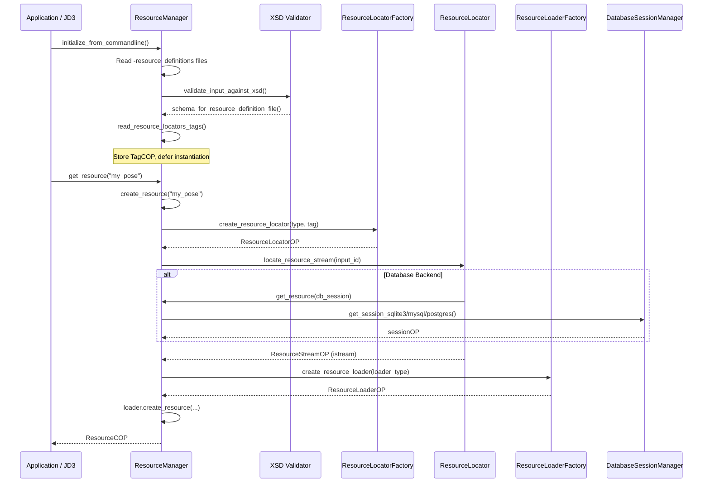

Rosetta's Runtime Database System provides a unified abstraction layer for accessing, constructing, and managing large, immutable data objects—called **Resources**—from heterogeneous data stores during protocol execution. Rather than having each protocol independently manage file I/O or database connections, the system centralizes resource lifecycle management through a declarative XML configuration model, factory-driven instantiation, and inter-resource dependency tracking. This architecture is critical for the JD3 job-distribution framework, where expensive data (poses, fragment sets, score functions) must be shared safely across distributed tasks.

Sources: [ResourceManager.hh](source/src/basic/resource_manager/ResourceManager.hh#L1-L221), [types.hh](source/src/basic/resource_manager/types.hh#L1-L39)

## Architectural Overview

The Runtime Database System comprises two closely integrated subsystems: the **Resource Manager** (responsible for declarative resource construction and lifecycle) and the **Database Session Manager** (responsible for connection pooling and transaction management across multiple database backends). These subsystems operate through a layered pipeline: XML declarations are parsed and validated, resource locators resolve data streams from arbitrary backends, and resource loaders construct immutable objects from those streams.



Sources: [ResourceManager.cc](source/src/basic/resource_manager/ResourceManager.cc#L80-L115), [ResourceLocator.hh](source/src/basic/resource_manager/ResourceLocator.hh#L56-L128)

## Core Abstractions

### Resource — The Immutable Data Contract

A Resource is defined simply as `utility::VirtualBaseCOP`—a const owning pointer to any Rosetta-recognized object [types.hh](source/src/basic/resource_manager/types.hh#L29-L31). Once constructed, a resource is **bitwise immutable** for its entire lifetime. This design choice is deliberate: because resources cannot be modified after creation, they can be shared across multiple threads without race conditions, making the system naturally compatible with JD3's multi-threaded job execution. A resource may itself depend on other resources (for example, a pose resource might require a fragment set resource during its construction), and the ResourceManager tracks these interdependencies to ensure correct deallocation ordering.

Sources: [types.hh](source/src/basic/resource_manager/types.hh#L19-L31)

### ResourceManager — Central Orchestrator

The `ResourceManager` class ([ResourceManager.hh](source/src/basic/resource_manager/ResourceManager.hh#L35-L153)) serves as the system's central orchestrator. It is initialized from the command line via the `-resource_definitions` flag (mapped to `jd3::resource_definition_files`), which accepts one or more XML files [ResourceManager.cc](source/src/basic/resource_manager/ResourceManager.cc#L48-L67). Its primary responsibilities include:

- **Parsing and validating** XML resource definition files against an internally generated XSD schema
- **Lazily constructing** resources on first access via `get_resource()`
- **Tracking inter-resource dependencies** so that deallocating a parent resource cascades to dependent resources
- **Preventing circular dependencies** by maintaining a construction stack that detects infinite recursion

The ResourceManager stores resource declarations as `TagCOP` objects (deferred XML parse trees), locators as instantiated `ResourceLocatorOP` objects, and constructed resources in a `map<string, ResourceCOP>`. This separation between declaration and instantiation enables the lazy-loading pattern central to the system's efficiency.

Sources: [ResourceManager.hh](source/src/basic/resource_manager/ResourceManager.hh#L160-L221), [ResourceManager.cc](source/src/basic/resource_manager/ResourceManager.cc#L162-L200)

## Resource Locators — The Resolution Strategy Pattern

Resource Locators implement the **Strategy pattern** to abstract data retrieval from arbitrary backends. Each locator receives a `locator_id` (a string identifying the data source) and returns a `ResourceStream`—a polymorphic wrapper around `std::istream` that the ResourceLoader consumes [ResourceLocator.hh](source/src/basic/resource_manager/ResourceLocator.hh#L43-L51). The base class defines two pure virtual methods: `locate_resource_stream()` for stream creation and `parse_my_tag()` for XML configuration.

### Locator Comparison

| Locator | Backend | `locator_id` Semantics | Key Use Case |
|---------|---------|----------------------|--------------|
| **FileSystemResourceLocator** | Local filesystem | File path (resolved against `search_paths`) | Standard PDB/silent file loading |
| **DatabaseResourceLocator** | SQLite3, MySQL, PostgreSQL | Value bound to a parameterized SQL `SELECT` statement | Retrieving structures from features databases |
| **FileListResourceLocator** | Local filesystem | Whitespace-delimited list of file paths, concatenated into one stream | Constructing poses from multiple PDB segments |
| **NullResourceLocator** | None | Ignored | Testing and placeholder resources |

Sources: [FileSystemResourceLocator.hh](source/src/basic/resource_manager/locator/FileSystemResourceLocator.hh#L88-L144), [DatabaseResourceLocator.hh](source/src/basic/resource_manager/locator/DatabaseResourceLocator.hh#L43-L100), [FileListResourceLocator.hh](source/src/basic/resource_manager/locator/FileListResourceLocator.hh#L48-L88)

### DatabaseResourceLocator in Detail

The `DatabaseResourceLocator` is the most architecturally interesting locator because it bridges the Resource Manager with the Database Session Manager. It requires two pieces of configuration: the name of a database session resource (itself a resource managed by the ResourceManager), and a **partially-formatted SQL SELECT statement** with a single `?` placeholder [DatabaseResourceLocator.hh](source/src/basic/resource_manager/locator/DatabaseResourceLocator.hh#L50-L63). When `locate_resource_stream()` is invoked, the locator:

1. Requests the database session resource from the ResourceManager
2. Binds the `locator_id` to the SQL parameter
3. Executes the query
4. Packages the result set as a string stream

This design enables a single DatabaseResourceLocator instance to retrieve arbitrary rows from a database table simply by varying the `locator_id` passed by the resource declaration, making it highly reusable across multiple resource definitions.

Sources: [DatabaseResourceLocator.hh](source/src/basic/resource_manager/locator/DatabaseResourceLocator.hh#L43-L100)

## Database Session Manager — Connection Abstraction

The `DatabaseSessionManager` ([DatabaseSessionManager.hh](source/src/utility/sql_database/DatabaseSessionManager.hh#L97-L245)) is a singleton that provides a unified interface for acquiring database sessions across three backend engines. It wraps the **cppdb** library (a C++ database connectivity layer) and extends it with Rosetta-specific metadata including transaction mode, partitioning support, and schema search paths.

### Supported Database Backends

| Backend | Session Method | Typical Use Case |
|---------|---------------|------------------|
| **SQLite3** | `get_session_sqlite3()` | Local features databases, offline analysis |
| **MySQL** | `get_session_mysql()` | Shared structure repositories |
| **PostgreSQL** | `get_session_postgres()` | Large-scale production databases with schema partitioning |

Each `session` object ([DatabaseSessionManager.hh](source/src/utility/sql_database/DatabaseSessionManager.hh#L19-L95)) carries metadata including `DatabaseMode` (sqlite3/mysql/postgres), `TransactionMode` (standard/chunked), `db_name`, `pq_schema` (PostgreSQL schema name), and `db_partition` (for horizontal partitioning). The session class also provides `begin_transaction()`, `commit_transaction()`, and `force_commit_transaction()` methods that implement chunked transaction semantics—transactions are batched according to `chunk_size` to balance write performance against data integrity.

Sources: [DatabaseSessionManager.hh](source/src/utility/sql_database/DatabaseSessionManager.hh#L19-L95), [DatabaseSessionManager.hh](source/src/utility/sql_database/DatabaseSessionManager.hh#L128-L245)

## Resource Dependency Tracking

A distinctive feature of the ResourceManager is its built-in dependency tracking system. When a resource is being constructed and requests another resource from the ResourceManager, the system records the parent-child relationship using three data structures [ResourceManager.hh](source/src/basic/resource_manager/ResourceManager.hh#L208-L219):

- **`resources_being_constructed_stack_`** — detects circular dependencies by maintaining a stack of resources currently under construction
- **`resources_a_resource_depends_on_`** — maps each resource to the set of resources it depends on
- **`living_resources_dependent_on_a_resource_`** — reverse mapping used during deallocation

When `deallocate_resource()` is called on a parent, the ResourceManager recursively deallocates all dependent resources—**unless** a dependent has been explicitly marked to persist via `require_explicit_deallocation_for_resource()`. Circular dependencies are detected at runtime and result in an exception with a diagnostic message listing the full construction chain [ResourceManager.cc](source/src/basic/resource_manager/ResourceManager.cc#L162-L200).

> [!TIP]
> **Thread-safety through immutability**: Resources are stored as `ResourceCOP` (const owning pointers). Since they are bitwise immutable after creation, the ResourceManager can safely hand out the same resource to multiple concurrent consumers without locks. However, the ResourceManager itself is **not** thread-safe for concurrent writes—resource construction and deallocation must be serialized.

Sources: [ResourceManager.hh](source/src/basic/resource_manager/ResourceManager.hh#L208-L219), [ResourceManager.cc](source/src/basic/resource_manager/ResourceManager.cc#L162-L200)

## Factory Registration Pattern

Both ResourceLocators and ResourceLoaders are instantiated through the factory registration pattern used throughout Rosetta. The `ResourceLocatorFactory` and `ResourceLoaderFactory` are singletons that maintain a `map<string, CreatorOP>` mapping type-name strings to creator objects [ResourceLocatorFactory.hh](source/src/basic/resource_manager/ResourceLocatorFactory.hh#L43-L92). Concrete locator/loader classes register themselves at load time using `ResourceLocatorRegistrator` and `ResourceLoaderRegistrator` template classes, typically placed in library `init.cc` files. This pattern allows new data backends to be added without modifying the ResourceManager core—simply implement the interface, create a Creator, and add a registration line.

Sources: [ResourceLocatorFactory.hh](source/src/basic/resource_manager/ResourceLocatorFactory.hh#L43-L92), [ResourceLoaderFactory.hh](source/src/basic/resource_manager/ResourceLoaderFactory.hh#L40-L88)

## XML Resource Definition Format

Resource definitions are specified in XML files following the internally generated XSD schema. The top-level `<ResourceDefinitions>` element contains two repeatable sub-blocks: `<ResourceLocators>` and `<Resources>`. The schema is dynamically constructed by iterating over all registered locators and loaders, ensuring that adding a new backend automatically extends the valid XML vocabulary [ResourceManager.cc](source/src/basic/resource_manager/ResourceManager.cc#L230-L350).

```xml
<ResourceDefinitions>
  <ResourceLocators>
    <FileSystem name="std" search_paths="/data/inputs/" />
    <Database name="features_db"
              database_session_resource="features_session"
              sql_command="SELECT structure FROM structures WHERE tag = ?" />
  </ResourceLocators>
  <Resources>
    <Resource name="native_pose" input_id="1l2yH.pdb" locator="std">
      <PoseResource>
        <PDB><PoseLoaderOptions skip_conect_info="false"/></PDB>
      </PoseResource>
    </Resource>
  </Resources>
</ResourceDefinitions>
```

Multiple resource definition files may be loaded, and resources in one file may reference locators declared in another—provided the locator's file is parsed first. Name collisions across files throw an exception that reports both the conflicting name and the originating file paths [ResourceManager.cc](source/src/basic/resource_manager/ResourceManager.cc#L436-L470).

> [!TIP]
> **Lazy construction semantics**: Resources are not instantiated when the XML is parsed. The ResourceManager stores only the XML `TagCOP` objects. Actual construction occurs on the first call to `get_resource(name)`, and the resulting `ResourceCOP` is cached for subsequent access. This means configuration errors in a resource that is never requested will go undetected until runtime.

Sources: [ResourceManager.cc](source/src/basic/resource_manager/ResourceManager.cc#L230-L350), [ResourceManager.cc](source/src/basic/resource_manager/ResourceManager.cc#L436-L470)

## System Initialization Flow



Sources: [ResourceManager.cc](source/src/basic/resource_manager/ResourceManager.cc#L48-L115), [ResourceManager.cc](source/src/basic/resource_manager/ResourceManager.cc#L475-L520)

## Key Source Files

| File | Role |
|------|------|
| [ResourceManager.hh](source/src/basic/resource_manager/ResourceManager.hh) | Central resource lifecycle management class |
| [ResourceManager.cc](source/src/basic/resource_manager/ResourceManager.cc) | XML parsing, schema generation, lazy construction, dependency tracking |
| [ResourceLocator.hh](source/src/basic/resource_manager/ResourceLocator.hh) | Abstract base for data stream resolution + ResourceStream interface |
| [ResourceLoader.hh](source/src/basic/resource_manager/ResourceLoader.hh) | Abstract base for resource object construction |
| [ResourceLocatorFactory.hh](source/src/basic/resource_manager/ResourceLocatorFactory.hh) | Singleton factory for locator instantiation |
| [ResourceLoaderFactory.hh](source/src/basic/resource_manager/ResourceLoaderFactory.hh) | Singleton factory for loader instantiation |
| [FileSystemResourceLocator.hh](source/src/basic/resource_manager/locator/FileSystemResourceLocator.hh) | File-system based stream resolution with search paths |
| [DatabaseResourceLocator.hh](source/src/basic/resource_manager/locator/DatabaseResourceLocator.hh) | SQL-parameterized database query resolution |
| [FileListResourceLocator.hh](source/src/basic/resource_manager/locator/FileListResourceLocator.hh) | Multi-file concatenation stream resolution |
| [DatabaseSessionManager.hh](source/src/utility/sql_database/DatabaseSessionManager.hh) | Singleton database connection manager (SQLite3/MySQL/PostgreSQL) |
| [types.hh](source/src/basic/resource_manager/types.hh) | Resource type alias (`VirtualBaseCOP`) |

---

For context on how resources integrate into Rosetta's protocol execution model, see [Codebase Architecture](5-codebase-architecture). To understand how the Resource Manager connects with RosettaScripts XML configuration, see [RosettaScripts XML Framework](14-rosettascripts-xml-framework). For the factory pattern that underpins locator and loader registration, see [Factory Pattern Architecture](15-factory-pattern-architecture).