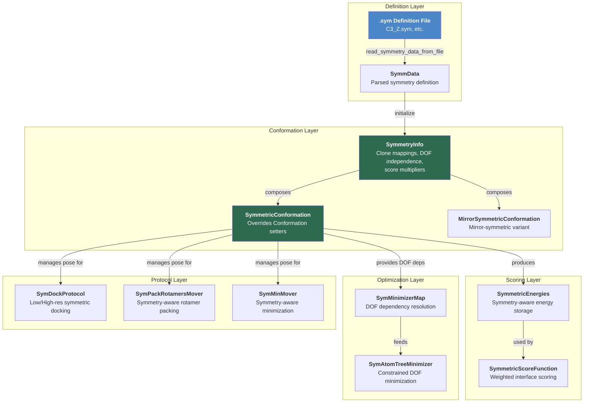

Rosetta's symmetry modeling framework enables the modeling, scoring, docking, and design of symmetric macromolecular assemblies — from simple cyclic homomers to complex multi-component architectures. Rather than representing every subunit explicitly during optimization, the system tracks a single **asymmetric unit (ASU)** and propagates all conformational changes through clone mappings, dramatically reducing the search space while preserving exact geometric symmetry.

## Architectural Overview

The symmetry system operates as a layered architecture that intercepts core Rosetta abstractions at the conformation, scoring, and optimization levels. A `.sym` definition file is parsed into a `SymmData` object, which initializes a `SymmetryInfo` registry inside a `SymmetricConformation`. From that point, every conformational mutation, energy evaluation, and minimization step is symmetry-aware.



The critical architectural insight is that `SymmetricConformation` **overrides every conformational setter** in `Conformation` — `set_dof`, `set_torsion`, `set_jump`, `set_xyz`, `replace_residue`, `set_bond_angle`, `set_bond_length`, `set_torsion_angle` — to automatically propagate changes from independent residues to all their clones. This means any protocol operating through the standard `Pose` API gains symmetry support transparently.

Sources: [SymmetricConformation.hh](/source/src/core/conformation/symmetry/SymmetricConformation.hh#L47-L200), [SymmetricConformation.cc](/source/src/core/conformation/symmetry/SymmetricConformation.cc#L146-L237)

## Symmetry Definition Files (`.sym`)

Symmetry definitions live under `database/symmetry/` and use a declarative text format that completely describes the geometric arrangement, degrees of freedom, and scoring behavior of a symmetric assembly. The current repository ships with 98 pre-defined cyclic symmetry files spanning C2 through C99.

Sources: [C3_Z.sym](/database/symmetry/cyclic/C3_Z.sym#L1-L25)

### File Format Reference

A complete symmetry definition consists of the following sections:

**Metadata section** — declares the symmetry group and global parameters.

| Directive | Description | Example |
|-----------|-------------|---------|
| `symmetry_name` | Human-readable symmetry group identifier | `symmetry_name C3` |
| `subunits` | Total number of subunits in the assembly | `subunits 3` |
| `number_of_interfaces` | Count of unique inter-subunit interface types | `number_of_interfaces 2` |
| `anchor_residue` | Residue or COM used as the coordinate origin | `anchor_residue COM` |

**Energy equation** — defines how the total energy is computed from subunit and interface terms. This controls which interactions are scored and how many times, preventing double-counting while ensuring all unique interfaces are evaluated. The format `E = N*S_self + M*(Si:Sj)` specifies subunit self-energy weights and interface weights.
Sources: [C3_Z.sym](/database/symmetry/cyclic/C3_Z.sym#L4)

**Virtual coordinates block** — defines the Cartesian frames for each subunit's virtual root and the symmetry centers. The `xyz` directive specifies a named coordinate system with an X-axis, Y-axis, and origin triplet.

**Connection directives** — wire virtual residues together through named jumps. `connect_virtual` links virtual residue pairs, and the special target `SUBUNIT` attaches a virtual root to the first residue of its subunit.

**DOF and grouping directives** — `set_dof` specifies which translational and rotational degrees of freedom each jump is allowed to explore. `set_jump_group` binds multiple jumps into coordinated groups that move in lockstep during sampling.

### C3 Cyclic Symmetry Example

The following definition file for C3 symmetry illustrates the complete format:

```
symmetry_name C3
subunits 3
number_of_interfaces 2
E = 2*S1  + 1*(S1:S2) + 1*(S1:S3)
anchor_residue COM
virtual_coordinates_start
xyz C1 0,0,1 +0.0000000,+1.0000000,0 0,0,0
xyz S1 0,0,1 +0.0000000,+1.0000000,0 0,0,0
xyz C2 0,0,1 +0.8660254,-0.5000000,0 0,0,0
xyz S2 0,0,1 +0.8660254,-0.5000000,0 0,0,0
xyz C3 0,0,1 -0.8660254,-0.5000000,0 0,0,0
xyz S3 0,0,1 -0.8660254,-0.5000000,0 0,0,0
virtual_coordinates_stop
connect_virtual JS1 C1 S1
connect_virtual JS1S S1 SUBUNIT
connect_virtual JC2 C1 C2
connect_virtual JS2 C2 S2
connect_virtual JS2S S2 SUBUNIT
connect_virtual JC3 C1 C3
connect_virtual JS3 C3 S3
connect_virtual JS3S S3 SUBUNIT
set_dof JS1 x y angle_x angle_y angle_z
set_jump_group JGS JS1 JS2 JS3
set_jump_group JGSS JS1S JS2S JS3S
```

Three subunits are arranged at 120° intervals (cos60° ≈ 0.866, sin60° ≈ 0.5) around the Z-axis. Virtual residues `C1`–`C3` define symmetry centers, `S1`–`S3` anchor each subunit, and the energy equation weights subunit 1's self-energy by 2 and evaluates both unique interfaces exactly once. The `set_dof` line grants the JS1 jump full rigid-body freedom (x, y, and all three rotational angles), while `set_jump_group` coordinates the three corresponding jumps across subunits.

Sources: [C3_Z.sym](/database/symmetry/cyclic/C3_Z.sym#L1-L25)

## SymmetryInfo: The Clone Registry

`SymmetryInfo` is the central runtime data structure that maintains all mappings between independent (master) degrees of freedom and their dependent clones. It is constructed from a `SymmData` object using the asymmetric unit's residue count and jump count.

Sources: [SymmetryInfo.hh](/source/src/core/conformation/symmetry/SymmetryInfo.hh#L53-L358)

### Independence and Clone Mapping

Every residue, torsion, and jump in the symmetric pose is classified as either **independent** (part of the ASU) or **dependent** (a clone). The registry provides three parallel mapping systems:

| Mapping System | Key Method | Purpose |
|----------------|------------|---------|
| Backbone clones | `bb_follows(res)`, `bb_clones(res)` | Maps each dependent residue to its ASU master; lists all clones of an independent residue |
| Chi clones | `chi_follows(res)`, `chi_clones(res)` | Same mapping for side-chain torsion DOFs |
| Jump clones | `jump_follows(j)`, `jump_clones(j)` | Maps symmetric jumps; supports **weighted clones** for partial propagation |

The distinction between `bb_clones` and `chi_clones` is critical: backbone and side-chain independence can diverge when, for example, a symmetric backbone has asymmetric side-chain packing. The `jump_clone_wts_` map stores per-clone weights, allowing derivative propagation to be scaled — essential for symmetric docking where not all subunit interfaces carry identical geometric relationships.

Sources: [SymmetryInfo.hh](/source/src/core/conformation/symmetry/SymmetryInfo.hh#L122-L203)

### Score Multiplier System

`SymmetryInfo` implements a sophisticated scoring correction to avoid energy double-counting in symmetric assemblies. The energy equation from the `.sym` file is compiled into per-residue-pair multipliers stored in `score_multiply_`. The method `score_multiply(res1, res2)` returns the weight for any inter-residue energy term, and `score_multiply_factor()` returns the global normalization factor that scales the total energy to approximate a full-assembly value.

The `reset_score_multiply_to_reasonable_default()` method provides a fallback when explicit multipliers are absent: it assigns weight 1 to intra-subunit interactions and weight 1/N to inter-subunit interactions, where N is the number of subunits. The `set_score_multiply_from_subunit_factors()` method allows fine-grained per-subunit weighting for hetero-oligomeric systems.

Sources: [SymmetryInfo.hh](/source/src/core/conformation/symmetry/SymmetryInfo.hh#L157-L235)

### Multi-Component Support

Beyond simple homomeric symmetry, `SymmetryInfo` supports **multi-component** assemblies (hetero-oligomers, coiled-coils with distinct chains). The component system tracks:

- `num_components_` — number of distinct chain types
- `components_` — per-residue component assignment vector
- `component_bounds_` — residue ranges `[lower, upper]` for each component in the ASU
- `jname2components_` / `jname2subunits_` — maps jump names to the components and subunit indices they connect

This enables protocols to reason about inter-component interfaces distinctly from intra-component symmetry.

Sources: [SymmetryInfo.hh](/source/src/core/conformation/symmetry/SymmetryInfo.hh#L249-L273)

## SymmData: Parsing the Definition File

`SymmData` is the raw data container produced by parsing a `.sym` file. It stores the complete symmetry specification before any optimization-specific preprocessing occurs.

Sources: [SymmData.hh](/source/src/core/conformation/symmetry/SymmData.hh#L40-L200), [SymmData.cc](/source/src/core/conformation/symmetry/SymmData.cc#L38-L597)

### Parsing Architecture

The parser in `read_symmetry_data_from_stream()` operates as a state machine with distinct reading modes:

1. **Normal mode** — processes top-level directives (`symmetry_name`, `subunits`, `E =`, `set_dof`, `connect_virtual`)
2. **Virtual coordinates mode** — between `virtual_coordinates_start` / `virtual_coordinates_stop`, parses `xyz` directives into `VirtualCoordinate` objects stored in the `virtual_coordinates_` map
3. **Transform mode** — between `virtual_transforms_start` / `virtual_transforms_stop`, reads rotation (`rot` with `Rx`, `Ry`, `Rz`, `Rx_angle`, `Ry_angle`, `Rz_angle`) and translation (`trans`) operations to procedurally generate subunit coordinate frames

The parser supports two coordinate specification strategies: **explicit** (listing every `xyz` line as in the C3 example) and **procedural** (specifying rotational symmetry operators that are composed to generate subunit frames). In the procedural mode, each `rot Rz N` directive creates an N-fold rotation matrix, and these are composed sequentially to place each successive subunit.

### Virtual Coordinate Graph

Virtual coordinates form a directed graph: each `VirtualCoordinate` stores an X-axis vector, Y-axis vector, and origin. The `connect_virtual` directives create edges in this graph. The `jump_string_to_virtual_pair_` map links jump names to `(parent_virtual, child_virtual)` pairs, while `jump_string_to_jump_num_` assigns sequential numeric IDs. The special target `SUBUNIT` in a `connect_virtual` directive links a virtual residue to the actual protein chain of the corresponding subunit.

Sources: [SymmData.hh](/source/src/core/conformation/symmetry/SymmData.hh#L79-L88), [SymmData.cc](/source/src/core/conformation/symmetry/SymmData.cc#L430-L597)

## SymDof: Degrees of Freedom Control

The `SymDof` class encodes which translational and rotational DOFs are permitted for each symmetric jump, along with their motion bounds. Each DOF type corresponds to one of six rigid-body parameters defined in the `dof_type` enum.

Sources: [SymDof.hh](/source/src/core/conformation/symmetry/SymDof.hh#L32-L156)

### DOF Types and Bounds

| DOF Constant | Value | Description |
|-------------|-------|-------------|
| `X_DOF` | 1 | Translation along X |
| `Y_DOF` | 2 | Translation along Y |
| `Z_DOF` | 3 | Translation along Z |
| `X_ANGLE_DOF` | 4 | Rotation around X |
| `Y_ANGLE_DOF` | 5 | Rotation around Y |
| `Z_ANGLE_DOF` | 6 | Rotation around Z |

Each DOF supports **two independent range pairs** (`range1` and `range2`), with separate lower/upper bounds and presence flags. The `range2_is_bound_` flag distinguishes between periodic ranges (e.g., angular limits) and hard bounds (e.g., translational limits). The `jump_dir_` field stores the direction of each DOF's jump (upstream vs. downstream), which is critical for correct derivative propagation during minimization. The `allowed_dof_jumps_` vector is the primary gate: only DOFs with `allow_dof(i) == true` are sampled.

Sources: [SymDof.hh](/source/src/core/conformation/symmetry/SymDof.hh#L32-L143)

## SymmetricConformation: Transparent Symmetry Propagation

`SymmetricConformation` extends `Conformation` by overriding every mutation method to maintain symmetric invariants automatically. It holds a `SymmetryInfoOP` and a mutable vector of `SymmetryTransform` objects (`Tsymm_`) that cache the homogeneous transforms between subunit frames.

Sources: [SymmetricConformation.hh](/source/src/core/conformation/symmetry/SymmetricConformation.hh#L47-L200)

### Setter Override Pattern

Every conformational setter follows the same three-step pattern:

1. **Resolve the independent master** — if the requested residue/DOF is dependent, look up its master via `bb_follows()`, `chi_follows()`, or `jump_follows()`
2. **Apply the change to the master** — delegate to the base `Conformation::set_*` method on the independent residue
3. **Propagate to all clones** — iterate over the clone list from `SymmetryInfo` and apply the same change

This pattern is exemplified by `set_torsion`: when a torsion is set on an independent residue, the same value is immediately applied to all clones listed in `dependent_torsions()`. For jumps, `set_jump` propagates rigid-body transformations across all jump clones. Crucially, after any jump change or when `torsion_changes_move_other_monomers_` is true, the cached transforms (`Tsymm_`) are cleared via `clear_Tsymm()`, forcing recomputation on the next geometry query.

Sources: [SymmetricConformation.cc](/source/src/core/conformation/symmetry/SymmetricConformation.cc#L146-L287)

### Coordinate Transformation System

`SymmetricConformation` provides methods to transform coordinates between subunit frames:

- `get_transformation(resid)` returns the `HomogeneousTransform<Real>` mapping the ASU frame to the frame of residue `resid`
- `apply_transformation(Xin, from, to)` remaps a point from one subunit's frame to another's
- `recalculate_transforms()` forces recomputation of all cached transforms from the current atom positions

These transforms are lazy-computed and cached, then invalidated whenever a jump changes. This system is essential for protocols that need to evaluate distances or orientations across subunit boundaries.

Sources: [SymmetricConformation.hh](/source/src/core/conformation/symmetry/SymmetricConformation.hh#L173-L191)

> [!TIP]
> The `torsion_changes_move_other_monomers_` flag in `SymmetryInfo` controls a critical performance tradeoff. When true, any backbone torsion change invalidates the subunit transform cache, ensuring geometric correctness but at the cost of frequent recomputation. For protocols that only modify side chains, leaving this flag false avoids unnecessary cache invalidation.

## Symmetry-Aware Scoring

Scoring symmetric assemblies requires careful handling to avoid both double-counting inter-subunit interactions and under-counting intra-subunit terms.

Sources: [SymmetricEnergies.hh](/source/src/core/scoring/symmetry/SymmetricEnergies.hh), [SymmetricScoreFunction.hh](/source/src/core/scoring/symmetry/SymmetricScoreFunction.hh)

### Score Multiplier Mechanism

`SymmetricEnergies` extends the base `Energies` class to incorporate the `score_multiply` weights from `SymmetryInfo`. When the scoring system evaluates a pairwise energy term between residues `i` and `j`, it queries `SymmetryInfo::score_multiply(i, j)` to determine the effective weight. This weight can be 0 (interaction should not be scored), 1 (scored once), or a fractional value for weighted interface contributions. The `get_residue_weight()` method in `SymmetricConformation` exposes this system to the scoring machinery.

Sources: [SymmetricConformation.hh](/source/src/core/conformation/symmetry/SymmetricConformation.hh#L141-L145)

### Residue Masking

`SymmetricConformation::get_residue_mask()` returns a `vector1<bool>` that identifies which residues in the full symmetric pose are "real" versus virtual, enabling scoring methods to skip virtual residues entirely. Combined with the score multiplier system, this ensures that only physically meaningful interactions contribute to the total energy.

Sources: [SymmetricConformation.hh](/source/src/core/conformation/symmetry/SymmetricConformation.hh#L141-L142)

## Symmetry-Constrained Optimization

Minimization of symmetric structures operates on a drastically reduced DOF space. The `SymAtomTreeMinimizer` works with a `SymMinimizerMap` that only exposes independent DOFs to the optimizer, while `SymAtomTreeMultifunc` evaluates the objective function including all clone contributions.

Sources: [SymAtomTreeMinimizer.hh](/source/src/core/optimization/symmetry/SymAtomTreeMinimizer.hh), [SymMinimizerMap.hh](/source/src/core/optimization/symmetry/SymMinimizerMap.hh)

### Derivative Propagation

The `get_dof_derivative_weight()` method in `SymmetryInfo` is the key to correct gradient computation. For independent DOFs, the weight is 1. For dependent non-jump DOFs, the weight is 0 (they are not free variables). For dependent jump DOFs, the weight can be any real number stored in `jump_clone_wts_`. This allows the minimizer to compute gradients only with respect to the true free variables while correctly accounting for their effect on the full assembly energy.

The protocol-layer `SymMinMover` wraps `SymAtomTreeMinimizer` as a standard Mover, and `TaskAwareSymMinMover` additionally respects packing task restrictions. Both are drop-in replacements for their asymmetric counterparts in any RosettaScripts workflow.

Sources: [SymmetryInfo.hh](/source/src/core/conformation/symmetry/SymmetryInfo.hh#L179-L184), [SymMinMover.hh](/source/src/protocols/minimization_packing/symmetry/SymMinMover.hh), [TaskAwareSymMinMover.hh](/source/src/protocols/minimization_packing/symmetry/TaskAwareSymMinMover.hh)

## Symmetry-Aware Packing

Rotamer packing for symmetric assemblies must respect the constraint that equivalent positions across subunits carry identical rotamers. The `SymPackRotamersMover` and `SymRotamerTrialsMover` override their base classes to restrict rotamer sampling to independent residues only, then propagate selected rotamers to all clones.

Sources: [SymPackRotamersMover.hh](/source/src/protocols/minimization_packing/symmetry/SymPackRotamersMover.hh), [SymRotamerTrialsMover.hh](/source/src/protocols/minimization_packing/symmetry/SymRotamerTrialsMover.hh)

The `SymRestrictTaskForDocking` utility further refines the packing task by identifying interface residues and restricting packing to those positions, which is essential for symmetric docking protocols where only the interface should be repacked.

Sources: [SymRestrictTaskForDocking.hh](/source/src/protocols/symmetric_docking/SymRestrictTaskForDocking.hh)

## Symmetric Docking Protocols

The symmetric docking framework provides a complete pipeline from low-resolution rigid-body search through high-resolution refinement, implemented across several dedicated classes.

Sources: [SymDockProtocol.hh](/source/src/protocols/symmetric_docking/SymDockProtocol.hh), [SymDockingLowRes.hh](/source/src/protocols/symmetric_docking/SymDockingLowRes.hh), [SymDockingHiRes.hh](/source/src/protocols/symmetric_docking/SymDockingHiRes.hh)

### Protocol Hierarchy

| Protocol | Purpose | Resolution |
|----------|---------|------------|
| `SymDockBaseProtocol` | Common initialization and scoring setup | — |
| `SymDockProtocol` | Full docking pipeline orchestration | Both |
| `SymDockingLowRes` | Centroid-level rigid-body sampling with Monte Carlo | Low |
| `SymDockingHiRes` | All-atom refinement with side-chain repacking and minimization | High |
| `SymFoldandDockMoveRbJumpMover` | Coupled folding and docking move set | Both |
| `SymFoldandDockSlideTrialMover` | Sliding symmetry trial moves for cyclic symmetry | Both |

The low-resolution phase uses a coarse-grained score function and explores the rigid-body DOFs defined in the `.sym` file via `SymDof` constraints. The high-resolution phase switches to a full-atom score function, repacks interface side chains using `SymPackRotamersMover`, and runs `SymMinMover` to relax the interface. The `SymFoldandDock*` movers integrate ab initio folding with symmetric docking, allowing simultaneous exploration of backbone conformation and subunit arrangement.

The `membrane/MPSymDockMover` extends symmetric docking to membrane proteins, adding membrane-aware scoring and orientation constraints.

Sources: [MPSymDockMover.hh](/source/src/protocols/symmetric_docking/membrane/MPSymDockMover.hh)

## Utility Functions

The `core::pose::symmetry` namespace and `core::conformation::symmetry::util` provide essential helper functions for working with symmetric poses, including detecting whether a pose is symmetric, extracting the ASU, and converting between symmetric and asymmetric representations.

Sources: [util.hh](/source/src/core/pose/symmetry/util.hh), [util.hh](/source/src/core/conformation/symmetry/util.hh)

The `SymmDataLoader` class integrates with Rosetta's resource loader framework, allowing `.sym` files to be referenced by name and loaded from the database search path. This enables protocols to specify symmetry by group name rather than absolute file path.

Sources: [SymmDataLoader.hh](/source/src/core/conformation/symmetry/SymmDataLoader.hh)

## Module File Map

The symmetry system spans multiple directories in the Rosetta codebase. The following table provides a complete map for targeted code exploration:

| Directory | Purpose | Key Classes |
|-----------|---------|-------------|
| `core/conformation/symmetry/` | Core data structures | `SymmData`, `SymmetryInfo`, `SymmetricConformation`, `SymDof`, `VirtualCoordinate`, `SymSlideInfo`, `MirrorSymmetricConformation`, `SymmetryTransform` |
| `core/scoring/symmetry/` | Symmetry-aware scoring | `SymmetricEnergies`, `SymmetricScoreFunction` |
| `core/optimization/symmetry/` | Constrained minimization | `SymAtomTreeMinimizer`, `SymMinimizerMap`, `SymAtomTreeMultifunc` |
| `core/pose/symmetry/` | Pose-level utilities | Symmetry detection, ASU extraction |
| `protocols/minimization_packing/symmetry/` | Symmetry-aware movers | `SymMinMover`, `SymPackRotamersMover`, `SymRotamerTrialsMover` |
| `protocols/symmetric_docking/` | Docking protocols | `SymDockProtocol`, `SymDockingLowRes`, `SymDockingHiRes`, `SymFoldandDock*` |
| `database/symmetry/cyclic/` | Pre-built definitions | C2 through C99 cyclic `.sym` files |

## Integration with RosettaScripts

All symmetry-aware movers are registered as RosettaScripts Movers via their respective `Creator` classes (`SymMinMoverCreator`, `SymPackRotamersMoverCreator`, `SymDockProtocolCreator`, etc.), making them directly usable in XML protocol definitions. Symmetry is typically activated by the `-symmetry:definition` command-line option, which triggers `SymmDataLoader` to parse the `.sym` file and construct the `SymmetricConformation` before the protocol begins.

> [!TIP]
> When debugging symmetry issues, the `symmetry_info` conformation attribute is your primary diagnostic. Call `pose.conformation().Symmetry_Info()->show()` to dump the complete clone mapping, DOF settings, and score multiplier table. The `independent_residues()` method returns a boolean vector useful for quickly identifying which residues are ASU masters.

## Navigating Further

Symmetry modeling intersects with several other Rosetta subsystems. For protocol composition fundamentals, see [Mover and Filter Hierarchy](11-mover-and-filter-hierarchy). The optimization layer depends on the core minimization infrastructure described in [Structure Relaxation](18-structure-relaxation). Scoring integration follows the patterns in [ScoreFunction Framework](9-scorefunction-framework). For the XML interface used to compose symmetric protocols, consult [RosettaScripts XML Framework](14-rosettascripts-xml-framework). Membrane protein symmetry extends the membrane framework covered in [Membrane Protein Modeling](25-membrane-protein-modeling).