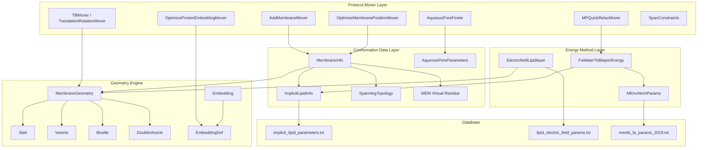

Rosetta's membrane protein modeling framework — **RosettaMP** — provides a biophysically grounded implicit membrane environment for folding, docking, design, and relaxation of transmembrane proteins. Rather than simulating individual lipid molecules, the framework represents the bilayer as a continuous solvent-like potential whose physical parameters are derived from all-atom MD simulations and X-ray/neutron scattering data. This page dissects the architectural layers that enable membrane-aware scoring, protein-membrane embedding optimization, and topology-driven constraint enforcement, equipping advanced developers to extend or customize any component of the pipeline.

Sources: [AddMembraneMover.hh](source/src/protocols/membrane/AddMembraneMover.hh#L1-L40), [MembraneInfo.hh](source/src/core/conformation/membrane/MembraneInfo.hh#L1-L40)

## Architecture Overview

RosettaMP is structured across four concentric layers: a **conformation data layer** that attaches membrane metadata to the Pose, a **geometry engine** that computes spatial relationships between atoms and the implicit bilayer, an **energy method layer** that scores atoms based on their membrane depth and local environment, and a **protocol mover layer** that orchestrates setup, transformation, and optimization workflows. These layers communicate through the `MembraneInfo` object, which is stored directly in the `Conformation` and accessed exclusively via `pose.conformation().membrane_info()`. The implicit membrane itself is represented by a virtual MEM residue — a root-level `Residue` appended to the Pose whose orientation defines the bilayer normal and center.

Sources: [MembraneGeometry.hh](source/src/core/conformation/membrane/MembraneGeometry.hh#L1-L80), [Embedding.hh](source/src/protocols/membrane/geometry/Embedding.hh#L50-L130), [FaWaterToBilayerEnergy.hh](source/src/protocols/membrane/scoring/FaWaterToBilayerEnergy.hh#L1-L60)

## Conformation Data Layer

The conformation data layer is the architectural foundation that makes any Pose "membrane-aware." Once initialized, `pose.conformation().is_membrane()` returns `true` and the full membrane scoring pipeline becomes available. The central class is `MembraneInfo`, which aggregates four pieces of essential state: the MEM residue index (sequence position of the membrane virtual residue), the membrane jump number (the FoldTree jump connecting protein chains to MEM), a `SpanningTopology` object describing which residues form transmembrane helices, and an `ImplicitLipidInfo` object encoding the physical properties of the lipid bilayer. This design enforces a single source of truth — all geometry queries, scoring methods, and movers route through `MembraneInfo` rather than maintaining independent membrane state.

Sources: [MembraneInfo.hh](source/src/core/conformation/membrane/MembraneInfo.hh#L46-L80)

### MembraneInfo

`MembraneInfo` provides the canonical API for all membrane spatial queries. Key methods include `membrane_center()` and `membrane_normal()` which compute the bilayer's position and orientation from the MEM residue's current coordinates, `in_membrane()` and `in_membrane_atom()` which classify residues and atoms as intramembrane or extramembrane based on the transition zone, and `residue_z_position()` / `atom_z_position()` which return the signed distance along the membrane normal. The constructor accepts either legacy thickness/steepness parameters directly or a lipid composition name and temperature, delegating to `ImplicitLipidInfo` for parameter lookup. The `MP_GEOMETRY_TRANSITION` enum selects among `Slab`, `Vesicle`, `Bicelle`, or `DoubleVesicle` membrane topologies, each of which provides a different thickness profile function.

> [!TIP]
> **MEM residue is a FoldTree root anchor.** The MEM virtual residue is always positioned at the root of the FoldTree. All downstream kinematic transformations — jumps, minimization, backbone sampling — propagate through this root, meaning the membrane and protein move as a coupled system unless a mover explicitly modifies the membrane jump. This is why `AddMembraneMover` accepts an `anchor_rsd` parameter: it redesigns the FoldTree so the specified protein residue becomes the root, with MEM as its immediate child.

Sources: [MembraneInfo.hh](source/src/core/conformation/membrane/MembraneInfo.hh#L80-L160), [AddMembraneMover.hh](source/src/protocols/membrane/AddMembraneMover.hh#L98-L120)

### SpanningTopology and Span

`SpanningTopology` stores a collection of `Span` objects, each representing a single transmembrane segment defined by a start residue, end residue, and an `Orientation` enum (`IN` for N-to-C cytoplasmic orientation, `OUT` for the reverse). The topology can be loaded from a spanfile (a whitespace-delimited text file with columns for start, end, and orientation) or constructed programmatically. Topology drives two critical downstream behaviors: it determines which residues are classified as transmembrane for span-based constraints, and it provides the span boundaries used by `Embedding::from_spans()` to compute per-helix embedding vectors that feed into the optimization movers.

Sources: [Span.hh](source/src/core/conformation/membrane/Span.hh#L1-L30), [AddMembraneMover.hh](source/src/protocols/membrane/AddMembraneMover.hh#L71-L90)

### ImplicitLipidInfo

`ImplicitLipidInfo` encapsulates the biophysical parameters of the lipid bilayer, loaded at runtime from `database/membrane/implicit_lipid_parameters.txt`. The file contains experimentally-derived measurements for over 90 lipid composition/temperature combinations across four headgroup types (PC, PE, PG, ToCdl). Each entry specifies: `WATER_THK` (half the distance between Gibbs dividing surfaces), `PARAM_A` (a thickness proxy), `WATER_STP` (the steepness of the water density gradient), `TEMP`, and `DOS` (degrees of saturation). The `ImplicitLipidInfo` constructor looks up the matching row by lipid name and temperature (default: DLPC at 37°C) and exposes these values through accessor methods used by the geometry engine's transition functions.

Sources: [ImplicitLipidInfo.hh](source/src/core/conformation/membrane/ImplicitLipidInfo.hh#L1-L30), [implicit_lipid_parameters.txt](database/membrane/implicit_lipid_parameters.txt#L1-L30)

## Membrane Geometry Engine

The geometry engine translates the abstract membrane parameters into concrete per-atom spatial classifications. This is where the "implicit" in implicit membrane becomes computationally real: every atom receives a continuous hydration score between 0 (fully buried in lipid) and 1 (fully exposed to water) based on its position relative to the bilayer.

Sources: [MembraneGeometry.hh](source/src/core/conformation/membrane/MembraneGeometry.hh#L1-L200)

### Transition Functions

The geometry engine provides two mathematically distinct transition functions that map an atom's z-coordinate (distance along the membrane normal) to a continuous [0, 1] hydration value:

- **`f_imm1(z)`** — The classic Lazaridis IMM1 function, an exponential sigmoid that models the water-to-lipid interface as a smooth step. This is the default for `Slab` and `Vesicle` geometries and is controlled by the `steepness` parameter.
- **`f_franklin(z, τ, κ)`** — A newer transition function introduced by Alford, Fleming, and Gray (2020) with lipid-type-dependent parameters τ (transition midpoint) and κ (transition sharpness). This provides better discrimination for different headgroup chemistries and is selected when `use_franklin()` returns true.

The base `MembraneGeometry` class computes `f_thickness()` as the flat-membrane transition value, then `f_hydration()` composes it with `f_cavity()` to account for aqueous pore effects. The `corrected_xyz()` method transforms atom coordinates from lab frame into membrane-local frame (thickness axis, binormal axis, normal axis) for geometric queries.

Sources: [MembraneGeometry.hh](source/src/core/conformation/membrane/MembraneGeometry.hh#L140-L200)

### Membrane Geometry Variants

The `MembraneGeometry` class hierarchy supports four distinct membrane topologies, each modeling a physically different environment:

| Geometry Class | Description | Use Case |
|---|---|---|
| `Slab` | Infinite planar bilayer (default) | Standard α-helical membrane proteins |
| `Vesicle` | Single spherical shell | Monotopic/peripheral proteins, vesicle-bound peptides |
| `Bicelle` | Discoidal bilayer patch | Nanodisc or bicelle-embedded systems |
| `DoubleVesicle` | Concentric double shell | Vesicle fusion intermediates, dual-membrane systems |

Each subclass overrides `clone()`, `show()`, and the core `f_thickness()` / `f_hydration()` virtual methods to implement geometry-specific thickness profiles. All subclasses inherit the pore correction machinery from the base class through `f_cavity()` and `f_hydration()`.

Sources: [membrane_geometry/](source/src/core/conformation/membrane/membrane_geometry/)

### Embedding System

The embedding subsystem — located in `protocols/membrane/geometry/` rather than `core/conformation/membrane/` — provides a higher-level abstraction for representing how transmembrane helices are positioned relative to the bilayer. `EmbeddingDef` is the atomic unit: a struct holding a `center` (3D point) and `normal` (3D unit vector) that together define a helical segment's position and tilt. It can be constructed from a pose and residue range, automatically computing the Cα centroid and principal axis. `Embedding` aggregates multiple `EmbeddingDef` objects (one per transmembrane span) and maintains a `total_embed_` — the average embedding across all spans — which is used by `OptimizeProteinEmbeddingMover` as the optimization target.

Sources: [EmbeddingDef.hh](source/src/protocols/membrane/geometry/EmbeddingDef.hh#L55-L109), [Embedding.hh](source/src/protocols/membrane/geometry/Embedding.hh#L90-L130)

## Energy Method Layer

RosettaMP provides two custom one-body energy methods that score membrane-embedded atoms based on their depth-dependent solvation environment. Both are registered as `ContextDependentOneBodyEnergy` methods, meaning they compute per-residue scores that depend on the full pose context (specifically, the membrane position).

Sources: [FaWaterToBilayerEnergy.hh](source/src/protocols/membrane/scoring/FaWaterToBilayerEnergy.hh#L50-L60), [ElectricfieldLipidlayer.hh](source/src/protocols/membrane/scoring/ElectricfieldLipidlayer.hh#L50-L60)

### FaWaterToBilayerEnergy (fa_wtbe)

This energy method implements the water-to-bilayer transfer free energy, the core scoring term of RosettaMP. For each atom, it retrieves `MEnvAtomParams` containing `dGfreeW` (solvation free energy in water), `dGfreeB` (solvation free energy in bilayer), and a `hydration` value from the geometry engine. The per-atom energy is computed by `eval_fa_wtbe()` as a weighted interpolation between the water and bilayer reference states, modulated by the atom's membrane depth. The method supports full derivative computation through `eval_atom_derivative()`, which produces F1/F2 force vectors for gradient-based minimization. An internal flag `use_fleming_de_` toggles between the original and a revised dielectric formulation.

Sources: [FaWaterToBilayerEnergy.hh](source/src/protocols/membrane/scoring/FaWaterToBilayerEnergy.hh#L70-L139), [MEnvAtomParams.hh](source/src/protocols/membrane/scoring/MEnvAtomParams.hh#L40-L79)

### ElectricfieldLipidlayer (f_elec_lipidlayer)

This method captures the electrostatic contribution of the lipid headgroup dipole field. Real lipid bilayers generate a substantial electric field in the headgroup region due to oriented carbonyl and phosphate dipoles; this field influences the energetics of charged and polar residues near the membrane interface. `ElectricfieldLipidlayer` computes a per-atom electrostatic penalty/reward based on the atom's z-position using `MEnvElectroAtomParams`, providing both energy values and gradient derivatives for optimization.

Sources: [ElectricfieldLipidlayer.hh](source/src/protocols/membrane/scoring/ElectricfieldLipidlayer.hh#L70-L122)

### MEnvAtomParams

The `MEnvAtomParams` container is the parameter bridge between the scoring methods and the database files. Each instance stores: `atom_type_name` (the Rosetta atom type), `dGfreeW` and `dGfreeB` (pair of reference solvation energies), `hyd_` (the continuous hydration value computed by the geometry engine at scoring time), and F1/F2 derivative vectors. Parameters are loaded from `database/membrane/memb_fa_params_2019.txt` during score function initialization and indexed by atom type name. The hydration field is populated dynamically during `setup_for_scoring()` based on the current membrane geometry, making the energy method fully responsive to membrane position changes during optimization.

Sources: [MEnvAtomParams.hh](source/src/protocols/membrane/scoring/MEnvAtomParams.hh#L30-L79)

## Protocol Mover Layer

The protocol layer provides the end-user-facing API for membrane protein workflows. All membrane movers extend `protocols::moves::Mover` and are fully RosettaScripts-compatible with XML schema definitions and `Creator` classes following the [Factory Pattern Architecture](15-factory-pattern-architecture).

Sources: [AddMembraneMover.hh](source/src/protocols/membrane/AddMembraneMover.hh#L55-L70)

### Initialization: AddMembraneMover

`AddMembraneMover` is the gateway to RosettaMP — every membrane protocol must invoke it first. Its `apply()` method performs six sequential initialization steps documented in the class header: (1) creates and appends a MEM virtual residue to the pose, (2) constructs a `SpanningTopology` object from the spanfile or inline span definitions, (3) sets up initial membrane coordinates (default: centered at origin), (4) optionally initializes per-atom lipid accessibility data, (5) optionally initializes aqueous pore dimensions, and (6) creates the `ImplicitLipidMembraneInfo` and attaches it to the conformation. The mover offers multiple constructor overloads for common initialization patterns: from a spanfile path, from an existing MEM residue number, from a pre-built `SpanningTopologyOP`, or via RosettaScripts XML tags.

> [!TIP]
> **Constructor overload resolution is non-trivial.** Several `AddMembraneMover` constructors have overlapping signature patterns when `membrane_rsd=0` (auto-detect). The version with `(anchor_rsd, bool, bool, membrane_rsd)` uses the two boolean dummy parameters purely to disambiguate from `(membrane_rsd, lipid_composition, temperature)`. When calling from C++, always use the explicit constructor forms or the RosettaScripts interface to avoid accidental overload selection.

Sources: [AddMembraneMover.hh](source/src/protocols/membrane/AddMembraneMover.hh#L55-L135)

### Membrane Position and Embedding Optimization

Once initialized, the membrane position can be optimized through two complementary movers:

- **`OptimizeMembranePositionMover`** — Adjusts the membrane (MEM residue) relative to a fixed protein by minimizing a scoring function that includes `fa_wtbe` and `f_elec_lipidlayer`. This is used when the protein structure is trusted and the membrane placement needs refinement.
- **`OptimizeProteinEmbeddingMover`** — Adjusts the protein position relative to a fixed membrane by modifying the protein-MEM jump. This uses the `Embedding` system to define per-span targets and optimizes the global transform to match the computed average embedding.

Both movers operate on the FoldTree jump connecting the protein root to MEM, but from opposite perspectives. `SetMembranePositionMover` and `RandomMembranePositionMover` provide non-optimizing alternatives for explicit positioning or stochastic initialization. `MembranePositionFromTopologyMover` computes an initial placement purely from spanning topology and ideal helix geometry.

Sources: [OptimizeMembranePositionMover.hh](source/src/protocols/membrane/OptimizeMembranePositionMover.hh), [OptimizeProteinEmbeddingMover.hh](source/src/protocols/membrane/OptimizeProteinEmbeddingMover.hh)

### Transformation and Sampling Movers

The framework provides fine-grained movers for exploring membrane protein conformational space:

| Mover | Operation | Parameters |
|---|---|---|
| `TiltMover` | Rotates protein around the membrane normal | Tilt angle range, angle increment |
| `TranslationRotationMover` | Full rigid-body transform of protein in membrane | Translation magnitude, rotation angle |
| `SpinAroundPartnerMover` | Rotates protein around a partner protein | Partner chain, angular range |
| `FlipMover` | Inverts membrane orientation (inside ↔ outside) | None (stateless) |
| `TransformIntoMembraneMover` | Applies a computed transformation to embed protein into membrane | Embedding target |

Each mover modifies the protein-MEM jump while preserving the MEM residue's position, effectively repositioning the protein within the fixed bilayer reference frame.

Sources: [TiltMover.hh](source/src/protocols/membrane/TiltMover.hh), [TranslationRotationMover.hh](source/src/protocols/membrane/TranslationRotationMover.hh), [SpinAroundPartnerMover.hh](source/src/protocols/membrane/SpinAroundPartnerMover.hh)

### Relaxation and Constraints

`MPQuickRelaxMover` provides a membrane-aware relaxation protocol that wraps the standard FastRelax with membrane-specific score function weights and fold-tree constraints. Unlike the general-purpose [Structure Relaxation](18-structure-relaxation) pipeline, it ensures the membrane jump is preserved during minimization and that `fa_wtbe` gradients are properly included in the optimization.

Span-based constraints are added by `AddMembraneSpanConstraint` (penalizes deviation from idealized transmembrane geometry) and `AddMembraneSpanTermZConstraint` (keeps span termini near the membrane interface). These constraints work in concert with the energy methods to maintain physically realistic membrane embeddings during aggressive backbone sampling.

Sources: [MPQuickRelaxMover.hh](source/src/protocols/membrane/MPQuickRelaxMover.hh), [AddMembraneSpanConstraint.hh](source/src/protocols/membrane/AddMembraneSpanConstraint.hh)

### Aqueous Pore System

For transmembrane proteins with water-filled channels (ion channels, porins, transporters), the framework provides `AqueousPoreFinder` and `AqueousPoreParameters`. The pore finder detects channel-like voids in the protein structure and initializes pore geometry parameters (radius, taper, axis). The geometry engine then uses `f_cavity()` to modify the hydration profile: atoms inside the pore receive higher hydration values even when their z-coordinate places them nominally within the bilayer, correctly modeling the fact that channel-lining residues face water rather than lipid.

Sources: [AqueousPoreFinder.hh](source/src/protocols/membrane/AqueousPoreFinder.hh), [AqueousPoreParameters.hh](source/src/core/conformation/membrane/AqueousPoreParameters.hh)

### Symmetry Support

`SymmetricAddMembraneMover` extends `AddMembraneMover` for symmetric membrane protein assemblies. It handles the additional complexity of symmetric FoldTrees, ensuring that the MEM residue is correctly placed in the asymmetric unit and that the symmetry definition propagates the membrane across all subunits. The utility functions in `protocols/membrane/symmetry/util.hh` provide helpers for setting up symmetric membrane poses compatible with the [Symmetry Modeling](24-symmetry-modeling) framework.

Sources: [symmetry/SymmetricAddMembraneMover.hh](source/src/protocols/membrane/symmetry/SymmetricAddMembraneMover.hh)

## Database Parameter Files

The membrane framework depends on three runtime database files located in `database/membrane/`:

| File | Content | Consumers |
|---|---|---|
| `implicit_lipid_parameters.txt` | 90+ lipid composition entries with thickness, steepness, temperature, saturation data | `ImplicitLipidInfo` |
| `lipid_electric_field_params.txt` | Electric field parameters per lipid type | `ElectricfieldLipidlayer` |
| `memb_fa_params_2019.txt` | Per-atom-type water/bilayer solvation energies | `MEnvAtomParams` / `FaWaterToBilayerEnergy` |

The implicit lipid parameters file covers four headgroup families (PC, PE, PG, cardiolipin) across chain lengths from 12:0 to 22:6 and temperatures from 20°C to 60°C. This breadth allows users to model membrane proteins in physiologically relevant bilayer compositions by specifying `-mp:lipids:composition DOPC -mp:lipids:temperature 37` on the command line.

Sources: [implicit_lipid_parameters.txt](database/membrane/implicit_lipid_parameters.txt#L19-L30)

## Lipid Composition Reference

The following table summarizes the most commonly used lipid compositions available in the framework, showing how bilayer thickness varies with chain length, headgroup type, and temperature:

| Lipid | Headgroup | Chains | Thickness (Å) @ 30°C | Thickness (Å) @ 37°C |
|---|---|---|---|---|
| DLPC | PC | 12:0/12:0 | 16.3–16.5 | 17.25 |
| DMPC | PC | 14:0/14:0 | 18.35–19.7 | 17.974 |
| DOPC | PC | 18:1/18:1 | 18.0 | 18.639 |
| POPC | PC | 16:0/18:1 | 19.55 | 19.1 |
| DPPC | PC | 16:0/16:0 | — | 20.029 |
| DLPE | PE | 12:0/12:0 | — | 16.454 |
| POPE | PE | 16:0/18:1 | — | 19.397 |
| DOPG | PG | 18:1/18:1 | 17.85 | 17.974 |
| POPG | PG | 16:0/18:1 | 18.3 | 18.688 |

PE and PG headgroups produce systematically thicker effective hydrophobic layers compared to PC lipids of the same chain length, reflecting their smaller headgroup cross-sections and tighter packing.

Sources: [implicit_lipid_parameters.txt](database/membrane/implicit_lipid_parameters.txt#L23-L92)

## Visualization and Debugging

The `protocols/membrane/visualize/` subdirectory provides two diagnostic movers: `VisualizeEmbeddingMover` outputs per-span embedding vectors (center + normal) as PDB B-factor records or via PyMOL/ChimeraX session files, while `VisualizeMembraneMover` renders the implicit membrane boundary as a mesh or series of planes at the user-specified hydration contour level. These are invaluable for validating that the membrane is correctly positioned relative to the protein before launching expensive sampling protocols.

Sources: [visualize/VisualizeEmbeddingMover.hh](source/src/protocols/membrane/visualize/VisualizeEmbeddingMover.hh), [visualize/VisualizeMembraneMover.hh](source/src/protocols/membrane/visualize/VisualizeMembraneMover.hh)

## Integration with Broader Rosetta Frameworks

RosettaMP intersects several other subsystems in the Rosetta architecture. The membrane energy methods integrate into the [ScoreFunction Framework](9-scorefunction-framework) as standard `EnergyMethod` plugins, activated by including `fa_wtbe` and `f_elec_lipidlayer` terms. The Environment framework (`core::environment` and `protocols::environment`) provides a general mechanism for controlling degrees of freedom through a claims-based system (`XYZClaim`, `JumpClaim`, `TorsionClaim`) and `DofPassport` objects — this is the infrastructure that allows membrane movers to lock and unlock specific FoldTree jumps during coordinate manipulation. For machine-learning-assisted membrane modeling, the framework is compatible with [ProteinMPNN Integration](22-proteinmpnn-integration) for sequence design of transmembrane regions.
