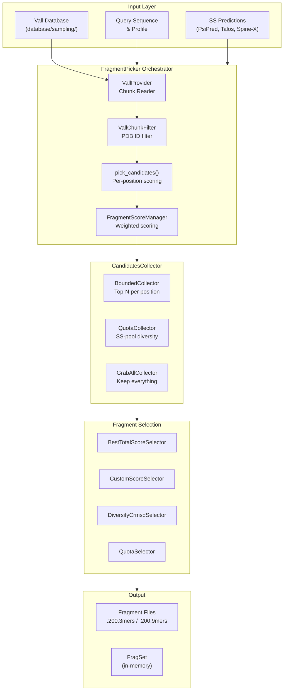
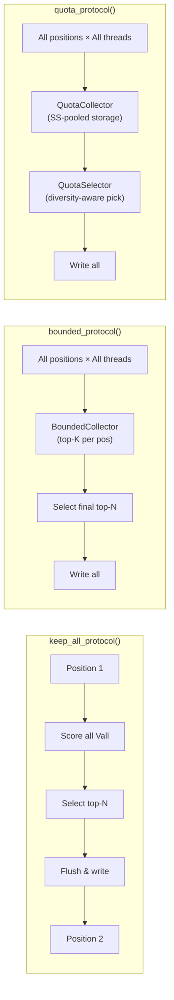

The Fragment Picking System is one of Rosetta's most critical preprocessing pipelines — it is the engine that selects short protein backbone fragments (typically 3-mers and 9-mers) from a massive structural database to serve as the sampling building blocks for ab initio folding, comparative modeling, and hybridization protocols. Without high-quality fragments, downstream conformational search is blind; with them, Rosetta can efficiently explore native-like conformational space by assembling pre-validated local structural motifs.

## Architectural Overview

The fragment picker follows a **plugin-based pipeline architecture** where a central orchestrator (`FragmentPicker`) coordinates data ingestion, chunk filtering, scoring, collection, and final selection through composable, swappable components. The entire system lives under `source/src/protocols/frag_picker/` and draws structural data from the **Vall** database — a comprehensive library of protein backbone torsion angles extracted from the PDB.

Sources: [FragmentPicker.hh](source/src/protocols/frag_picker/FragmentPicker.hh#L83-L106), [FragmentPicker.cc](source/src/protocols/frag_picker/FragmentPicker.cc#L16-L46)



## Core Classes and Data Flow

### FragmentPicker — The Central Orchestrator

`FragmentPicker` is the main entry point for the entire system. It manages query data (sequence profiles, secondary structure predictions, phi/psi angles, solvent accessibility), orchestrates the scoring pipeline, and drives the three picking protocols. The class supports multithreaded operation via `set_max_threads()`, with one `FragmentScoreManager` per thread to avoid cache contention on chunk-level scoring data. It maintains a map of `CandidatesCollector` instances keyed by fragment size and thread index, enabling parallel scoring of different fragment lengths simultaneously.

Sources: [FragmentPicker.hh](source/src/protocols/frag_picker/FragmentPicker.hh#L89-L121), [FragmentPicker.hh](source/src/protocols/frag_picker/FragmentPicker.hh#L451-L475)

### FragmentCandidate — A Potential Fragment

Each `FragmentCandidate` represents a contiguous X-mer extracted from a Vall chunk that aligns to a specific position in the query sequence. It stores three critical indices: the query residue index, the Vall residue index, and the fragment length. Critically, **scores are stored separately** in a `FragmentScoreMap` object rather than on the candidate itself — this separation allows the same candidate to be evaluated by different scoring schemes without mutation. The candidate can produce a `FragData` object for direct integration with Rosetta's fragment framework via `get_frag_data()`.

Sources: [FragmentCandidate.hh](source/src/protocols/frag_picker/FragmentCandidate.hh#L41-L58), [FragmentCandidate.hh](source/src/protocols/frag_picker/FragmentCandidate.hh#L132-L148)

### VallProvider — Structural Database Reader

`VallProvider` reads the Vall database file (e.g., `filtered.vall.dat.2006-05-05.gz`) and partitions it into `VallChunk` objects — contiguous segments from the same PDB entry. Each chunk contains `VallResidue` entries with backbone torsion angles (φ, ψ, ω), secondary structure assignments, B-factors, and residue depth information. The provider supports lazy loading with configurable line ranges, profile caching, and pose caching to avoid redundant computation when the same chunk is scored against multiple query positions.

Sources: [VallProvider.hh](source/src/protocols/frag_picker/VallProvider.hh#L38-L128)

### FragmentScoreManager — Pluggable Scoring Engine

`FragmentScoreManager` is the extensible scoring subsystem that evaluates how well a fragment candidate matches the query's predicted properties. It maintains an ordered list of `FragmentScoringMethod` instances, each with a weight. Methods are sorted by priority (higher priority scored first) to enable early rejection of poor candidates before expensive scores are computed. The manager implements a caching protocol via the `CachingScoringMethod` interface — chunk-level data that doesn't change per-candidate (e.g., Gunn costs) is precomputed once per chunk, then reused across all fragments derived from that chunk. The total score is a simple weighted sum: `Σ(weight_i × score_i)`.

Sources: [FragmentScoreManager.cc](source/src/protocols/frag_picker/scores/FragmentScoreManager.cc#L101-L144), [FragmentScoreManager.cc](source/src/protocols/frag_picker/scores/FragmentScoreManager.cc#L146-L167)

## Scoring Methods Catalog

The scoring subsystem contains over 40 pluggable scoring methods organized under `source/src/protocols/frag_picker/scores/`. Each implements the `FragmentScoringMethod` base class with a `score()` virtual method and participates in the priority-ordered evaluation pipeline.

| Category | Scoring Method | Purpose |
|----------|---------------|---------|
| **Sequence** | `ProfileScoreL1`, `ProfileScoreBlosum62`, `SequenceIdentity` | Compare query sequence profile against Vall fragment sequence |
| **Secondary Structure** | `SecondarySimilarity`, `SecondaryIdentity`, `TalosSSSimilarity`, `PartialSecondarySimilarity`, `ABEGO_SS_Score` | Match predicted vs. observed secondary structure |
| **Torsion Angles** | `RamaScore`, `PhiPsiRmsd`, `PhiPsiSquareWell`, `TorsionBinSimilarity`, `Phi`, `Psi` | Evaluate backbone torsion angle agreement |
| **Geometry** | `FragmentCrmsd`, `FragmentAllAtomCrmsd`, `FragmentCrmsdResDepth`, `FragmentDME`, `GunnCostScore` | Structural similarity metrics |
| **Experimental (NMR)** | `JCoupling`, `RDCScore`, `CSScore`, `AmbigCSScore`, `PCS_FragDistance` | Restraint-based scoring from NMR data |
| **Environment** | `SolventAccessibility`, `BFactor`, `Faraggi_SA`, `HydrophobicitySimilarity`, `HydrophobicityProfileSimilarity` | Solvent and physico-chemical context |
| **Constraints** | `AtomPairConstraintsScore`, `DihedralConstraintsScore`, `InterbondAngleScore` | Custom distance/angle restraints |
| **Special** | `DisulfideIdentity`, `DisulfideDistance`, `ProlinePhiScore`, `MidPhiOut`, `MidPsiOut` | Residue-specific checks |

Sources: [FragmentScoreManager.cc](source/src/protocols/frag_picker/scores/FragmentScoreManager.cc#L22-L64), [FragmentScoringMethod.hh](source/src/protocols/frag_picker/scores/FragmentScoringMethod.hh#L34-L93)

The `FragmentScoringMethod` base class defines a critical **early rejection** mechanism: each method declares a `lowest_acceptable_value_` threshold and a `use_lowest_` flag. If a candidate's score falls below this threshold, it can be discarded before remaining (potentially expensive) scores are evaluated — a key optimization when scanning millions of Vall residues.

Sources: [FragmentScoringMethod.hh](source/src/protocols/frag_picker/scores/FragmentScoringMethod.hh#L69-L85)

## Three Picking Protocols

The `FragmentPicker` exposes three distinct protocols that differ in how they manage candidate storage and memory consumption. Each is suited to different computational scenarios.

Sources: [FragmentPicker.cc](source/src/protocols/frag_picker/FragmentPicker.cc#L113-L218)

### Keep-All Protocol

The `keep_all_protocol()` is a **position-by-position** approach. For each query position, it scans the entire Vall, scores every candidate, stores all candidates that pass filters, then selects the top-N fragments and writes them immediately. Storage is flushed after each position, making this the most memory-efficient option. However, it is **incompatible with multithreading** — each Vall chunk must be processed sequentially per position. It processes fragment sizes in an outer loop, writing separate output files per size.

Sources: [FragmentPicker.cc](source/src/protocols/frag_picker/FragmentPicker.cc#L160-L218)

### Bounded Protocol

The `bounded_protocol()` is the **default and recommended approach** for production use. It scores all Vall data against all query positions in parallel (multi-threaded), keeping only the top-K candidates per position using a `BoundedCollector` — a template class parameterized by a `StrictWeakOrdering` comparator that maintains a lazy-sorted bounded priority queue with configurable buffer factor. This protocol uses significantly more memory (O(query_length × max_candidates_per_position)) but enables full thread parallelism and produces higher-quality fragment sets because it sees all Vall candidates before making final selections.

Sources: [FragmentPicker.cc](source/src/protocols/frag_picker/FragmentPicker.cc#L113-L117), [BoundedCollector.hh](source/src/protocols/frag_picker/BoundedCollector.hh#L48-L79)

### Quota Protocol

The `quota_protocol()` is the most sophisticated approach, designed to ensure **secondary structure diversity** in the final fragment set. Instead of selecting the globally best N fragments per position, it distributes fragments across secondary structure pools (e.g., H, E, L for helix, strand, loop) using `QuotaCollector` and `QuotaPool`. Each pool receives a proportional allocation based on predicted secondary structure, preventing the picker from over-representing one structure type. The `ABEGO_SS_Config` extension further classifies fragments by ABEGO backbone torsion bins within each secondary structure category.

Sources: [FragmentPicker.cc](source/src/protocols/frag_picker/FragmentPicker.cc#L119-L158), [QuotaCollector.hh](source/src/protocols/frag_picker/quota/QuotaCollector.hh#L40-L113)



| Property | Keep-All | Bounded | Quota |
|----------|----------|---------|-------|
| Memory usage | Low (per-position) | Medium (O(Q×K)) | Medium (O(Q×P×K)) |
| Thread-safe | No | Yes | Yes |
| Output quality | Good | Better | Best (diversity) |
| Typical use case | Debugging, small queries | Default production | SS-diverse fragment sets |
| Storage type | Any `CandidatesCollector` | `BoundedCollector` | `QuotaCollector` |

## CandidatesCollector Hierarchy

All three protocols share the `CandidatesCollector` abstract interface, which defines `add()`, `clear()`, `insert()`, `count_candidates()`, and `get_candidates()` operations. The three concrete implementations provide fundamentally different storage strategies:

- **`GrabAllCollector`** — Stores every candidate without limit; useful for debugging and when external selection logic is needed. Found in [GrabAllCollector.hh](source/src/protocols/frag_picker/GrabAllCollector.hh).
- **`BoundedCollector<StrictWeakOrdering>`** — A templated class using `LazySortedVector1` to maintain a bounded priority queue per query position. The `buffer_factor` (default 5) controls internal buffer size vs. the exposed max candidates. [BoundedCollector.hh](source/src/protocols/frag_picker/BoundedCollector.hh#L48-L163)
- **`QuotaCollector`** — A two-level storage structure: per-position arrays of `QuotaPool` objects, where each pool tracks candidates belonging to a specific secondary structure or ABEGO category. Pools can be renormalized dynamically. [QuotaCollector.hh](source/src/protocols/frag_picker/quota/QuotaCollector.hh#L40-L113)

Sources: [CandidatesCollector.hh](source/src/protocols/frag_picker/CandidatesCollector.hh#L43-L73), [BoundedCollector.hh](source/src/protocols/frag_picker/BoundedCollector.hh#L44-L79), [QuotaCollector.hh](source/src/protocols/frag_picker/quota/QuotaCollector.hh#L40-L113)

## Fragment Selection Rules

After candidates are collected, a `FragmentSelectingRule` determines the final fragment set. The picker supports four selection strategies:

- **`BestTotalScoreSelector`** — Selects the N fragments with the lowest weighted total score. This is the default for bounded and keep-all protocols.
- **`CustomScoreSelector`** — Allows users to define arbitrary selection criteria beyond the total score.
- **`DiversifyCrmsdSelector` / `DiversifyDihedralsSelector`** — Enforces structural diversity among selected fragments by filtering out candidates that are too similar (measured by Cα RMSD or backbone dihedral angles) to already-selected fragments.
- **`QuotaSelector`** — Selects fragments proportionally from each `QuotaPool` to maintain secondary structure balance. Used exclusively by the quota protocol.

> [!TIP]
> When using the `DiversifyCrmsdSelector`, note that diversity filtering happens **after** scoring but **before** final output. A common mistake is to request more fragments than the diversity filter can produce, resulting in fewer than expected output fragments. Increase `n_candidates` (the collector capacity) to compensate.

Sources: [FragmentPicker.hh](source/src/protocols/frag_picker/FragmentPicker.hh#L210-L213), [FragmentPicker.cc](source/src/protocols/frag_picker/FragmentPicker.cc#L24-L34)

## Query Data Inputs

The fragment picker ingests multiple types of predictive query data to evaluate fragment candidates:

| Input | Method | Description |
|-------|--------|-------------|
| Sequence profile | `set_query_seq()` / `set_query_profile()` | PSI-BLAST or similar PSSM |
| Secondary structure (PsiPred) | `read_psipred_ss2()` | Helix/strand/loop probabilities per residue |
| Secondary structure (Talos) | `read_talos_ss()` | NMR-derived SS from TALOS+ |
| Phi/Psi/Solvent accessibility | `read_spine_x()` | SPINE-X predictions |
| Residue depth | `read_depth()` | DEPTH algorithm output |
| Phi/Psi angles & confidence | `set_query_phi()` / `set_query_psi()` / `set_query_phi_conf()` / `set_query_psi_conf()` | Direct angle predictions |

These inputs feed into the corresponding scoring methods. For example, `ProfileScoreL1` uses the sequence profile, `SecondarySimilarity` uses PsiPred predictions, and `RamaScore` uses Spine-X phi/psi predictions. The picker supports multiple secondary structure predictions simultaneously via a map keyed by prediction name.

Sources: [FragmentPicker.hh](source/src/protocols/frag_picker/FragmentPicker.hh#L235-L328), [FragmentPicker.hh](source/src/protocols/frag_picker/FragmentPicker.hh#L215-L233)

## Vall Database and Chunk Filtering

The Vall database is stored under `database/sampling/` with files like `filtered.vall.dat.2006-05-05.gz` (full PDB-derived library) and `small.vall.gz` (testing subset). Additional specialized databases exist for RNA (`rna/`), antibodies (`antibodies/Fragments/`), and secondary-structure-specific fragments (`ss_fragfiles/` with 27 files covering all 3-letter SS combinations from EEE to LLL).

Before fragments are extracted, `VallChunkFilter` instances can reject entire chunks. The most common filter is `PdbIdChunkFilter`, which excludes chunks derived from specific PDB entries (e.g., the query protein itself to avoid homology bias). Filters are registered via `add_chunk_filter()` on the picker.

Sources: [FragmentPicker.hh](source/src/protocols/frag_picker/FragmentPicker.hh#L441-L444), [FragmentPicker.cc](source/src/protocols/frag_picker/FragmentPicker.cc#L31)

## Integration with Core Fragment Framework

Selected fragments ultimately become `ConstantLengthFragSet` objects — the standard in-memory fragment representation used throughout Rosetta's sampling protocols. The `FragmentPicker::getFragSet()` method performs this conversion, producing a vector of `ConstantLengthFragSetOP` instances (one per fragment size). Each `FragSet` contains `Frame` objects at each query position, and each Frame holds the selected `FragData` entries with backbone torsion angles. These `FragSet` objects are then consumed by the ab initio folding, comparative modeling, and loop modeling protocols described in other pages of this documentation.

On disk, fragments are written in Rosetta's standard fragment format with files named `{prefix}.{n_frags}.{size}mers` (e.g., `frags.200.3mers` and `frags.200.9mers`), which can be loaded via `-in:file:fraglist` or the `FragmentSetLoader` class.

Sources: [FragmentPicker.hh](source/src/protocols/frag_picker/FragmentPicker.hh#L392-L394), [FragmentCandidate.hh](source/src/protocols/frag_picker/FragmentCandidate.hh#L132-L148)

## Nonlocal Fragments and Contact Prediction

Beyond standard local fragment picking, the system supports **nonlocal fragment pairs** — pairs of fragments from distant positions in the query sequence that are predicted to be in spatial contact. The `nonlocal_pairs()` and `nonlocal_pairs_at_position()` methods identify such pairs by analyzing side-chain contact geometry from top-scoring local fragments. This functionality integrates with Rosetta's nonlocal folding protocols and contact prediction pipelines, using `NonlocalPair` objects that wrap two `FragmentCandidate` instances plus a contact count score.

Sources: [FragmentPicker.hh](source/src/protocols/frag_picker/FragmentPicker.hh#L170-L173), [FragmentPicker.cc](source/src/protocols/frag_picker/FragmentPicker.cc#L221-L250)

## Source Code Layout

```
source/src/protocols/frag_picker/
├── FragmentPicker.hh/cc          # Central orchestrator
├── FragmentCandidate.hh/cc       # A potential fragment (Vall → query mapping)
├── CandidatesCollector.hh        # Abstract collector interface
├── BoundedCollector.hh           # Top-K bounded priority queue (templated)
├── GrabAllCollector.hh           # Unlimited storage collector
├── VallProvider.hh/cc            # Vall database reader & chunk manager
├── VallChunk.hh/cc               # Contiguous PDB segment from Vall
├── VallResidue.hh/cc             # Single residue with torsion data
├── VallChunkFilter.hh/cc         # Chunk pre-screening base + PdbId filter
├── FragmentScoreFilter.hh/cc     # Score-based candidate filtering
├── FragmentSelectingRule.hh      # Selection base class
├── BestTotalScoreSelector.hh/cc  # Select by lowest total score
├── CustomScoreSelector.hh/cc     # User-defined selection logic
├── DiversifyCrmsdSelector.hh/cc  # Diversity by Cα RMSD
├── DiversifyDihedralsSelector.hh # Diversity by dihedral angles
├── scores/                       # 40+ scoring method implementations
│   ├── FragmentScoringMethod.hh  # Base class for all scorers
│   ├── CachingScoringMethod.hh   # Chunk-level caching interface
│   ├── FragmentScoreManager.hh/cc# Scoring engine with weighted sum
│   ├── PValuedFragmentScoreManager.hh/cc # P-value based scoring
│   ├── AdaptiveScoreHistogram.hh/cc     # Dynamic score calibration
│   └── ...
├── quota/                        # Quota-based diversity system
│   ├── QuotaCollector.hh/cc      # SS-pooled collector
│   ├── QuotaSelector.hh/cc       # Proportional pool selection
│   ├── QuotaPool.hh              # Single SS category storage
│   ├── QuotaConfig.hh/cc         # Pool configuration parser
│   ├── ABEGO_SS_Pool.hh/cc       # ABEGO+SS combined pools
│   ├── ABEGO_SS_Map.hh/cc        # ABEGO↔SS mapping logic
│   └── SecondaryStructurePool.hh/cc # SS-based pool implementation
└── nonlocal/                     # Nonlocal fragment pair support
    ├── NonlocalFrags.hh/cc       # Nonlocal fragment finder
    ├── NonlocalPair.hh           # Pair of distant fragments
    └── NonlocalFragsMain.hh/cc   # Entry point for nonlocal picking
```

## Next Steps

Having understood the fragment picking pipeline, the following pages provide natural continuation points depending on your goal:

- **[Ab Initio Folding](20-ab-initio-folding)** — See how picked fragments drive Rosetta's de novo structure prediction via Monte Carlo assembly
- **[Structure Relaxation](18-structure-relaxation)** — Understand how fragment-based moves integrate with relaxation protocols
- **[De Novo Protein Design](17-de-novo-protein-design)** — Explore how fragment libraries inform the design of novel protein folds
- **[RosettaScripts XML Framework](14-rosettascripts-xml-framework)** — Learn how to configure fragment picking through XML for automated pipelines
- **[ScoreFunction Framework](9-scorefunction-framework)** — Compare fragment scoring with Rosetta's full-atom scoring system