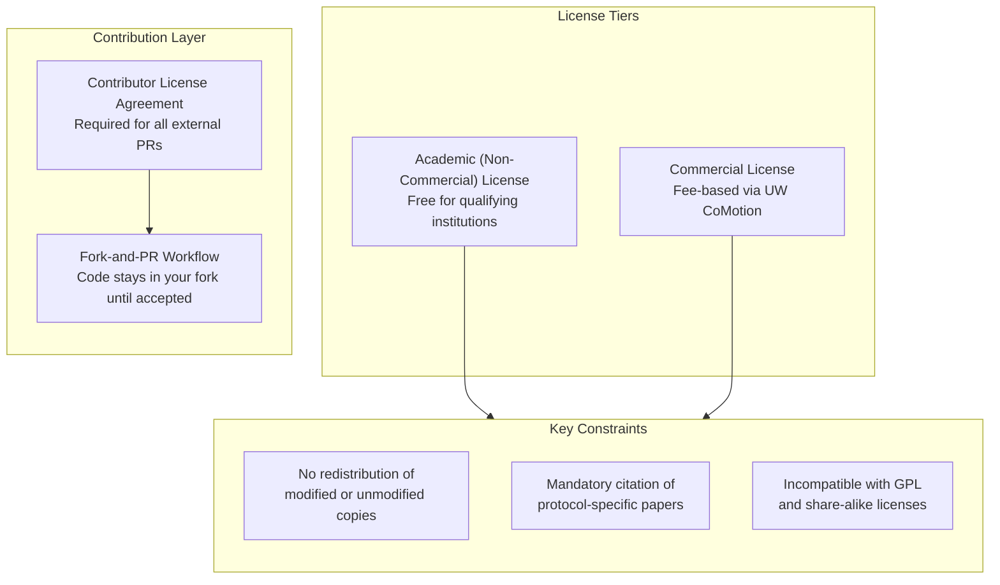
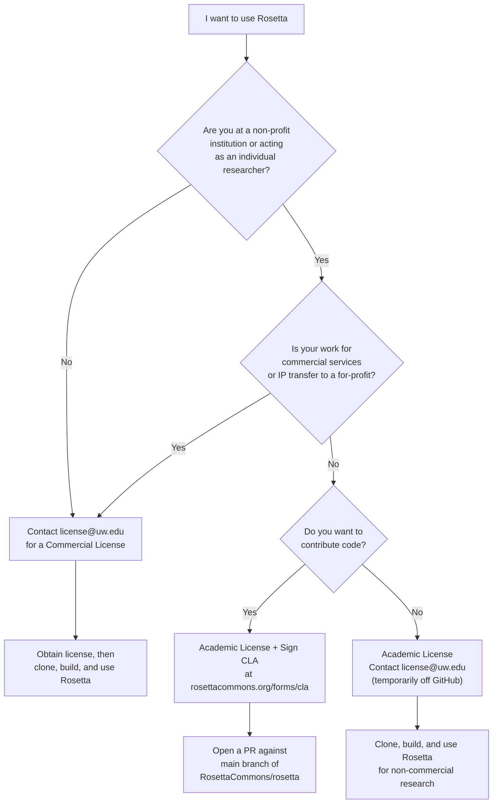

Understanding Rosetta's licensing model is one of the most important first steps before you write a single line of code. Unlike many scientific tools you may have encountered, Rosetta is **not Open Source** according to the Open Source Initiative (OSI) definition. This means the source code is publicly visible on GitHub, but its use is governed by a specific license agreement that restricts certain activities—most notably, commercial use. This page walks you through every dimension of the licensing model so you can confidently determine how Rosetta fits into your project.

## License Architecture Overview

Rosetta's licensing model is organized into three distinct layers, each governing a different relationship between you and the software. The diagram below illustrates how these layers connect:

The two license tiers—academic and commercial—sit at the top of the hierarchy and determine how you may *use* the software. The contribution layer operates independently and governs how you may *give back* code. Both layers share a set of common constraints that apply regardless of which tier you fall under.

Sources: [LICENSE.md](LICENSE.md#L1-L6), [README.md](README.md#L1-L161)

## Academic (Non-Commercial) License

The academic license is the pathway most developers will encounter first. It grants free access to Rosetta and PyRosetta for non-commercial, non-profit research use. However, the definition of "Non-Commercial User" is precise and worth understanding fully, as exceeding its boundaries can have legal implications.

### Who Qualifies as a Non-Commercial User

The license defines a Non-Commercial User as someone who falls into one of two categories, each with explicit exclusions:

| Category | Included | Excluded |
|----------|----------|----------|
| **Institutional** | Employees of not-for-profit research institutions, government laboratories, and universities | (a) Commercial services; (b) Contract research for a for-profit company where resulting IP is owned by that company |
| **Individual** | Individual researchers acting in a non-commercial capacity | (a) Any use by, for, or on behalf of a for-profit entity; (b) Any use intended for commercial advantage or monetary compensation |

The key distinction is **intent and IP ownership**, not just your employer's tax status. For example, a university researcher performing contract research where the resulting intellectual property transfers to a for-profit company would fall outside the academic license, even though they work at an academic institution.

### What the Academic License Grants

Non-Commercial Users are granted the rights to **perform, display, reproduce, and modify** the Software—this includes both source and executable copies—solely for internal non-commercial purposes. This is broad enough to cover typical academic research activities: running simulations, modifying scoring functions, developing new protocols, and publishing results.

### Obtaining an Academic License

As of April 2026, the academic license text has been temporarily removed from the GitHub repository while the University of Washington conducts an export control review. Users seeking academic licenses should contact `license@uw.edu` directly and follow the instructions provided once the review process completes. This is a procedural pause, not a policy change—academic licensing remains available.

Sources: [LICENSE.md](LICENSE.md#L1-L6), [LICENSE.PyRosetta.md](LICENSE.PyRosetta.md#L1-L64)

## Commercial License

If your use case falls outside the non-commercial definition—or if you represent a for-profit entity—you need a commercial license. This is the licensing tier that sustains the RosettaCommons financially, as all profits from commercial licenses fund the scientific mission of the collaborative.

### How to Obtain a Commercial License

Commercial licenses for both Rosetta and PyRosetta are administered by **UW CoMotion**, the University of Washington's technology transfer office. You can initiate the licensing process through two channels:

| Method | Details |
|--------|---------|
| **Email** | Contact `license@uw.edu` directly |
| **Web Portal** | Rosetta: `https://els2.comotion.uw.edu/product/rosetta` |
| | PyRosetta: `https://els2.commotion.uw.edu/product/pyrosetta` |

The commercial license grants broader usage rights appropriate for pharmaceutical companies, biotech firms, and other for-profit organizations that wish to use Rosetta's capabilities in their pipelines.

### The Commercial/Academic Boundary

A common source of confusion is determining exactly where the boundary lies between academic and commercial use. The contributing FAQ provides explicit guidance on several edge cases:

- **Using Rosetta as a library** in another program does not exempt you from Rosetta's licensing terms. Any combination of Rosetta with another program must maintain Rosetta licensing terms for those portions containing Rosetta code.
- **Charging a fee** for programs that contain Rosetta code counts as commercial use, even if the fee is nominally for "your" code rather than Rosetta's.
- **Combining with GPL-licensed code** is not permitted, as the Rosetta license is explicitly incompatible with GPL and other share-alike provisions.

> [!TIP]
> Before deciding your license tier, carefully evaluate whether any aspect of your project involves IP transfer to a for-profit entity, fee-based services, or commercial advantage. When in doubt, contact `license@uw.edu` for a determination—it is far cheaper than discovering a license violation after the fact.

Sources: [LICENSE.md](LICENSE.md#L1-L6), [CONTRIBUTING.md](CONTRIBUTING.md#L46-L73)

## Contributor License Agreement (CLA)

If you plan to contribute code back to Rosetta—whether bug fixes, new protocols, or documentation improvements—you must sign a Contributor License Agreement before any Pull Request can be merged. This is a critical piece of the licensing architecture that exists specifically because Rosetta is **not** OSI Open Source.

### Why a CLA Instead of "Inbound = Outbound"

Many open-source projects use a simple "inbound equals outbound" model, meaning contributions are accepted under the same license as the existing codebase. Rosetta cannot do this because its license must preserve the RosettaCommons' ability to charge commercial license fees. If inbound contributions were licensed under the same restricted terms, it would create an "incompatible mess"—particularly problematic if the project ever attempted to change its license in the future.

Instead, the CLA asks contributors to grant more **permissive terms** on their inbound contributions, creating flexibility for future licensing transitions while preserving the commercial licensing model for the existing codebase.

### What the CLA Grants and Preserves

The CLA is structured to balance the interests of contributors, the RosettaCommons, and downstream users:

| Aspect | What It Means |
|--------|--------------|
| **Copyright License** | You grant UW a perpetual, worldwide, non-exclusive, royalty-free, irrevocable license to reproduce, modify, display, perform, sublicense, and distribute your contributions |
| **Patent License** | You grant the same terms for patent claims necessarily infringed by your contribution (alone or combined with Rosetta) |
| **Ownership Retention** | You retain all right, title, and interest in your contributions—you can still use your own code under any terms you wish |
| **Patent Retaliation** | If anyone sues alleging your contribution infringes their patent, their patent license under the CLA terminates |
| **Scope Limitation** | UW agrees not to use your contributions in a way inconsistent with the RosettaCommons' mission of developing and broadly sharing protein modeling software |

### Signing the CLA

You sign the CLA **once** at [https://www.rosettacommons.org/forms/cla](https://www.rosettacommons.org/forms/cla), and it applies to all your future contributions. Important details:

- If you are contributing as an employee or graduate student, confirm with your institution that you are authorized to sign on their behalf.
- If you change employers, you must re-sign the CLA with your new employer's information.
- RosettaCommons lab members follow a separate Developers Agreement process through their PI.
- Third-party code (code you did not write) must be submitted separately, clearly identified with its source and any applicable license restrictions.

Sources: [CLA.md](CLA.md#L1-L64), [CONTRIBUTING.md](CONTRIBUTING.md#L1-L45)

## License Restrictions and Responsibilities

Regardless of which license tier you fall under, there are several responsibilities and restrictions that apply universally. Understanding these upfront prevents surprises later.

### Core Restrictions

The following table summarizes the binding constraints that apply to all Rosetta users:

| Restriction | Academic Users | Commercial Users |
|-------------|---------------|-----------------|
| **No redistribution** of the Software or modifications | ✅ Enforced | ✅ Enforced |
| **Retain all copyright/trademark notices** in copies and modifications | ✅ Enforced | ✅ Enforced |
| **Cite Rosetta** in publications | ✅ Enforced | ✅ Enforced |
| **Software provided "AS IS"** with no warranty | ✅ Enforced | ✅ Enforced |
| **No commercial use** | ✅ Enforced | ❌ Covered by license fee |

The "no redistribution" clause is particularly notable—it means you cannot share Rosetta binaries or modified source code with colleagues at other institutions. Each institution must obtain their own license directly from UW CoMotion.

### Citation Requirements

The license requires you to acknowledge the contribution of the Developers and cite appropriate references in your publications. Importantly, there is no single "The Rosetta Citation." Rosetta is composed of many sub-protocols, each described in its own paper. You should cite the specific papers that describe the protocols you actually used.

Rosetta sometimes prints citation information at the end of a run, but this list is **not exhaustive** and may contain outdated or incomplete references. The recommended approach is to trace back to where you learned about the protocol (documentation, tutorials, or other papers) and cite accordingly.

Several landmark papers serve as starting points for citation searches, including the foundational methods paper by Leaver-Fay et al., the RosettaScripts paper by Fleishman et al., the All-Atom Energy Function paper by Alford et al., and the 2020 Nature Methods overview by Leman et al.

### External Library Compatibility

When incorporating external libraries into Rosetta or combining Rosetta with other software, license compatibility must be verified:

| License Type | Compatible with Rosetta? |
|-------------|------------------------|
| MIT | ✅ Yes |
| OSI-approved BSD | ✅ Yes |
| GPL (any version) | ❌ No |
| Other share-alike licenses | ❌ No |
| Uncertain | Open a GitHub issue to discuss |

Sources: [LICENSE.PyRosetta.md](LICENSE.PyRosetta.md#L1-L64), [CITING_ROSETTA.md](CITING_ROSETTA.md#L1-L37), [CONTRIBUTING.md](CONTRIBUTING.md#L46-L73)

## Quick-Start Decision Guide

If you are a new developer trying to figure out where you fit, use this flowchart to determine your licensing path:

> [!TIP]
> Even if you only plan to *use* Rosetta and never contribute code, clone the repository via `git clone https://github.com/RosettaCommons/rosetta` and review the LICENSE.md and LICENSE.PyRosetta.md files yourself. These are legal documents, and this guide is for informational purposes only—your actual rights and obligations are defined by the license agreements themselves.

Sources: [README.md](README.md#L1-L161), [CONTRIBUTING.md](CONTRIBUTING.md#L1-L45)

## Next Steps

Now that you understand the licensing landscape, here is the recommended reading progression based on your goals:

- **Ready to start using Rosetta?** → Move to [Quick Start](2-quick-start) for installation and your first build.
- **Prefer containerized environments?** → Jump to [Docker and Conda Setup](4-docker-and-conda-setup) for pre-built images and Conda packages.
- **Planning to contribute code?** → Review [Contributing to Rosetta](CONTRIBUTING.md) for the full Fork-and-PR workflow, and keep the CLA signing step in mind.
- **Want to understand the codebase before diving in?** → Continue to [Codebase Architecture](5-codebase-architecture) for a structural overview of the source tree.