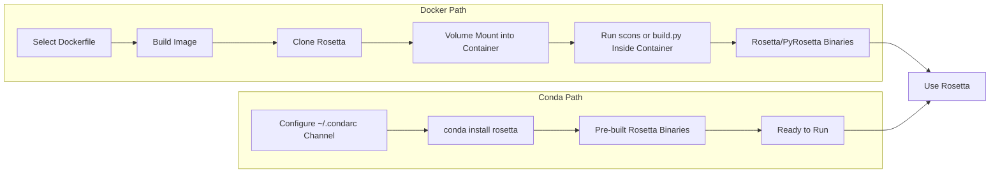
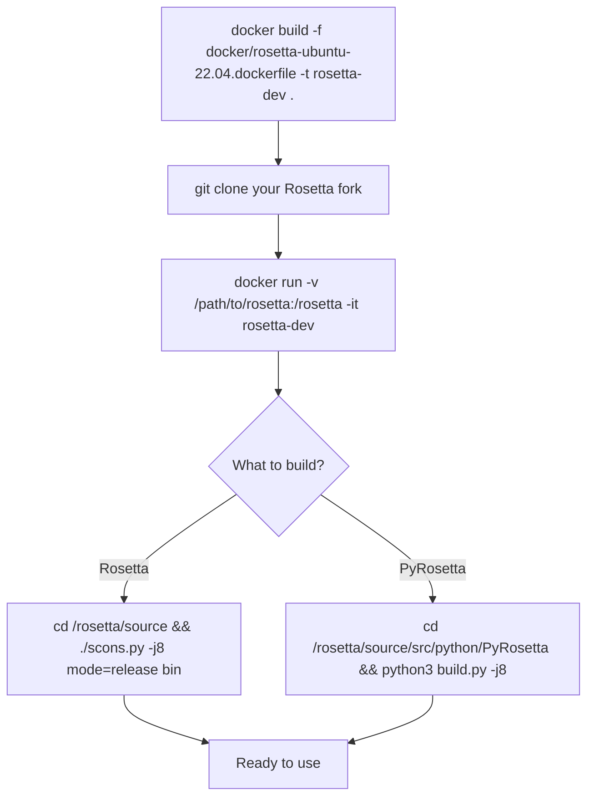

Rosetta provides two primary pathways for environment provisioning that bypass the complexities of manual compilation: **Docker containers** for fully isolated, reproducible builds and **Conda packages** for pre-built binary distributions. Both approaches abstract away compiler toolchain configuration, external dependency management, and the notoriously time-consuming Rosetta build process itself. This page covers the architecture of each approach, their configuration variants, and practical workflows for getting Rosetta or PyRosetta running with minimal friction.

## Environment Provisioning Architecture

The two provisioning paths serve complementary needs. Docker images are **self-contained build environments** — they provide the toolchain and dependencies but expect you to supply a cloned Rosetta source tree via volume mount. Conda packages, by contrast, deliver **pre-compiled Rosetta binaries** ready for direct execution without any build step. Understanding this distinction is critical for choosing the right approach.



| Criterion | Docker Images | Conda Packages |
|---|---|---|
| **What you get** | Build environment (compiler + deps) | Pre-compiled binary executables |
| **Requires source clone** | Yes — mounted at runtime | No |
| **Requires compilation** | Yes — you run the build | No — binaries are pre-built |
| **Isolation** | Full container isolation | Shares host environment |
| **PyRosetta included** | Yes (in most images) | Yes (as separate package) |
| **ML support** | Yes (via `rosetta-ml` image) | Depends on package variant |
| **Best for** | Developers modifying Rosetta | Users running existing protocols |

Sources: [README.md](README.md#L63-L161), [docker/README.md](docker/README.md#L1-L19)

## Docker Setup

### Official Images vs. Reference Recipes

The Docker ecosystem in this repository has two layers. The **official Docker Hub images** at `rosettacommons/rosetta` ship with Rosetta and PyRosetta pre-installed, including serial and MPI builds, Jupyter environments, and experimental ML-enabled builds. These are the fastest path to a working Rosetta environment. The **reference Dockerfiles** in the `docker/` directory serve as templates for building custom environments — they provide the toolchain and dependencies but **do not clone or build Rosetta**. You must mount your own source tree and run the build commands yourself.

Sources: [docker/README.md](docker/README.md#L1-L19)

### Available Dockerfile Variants

Each Dockerfile in `docker/` targets a specific combination of base OS and feature set:

| Dockerfile | Base Image | Purpose | Python | MPI | ML Libraries |
|---|---|---|---|---|---|
| [rosetta-ubuntu-22.04.dockerfile](docker/rosetta-ubuntu-22.04.dockerfile#L1-L43) | `ubuntu:22.04` | Primary reference — Rosetta + PyRosetta | Python 3 | MPICH | No |
| [rosetta-ubuntu-20.04.dockerfile](docker/rosetta-ubuntu-20.04.dockerfile#L1-L40) | `ubuntu:20.04` | Legacy reference build | Python 3 | MPICH | No |
| [rosetta-ubuntu-18.04.dockerfile](docker/rosetta-ubuntu-18.04.dockerfile#L1-L33) | `ubuntu:18.04` | Python 2.7 compatible build | Python 2.7 + 3 | No | No |
| [rosetta-alpine-3.9.dockerfile](docker/rosetta-alpine-3.9.dockerfile#L1-L19) | `alpine:3.9` | Minimal footprint build | Python 3 | No | No |
| [rosetta-ml.dockerfile](docker/rosetta-ml.dockerfile#L1-L48) | `ubuntu:22.04` | ML-enabled PyRosetta | Python 3 | No | TensorFlow + libtorch |

### Shared Dependency Stack (Ubuntu variants)

The Ubuntu-based Dockerfiles (22.04, 20.04, ML) share a common dependency foundation consisting of four layers. The first layer provides **core build tools** — `git`, `curl`, `cmake`, `ninja-build`, `build-essential`, and `clang` ([rosetta-ubuntu-22.04.dockerfile](docker/rosetta-ubuntu-22.04.dockerfile#L21-L26)). The second layer adds **system library development headers** required by Rosetta's C++ core — `zlib1g-dev`, `libssl-dev`, `libbz2-dev`, `libreadline-dev`, `libsqlite3-dev`, `liblzma-dev`, and `libffi-dev` ([rosetta-ubuntu-22.04.dockerfile](docker/rosetta-ubuntu-22.04.dockerfile#L28-L28)). The third layer installs the **Python 3 runtime and scientific stack** — `python3`, `python3-dev`, `python3-numpy`, `python3-setuptools`, and `python3-venv` ([rosetta-ubuntu-22.04.dockerfile#L30-L30)). Finally, optional layers add **static analysis tools** (`clang-tidy`, `clang-format`) and **documentation tooling** (`doxygen`, `graphviz`) ([rosetta-ubuntu-22.04.dockerfile#L38-L42).

The 22.04 variant is the most complete reference, adding MPI support via `mpich` and `mpi-default-dev`, plus the `python-dev-is-python3` convenience package ([rosetta-ubuntu-22.04.dockerfile#L37-L40).

### ML Image Specifics

The `rosetta-ml` Dockerfile extends the standard Ubuntu 22.04 stack with two deep learning frameworks critical for Rosetta's ML-enabled protocols. It downloads and installs **TensorFlow 1.15.0** (CPU-only) by extracting the pre-built C library to `/usr/local/lib/` and configuring `LIBRARY_PATH` and `LD_LIBRARY_PATH` ([rosetta-ml.dockerfile](docker/rosetta-ml.dockerfile#L34-L39)). It then installs **PyTorch 2.0.1** (CPU, C++11 ABI, shared with deps) by downloading `libtorch`, extracting it to a temporary location, and copying its contents into `/usr/local` ([rosetta-ml.dockerfile](docker/rosetta-ml.dockerfile#L42-L44). These libraries enable the `--torch` and `--tensorflow` flags in the PyRosetta build system ([source/src/python/PyRosetta/build.py](source/src/python/PyRosetta/build.py#L875-L876).

Sources: [rosetta-ml.dockerfile](docker/rosetta-ml.dockerfile#L1-L48)

### Building and Running a Docker Environment

The workflow for using reference Dockerfiles follows a three-step pattern: build the image, clone the source, then compile inside the container.



The key principle is that the Docker container provides the **build environment** while the host volume provides the **source code**. After building, the compiled binaries live inside the container's filesystem. To persist them, you can either commit the container to a new image or mount additional volumes for output directories.

> [!TIP]
> The `DEBIAN_FRONTEND=noninteractive` environment variable set in all Ubuntu Dockerfiles prevents `tzdata` and other packages from prompting for interactive input during `apt-get install`, which would hang in non-TTY Docker builds ([rosetta-ubuntu-22.04.dockerfile](docker/rosetta-ubuntu-22.04.dockerfile#L12-L12).

> [!TIP]
> All Ubuntu Dockerfiles comment out the final cleanup layer (`apt-get clean && rm -rf /var/lib/apt/lists/*`) by default. Uncommenting this line significantly reduces image size but prevents installing additional packages in derived images ([rosetta-ubuntu-22.04.dockerfile](docker/rosetta-ubuntu-22.04.dockerfile#L43-L43).

## Conda Setup

### Channel Configuration

Rosetta distributes pre-compiled binaries through its own Conda channel, with two geographic mirrors for reliability. All binaries are built with `serialization` and `cxx11thread` extras enabled. Configuration requires editing the `~/.condarc` file to add the appropriate channel URL.

**US West coast mirror** (recommended default):
```yaml
channels: 
  - https://conda.rosettacommons.org
  - conda-forge
```

**US East coast mirror**:
```yaml
channels: 
  - https://conda.graylab.jhu.edu
  - conda-forge
```

The `conda-forge` channel is specified as a fallback, providing access to supplementary packages like `ninja` and `cmake` that may be needed for development work even when using the pre-built binaries ([README.md](README.md#L86-L100).

Sources: [README.md](README.md#L86-L100)

### Installing Rosetta via Conda

Once the channel is configured, installation is a single command:

```bash
conda install rosetta
```

This installs pre-compiled Rosetta executables and the runtime database, eliminating the need for any C++ compilation. The `serialization` build extra means that Rosetta's checkpointing and object serialization capabilities are available out of the box, and `cxx11thread` enables modern C++ threading support.

### Conda vs. Docker Decision Guide

| Scenario | Recommended Approach | Reasoning |
|---|---|---|
| Running existing Rosetta protocols | **Conda** | Pre-built binaries, fastest setup |
| Following Rosetta tutorials | **Docker Hub** | Self-contained with Jupyter + PyRosetta |
| Modifying Rosetta C++ source | **Docker reference** | Full compiler toolchain in isolated env |
| Reproducing published results | **Docker Hub** | Version-pinned, reproducible images |
| Multi-user shared cluster | **Conda** | No root/Docker privileges required |
| ML-augmented protocols (trRosetta, ProteinMPNN) | **Docker ML image** | TensorFlow + libtorch pre-installed |
| Minimal disk footprint | **Conda** | Downloads only the package, not full OS |

Sources: [README.md](README.md#L63-L161)

## From Setup to Execution

After provisioning your environment through either Docker or Conda, the natural next step depends on your goal. If you want to understand how Rosetta's build system works under the hood (relevant when using Docker reference images for compilation), proceed to the [SCons Build System](6-scons-build-system) page. For an architectural overview of Rosetta's internal organization, see [Codebase Architecture](5-codebase-architecture). If you're specifically interested in PyRosetta's Python bindings and how they connect to the C++ core, the [PyRosetta Python Bindings](16-pyrosetta-python-bindings) page covers the binding generation pipeline. For ML-enabled workflows using the Docker ML image, the [trRosetta Deep Learning](21-trrosetta-deep-learning) and [ProteinMPNN Integration](22-proteinmpnn-integration) pages detail those specific integrations.