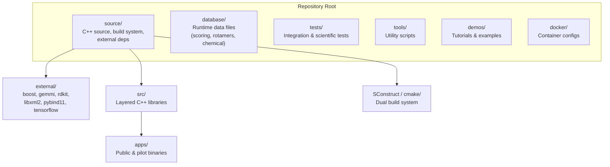
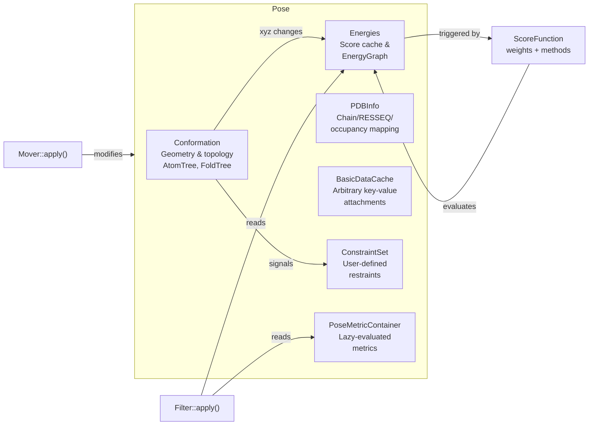
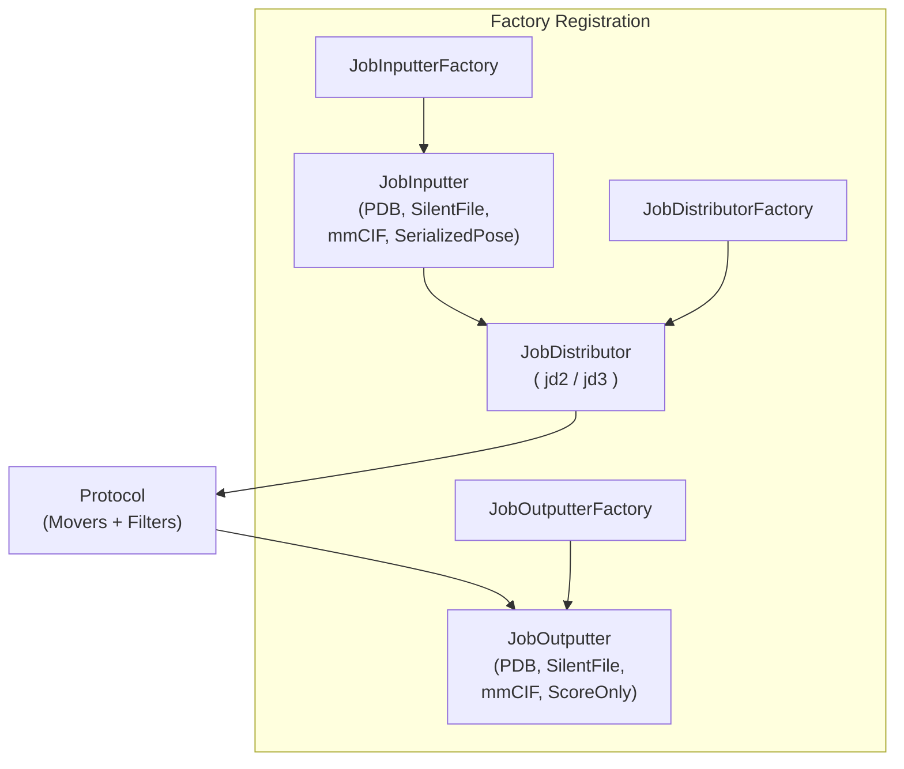

Rosetta is a monolithic C++ software suite for macromolecular modeling and design, organized around a strict layered library architecture. Understanding this architecture is essential before diving into individual subsystems, as the dependency flow dictates what can import what, where new code belongs, and how the build system orchestrates compilation across millions of lines of code. This page maps the structural skeleton — the top-level directories, the internal library layering, the shared programming idioms, and the data flow that binds it all together.

Sources: [SConstruct](source/SConstruct#L1-L8), [core/types.hh](source/src/core/types.hh#L30-L70)

## Top-Level Directory Map

The repository root divides into five functional zones. The **source/** directory is the heart of the project, containing all C++ source code, the build system, and external dependencies. The **database/** directory holds runtime data files — scoring parameters, rotamer libraries, chemical definitions — that Rosetta loads at startup rather than embedding in binary. The **tests/** directory contains integration and scientific validation tests. The **tools/** and **demos/** directories provide standalone scripts and tutorial materials, while **docker/** ships pre-configured container environments for reproducible builds.

Sources: [get_repo_structure source/](source/SConstruct), [get_repo_structure database/](database), [get_repo_structure source/external/](source/external)

## The Library Layer Hierarchy

All C++ code lives under `source/src/` and is organized into strictly ordered layers. Each layer may only depend on layers below it — never above. This dependency discipline is enforced by the build system through `.src.settings` files that declare inter-library linkages. The layers, from bottom to top, are:

**ObjexxFCL** — A vendored Fortran-compatible array library providing `FArray1D`, `FArray2D`, and other N-dimensional fixed-size arrays. Originally derived from the Objexx project, it bridges Rosetta's scientific computing heritage with modern C++. Its header at [ObjexxFCL/FArray2D.hh](source/src/ObjexxFCL/FArray2D.hh) is included throughout the scoring system for statistical potential tables.

**numeric** — Pure mathematical primitives: vectors (`xyzVector`), matrices (`xyzMatrix`), transformations (`xyzTransform`), quaternions, interpolation, clustering, and spatial data structures (KD-trees, voxel grids). These are the atomic units of geometric computation that every higher layer consumes. Critically, `numeric::xyzVector<core::Length>` is typedef'd as `core::PointPosition` in [core/types.hh](source/src/core/types.hh#L67-L69).

**utility** — The foundation for all Rosetta programming idioms: smart pointers ([owning_ptr.hh](source/src/utility/pointer/owning_ptr.hh)), the polymorphic base class `VirtualBase` ([VirtualBase.hh](source/src/utility/VirtualBase.hh#L37-L56)), the CRTP-based `SingletonBase` ([SingletonBase.hh](source/src/utility/SingletonBase.hh#L27-L54)), the factory/registration pattern ([factory/](source/src/utility/factory)), serialization, exception hierarchies, graph data structures, thread-safe MPI utilities, JSON spirit, and ubiquitous string/vector type aliases like `vector1` (1-indexed). The comment in `VirtualBase.hh` makes the architectural contract explicit: every polymorphic class in Rosetta must inherit from `VirtualBase` to guarantee a virtual destructor.

**basic** — Cross-cutting infrastructure that doesn't belong to any specific domain: the `Tracer` logging system, the global initialization gate ([basic/init.cc](source/src/basic/init.cc#L20-L29)), the option system (`basic/options/`), the resource manager, random number generators, profiling utilities, and the citation manager. The `init()` function sets a global flag that downstream code checks to detect forgotten initialization.

**core** — The central modeling engine. Due to its massive size, it is split across six compilation units (`core.1` through `core.6`) for parallel builds. It defines the fundamental data model of Rosetta: chemical types, poses, conformations, scoring, kinematics, energy methods, fragment picking, and packing. This is the domain of [Pose](source/src/core/pose/Pose.hh#L10-L25), [Conformation](source/src/core/conformation/Conformation.hh#L10-L17), [ScoreFunction](source/src/core/scoring/ScoreFunction.hh#L10-L17), and the `EnergyMethod` hierarchy. The comment in `Pose.hh` — *"almost every file in Rosetta #includes Pose.hh"* — underscores that this class is the gravitational center of the entire codebase.

**protocols** — Concrete modeling algorithms organized by scientific domain. With over 180 subdirectories, this is by far the largest layer. It implements everything from ab initio folding and relaxation to ligand docking, antibody design, membrane modeling, RNA structure prediction, and machine learning integration (trRosetta, ProteinMPNN). Each protocol directory typically contains Movers, Filters, and TaskOperations following the [Mover and Filter Hierarchy](11-mover-and-filter-hierarchy) pattern. Like core, it is split across multiple compilation units for build parallelism.

**apps** — Executable entry points split into `public/` (stable, documented applications like `relax`, `minimize`, `rosetta_scripts`) and `pilot/` (experimental code organized by developer). Each public app is a thin `main()` that delegates to the protocol layer through the Job Distributor.

**python** — PyRosetta bindings built with pybind11, living under `source/src/python/PyRosetta/`. This is covered in depth on the [PyRosetta Python Bindings](16-pyrosetta-python-bindings) page.

> [!TIP]
> The `.src.settings` files at each layer level (e.g., `core.1.src.settings`, `protocols.3.src.settings`) declare compile flags and link dependencies. If you introduce a new library or move code between layers, you must update the corresponding settings file — the build will fail with cryptic linker errors if the dependency graph has cycles.

Sources: [core/types.hh](source/src/core/types.hh#L30-L69), [VirtualBase.hh](source/src/utility/VirtualBase.hh#L21-L56), [SingletonBase.hh](source/src/utility/SingletonBase.hh#L19-L54), [Pose.hh](source/src/core/pose/Pose.hh#L16-L25), [basic/init.cc](source/src/basic/init.cc#L15-L31), [SConscript](source/src/SConscript.src)

## Core Namespace Anatomy

The `core` namespace is the single largest namespace in the codebase and serves as the domain model for structural biology. Its subdirectories under `source/src/core/` map directly to conceptual subsystems:

| Namespace | Directory | Responsibility |
|-----------|-----------|----------------|
| `core::id` | `core/id/` | Typed identifiers: `AtomID`, `TorsionID`, `DOF_ID`, `JumpID`, `SequenceMapping` — the address system for every degree of freedom |
| `core::chemical` | `core/chemical/` | Residue types, atom types, element types, orbital types, and the `ChemicalManager` singleton that loads type definitions |
| `core::conformation` | `core/conformation/` | `Residue`, `Conformation` (the geometric state container), `AtomTree`, membrane info |
| `core::kinematics` | `core/kinematics/` | `FoldTree`, `Jump`, `Stub`, `RT` (rigid-body transforms), `AtomTree` traversal, DOF management |
| `core::pose` | `core/pose/` | `Pose` (the full modeling container), `PDBInfo`, `MiniPose`, pose utilities, variant types |
| `core::scoring` | `core/scoring/` | `ScoreFunction`, `ScoreType` enum, `EnergyMap`, `Energies`, `ScoringManager`, `NeighborList`, `EnergyGraph` |
| `core::scoring::methods` | `core/scoring/methods/` | The `EnergyMethod` class hierarchy — the extensibility point for new energy terms |
| `core::pack` | `core/pack/` | Rotamer packing, rotamer sets, interaction graphs, packing statistics |
| `core::fragment` | `core/fragment/` | Fragment picker framework for ab initio folding |
| `core::optimization` | `core/optimization/` | Minimization algorithms (LBFGS, conjugate gradient, atom-tree minimizer) |
| `core::io` | `core/io/` | PDB and mmCIF file parsers (now via gemmi), silent-file I/O |
| `core::import_pose` | `core/import_pose/` | Pose loading utilities wrapping core::io |
| `core::simple_metrics` | `core/simple_metrics/` | Reusable metric calculators (RMSD, SASA, etc.) |
| `core::select` | `core/select/` | Residue selectors — logical predicates for choosing subsets of residues |

The `core::id` subsystem deserves special attention because it is the universal addressing scheme. An `AtomID` is a `(residue_number, atom_within_residue)` pair; a `DOF_ID` is a `(atom_id, dof_type)` pair; a `TorsionID` identifies a torsional degree of freedom by its structural context (BB, CHI, JUMP). This typed-ID pattern prevents the subtle index bugs that plague positionally-indexed code in other molecular modeling frameworks.

Sources: [core/id/](source/src/core/id), [core/scoring/ScoreFunction.hh](source/src/core/scoring/ScoreFunction.hh#L1-L54), [core/types.hh](source/src/core/types.hh#L47-L69)

## The Pose-Centric Data Flow

Everything in Rosetta revolves around the `Pose` object. It is not just a data container — it is an event-bus that coordinates updates between its constituent subsystems. Understanding the Pose's internal composition is the single most important architectural insight for working with Rosetta.

The `Pose` aggregates five major subsystems. The **Conformation** holds the actual 3D coordinates, managed through an `AtomTree` kinematic forest rooted at the FoldTree topology. When a Mover changes a torsion angle, the AtomTree propagates the coordinate update efficiently to only the downstream atoms. The **Energies** object caches the results of the last scoring evaluation in a dense neighbor-aware `EnergyGraph`, avoiding redundant computation. The **PDBInfo** maps Rosetta's internal residue numbering back to the author-assigned chain IDs and residue numbers, ensuring round-trip fidelity with PDB files. The **ConstraintSet** holds user-defined spatial restraints (distance, angle, dihedral). The **BasicDataCache** provides extensible storage for arbitrary data that protocols want to attach to a Pose.

The comment block at the top of `Pose.hh` reveals an important architectural constraint: because "almost every file in Rosetta #includes Pose.hh," any heavy header added to Pose.hh triggers a massive recompilation cascade. Only lightweight forward declarations and enum typedefs are permitted in its header — everything else must be forward-declared or placed in implementation files.

Sources: [Pose.hh](source/src/core/pose/Pose.hh#L16-L25), [Conformation.hh](source/src/core/conformation/Conformation.hh#L10-L17), [ScoreFunction.hh](source/src/core/scoring/ScoreFunction.hh#L10-L54)

## The Mover-Filter-Job Runtime Pattern

The execution model follows a three-stage pipeline: **input → processing → output**, each governed by a pluggable factory. The `protocols::jd2` (Job Distributor 2) namespace orchestrates this pipeline, with concrete implementations for filesystem, MPI, BOINC, and multi-threaded execution backends.

The Job Distributor iterates over input structures (each wrapped in a `Job` object), applies the user-specified protocol (a sequence of Movers), evaluates Filters, and writes results through the outputter. Each of these three points is extensible through a factory: `JobInputterFactory`, `JobDistributorFactory`, and `JobOutputterFactory`. The `jd2` namespace contains 15+ inputter and outputter implementations, from PDB/Silent file I/O to MPI-parallel and BOINC-volunteer computing backends.

> [!TIP]
> The "Creator" pattern is pervasive throughout Rosetta. For every pluggable component (Movers, Filters, JobInputters, ScoreTypes, EnergyMethods), there is a corresponding `*Creator` class and a `*Factory` that maintains a registry. Registration happens through static initialization — each translation unit defines a static `*Registrator` object whose constructor calls `Factory::register_creator()`. This means simply linking a new `.cc` file into the binary automatically makes its components available to the XML parser and the C++ API.

Sources: [protocols/jd2/](source/src/protocols/jd2), [utility/factory/Factory.hh](source/src/utility/factory/Factory.hh)

## Shared Programming Idioms

Rosetta enforces several coding conventions that are deeply embedded in its architecture and build infrastructure:

**1-indexed vectors everywhere.** The `utility::vector1<T>` template (an adapter around `std::vector` that shifts indices to start at 1) is used throughout the codebase instead of `std::vector`. This eliminates the off-by-one errors endemic to 0-indexed molecular modeling code, where residue 1 is the first residue, not residue 0.

**Forward declarations over includes.** The `.fwd.hh` pattern is mandatory across the entire codebase. For every `Foo.hh`, there is a `Foo.fwd.hh` containing only forward declarations and `OP`/`COP`/`AP` typedefs. This is not optional — the build system and code review process enforce it to keep compilation times manageable in a codebase where a single `.hh` can be transitively included by thousands of translation units.

**Singleton pattern via CRTP.** The `SingletonBase<T>` template ([SingletonBase.hh](source/src/utility/SingletonBase.hh#L27-L54)) provides thread-safe singleton semantics using C++11 function-scope static initialization. The `ScoringManager`, `ChemicalManager`, and dozens of other managers derive from it. The derived class must have a private constructor and declare `SingletonBase<T>` as a friend.

**XML-driven protocol composition.** The `protocols::rosetta_scripts` subsystem provides an XML parser that instantiates Movers, Filters, TaskOperations, and ScoreFunctions by name from the factory registries. This decouples protocol definition from protocol implementation and is the primary interface for non-C++-developers. The full framework is described on the [RosettaScripts XML Framework](14-rosettascripts-xml-framework) page.

**Option system.** The `basic/options/` system provides a hierarchical, type-safe command-line option framework. Options are declared as static `BooleanOptionKey`, `RealOptionKey`, `IntegerOptionKey`, `StringOptionKey`, etc., organized by namespace (e.g., `OptionKeys::relax::fast`). The option system is initialized during `core::init::init()` and is accessible globally.

Sources: [SingletonBase.hh](source/src/utility/SingletonBase.hh#L19-L54), [VirtualBase.hh](source/src/utility/VirtualBase.hh#L21-L56), [utility/factory/](source/src/utility/factory)

## External Dependencies

Rosetta vendors a significant number of third-party libraries under `source/external/` to ensure build reproducibility across platforms. The key dependencies are:

| Dependency | Location | Purpose |
|-----------|----------|---------|
| **boost_submod** | `external/boost_submod/` | Smart pointers, filesystem, containers (C++11-era subset) |
| **gemmi_repo** | `external/gemmi_repo/` | PDB and mmCIF file parsing (replacing the legacy parser) |
| **libxml2** | `external/libxml2/` | XML parsing for RosettaScripts |
| **rdkit** | `external/rdkit/` | Chemical informatics for ligand handling |
| **pybind11** | `external/pybind11/` | Python bindings for PyRosetta |
| **tensorflow** | `external/tensorflow/` | Deep learning inference (trRosetta, ProteinMPNN) |
| **libzmq** | `external/libzmq/` | ZeroMQ for distributed computing |
| **zlib** | `external/zlib-1.2.8/` | Compression for silent files |
| **scons-local** | `external/scons-local/` | Vendored SCons build tool |
| **ObjexxFCL** | `src/ObjexxFCL/` | Fortran-compatible array library (internal vendoring) |

The `*.external.settings` files in `source/external/` control which optional dependencies are enabled. For example, `rdkit.external.settings` configures the RDKit integration, while `bcl.external.settings` controls the BCL library for membrane protein folding. These settings feed into both the SCons and CMake build systems.

Sources: [external/](source/external), [external SConscript](source/external/SConscript.external)

## Build System Architecture

Rosetta supports two build systems that coexist: **SCons** (primary, used for production and release builds) and **CMake** (secondary, used for PyRosetta, IDE integration, and some CI workflows). Both share the same source layout and produce equivalent binaries.

The SCons build is orchestrated from `source/SConstruct`, which loads project settings, configures the compiler toolchain, and delegates to per-directory `SConscript` files. The `source/cmake/` directory contains over 40 build configuration presets (e.g., `build_release/`, `build_debug/`, `build_torch/`, `build_sharedmpi/`) that generate platform-specific CMake configurations. These are described in detail on the [SCons Build System](6-scons-build-system) and [CMake Build Configuration](7-cmake-build-configuration) pages.

The parallel compilation of the `core` and `protocols` layers (split into `core.1`–`core.6` and `protocols.1`–`protocols.8`, plus domain-specific sub-groups) is one of the key build optimizations that makes this multi-million-line codebase practical to compile. Each compilation unit is a separate shared library with its own `.src.settings` declaring its dependencies, allowing independent incremental builds.

Sources: [SConstruct](source/SConstruct#L1-L80), [cmake/](source/cmake)

## Where to Go Next

Now that you understand the architectural skeleton, the natural next step is to examine the build system that assembles it, or to dive into the core data structures that define Rosetta's computational model:

- **[SCons Build System](6-scons-build-system)** — How Rosetta compiles across platforms and manages its massive dependency graph
- **[Pose and Conformation](8-pose-and-conformation)** — A deep dive into the central data object that drives all computation
- **[ScoreFunction Framework](9-scorefunction-framework)** — How energy terms are composed, weighted, and evaluated
- **[Mover and Filter Hierarchy](11-mover-and-filter-hierarchy)** — The protocol composition pattern that makes Rosetta extensible
- **[RosettaScripts XML Framework](14-rosettascripts-xml-framework)** — The declarative interface for assembling protocols without writing C++