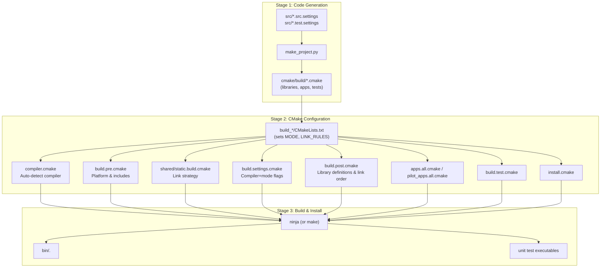
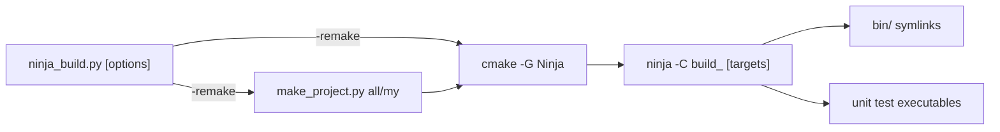

Rosetta's CMake build system operates as a two-stage code-generation pipeline: Python scripts read SCons-style `.src.settings` files to emit intermediate `.cmake` project definitions, which CMake then consumes alongside a layered chain of shared configuration modules. This architecture allows the CMake system to coexist with the legacy SCons build while leveraging CMake's superior IDE integration and Ninja's parallelism. This page documents every layer of that pipeline, from project scaffolding scripts down to per-compiler flag matrices.

Sources: [README](source/cmake/README), [ninja_build.py](source/ninja_build.py)

## Build Pipeline Architecture

The CMake system is not a standalone build definition — it is a *consumer* of the same `.src.settings` manifests that SCons uses. A Python preprocessing step (`make_project.py`) reads these manifests and generates per-library and per-application `.cmake` files into `source/cmake/build/`. The build directory's `CMakeLists.txt` then stitches these generated files together with a shared chain of configuration includes.



The three-stage design means that **any change to source file membership** (adding a new `.cc` file to a library, registering a new application) requires re-running `make_project.py` before CMake will see it. This is the most common source of "file not found" errors for developers migrating from SCons.

Sources: [make_project.py](source/cmake/make_project.py), [build_release/CMakeLists.txt](source/cmake/build_release/CMakeLists.txt)

## Build Variant Catalog

Rosetta ships with over 30 pre-configured build directories under `source/cmake/build_*/`, each containing a minimal `CMakeLists.txt` that sets the `MODE` and `LINK_RULES` variables and then includes the shared build chain. This table catalogs the most commonly used variants.

| Build Directory | MODE | LINK_RULES | Compiler Override | Key Purpose |
|---|---|---|---|---|
| `build_release` | `release` | `shared` | Auto-detect | Standard optimized build |
| `build_debug` | `debug` | `shared` | Auto-detect | Debug + unit tests (default) |
| `build_clang` | `release` | `shared` | `clang`/`clang++` | Clang-specific release |
| `build_omp` | `release` | `shared` | `gcc` (forced) | OpenMP parallelism (`-fopenmp`) |
| `build_release_static` | `release_static` | `static` | Auto-detect | Static linking for portability |
| `build_sharedmpi` | `release` | `shared` | Auto-detect | MPI with shared libraries |
| `build_staticmpi` | `release` | `static` | Auto-detect | MPI with static linking |
| `build_cxx11` | `release` | `shared` | Auto-detect | Explicit C++11 build |
| `build_cxx11_omp` | `release` | `shared` | Auto-detect | C++11 + OpenMP |
| `build_graphics` | `release` | `shared` | Auto-detect | Graphics/visualization support |
| `build_cxx11_windows_vs` | `release` | `shared` | `cl` (MSVC) | Windows Visual Studio |
| `build_torch` | `release` | `shared` | Auto-detect | PyTorch/ML integration |
| `build_zeromq` | — | `shared` | Auto-detect | ZeroMQ messaging layer |
| `build_clangSA` | `release` | `shared` | `clang` | Clang Static Analyzer |
| `build_clang_tidy` | `release` | `shared` | Auto-detect | Clang-Tidy linting |
| `build_PyRosetta.release` | `release` | `shared` | Auto-detect | PyRosetta Python bindings |
| `build_PyRosetta.debug` | `debug` | `shared` | Auto-detect | PyRosetta debug bindings |

Each variant's `CMakeLists.txt` follows an identical include sequence, differing only in the values of `MODE`, `LINK_RULES`, and optional compiler overrides. The full include chain for a standard variant is:

Sources: [build_release/CMakeLists.txt](source/cmake/build_release/CMakeLists.txt#L1-L34), [build_debug/CMakeLists.txt](source/cmake/build_debug/CMakeLists.txt#L1-L39)

```
INCLUDE(../build/compiler.cmake)
INCLUDE(../build/build.pre.cmake)
INCLUDE(../build/${LINK_RULES}.build.cmake)
INCLUDE(../build/build.settings.cmake)
INCLUDE(../build/build.post.cmake)
INCLUDE(../build/apps.all.cmake)
INCLUDE(../build/pilot_apps.all.cmake)
INCLUDE(../build/build.test.cmake)
INCLUDE(../build/install.cmake)
```

## Project Scaffolding: make_project.py

The `make_project.py` script is the bridge between Rosetta's SCons-era file manifests and the CMake build. It executes four preparatory steps before generating build files:

1. **`update_version()`** — Runs `version.py` to regenerate version strings
2. **`update_options()`** — Runs `update_options.sh` to regenerate option registration code
3. **`update_submodules()`** — Runs `update_submodules.sh` to fetch external dependencies
4. **`update_ResidueType_enum_files()`** — Regenerates ResidueType enumeration files

It then reads the `.src.settings` files and writes three categories of `.cmake` output into `source/cmake/build/`:

- **Library `.cmake` files** — Each library (e.g., `core.1`, `protocols.3`) gets a `<library>.cmake` file setting `<library>_files` as a list of source paths
- **Application `.cmake` files** — Each app under `src/apps/` gets a `<app>.cmake` file with `ADD_EXECUTABLE`, `TARGET_LINK_LIBRARIES`, compile/link property assignments, and symlinking rules
- **Test `.cmake` files** — Unit test manifests for CxxTest integration, setting `*_testfiles`, `*_testdirectories`, `*_testheaders`, and `*_testinputs`

The application `.cmake` generator also creates symlink targets that place executables into `source/bin/` with Rosetta's naming convention: `<app>.<platform><compiler><mode>` (e.g., `relax.linuxgccrelease`).

Sources: [make_project.py](source/cmake/make_project.py#L90-L188)

## Core Configuration Modules

The shared build infrastructure lives in `source/cmake/build/` and is organized into a strict include ordering. Each module has a specific responsibility in the configuration pipeline.

### compiler.cmake — Compiler Auto-Detection

Rather than letting build variants hardcode the compiler, `compiler.cmake` inspects `CMAKE_CXX_COMPILER_ID` and maps it to a `COMPILER` variable used by downstream modules. The detection logic follows a priority chain:

- If the compiler ID matches `.*[Cc][Ll][Aa][Nn][Gg].*` → sets `COMPILER clang`
- If `WIN32` is set → sets `COMPILER cl`
- Otherwise → sets `COMPILER gcc`

Crucially, this file **does not change which compiler CMake uses** — it only sets the Rosetta-internal `COMPILER` string that drives flag selection in `build.settings.cmake` and the executable extension suffix. To actually change compilers, you must set `$CC`/`$CXX` environment variables or pass `-DCMAKE_CXX_COMPILER` — and perform a clean rebuild, because CMake caches the compiler choice.

Sources: [compiler.cmake](source/cmake/build/compiler.cmake#L1-L43)

### build.pre.cmake — Platform and Include Setup

This module declares the project (`minirosetta`), sets archive creation policies (to fix linker issues on some platforms), and configures include paths. It handles platform detection via `APPLE`, `UNIX`, and `WIN32` conditionals, adding platform-specific directories under `src/platform/` and setting corresponding preprocessor defines (`-DMAC`, `-DLINUX`, `-DWIN32`). External dependency include paths are set with the `SYSTEM` directive to suppress warnings from third-party headers.

Sources: [build.pre.cmake](source/cmake/build/build.pre.cmake#L1-L50)

### build.settings.cmake — Compiler and Mode Flag Matrix

This is the largest and most critical configuration file at 704 lines. It defines a comprehensive flag matrix organized as a two-dimensional lookup: **compiler × build mode**. Each combination specifies compile flags, warning flags, preprocessor defines, and linker flags.

For **GCC**, the flag categories are:

| Category | Debug Mode | Release Mode |
|---|---|---|
| Optimization | `-O0` | `-O3 -ffast-math -fno-finite-math-only -funroll-loops -finline-functions -finline-limit=20000 -s` |
| Debug info | `-g -ggdb -ffloat-store` | (none) |
| Warnings | `-Wall -Wextra -pedantic -Werror -Wno-long-long -Wno-strict-aliasing` | Same + `-Wno-unused-variable -Wno-unused-parameter` |
| Defines | `-D_DEBUG -D_GLIBCXX_DEBUG` | `-DNDEBUG` |
| Base compile | `-pipe -ffor-scope -ftemplate-depth-256 -fPIC` | Same |
| Language | `-std=c++11` | `-std=c++11` |

For GCC versions above 8.1, the configuration additionally appends `-Wl,--no-as-needed` to both compile and link flags and removes the now-obsolete `-ffor-scope`.

For **Clang**, the release configuration uses `-O3 -w -std=c++11 -Qunused-arguments -DUNUSUAL_ALLOCATOR_DECLARATION -ftemplate-depth-256` with platform-specific standard library selection (`-stdlib=libstdc++` on Linux, `-stdlib=libc++` on macOS).

For **MSVC** (`cl`), the configuration uses `-permissive- -bigobj` with a curated set of warning suppressions (`-wd4018`, `-wd4101`, `-wd4244`, `-wd4251`, `-wd4267`, `-wd4275`, `-wd4305`, `-wd4996`) and defines `-DNOMINMAX -DWIN32_LEAN_AND_MEAN -DBOOST_ERROR_CODE_HEADER_ONLY -DBOOST_SYSTEM_NO_DEPRECATED -DBOOST_ALL_NO_LIB`. A global job pool of 4 link processes is enforced to prevent the MSVC linker from consuming all physical memory during parallel builds of Rosetta's massive static libraries.

> [!TIP]
> The `-Werror` flag is enabled for both GCC and Clang in the default `build.settings.cmake`. If you are building against a newer compiler version that introduces new warnings, you may need to either remove `-Werror` from the `warn` list or add specific `-Wno-<warning>` suppressions. The `build_release_werror` variant exists specifically to isolate this concern for CI workflows.

Sources: [build.settings.cmake](source/cmake/build/build.settings.cmake#L1-L200), [build.settings.cmake](source/cmake/build/build.settings.cmake#L200-L500)

### shared.build.cmake vs static.build.cmake — Linking Strategy

The `LINK_RULES` variable set in each variant's `CMakeLists.txt` determines which link module is included. The **shared** variant sets `LINK_TYPE SHARED` and links against `z dl stdc++` as external system libraries. It also configures RPATH handling for relocatable binaries — setting `CMAKE_INSTALL_RPATH` to search `${CMAKE_INSTALL_PREFIX}/lib`, `$ORIGIN/../lib`, and `@executable_path/../lib`, which allows Rosetta executables to find their shared libraries after installation.

The **static** variant sets `LINK_TYPE STATIC` and links against `z.a libcppdb-static.a`. On MSVC, it uses `zlib ws2_32` instead. Static builds are preferred for HPC environments and containerized deployments where library portability matters more than incremental link times.

Sources: [shared.build.cmake](source/cmake/build/shared.build.cmake#L1-L21), [static.build.cmake](source/cmake/build/static.build.cmake#L1-L9)

### build.post.cmake — Library Chaining and Target Hierarchy

After flags are set, `build.post.cmake` iterates over the `LIBRARIES` list (generated by `make_project.py` from the `.src.settings` files), includes each library's `.cmake` definition, creates the library target, and chains them into a sequential link order. The chaining is critical: each library depends on the previous one via `ADD_DEPENDENCIES`, and `TARGET_LINK_LIBRARIES` passes the accumulated link chain forward. This produces a deterministic link order that mirrors the SCons dependency resolution.

The module also defines the **build target hierarchy** used by Ninja/Make:

| Custom Target | Dependencies | Purpose |
|---|---|---|
| `libs` | `BUILD_ROSETTA_LIBS` | Build all Rosetta libraries only |
| `apps` | `BUILD_ROSETTA_LIBS` | Build public applications |
| `pilot_apps` | `BUILD_ROSETTA_LIBS` | Build pilot/experimental applications |
| `bin` | `apps` + `pilot_apps` | Build all executables |
| `unit` | `BUILD_ROSETTA_LIBS` | Build all unit test executables |

Sources: [build.post.cmake](source/cmake/build/build.post.cmake#L1-L36)

### external.cmake — Third-Party Dependency Management

Rosetta vendors its critical external dependencies in `source/external/` and builds them as part of the CMake pipeline. The `external.cmake` module iterates over `EXTERNAL_LIBRARIES`, reads each `external_<lib>.cmake` definition, and builds them with suppressed warnings (`-Wno-error -w` on non-MSVC compilers). The key vendored dependencies built here include:

- **cppdb** — A C++ database connectivity layer wrapping SQLite3
- **sqlite3** — Built from source with `SQLITE_OMIT_LOAD_EXTENSION`, `SQLITE_OMIT_DISABLE_LFS`, and `SQLITE_THREADSAFE=0`
- **zlib** — Compression library (platform-specific compile flags on MSVC: `-DZLIB_DLL=1 -DZLIB_WINAPI=1`)

The module also applies version-specific workarounds for GCC 4.9 and GCC 5.x/6.x/7.x to fix cppdb linking errors via `-fno-strict-aliasing -ldl` and `-Wl,--no-as-needed -ldl`.

Sources: [external.cmake](source/cmake/build/external.cmake#L1-L169)

## Unit Test Infrastructure

Unit tests use the **CxxTest** framework, vendored in `source/external/cxxtest/`. The `build.test.cmake` module automates the complete test lifecycle:

1. **Test registration** — Reads `test_<library>.cmake` files (generated by `make_project.py`) containing lists of test source files, directories, headers, and input files
2. **Code generation** — For each test `.cc` file, invokes `cxxtestgen.py --have-std --part` to generate a CxxTest runner
3. **Main wrapper** — Generates a root test runner per library using `cxxtestgen.py --error-printer --root`
4. **Compilation** — Builds each library's test as a single executable linked against all Rosetta libraries
5. **Input staging** — Copies test input files into the build tree using `CMAKE_COMMAND -E copy`

The Windows path uses `cmd /c` to invoke `cxxtestgen.py` due to CMake's `EXECUTE_PROCESS` requiring a binary executable on that platform.

Sources: [build.test.cmake](source/cmake/build/build.test.cmake#L1-L53)

## Building with ninja_build.py (Recommended)

The `ninja_build.py` script at `source/ninja_build.py` is the officially recommended entry point for CMake builds. It orchestrates the full pipeline — project generation, CMake configuration, and Ninja invocation — through a single command with intuitive abbreviations.



**First-time build:**
```bash
cd rosetta/main/source/
./ninja_build.py release -remake
```

**Subsequent incremental builds** (after editing `.cc`/`.hh` files but NOT `.src.settings`):
```bash
./ninja_build.py r
```

**After modifying `.src.settings` files:**
```bash
./ninja_build.py r -remake
```

### Command Reference

| Flag | Description |
|---|---|
| `release` / `r` | Optimized release build |
| `debug` / `d` | Debug build with unit tests |
| `rs` | Release with static linking |
| `z` | ZeroMQ messaging build |
| `m` | C++11 threading build |
| `-remake` | Re-run `make_project.py` + `cmake` |
| `-my` | Use `*.src.settings.my` instead of `*.src.settings.all` |
| `-t <target>` | Build specific target(s): `bin`, `apps`, `pilot_apps`, `unit`, `relax`, etc. |
| `-j <N>` | Override Ninja's auto-detected parallelism |
| `-k` | Keep building on errors (up to 5000) |
| `-v` | Verbose output (show actual compiler commands) |
| `-clean` | Remove all generated files in build directory |
| `-install <path>` | Install relocatable binaries to given path |

The script validates that both `cmake` and `ninja` are on `PATH` before proceeding and provides clear error messages if prerequisites are missing.

Sources: [ninja_build.py](source/ninja_build.py#L1-L138)

## Manual CMake Workflow

For developers who prefer direct control over CMake, the manual workflow follows three steps:

```bash
cd rosetta/main/source/cmake/

# Step 1: Generate CMake project files from src.settings
./make_project.py all          # or "my" for restricted build

# Step 2: Configure with CMake
cd build_release/
cmake -G Ninja                 # or "cmake ." for Make

# Step 3: Build
ninja                          # or "make"
ninja -v                       # verbose compiler commands
ninja relax                    # build single application
ninja core                     # build single library sub-target
```

For Make-based builds, the `/fast` suffix skips dependency checking for already-built libraries:
```bash
make myapp/fast    # rebuild only myapp, skip dependency checks
make VERBOSE=1     # show full compiler commands
```

> [!TIP]
> CMake caches the compiler selection from the first invocation in a clean build directory. Changing `$CC`/`$CXX` or `-DCMAKE_CXX_COMPILER` on subsequent runs will have no effect — you must delete the build directory contents and re-run from scratch. This is a fundamental difference from SCons, which re-evaluates compiler selection on every invocation.

Sources: [README](source/cmake/README#L18-L135)

## Installation and Relocation

The `install.cmake` module configures a relocatable installation layout. Running `ninja install` (or `cmake --install .`) produces:

```
<install_prefix>/
├── bin/          # All executables
├── lib/          # Shared/static libraries
└── database/     # Full Rosetta database (copied from source)
```

During installation, the `score` application is automatically executed against a test PDB to generate binary Dunbrack rotamer files — a post-install step that ensures the database is in a usable state. The `CMAKE_SKIP_INSTALL_ALL_DEPENDENCY` policy is set to `TRUE`, allowing partial installations (e.g., `ninja rosetta_scripts && ninja install`) without triggering a full rebuild.

Sources: [install.cmake](source/cmake/build/install.cmake#L1-L25)

## Creating Custom Build Configurations

The `make_new_build.py` script (located at `source/cmake/make_new_build.py`) scaffolds new build variant directories. For manual creation, the pattern is straightforward — create a new `build_<name>/CMakeLists.txt` with the desired configuration variables:

```cmake
CMAKE_MINIMUM_REQUIRED(VERSION 2.6)
SET(MODE release)           # "release", "debug", or custom
SET(LINK_RULES shared)      # "shared" or "static"
SET(CMAKE_EXPORT_COMPILE_COMMANDS 1)

INCLUDE(../build/compiler.cmake)
INCLUDE(../build/build.pre.cmake)
INCLUDE(../build/${LINK_RULES}.build.cmake)
INCLUDE(../build/build.settings.cmake)
INCLUDE(../build/build.post.cmake)

INCLUDE(../build/apps.all.cmake)
INCLUDE(../build/pilot_apps.all.cmake)
INCLUDE(../build/build.test.cmake)
INCLUDE(../build/install.cmake)
```

For build variants that need non-standard flags (like the OpenMP variant), the generated flags from `build.settings.cmake` can be overridden by setting `COMPILE_FLAGS`, `CMAKE_CXX_FLAGS`, and `CMAKE_EXE_LINKER_FLAGS` directly in the variant's `CMakeLists.txt` after including the standard chain.

Sources: [build_omp/CMakeLists.txt](source/cmake/build_omp/CMakeLists.txt#L1-L25), [build_clang/CMakeLists.txt](source/cmake/build_clang/CMakeLists.txt#L1-L25)

## SCons Coexistence and Migration Context

The CMake build system was designed to coexist with the SCons build system documented in [SCons Build System](6-scons-build-system). Both systems read the same `.src.settings` manifest files, ensuring source file lists remain synchronized. The key architectural difference is that SCons evaluates its build graph dynamically on every invocation, while CMake requires explicit regeneration via `make_project.py` when source membership changes.

The `gen_cmake_build.py` utility at `source/cmake/gen_cmake_build.py` demonstrates the original bridge concept: it parses `tools/build/basic.settings` (the SCons configuration) and extracts settings matching a given build tag, providing a reference for how SCons settings map to CMake equivalents. This script is primarily of historical interest now, as `build.settings.cmake` has evolved to be independently maintained.
