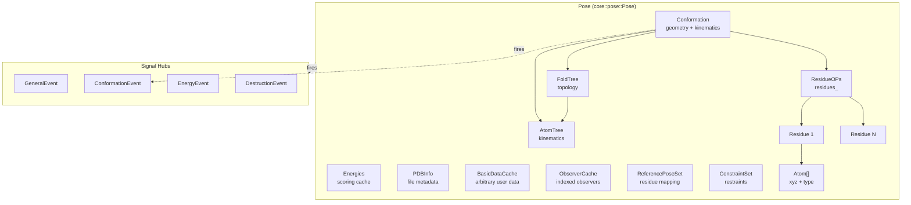
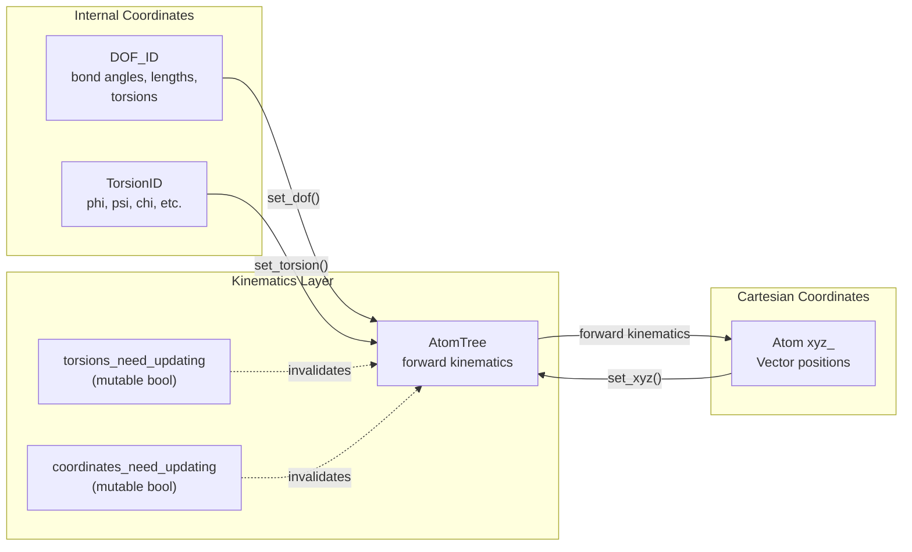

The **Pose** is the central data structure in all of Rosetta — the atomic unit of computation that flows through every protocol, mover, and scorer. Understanding Pose and its Conformation subsystem is prerequisite to effective work in any domain of the codebase. This page dissects their architecture, the relationship between internal (torsion/DOF) and external (Cartesian) coordinates, the observer pattern that binds them together, and the extension points available to developers.

## Architectural Overview

Pose is not a monolithic class. It is a **coordinating façade** that composes four major subsystems — Conformation (geometry and kinematics), Energies (scoring cache), PDBInfo (file-format metadata), and a signal network (observer notifications). The header itself carries a stark warning: nearly every file in Rosetta includes Pose.hh, so unnecessary includes here trigger massive recompilation [Pose.hh](source/src/core/pose/Pose.hh#L16-L25).

The class declaration at line 162 makes this composition explicit: Pose inherits from `utility::VirtualBase` and `enable_shared_from_this<Pose>`, providing both polymorphic ownership and safe weak-pointer access [Pose.hh](source/src/core/pose/Pose.hh#L162-L163).

## Core Responsibilities of Pose

The official documentation in the Pose header enumerates three responsibilities [Pose.hh](source/src/core/pose/Pose.hh#L117-L142):

| Responsibility | Description | Key Methods |
|---|---|---|
| **Kinematic** | (a) Update xyz coordinates when internal DOFs change; (b) Update internal coordinates when xyz changes | `set_phi()`, `set_xyz()`, `set_jump()`, `dof()`, `set_dof()` |
| **Scoring** | (a) Track what parts changed since last evaluation; (b) Cache residue and residue-pair energies | `energies()`, `scoring_begin()`, `scoring_end()` |
| **Container** | Single object for passing molecular systems; copying whole molecules or stretches between Poses | `assign()`, `detached_copy()`, `clone()`, `append_pose_by_jump()` |

> [!TIP]
> Calling `pose.residue(seqpos)` triggers a **refold** if torsions or coordinates are out-of-date. In contrast, `pose.residue_type(seqpos)` does not trigger a refold. This distinction matters in performance-critical loops — use the lighter accessor when you only need type information.

## Conformation: The Geometry Engine

`core::conformation::Conformation` is defined as "a container of Residues and the kinematics to manage them" [Conformation.hh](source/src/core/conformation/Conformation.hh#L90-L91). It inherits from `utility::VirtualBase` and `enable_shared_from_this<Conformation>`, mirroring Pose's ownership model [Conformation.hh](source/src/core/conformation/Conformation.hh#L91).

### Private Data Layout

The Conformation's private data section reveals its internal architecture [Conformation.hh](source/src/core/conformation/Conformation.hh#L1710-L1800):

| Member | Type | Purpose |
|---|---|---|
| `residues_` | `ResidueOPs` | Owning container of all residues |
| `residue_type_sets_` | `CacheableResidueTypeSets` | Conformation-specific residue type definitions (copy-on-write) |
| `chain_endings_` | `vector1<Size>` | Positions marking chain boundaries |
| `fold_tree_` | `FoldTreeOP` | Topological connectivity of residues |
| `atom_tree_` | `AtomTreeOP` | Kinematic tree for DOF propagation |
| `membrane_info_` | `MembraneInfoOP` | Membrane protein environment data |
| `tree_set_observer_` | `GlycanTreeSetObserverOP` | Carbohydrate tree connectivity |
| `parameters_set_` | `vector1<ParametersSetOP>` | Parametric conformation generation data |
| `contains_carbohydrate_residues_` | `bool` | Carbohydrate presence flag |
| `residue_coordinates_need_updating_` | `bool mutable` | Dirty flag for coordinate sync |
| `residue_torsions_need_updating_` | `bool mutable` | Dirty flag for torsion sync |
| `dof_moved_` | `AtomID_Mask` | Tracks which DOFs changed (for energy caching) |
| `xyz_moved_` | `AtomID_Mask` | Tracks which xyz coords changed |
| `structure_moved_` | `bool mutable` | Global movement flag since last reset |
| `secstruct_` | `vector1<char>` | Per-residue secondary structure assignments |

The five signal hubs at the bottom (`connection_obs_hub_`, `general_obs_hub_`, `identity_obs_hub_`, `length_obs_hub_`, `xyz_obs_hub_`) form the observer backbone [Conformation.hh](source/src/core/conformation/Conformation.hh#L1786-L1800).

### Chain Management

Chains in Rosetta are tracked via the `chain_endings_` vector. The relationship between chain numbers, chain letters, and jumps is carefully documented in the Pose header [Pose.hh](source/src/core/pose/Pose.hh#L1370-L1399):

- **Chain numbers (ids)** belong to Conformation — sequentially numbered positive integers for consecutively numbered residues that are chemically connected.
- **Chain letters** belong to PDBInfo — arbitrary single characters with no ordering guarantees.
- **Jumps** belong to FoldTree — specify how movement propagates; a single chain may span multiple jumps.

Key accessors delegate directly to Conformation: `chain_begin(chain)`, `chain_end(chain)`, `num_chains()` [Conformation.hh](source/src/core/conformation/Conformation.hh#L292-L322).

### Mode Detection

Conformation provides convenience methods for detecting the representation level [Conformation.hh](source/src/core/conformation/Conformation.hh#L253-L266):

| Method | Returns true when |
|---|---|
| `is_fullatom()` | Majority of residues use `FULL_ATOM` typeset |
| `is_centroid()` | Majority of residues use `CENTROID` typeset |
| `is_mixed_mode()` | Residues span multiple typeset modes |
| `is_membrane()` | `membrane_info_` is non-null |
| `contains_carbohydrate_residues()` | Carbohydrate flag is set |

## Residue Manipulation API

Pose provides a rich vocabulary for structural modification, divided into append, insert, replace, and delete operations [Pose.hh](source/src/core/pose/Pose.hh#L456-L619):

### Append Operations

| Method | Connection Type | Key Parameters |
|---|---|---|
| `append_residue_by_jump()` | Rigid-body jump | anchor residue, anchor/root atoms, start_new_chain |
| `append_residue_by_bond()` | Covalent bond | build_ideal_geometry, connection number, anchor residue/connection |
| `append_residue_by_atoms()` | Covalent by atom name | connect_atom, anchor atom names (wraps `append_residue_by_bond`) |
| `append_pose_by_jump()` | Whole pose by jump | Source pose, anchor residue |
| `append_polymer_residue_after_seqpos()` | Polymer bond after position | build_ideal_geometry |
| `prepend_polymer_residue_before_seqpos()` | Polymer bond before position | build_ideal_geometry |

### Replace and Delete

`replace_residue(seqpos, new_rsd, orient_backbone)` swaps a residue at a given position, optionally reorienting the backbone to match the existing frame [Pose.hh](source/src/core/pose/Pose.hh#L563-L569). An overload accepts explicit atom-pair mappings for superposition [Pose.hh](source/src/core/pose/Pose.hh#L574-L580).

Deletion is available via `delete_polymer_residue(seqpos)` (fast, polymer-only) and `delete_residue_slow(seqpos)` (general, handles jumps/root) [Pose.hh](source/src/core/pose/Pose.hh#L606-L616).

## Atom: The Coordinate Primitive

The `conformation::Atom` class is deliberately minimal — a stark contrast to `chemical::Atom` which describes chemical properties. The header explicitly notes this distinction [Atom.hh](source/src/core/conformation/Atom.hh#L33-L37):

> This atom class differs from chemical::Atom, AtomType, and AtomTypeSet in that it only contains the information about the xyz coordinates.

The class holds exactly three data members [Atom.hh](source/src/core/conformation/Atom.hh#L129-L143):

| Member | Type | Purpose |
|---|---|---|
| `xyz_` | `numeric::xyzVector<Real>` | 3D position in Angstroms |
| `type_` | `ShortSize` | Rosetta atom type index (for Lennard-Jones) |
| `mm_type_` | `ShortSize` | MM atom type index (for CHARMM LJ) |

`chemical::Atoms` are stored in `chemical::ResidueType` (the ResidueGraph), while `conformation::Atoms` are stored in `conformation::Residue` — the former defines the template, the latter the instance [Atom.hh](source/src/core/conformation/Atom.hh#L36-L38).

## Torsion Angle Access

Pose provides two tiers of torsion access: **convenience methods** for standard backbone/sidechain angles, and **generic access** through `TorsionID`.

### Backbone Torsions (Peptides)

Convenience methods `phi()`, `psi()`, `omega()` operate on residue sequence positions and return/accept degrees [Pose.hh](source/src/core/pose/Pose.hh#L1008-L1083). For non-standard backbones, `theta()` (beta-amino acids, oligoureas) and `mu()` (oligoureas) are provided [Pose.hh](source/src/core/pose/Pose.hh#L1085-L1143).

### Nucleic Acid Torsions

Six backbone torsions — `alpha()`, `beta()`, `gamma()`, `delta()`, `epsilon()`, `zeta()` — cover the nucleic acid backbone [Pose.hh](source/src/core/pose/Pose.hh#L1145-L1299).

### Sidechain and Generic Access

Chi angles use `chi(chino, seqpos)` for peptides/saccharides and `chi(seqpos)` for nucleic acids [Pose.hh](source/src/core/pose/Pose.hh#L1305-L1363). The generic `torsion(TorsionID)` and `set_torsion(TorsionID, setting)` methods provide uniform access for any torsion type [Pose.hh](source/src/core/pose/Pose.hh#L1571-L1586).

### AtomTree DOF Access

Below the torsion level, raw DOFs are accessible via `dof(DOF_ID)` and `set_dof(DOF_ID, setting)` [Pose.hh](source/src/core/pose/Pose.hh#L1592-L1606). Cartesian coordinates are accessed through `xyz(AtomID)`, `set_xyz(AtomID, point)`, and batch variants `batch_set_xyz()`/`batch_get_xyz()` for performance [Pose.hh](source/src/core/pose/Pose.hh#L1616-L1671).

## Coordinate System Duality

The relationship between internal coordinates (torsions/DOFs) and Cartesian coordinates (xyz) is mediated by the AtomTree and guarded by dirty flags in Conformation.

When `set_phi()` or `set_dof()` is called, Conformation marks `residue_coordinates_need_updating_` as true [Conformation.hh](source/src/core/conformation/Conformation.hh#L1754-L1755). The next call to `residue(seqpos)` or `xyz()` triggers the AtomTree refold. Conversely, when `set_xyz()` modifies coordinates, `residue_torsions_need_updating_` is set [Conformation.hh](source/src/core/conformation/Conformation.hh#L1757-L1758).

## Observer and Signal Architecture

Both Pose and Conformation use a signal/hub pattern for loose coupling between subsystems. Pose exposes four signal attachment points [Pose.hh](source/src/core/pose/Pose.hh#L1857-L1899):

| Signal Hub | Event Type | Trigger |
|---|---|---|
| `destruction_obs_hub_` | `DestructionEvent` | Pose destruction |
| `general_obs_hub_` | `GeneralEvent` | Any derived signal (superset) |
| `energy_obs_hub_` | `EnergyEvent` | Scoring state changes |
| `conformation_obs_hub_` | `ConformationEvent` | Structural changes |

Conformation adds five more [Conformation.hh](source/src/core/conformation/Conformation.hh#L1786-L1800):

| Signal Hub | Event Type | Trigger |
|---|---|---|
| `connection_obs_hub_` | `ConnectionEvent` | Observer attachment/detachment |
| `general_obs_hub_` | `GeneralEvent` | Any conformation signal |
| `identity_obs_hub_` | `IdentityEvent` | Residue identity changes |
| `length_obs_hub_` | `LengthEvent` | Insertions/deletions |
| `xyz_obs_hub_` | `XYZEvent` | Coordinate changes |

> [!TIP]
> Conformation's `general_obs_hub_` is a `PausableSignalHub`, unlike the `BufferedSignalHub` used for other event types. This allows bulk operations to temporarily suppress general notifications, then fire a single summary event — a critical optimization for fragment insertion and large-scale remodels.

## I/O and Serialization

Pose supports export to multiple formats through a unified `dump_file()` method that dispatches based on file extension [Pose.hh](source/src/core/pose/Pose.hh#L1790-L1801):

| Method | Format | Notes |
|---|---|---|
| `dump_pdb(filename)` | PDB | Returns bool for success |
| `dump_pdb(ostream)` | PDB | Stream variant |
| `dump_pdb(ostream, residue_indices)` | PDB | Subset output |
| `dump_scored_pdb(filename, scorefxn)` | PDB + scores | Includes per-residue energy annotations |
| `dump_cif(filename)` | mmCIF | |
| `dump_mmtf(filename)` | MMTF | Binary format |
| `dump_file(filename)` | Auto-detected | Dispatches by extension |

Both Pose and Conformation support Cereal serialization via `save()`/`load()` template methods, enabled by the `SERIALIZATION` preprocessor guard [Pose.hh](source/src/core/pose/Pose.hh#L106-L109), [Conformation.hh](source/src/core/conformation/Conformation.hh#L79-L82).

## Pose Subsystems at a Glance

The `source/src/core/pose/` directory reveals the full scope of Pose's supporting infrastructure:

| Subdirectory/Module | Purpose |
|---|---|
| `datacache/` | `ObserverCache`, `CacheableDataType`, `CacheableObserver` hierarchy |
| `metrics/` | `PoseMetricCalculatorBase`, `CalculatorFactory` for runtime structural metrics |
| `reference_pose/` | `ReferencePoseSet` — residue index mapping across structural changes |
| `signals/` | `ConformationEvent`, `DestructionEvent`, `EnergyEvent`, `GeneralEvent` |
| `full_model_info/` | RNA/protein modeling parameters for stepwise assembly |
| `rna/` | RNA-specific data: base pairs, base stacks, suite names |
| `copydofs/` | `CopyDofs` — selective DOF copying between poses |
| `symmetry/` | Symmetric pose utilities |
| `carbohydrates/` | Carbohydrate pose manipulation utilities |

## Deep Copy vs. Assignment

Pose provides two distinct copying semantics with critical differences [Pose.hh](source/src/core/pose/Pose.hh#L226-L233):

- `operator=(src)` performs a **shallow-aware copy** where two Poses may share non-bitwise-constant data through the AtomTree observer system. This is fast but creates coupling.
- `detached_copy(src)` performs a **deep copy** guaranteeing no shared mutable data. The resulting Pose is fully independent.

The same pattern exists on Conformation with `operator=` vs. `detached_copy()` [Conformation.hh](source/src/core/conformation/Conformation.hh#L163-L172). Always use `detached_copy()` when passing poses across protocol boundaries that modify structure independently.

## Specialized Conformations

Conformation is designed for extension through inheritance. The codebase includes notable derived classes in `source/src/core/conformation/symmetry/`:

- **`SymmetricConformation`** — extends Conformation with symmetry-aware kinematics via `SymmetryInfo` [symmetry/SymmetricConformation.hh](source/src/core/conformation/symmetry/SymmetricConformation.hh)
- **`MirrorSymmetricConformation`** — handles mirror symmetry constraints

The `same_type_as_me()` virtual method enables runtime type checking between Conformation instances [Conformation.hh](source/src/core/conformation/Conformation.hh#L208-L210), and `set_new_conformation(ConformationCOP)` on Pose allows swapping the entire conformation backend [Pose.hh](source/src/core/pose/Pose.hh#L298-L301).

## Where to Go Next

Having understood Pose and Conformation, the natural progression follows the data flow through Rosetta's architecture. The [ScoreFunction Framework](9-scorefunction-framework) describes how the `Energies` object within Pose gets populated and used. The [Mover and Filter Hierarchy](11-mover-and-filter-hierarchy) shows how protocols transform Pose objects. For the kinematic underpinnings — FoldTree and AtomTree — consult [Monte Carlo Sampling](12-monte-carlo-sampling) which depends heavily on jump manipulation. Finally, [Symmetry Modeling](24-symmetry-modeling) and [Membrane Protein Modeling](25-membrane-protein-modeling) demonstrate how specialized Conformation subclasses extend this architecture for domain-specific needs.