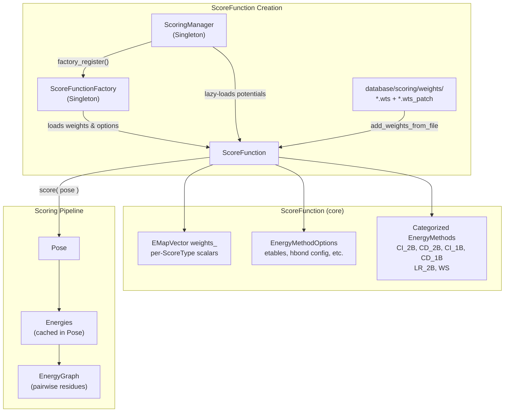
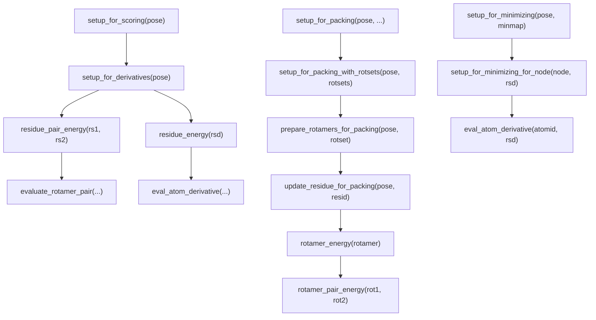

The ScoreFunction is the central nervous system of Rosetta's energy evaluation — the object that decides *what* physics to compute, *how much* each term matters, and *when* to invoke expensive calculations. Every protocol that evaluates, compares, or optimizes protein structures ultimately passes through a ScoreFunction. This document dissects the framework's architecture, its extension mechanisms, and the practical patterns you'll encounter when customizing or debugging scoring behavior across Rosetta's codebase.

## Architectural Overview

At its highest level, the ScoreFunction framework follows a **weighted-sum composition pattern**: a `ScoreFunction` object holds an `EMapVector` of per-term weights and a categorized collection of `EnergyMethod` instances. When `score(pose)` is called, only methods whose corresponding weight is non-zero are evaluated — this zero-weight culling is the framework's primary performance lever. The result is a single scalar (the total score) plus a rich decomposition stored in the `Pose`'s `Energies` object.



This diagram illustrates the two-phase lifecycle: **construction** (factory creates, loads weights, instantiates methods) followed by **evaluation** (pose is scored, energies cached in its `Energies` object). The key insight is that weights drive method selection — setting a weight to zero effectively disables that term without removing the method.

## Core Classes and Their Relationships

### ScoreFunction

The `ScoreFunction` class, defined in [ScoreFunction.hh](source/src/core/scoring/ScoreFunction.hh#L91-L120), inherits from `utility::VirtualBase` and `enable_shared_from_this`. It is the user-facing orchestrator. Its constructor delegates to `reset()`, which clears all weights and calls `initialize_methods_arrays()` to prepare categorized method containers. The class explicitly makes its copy constructor and assignment operator private — you must use `clone()` instead, which preserves subclass information through virtual dispatch ([ScoreFunction.cc](source/src/core/scoring/ScoreFunction.cc#L136-L142)).

The categorized method typedefs reveal the framework's taxonomy for energy computations:

| Category | Typedef | Evaluation Scope |
|---|---|---|
| **CI_2B_Methods** | `ContextIndependentTwoBodyEnergyOP` | Pairwise, residue-level, no environment dependence |
| **CD_2B_Methods** | `ContextDependentTwoBodyEnergyOP` | Pairwise, residue-level, depends on structural context |
| **CI_1B_Methods** | `ContextIndependentOneBodyEnergyOP` | Per-residue, no environment dependence |
| **CD_1B_Methods** | `ContextDependentOneBodyEnergyOP` | Per-residue, depends on structural context |
| **CI_LR_2B / CD_LR_2B** | `ContextIndependentLRTwoBodyEnergyOP` | Long-range pairwise (beyond neighbor cutoff) |
| **WS_Methods** | `WholeStructureEnergyOP` | Global terms over the entire pose |

The distinction between **context-independent** and **context-dependent** is critical for caching. Context-independent two-body energies are cached in the `EnergyGraph` and reused across scoring rounds; context-dependent energies must be recomputed when the structural context changes. This categorization is declared at [ScoreFunction.hh](source/src/core/scoring/ScoreFunction.hh#L102-L117).

### ScoreType Enumeration

Every energy term in Rosetta corresponds to a `ScoreType` enum value defined in [ScoreType.hh](source/src/core/scoring/ScoreType.hh#L35-L120). The enum starts at `fa_atr = 1` (for `utility::vector1` compatibility) and extends to several hundred types covering full-atom physics (`fa_atr`, `fa_rep`, `fa_sol`), electrostatics (`fa_elec`), hydrogen bonding (`hbond_sr_bb`, `hbond_lr_bb`), knowledge-based terms (`rama_prepro`, `p_aa_pp`), and domain-specific terms (RNA, membrane, DNA). The comment block at the top of the file warns that any new `ScoreType` must also be registered in `ScoreTypeManager.cc` with its string name for serialization and weights-file parsing ([ScoreType.hh](source/src/core/scoring/ScoreType.hh#L25-L30)).

### EMapVector (EnergyMap)

The `EMapVector` class in [EnergyMap.hh](source/src/core/scoring/EnergyMap.hh#L43-L99) is a fixed-size `std::array<Real, n_score_types>` that provides ScoreType-indexed access to energy values. Its critical operation is the `dot()` method ([EnergyMap.hh](source/src/core/scoring/EnergyMap.hh#L153-L161)), which computes the weighted sum over non-zero terms — this is how the total score is calculated from the component energy map. The `zero()` method is essential between uses since the same `EMapVector` objects are often reused across residue pairs to avoid allocation overhead.

## ScoreFunctionFactory and Weight Files

### Factory Pattern

`ScoreFunctionFactory` is a `SingletonBase` ([ScoreFunctionFactory.hh](source/src/core/scoring/ScoreFunctionFactory.hh#L90-L91)) that provides static `create_score_function()` overloads. These accept a weights tag (e.g., `"ref2015"`), an optional patch tag, and an optional `OptionCollection` for thread-local configuration. The factory uses a `ScoreFunctionKey` struct ([ScoreFunctionFactory.hh](source/src/core/scoring/ScoreFunctionFactory.hh#L55-L87)) — a tuple of weights filename, comma-separated patches, and a raw pointer to the `OptionCollection` — to cache previously loaded score functions in a `std::map`. Each call returns a `clone()` of the cached instance, making repeated constructions from the same weights tag essentially free.

The `_add_weights_from_stream()` method ([ScoreFunction.cc](source/src/core/scoring/ScoreFunction.cc#L263-L349)) parses weight files, which support a rich set of directives beyond simple weight assignments:

| Directive | Effect |
|---|---|
| `ETABLE <name>` | Selects the Etable (Lennard-Jones + solvation) parameterization |
| `METHOD_WEIGHTS <type> <w1> <w2>...` | Sets per-method sub-weights for multi-component terms |
| `NO_PROTEIN_PROTEIN_FA_ELEC` | Excludes protein-protein electrostatic interactions |
| `NO_HB_ENV_DEP` | Disables environment-dependent hydrogen bond scoring |
| `PUT_INTRA_INTO_TOTAL` | Includes intra-residue energies in the total score |
| `PATHTYPE` | Selects atom-pair path type for etable computation |

### Weight File Ecosystem

The `database/scoring/weights/` directory contains over 150 weight files spanning Rosetta's history and application domains. The major families include:

| Weight Set | Era | Primary Use Case |
|---|---|---|
| `ref2015` / `ref2015_cart` | Current standard | General-purpose full-atom scoring, relaxation |
| `talaris2013` / `talaris2014` | Predecessor to ref2015 | Legacy protocols, backward compatibility |
| `beta_nov16` / `beta_jan25` | Centroid scoring | Ab initio folding, low-resolution staging |
| `score12` / `score13` | Historical | Older published protocols |
| `mm_std` / `mm_std_cart` | Molecular mechanics | MM-based refinement |
| `membrane_highres` / `mpframework_*` | Membrane protein | Transmembrane protein modeling |
| `docking` / `interface` | Protein-protein interactions | Docking and interface design |
| `ligand` / `ligand_soft_rep` | Small molecule | Ligand docking and design |

Patches (files ending in `.wts_patch`) apply incremental modifications on top of base weight sets — for example, `docking.wts_patch` adjusts weights specifically for docking scenarios. The factory's `create_score_function("ref2015", "patch_name")` overload handles patch composition.

> [!TIP]
> When debugging scoring discrepancies, always check which weight set your protocol is actually using. The `ScoreFunction::show()` method prints all non-zero weights, and `serialize_weights()` returns them as a string. A common mistake is applying a patch that accidentally zeros out a critical term.

## EnergyMethod Hierarchy

### Base Class and Lifecycle

The `EnergyMethod` base class ([EnergyMethod.hh](source/src/core/scoring/methods/EnergyMethod.hh#L53-L64)) is itself a `VirtualBase` that takes an `EnergyMethodCreatorOP` at construction — this creator links the method to its factory registration. The base class defines a rich set of virtual lifecycle hooks that the scoring pipeline calls in strict order:



The packing setup sequence ([EnergyMethod.hh](source/src/core/scoring/methods/EnergyMethod.hh#L69-L101)) follows a strict five-step protocol: `setup_for_packing` → rotamer construction → `setup_for_packing_with_rotsets` → `prepare_rotamers_for_packing` → energy evaluation. Methods that need to precompute data (like `ApproximateBuriedUnsatPenalty`, which identifies compatible rotamers) use the `setup_for_packing_with_rotsets` hook for this purpose.

### EnergyMethodCreator and Registration

Every concrete `EnergyMethod` must have a corresponding `EnergyMethodCreator` subclass ([EnergyMethodCreator.hh](source/src/core/scoring/methods/EnergyMethodCreator.hh#L42-L58)) that implements two pure virtual methods: `create_energy_method(options)` and `score_types_for_method()`. The creator is auto-registered with the `ScoringManager` at static initialization time via the `EnergyMethodRegistrator<T>` template ([EnergyMethodRegistrator.hh](source/src/core/scoring/methods/EnergyMethodRegistrator.hh#L31-L53)), which inherits from `utility::factory::WidgetRegistrator<ScoringManager, T>`.

The `ScoringManager` singleton ([ScoringManager.hh](source/src/core/scoring/ScoringManager.hh#L149-L164)) serves a dual role: it acts as the factory registry for energy method creators via `factory_register()`, and it provides lazy-loaded, thread-safe access to scoring potentials (Ramachandran distributions, P_AA statistics, hydrogen bond potentials, etc.). The thread-safety of lazy loading is implemented using `utility::thread::safely_create_load_once_object_by_OP`.

> [!TIP]
> If you add a new energy method, you must create an `EnergyMethodCreator` subclass and add a static `EnergyMethodRegistrator<YourCreator> registrator_instance` in your `.cc` file. Without this, the ScoringManager will never know your method exists, and it won't be instantiated even if its weight is non-zero.

## The Scoring Pipeline

When `ScoreFunction::operator()(pose)` is called ([ScoreFunction.hh](source/src/core/scoring/ScoreFunction.hh#L255-L263)), the framework executes a multi-phase evaluation:

1. **ScoreFunctionInfo validation** — The `info()` method ([ScoreFunction.hh](source/src/core/scoring/ScoreFunction.hh#L275-L276)) creates a fingerprint object that the `Energies` class uses to detect stale cached data. If the pose's cached state matches the current ScoreFunction's info, short-circuiting may occur.

2. **Long-range energy setup** — Long-range methods (electrostatics, constraints) initialize their `LREnergyContainer` objects, which store pairwise energies for residue pairs beyond the neighbor graph cutoff.

3. **Context graph construction** — `indicate_required_context_graphs()` ([ScoreFunction.hh](source/src/core/scoring/ScoreFunction.hh#L283-L284)) signals which context graphs (e.g., 10Å or 12Å neighbor graphs) the energy methods require.

4. **Two-body evaluation** — Short-range two-body energies are evaluated for neighbor residue pairs, with context-independent results cached in the `EnergyGraph` for reuse.

5. **One-body evaluation** — Per-residue energies (dihedral, Ramachandran, reference) are computed independently for each residue.

6. **Whole-structure evaluation** — Global terms (constraint scores, buried unsatisfied penalties) are computed over the entire pose.

The final total score is computed as the dot product of the weights vector with the accumulated energy map, filtered to only non-zero weight indices via the `nonzero_weights_` list ([ScoreFunction.hh](source/src/core/scoring/ScoreFunction.hh#L356-L360)).

## Minimization Integration

The ScoreFunction framework provides specialized pathways for gradient-based minimization through `setup_for_minimizing()` ([ScoreFunction.hh](source/src/core/scoring/ScoreFunction.hh#L501-L506)) and its symmetry-aware variants `asym_setup_for_minimizing()` / `sym_setup_for_minimizing()`. These methods populate a `MinimizationGraph` (distinct from the scoring `EnergyGraph`) with nodes that store per-residue one-body energies and edges that store two-body energies with their analytical derivatives. The `setup_for_minimizing_for_node()` method ([ScoreFunction.hh](source/src/core/scoring/ScoreFunction.hh#L534-L544)) initializes individual graph nodes and optionally accumulates fixed-position energies. After minimization completes, `finalize_after_minimizing()` ([ScoreFunction.hh](source/src/core/scoring/ScoreFunction.hh#L528-L530)) allows methods to perform cleanup operations.

## Practical Patterns

### Creating and Customizing ScoreFunctions

The most common usage pattern uses the factory to load a preset and then adjusts individual weights:

```
scorefxn = create_score_function("ref2015")
scorefxn.set_weight(fa_sol, 0.8)       # Reduce solvation weight
scorefxn.set_weight(hbond_sr_bb, 1.5)  # Strengthen short-range H-bonds
total = scorefxn(pose)                 # Score the pose
```

For programmatic construction, `initialize_from_file()` ([ScoreFunction.hh](source/src/core/scoring/ScoreFunction.hh#L205-L206)) resets the ScoreFunction and loads weights from a file path. The `add_extra_method()` method ([ScoreFunction.hh](source/src/core/scoring/ScoreFunction.hh#L483-L496)) allows injection of non-standard energy methods — useful for protocol-specific scoring that doesn't warrant full framework integration.

### Weight Perturbation for Benchmarking

The `perturb_weights()` method ([ScoreFunction.cc](source/src/core/scoring/ScoreFunction.cc#L216-L237)) adds Gaussian noise to each non-zero weight with a standard deviation of `weight / 8`, enforcing non-negativity. This is used in benchmarking to generate ensembles of slightly different score functions, testing protocol robustness. The method's documentation notes the resulting distribution: 68% of weights change by less than 12.5%, 26% by 12.5–25%, and 4% by more than 25%.

### EnergyMethodOptions Configuration

The `EnergyMethodOptions` object ([EnergyMethodOptions.hh](source/src/core/scoring/methods/EnergyMethodOptions.hh#L60-L82)) held by each ScoreFunction controls fine-grained behavior of all energy methods — everything from the etable parameterization to hydrogen bond exclusion rules to per-domain composition setup files. When you call `set_energy_method_options()`, the ScoreFunction triggers `reset_energy_methods()` to rebuild its method collection, ensuring method state stays consistent with the new options.

## Navigation

This page covered the ScoreFunction framework's architecture, from weight files through the energy method hierarchy to the scoring pipeline. For the next level of detail on how individual energy terms are implemented, proceed to [Energy Methods](10-energy-methods). To understand how ScoreFunctions integrate with Rosetta's protocol framework — particularly how Movers invoke scoring during Monte Carlo trajectories — see [Monte Carlo Sampling](12-monte-carlo-sampling). For the XML-based mechanism that allows non-programmers to compose and customize score functions, see [RosettaScripts XML Framework](14-rosettascripts-xml-framework).