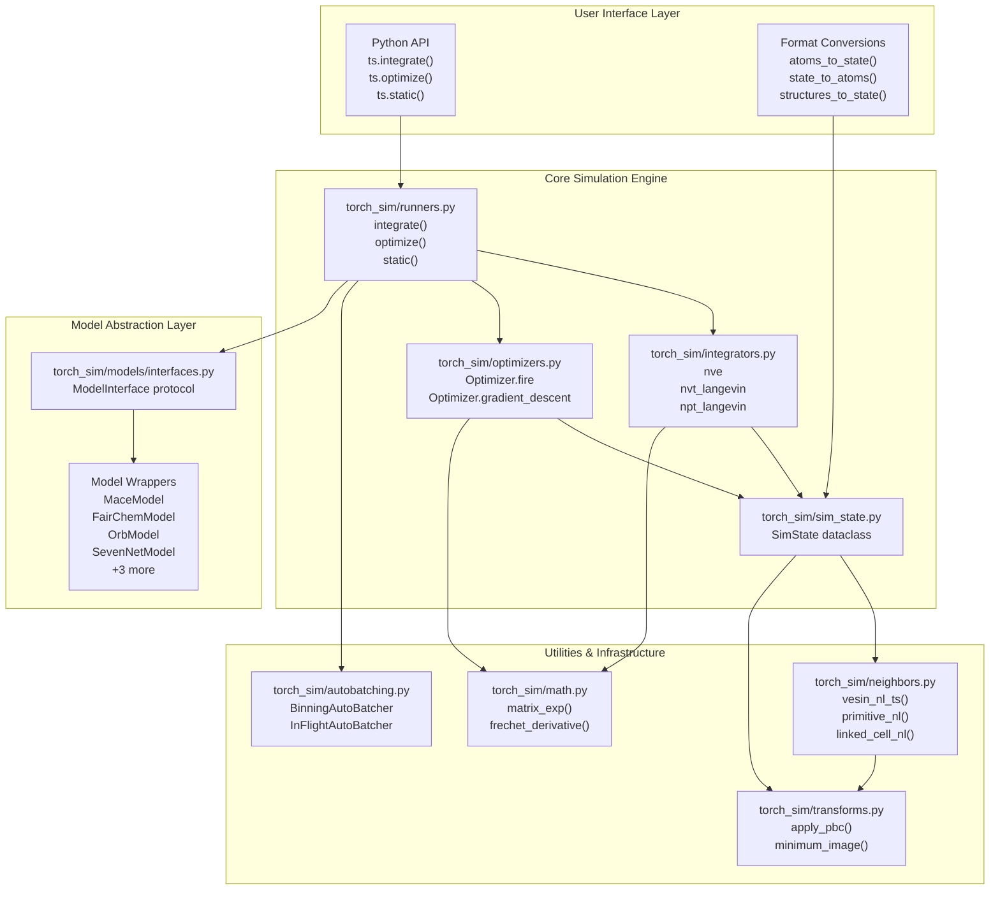
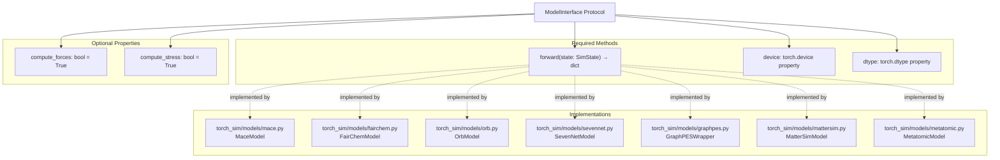
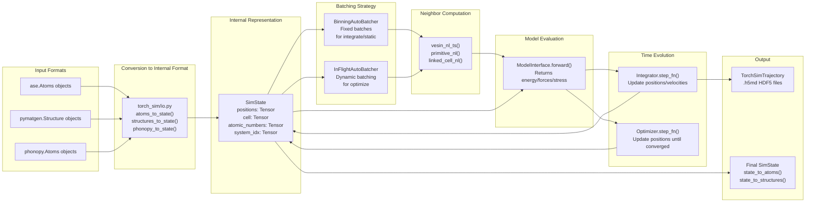

# Overview

<details>
<summary>Relevant source files</summary>

The following files were used as context for generating this wiki page:

- [.github/workflows/test.yml](.github/workflows/test.yml)
- [README.md](README.md)
- [pyproject.toml](pyproject.toml)

</details>


## Purpose and Scope

This document provides a comprehensive overview of the TorchSim architecture, its core components, and how they interact to enable GPU-accelerated atomistic simulations using machine learning interatomic potentials (MLIPs). TorchSim is designed to achieve orders-of-magnitude speedup over traditional simulation tools by leveraging PyTorch for GPU acceleration and implementing automatic batching of heterogeneous atomic systems.

For installation instructions and initial setup, see [Installation and Setup](#2.1). For hands-on examples, see [Quick Start Tutorial](#2.2). For detailed documentation of specific components, refer to the respective sections: [Core Concepts](#3) covers fundamental abstractions, [Simulation Methods](#4) documents algorithms, [Machine Learning Potentials](#5) explains MLIP integration, and [Advanced Features](#6) describes performance optimization systems.

**Sources:** [README.md:1-143](), [pyproject.toml:1-195]()

## What is TorchSim?

TorchSim is an atomistic simulation engine that reimplements core simulation primitives in PyTorch, enabling GPU-accelerated molecular dynamics (MD), geometry optimization, and property calculations. The primary design goals are:

1. **GPU Acceleration**: All tensor operations run natively on CUDA devices when available
2. **Automatic Batching**: Heterogeneous systems of different sizes are automatically grouped into memory-efficient batches
3. **MLIP Interoperability**: Unified interface to 7+ MLIP frameworks (MACE, FairChem, ORB, SevenNet, GraphPES, MatterSim, Metatomic)
4. **High-level API**: Simple functions (`ts.integrate`, `ts.optimize`, `ts.static`) abstract away implementation complexity
5. **Compatibility**: Seamless conversion between ASE, Pymatgen, and Phonopy formats

The package achieves 10-100x speedup compared to ASE for batched workflows by processing multiple atomic systems simultaneously on GPUs.

**Sources:** [README.md:12-25](), [pyproject.toml:3-4]()

## Core Architecture

TorchSim follows a layered architecture with clear separation of concerns:

### Architecture Diagram: System Layers



**Sources:** [torch_sim/runners.py:1-800](), [torch_sim/integrators.py:1-500](), [torch_sim/optimizers.py:1-600](), [torch_sim/sim_state.py:1-300]()

## Key Components

### Core Simulation Engine

The simulation engine consists of three main modules in [torch_sim/runners.py]():

| Function | Purpose | Returns |
|----------|---------|---------|
| `integrate()` | Molecular dynamics time integration | `SimState` with evolved positions/velocities |
| `optimize()` | Geometry optimization until convergence | `SimState` with relaxed structure |
| `static()` | Single-point energy/force/stress calculation | `SimState` with computed properties |

These functions orchestrate the simulation workflow by:
1. Converting input structures to `SimState` objects
2. Configuring autobatchers based on system sizes
3. Dispatching to integrators or optimizers
4. Managing trajectory output via reporters
5. Converting final states back to user-specified formats

**Sources:** [torch_sim/runners.py:1-800]()

#### Integrators

[torch_sim/integrators.py]() implements three thermodynamic ensembles:

- **`nve`**: Microcanonical (constant N, V, E) using velocity Verlet algorithm
- **`nvt_langevin`**: Canonical (constant N, V, T) with Langevin thermostat
- **`npt_langevin`**: Isothermal-isobaric (constant N, P, T) with barostat

Each integrator exposes a `step_fn(state, forces, stress, **kwargs)` that updates positions, velocities, and optionally cell parameters.

**Sources:** [torch_sim/integrators.py:1-500]()

#### Optimizers

[torch_sim/optimizers.py]() provides two optimization algorithms accessible via the `Optimizer` enum:

- **`Optimizer.fire`**: Fast Inertial Relaxation Engine (FIRE) for efficient energy minimization
- **`Optimizer.gradient_descent`**: Standard gradient descent with line search

Optimizers support cell relaxation via cell filters: `CellFilter.frechet`, `CellFilter.exp`, `CellFilter.full_strain` which parameterize the cell strain tensor differently.

**Sources:** [torch_sim/optimizers.py:1-600]()

### SimState: Core Data Structure

The `SimState` dataclass in [torch_sim/sim_state.py]() is the central data structure containing:

```python
@dataclass
class SimState:
    positions: torch.Tensor          # (n_atoms_total, 3)
    cell: torch.Tensor               # (n_systems, 3, 3)
    atomic_numbers: torch.Tensor     # (n_atoms_total,)
    system_idx: torch.Tensor         # (n_atoms_total,) maps atoms to systems
    pbc: torch.Tensor                # (n_systems, 3) periodic boundary flags
    device: torch.device
    dtype: torch.dtype
    # Optional fields: velocities, forces, stress, energy, etc.
```

This structure enables batching multiple systems with different sizes by concatenating atoms and using `system_idx` to track which system each atom belongs to. All tensors reside on the specified `device` (CPU or CUDA).

**Sources:** [torch_sim/sim_state.py:1-300]()

### Model Abstraction Layer

The model abstraction system uses the `ModelInterface` protocol defined in [torch_sim/models/interfaces.py]():

#### ModelInterface Protocol Diagram



Each model wrapper converts `SimState` to the format expected by its underlying MLIP implementation, calls the model, and returns a standardized dictionary: `{"energy": Tensor, "forces": Tensor, "stress": Tensor}`.

**Sources:** [torch_sim/models/interfaces.py:1-100](), [torch_sim/models/mace.py:1-200](), [torch_sim/models/fairchem.py:1-300]()

### Supported MLIP Models

TorchSim integrates 7+ MLIP frameworks via optional dependencies in [pyproject.toml:39-56]():

| Model | Package | Optional Dependency | Wrapper Location |
|-------|---------|-------------------|------------------|
| MACE | `mace-torch>=0.3.12` | `[mace]` | [torch_sim/models/mace.py]() |
| FairChem | `fairchem-core>=2.7` | `[fairchem]` | [torch_sim/models/fairchem.py]() |
| ORB | `orb-models>=0.5.2` | `[orb]` | [torch_sim/models/orb.py]() |
| SevenNet | `sevenn>=0.11.0` | `[sevenn]` | [torch_sim/models/sevennet.py]() |
| GraphPES | `graph-pes>=0.0.34` | `[graphpes]` | [torch_sim/models/graphpes.py]() |
| MatterSim | `mattersim>=0.1.2` | `[mattersim]` | [torch_sim/models/mattersim.py]() |
| Metatomic | `metatomic-torch>=0.1.1` | `[metatomic]` | [torch_sim/models/metatomic.py]() |

Many MLIPs have incompatible dependency requirements (particularly `e3nn` versions). TorchSim uses `uv`'s conflict resolution system to declare mutually exclusive dependency groups in [pyproject.toml:136-180]().

**Sources:** [pyproject.toml:39-180]()

## Data Flow: Typical Simulation Workflow

### Workflow Diagram: Input to Output



**Sources:** [torch_sim/io.py:1-400](), [torch_sim/autobatching.py:1-600](), [torch_sim/neighbors.py:1-500]()

## Performance Features

### Autobatching System

TorchSim implements two autobatching strategies in [torch_sim/autobatching.py]():

**BinningAutoBatcher**
- Used by `integrate()` and `static()` where all systems run for same number of steps
- Pre-groups systems into fixed batches using bin-packing algorithm (`to_constant_volume_bins()`)
- Memory metric: `n_atoms` or `n_atoms * density` depending on configuration
- Ensures no batch exceeds GPU memory limit via `max_memory_scaler` parameter
- O(n log n) complexity for sorting and binning

**InFlightAutoBatcher**
- Used by `optimize()` where systems converge at different rates
- Maintains a full batch by dynamically swapping converged systems with new ones
- Checks convergence every `steps_between_swaps` iterations
- Uses `estimate_max_memory_scaler()` to find safe batch size via geometric search
- Includes `max_memory_padding` safety margin (default 0.95)

Both autobatchers provide `restore_original_order()` to maintain input ordering despite asynchronous processing.

**Sources:** [torch_sim/autobatching.py:1-600]()

### Neighbor List Computation

[torch_sim/neighbors.py]() provides three algorithms:

| Function | Strategy | Use Case |
|----------|----------|----------|
| `vesin_nl_ts()` | Efficient verlet list via `vesin-torch` | MACE, SevenNet (external NL) |
| `primitive_nl()` | Simple pairwise distance calculation | Small systems, debugging |
| `linked_cell_nl()` | Cell-based spatial partitioning | Legacy support |

Neighbor lists respect periodic boundary conditions using `apply_pbc()` and `minimum_image()` from [torch_sim/transforms.py]().

**Sources:** [torch_sim/neighbors.py:1-500](), [torch_sim/transforms.py:1-300]()

## Quality Assurance and Testing

### Testing Infrastructure

The CI/CD pipeline in [.github/workflows/test.yml]() implements a three-tier testing strategy:

**Test Categories:**

1. **Core Tests** (`test-core` job)
   - Tests: [tests/test_integrators.py](), [tests/test_optimizers.py](), [tests/test_transforms.py]()
   - Runs on: Ubuntu + macOS, Python 3.12 + 3.13
   - Version matrix: `highest` and `lowest-direct` dependency resolution
   - No MLIP dependencies required

2. **Model Integration Tests** (`test-model` job)
   - Tests: [tests/models/test_mace.py](), [tests/models/test_fairchem.py](), etc.
   - Separate job per MLIP model
   - Validates wrapper implementation against ASE calculators
   - Includes consistency tests for identical physics results

3. **Example Tests** (`test-examples` job)
   - Runs all [examples/*.py]() scripts
   - Validates tutorials and documentation examples
   - Uses `uv run --with .` for dependency injection

**Consistency Validation:**
Model wrappers are validated by comparing results against ASE calculators with the same underlying model. Tests verify energy, forces, and stress match within numerical tolerance.

**Sources:** [.github/workflows/test.yml:1-176](), [tests/models/test_mace.py:1-200]()

### Code Quality Tools

Pre-commit checks via `prek` hooks enforce:
- **ruff**: Linting and formatting (90 char line length, Google docstrings)
- **codespell**: Typo checking
- **ty**: Type checking (relaxed for `models/` directory due to optional imports)

Configuration in [pyproject.toml:83-194]().

**Sources:** [pyproject.toml:83-194]()

## Project Structure

The codebase is organized as follows:

```
torch_sim/
├── runners.py              # High-level API: integrate(), optimize(), static()
├── integrators.py          # NVE, NVT, NPT integrators
├── optimizers.py           # FIRE, gradient descent
├── sim_state.py            # SimState dataclass
├── autobatching.py         # BinningAutoBatcher, InFlightAutoBatcher
├── neighbors.py            # Neighbor list algorithms
├── transforms.py           # PBC, coordinate transformations
├── math.py                 # Matrix operations (exp, frechet)
├── io.py                   # ASE/Pymatgen/Phonopy conversions
├── trajectory.py           # TorchSimTrajectory, .h5md format
├── models/
│   ├── interfaces.py       # ModelInterface protocol
│   ├── mace.py             # MaceModel wrapper
│   ├── fairchem.py         # FairChemModel wrapper
│   ├── orb.py              # OrbModel wrapper
│   ├── sevennet.py         # SevenNetModel wrapper
│   ├── graphpes.py         # GraphPESWrapper
│   ├── mattersim.py        # MatterSimModel wrapper
│   └── metatomic.py        # MetatomicModel wrapper
└── calculators/
    └── elastic.py          # Elastic tensor calculations

examples/                   # Tutorial scripts and demonstrations
tests/                      # Test suite
docs/                       # Sphinx documentation
```

**Sources:** [pyproject.toml:79-81]()

## Design Philosophy

TorchSim's architecture embodies several design principles:

1. **Separation of Concerns**: High-level API (`ts.integrate`, `ts.optimize`, `ts.static`) abstracts implementation details from users while maintaining extensibility
2. **Protocol-Based Interfaces**: `ModelInterface` enables "bring your own model" flexibility without tight coupling
3. **Tensor-First Design**: All operations on PyTorch tensors for GPU acceleration and automatic differentiation
4. **Explicit Batching**: `system_idx` in `SimState` makes batching semantics transparent rather than implicit
5. **Optional Dependencies**: MLIP integrations are optional extras, keeping core lightweight
6. **Interoperability**: First-class support for ASE, Pymatgen, Phonopy via [torch_sim/io.py]()

This architecture enables TorchSim to achieve 10-100x speedup over traditional tools while maintaining compatibility with existing atomistic simulation ecosystems.

**Sources:** [README.md:12-25](), [torch_sim/sim_state.py:1-300](), [torch_sim/models/interfaces.py:1-100]()

---