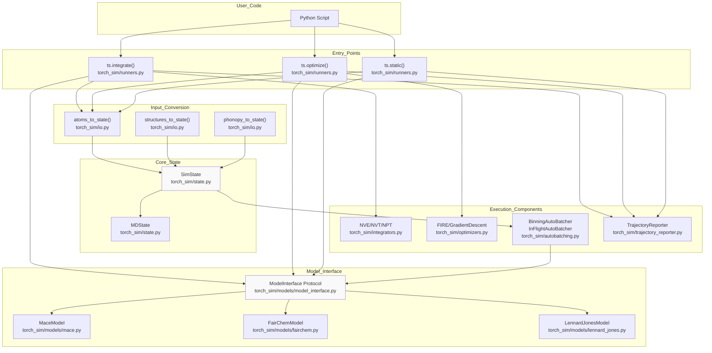
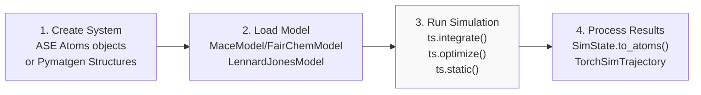
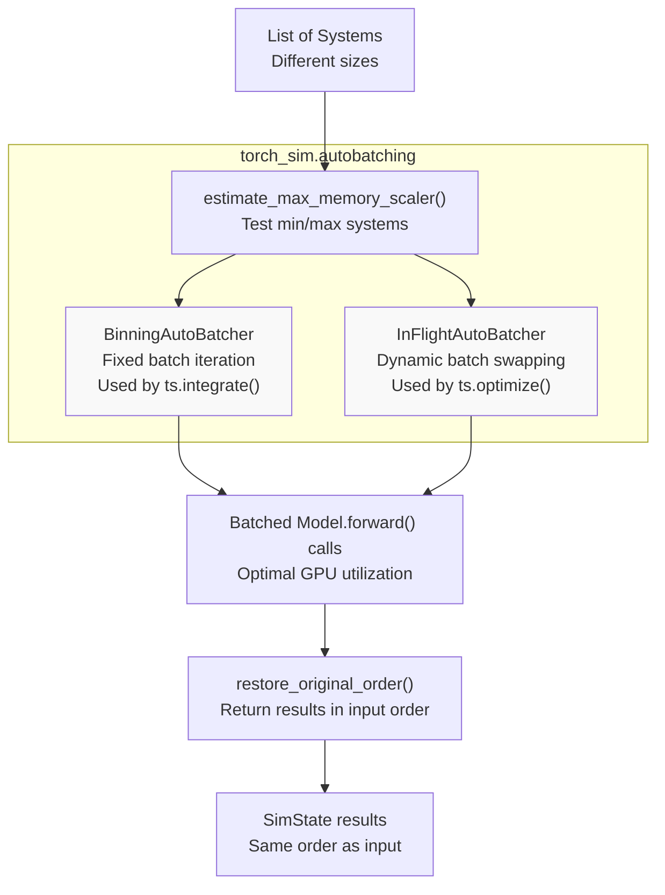

# Getting Started

<details>
<summary>Relevant source files</summary>

The following files were used as context for generating this wiki page:

- [.github/workflows/test.yml](.github/workflows/test.yml)
- [README.md](README.md)
- [pyproject.toml](pyproject.toml)
- [tests/test_runners.py](tests/test_runners.py)
- [tests/test_trajectory.py](tests/test_trajectory.py)
- [torch_sim/runners.py](torch_sim/runners.py)
- [torch_sim/trajectory.py](torch_sim/trajectory.py)

</details>


This page guides users through initial setup and their first simulations with TorchSim. It provides a minimal working example and overview of the high-level API, with pointers to detailed documentation for installation, tutorials, and advanced features.

TorchSim is a PyTorch-based atomistic simulation engine that enables GPU-accelerated simulations with machine learning interatomic potentials (MLIPs). The package provides three main entry points: `ts.integrate()` for molecular dynamics, `ts.optimize()` for structure relaxation, and `ts.static()` for property calculations.

**Quick Navigation:**
- **Installation details** → See page 2.1 (Installation and Setup)
- **Step-by-step tutorials** → See page 2.2 (Quick Start Tutorial)  
- **Core concepts** → See page 3 (Core Concepts)
- **Model integration** → See page 5 (Machine Learning Potentials)
- **Advanced features** → See page 6 (Advanced Features)

Sources: [README.md:1-26]()

## System Architecture Overview

**High-Level API Functions and Data Flow**



This diagram shows how user code interacts with TorchSim's three main entry points ([torch_sim/runners.py]()) and how data flows through the system. Input structures are converted to `SimState` objects via conversion functions in [torch_sim/io.py](). Models implement the `ModelInterface` protocol ([torch_sim/models/model_interface.py]()), and execution is managed by integrators ([torch_sim/integrators.py]()), optimizers ([torch_sim/optimizers.py]()), and autobatchers ([torch_sim/autobatching.py]()).

Sources: [torch_sim/runners.py](), [torch_sim/state.py](), [torch_sim/io.py](), [torch_sim/models/model_interface.py](), [torch_sim/autobatching.py]()

## Minimal Installation

Install TorchSim from PyPI:

```bash
pip install torch-sim-atomistic
```

This installs the core package with dependencies: `torch>=2`, `numpy>=2`, `h5py>=3.12.1`, `tables>=3.10.2`, `tqdm>=4.67`, and `vesin-torch>=0.3.7`.

**Model-specific dependencies** are installed separately using optional extras. For example:

```bash
pip install torch-sim-atomistic[mace]     # MACE models
pip install torch-sim-atomistic[fairchem]  # FairChem models
pip install torch-sim-atomistic[orb]       # ORB models
```

See page 2.1 (Installation and Setup) for complete installation instructions, dependency conflict resolution, GPU setup, and environment configuration.

Sources: [pyproject.toml:29-56](), [README.md:106-119]()

## Minimal Working Example

This example demonstrates the basic TorchSim workflow: loading a model, creating atomic structures, and running molecular dynamics.

**Complete Example: Batched MD Simulation**

```python
import torch
import torch_sim as ts
from ase.build import bulk

# 1. Setup: Device and model
device = torch.device("cuda" if torch.cuda.is_available() else "cpu")

from mace.calculators.foundations_models import mace_mp
from torch_sim.models.mace import MaceModel

mace = mace_mp(model="small", return_raw_model=True)
model = MaceModel(model=mace, device=device)

# 2. Create atomic systems (ASE Atoms objects)
cu_atoms = bulk("Cu", "fcc", a=3.58, cubic=True).repeat((2, 2, 2))
systems = [cu_atoms] * 50  # Batch of 50 identical systems

# 3. Run molecular dynamics with ts.integrate()
final_state = ts.integrate(
    system=systems,
    model=model,
    integrator=ts.integrators.nvt_langevin,
    n_steps=50,
    timestep=0.002,
    temperature=1000,
    trajectory_reporter={"filenames": [f"traj_{i}.h5md" for i in range(50)]},
)

# 4. Convert back to ASE format
final_atoms = final_state.to_atoms()
print(f"Final energies: {final_state.energy}")
```

This example uses:
- `atoms_to_state()` (called internally by `ts.integrate()`) to convert ASE Atoms to `SimState`
- `MaceModel` wrapper implementing `ModelInterface` protocol
- `nvt_langevin` integrator from [torch_sim/integrators.py:158-240]()
- Automatic batching and GPU memory management
- Trajectory output in H5MD format via `TrajectoryReporter`
- `state_to_atoms()` (called by `.to_atoms()`) to convert back to ASE

See page 2.2 (Quick Start Tutorial) for detailed explanations and additional examples.

Sources: [README.md:36-73](), [torch_sim/runners.py:40-180](), [torch_sim/integrators.py:158-240]()

## Typical Workflow Pattern

**Standard TorchSim Usage Pattern**



| Step | Code Entity | File Location |
|------|-------------|---------------|
| System creation | `ase.Atoms`, `pymatgen.Structure` | External libraries |
| Conversion to TorchSim | `atoms_to_state()`, `structures_to_state()` | [torch_sim/io.py:13-79]() |
| Model loading | `MaceModel`, `FairChemModel`, etc. | [torch_sim/models/]() |
| Simulation | `ts.integrate()`, `ts.optimize()`, `ts.static()` | [torch_sim/runners.py]() |
| Output conversion | `state_to_atoms()`, `state_to_structures()` | [torch_sim/io.py:82-148]() |
| Trajectory analysis | `TorchSimTrajectory` | [torch_sim/trajectory_reporter.py:15-161]() |

Sources: [torch_sim/io.py](), [torch_sim/runners.py](), [torch_sim/models/]()

## Key Feature: Automatic Batching

TorchSim automatically groups multiple systems into GPU-efficient batches. Enable by setting `autobatcher=True`:

```python
final_state = ts.integrate(
    system=many_systems,
    model=model,
    autobatcher=True,  # Enable automatic GPU memory management
    # ... other parameters
)
```

**Autobatching System Architecture**



**Autobatcher Selection:**
- `BinningAutoBatcher` ([torch_sim/autobatching.py:244-381]()): Pre-groups systems into fixed batches using bin-packing algorithm. Used by `ts.integrate()` and `ts.static()` where all systems run for the same number of steps.
- `InFlightAutoBatcher` ([torch_sim/autobatching.py:384-565]()): Dynamically maintains a full batch by swapping converged systems with new ones. Used by `ts.optimize()` where systems converge at different rates.

Both estimate safe batch sizes using `estimate_max_memory_scaler()` ([torch_sim/autobatching.py:76-168]()) which performs geometric search to find maximum systems that fit in GPU memory.

See page 6.1 (Autobatching and Memory Management) for detailed documentation.

Sources: [torch_sim/autobatching.py:76-565](), [torch_sim/runners.py:40-310]()

## Key Feature: Trajectory Reporting

Save simulation trajectories in H5MD format using `TrajectoryReporter`:

```python
# Simple usage
final_state = ts.integrate(
    system=systems,
    model=model,
    trajectory_reporter={"filenames": ["traj_0.h5md", "traj_1.h5md"]},
    # ... other parameters
)

# Read trajectory
with ts.TorchSimTrajectory("traj_0.h5md") as traj:
    energies = traj.get_array("potential_energy")
    positions = traj.get_array("positions")
```

The `TrajectoryReporter` class ([torch_sim/trajectory_reporter.py:15-161]()) saves system states and properties to HDF5 files in H5MD format, compatible with ASE via `TorchSimTrajectory.get_atoms()` method.

See page 6.3 (Trajectory Management and I/O) for detailed documentation.

Sources: [torch_sim/trajectory_reporter.py:15-161](), [README.md:54-72]()

## Supported Models

TorchSim supports multiple MLIP and classical potential implementations through the `ModelInterface` protocol:

**Model Interface Protocol**

```mermaid
graph TB
    PROTOCOL["ModelInterface Protocol<br/>torch_sim/models/model_interface.py"]
    
    subgraph "Classical_Potentials"
        LJ["LennardJonesModel<br/>torch_sim/models/lennard_jones.py"]
        MORSE["MorseModel<br/>torch_sim/models/morse.py"]
        SOFT["SoftSphereModel<br/>torch_sim/models/soft_sphere.py"]
    end
    
    subgraph "MLIP_Wrappers"
        MACE["MaceModel<br/>torch_sim/models/mace.py"]
        FAIRCHEM["FairChemModel<br/>torch_sim/models/fairchem.py"]
        ORB["OrbModel<br/>torch_sim/models/orb.py"]
        SEVENN["SevenNetModel<br/>torch_sim/models/sevennet.py"]
        GRAPHPES["GraphPESWrapper<br/>torch_sim/models/graphpes.py"]
        MATTERSIM["MatterSimModel<br/>torch_sim/models/mattersim.py"]
        METATOMIC["MetatomicModel<br/>torch_sim/models/metatomic.py"]
    end
    
    PROTOCOL --> LJ
    PROTOCOL --> MORSE
    PROTOCOL --> SOFT
    PROTOCOL --> MACE
    PROTOCOL --> FAIRCHEM
    PROTOCOL --> ORB
    PROTOCOL --> SEVENN
    PROTOCOL --> GRAPHPES
    PROTOCOL --> MATTERSIM
    PROTOCOL --> METATOMIC
    
    style PROTOCOL fill:#f9f9f9
```



All models implement `forward(state: SimState) -> dict[str, torch.Tensor]` returning `{"energy", "forces", "stress"}`.

**Installation requirements:**
- Classical models: No additional dependencies
- MACE: `pip install torch-sim-atomistic[mace]`
- FairChem: `pip install torch-sim-atomistic[fairchem]`
- ORB: `pip install torch-sim-atomistic[orb]`
- SevenNet: `pip install torch-sim-atomistic[sevenn]`
- GraphPES: `pip install torch-sim-atomistic[graphpes]`
- MatterSim: `pip install torch-sim-atomistic[mattersim]`
- Metatomic: `pip install torch-sim-atomistic[metatomic]`

See page 5 (Machine Learning Potentials) for model-specific documentation and integration details.

Sources: [torch_sim/models/model_interface.py](), [torch_sim/models/](), [pyproject.toml:49-56]()

## Available Simulation Methods

TorchSim provides three high-level simulation functions:

| Function | File | Purpose | Key Algorithms |
|----------|------|---------|----------------|
| `ts.integrate()` | [torch_sim/runners.py:40-180]() | Molecular dynamics | `nve`, `nvt_langevin`, `npt_langevin` |
| `ts.optimize()` | [torch_sim/runners.py:183-310]() | Structure relaxation | `fire`, `gradient_descent` + cell filters |
| `ts.static()` | [torch_sim/runners.py:313-384]() | Single-point calculations | Property evaluation |

**Integrator implementations:**
- `nve`: [torch_sim/integrators.py:63-118]() - Microcanonical ensemble (energy conserving)
- `nvt_langevin`: [torch_sim/integrators.py:158-240]() - Canonical ensemble with thermostat
- `npt_langevin`: [torch_sim/integrators.py:243-365]() - Isothermal-isobaric ensemble with barostat

**Optimizer implementations:**
- `fire`: [torch_sim/optimizers.py:110-229]() - Fast Inertial Relaxation Engine
- `gradient_descent`: [torch_sim/optimizers.py:232-280]() - Standard gradient descent

**Cell filters** (for optimizing lattice parameters):
- `CellFilter.frechet`: [torch_sim/optimizers.py:18-82]() - Frechet mean cell filter
- `CellFilter.exp`: [torch_sim/optimizers.py:85-103]() - Exponential map cell filter

See page 4 (Simulation Methods) for detailed algorithm documentation.

Sources: [torch_sim/runners.py](), [torch_sim/integrators.py](), [torch_sim/optimizers.py]()

## Next Steps

1. **Installation**: Follow detailed installation instructions in [Installation and Setup](#2.1)
2. **Tutorials**: Work through step-by-step examples in [Quick Start Tutorial](#2.2)
3. **Core Concepts**: Learn about `SimState`, `ModelInterface`, and batching in [Core Concepts](#3)
4. **Models**: Explore supported potentials in [Models and Potentials](#4)
5. **Advanced Features**: Learn about autobatching and trajectory management in [Advanced Features](#6)

The high-level API functions (`integrate`, `optimize`, `static`) handle most complexity automatically, making torch-sim accessible while still providing access to lower-level components for advanced use cases.

Sources: [README.md:1-138](), [examples/tutorials/high_level_tutorial.py:15-516]()

---