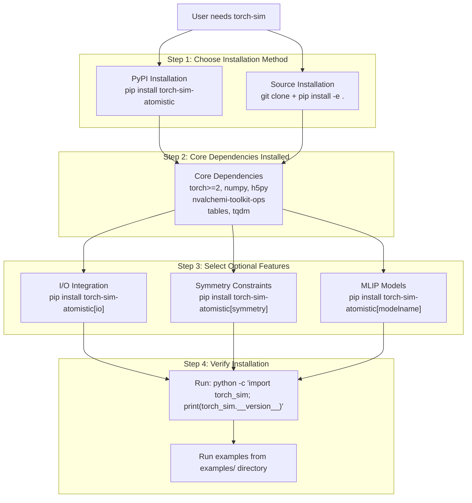
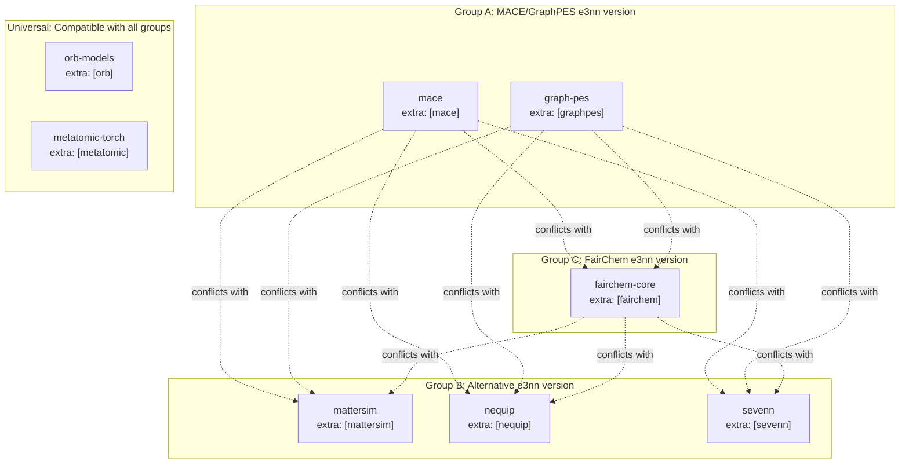
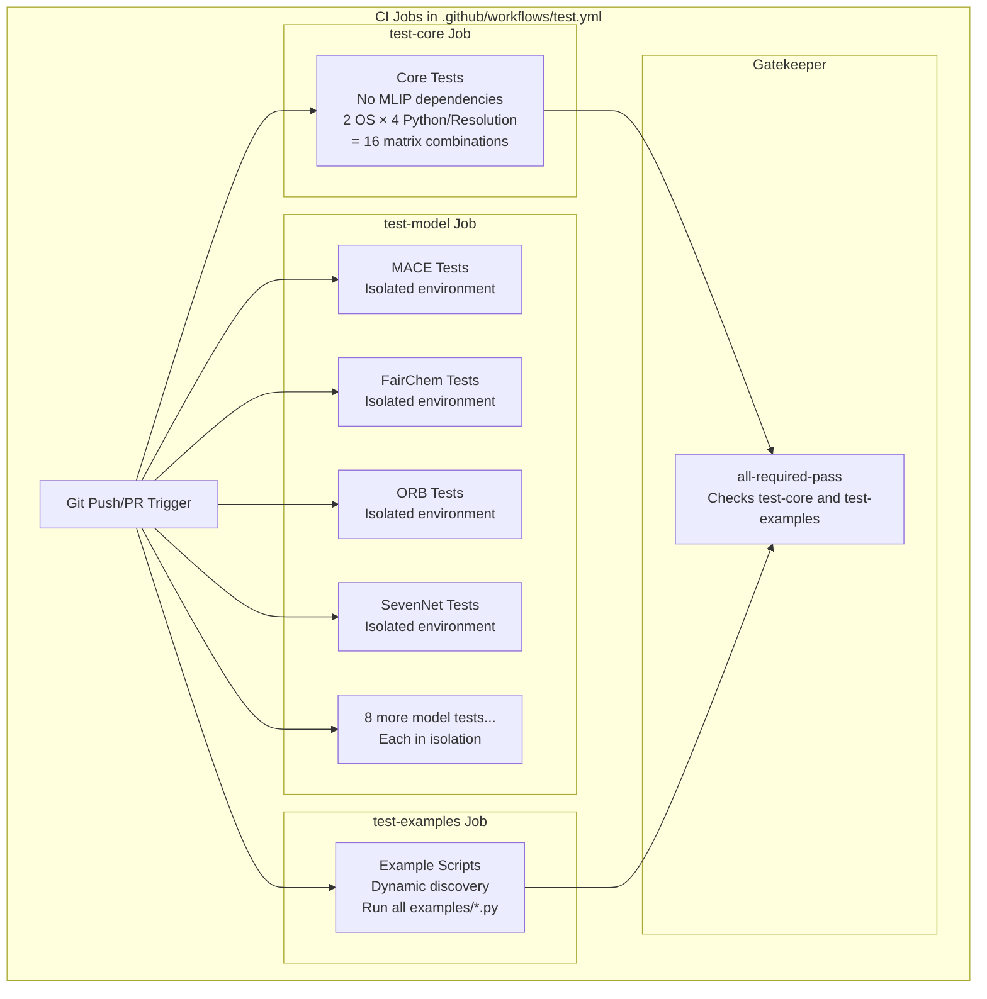

# Installation and Setup

<details>
<summary>Relevant source files</summary>

The following files were used as context for generating this wiki page:

- [.github/workflows/test.yml](.github/workflows/test.yml)
- [README.md](README.md)
- [pyproject.toml](pyproject.toml)

</details>


This document covers the installation of torch-sim, including core dependencies, optional extras for different MLIP models, and resolution of dependency conflicts. For information about running your first simulation after installation, see [Quick Start Tutorial](#2.2). For details about the model ecosystem and usage, see [Model Ecosystem Overview](#6.1).

---

## System Requirements

torch-sim supports the following platforms and Python versions:

| Requirement | Specification |
|-------------|---------------|
| **Python Version** | 3.12, 3.13, or 3.14 |
| **Operating Systems** | Linux, macOS (including Apple Silicon), Windows (untested but should work) |
| **PyTorch Version** | 2.0 or higher |
| **Required Disk Space** | ~500 MB for core + ~2-5 GB per MLIP model |

**Sources:** [pyproject.toml:28](), [pyproject.toml:18-27](), [.github/workflows/test.yml:19-24]()

---

## Core Installation

### From PyPI

The simplest installation includes only core dependencies (PyTorch, NumPy, HDF5, and nvalchemi-toolkit-ops):

```bash
pip install torch-sim-atomistic
```

This provides:
- Core simulation engine (`torch_sim.runners`)
- State management (`SimState`, `MDState`, `OptimState`)
- Classical potentials (Lennard-Jones, Morse, Soft Sphere)
- Trajectory I/O with HDF5
- Autobatching infrastructure

**Sources:** [README.md:110-112](), [pyproject.toml:29-37]()

### From Source

For development or to use the latest features:

```bash
git clone https://github.com/TorchSim/torch-sim
cd torch-sim
pip install -e .
```

For development with additional tooling:

```bash
pip install -e ".[test]"
```

**Sources:** [README.md:116-120](), [pyproject.toml:40-48]()

---

## Installation Workflow



**Sources:** [README.md:106-120](), [pyproject.toml:39-58]()

---

## Optional Dependencies

torch-sim uses the "extras" mechanism to provide optional functionality without bloating the core installation.

### I/O and Interoperability

Install support for ASE, Pymatgen, and Phonopy format conversions:

```bash
pip install torch-sim-atomistic[io]
```

This adds:
- `ase>=3.26` - ASE `Atoms` object conversion
- `pymatgen>=2025.6.14` - Pymatgen `Structure` object conversion
- `phonopy>=2.37.0` - Phonopy atoms conversion

**Key Functions Enabled:**
- `torch_sim.io.atoms_to_state()` / `state_to_atoms()`
- `torch_sim.io.structures_to_state()` / `state_to_structures()`
- `torch_sim.io.phonopy_to_state()`

**Sources:** [pyproject.toml:49](), [README.md:24]()

### Symmetry Preservation

Install support for crystal symmetry constraints:

```bash
pip install torch-sim-atomistic[symmetry]
```

This adds:
- `moyopy>=0.7.8` - Space group operations and symmetry enforcement

**Key Classes Enabled:**
- `torch_sim.constraints.FixSymmetry` - Preserve space group during relaxation

**Sources:** [pyproject.toml:50]()

### Testing Infrastructure

Install development dependencies for running tests:

```bash
pip install torch-sim-atomistic[test]
```

This includes `[io]`, `[symmetry]`, and test frameworks (pytest, pytest-cov).

**Sources:** [pyproject.toml:40-48]()

---

## MLIP Model Installation

### Overview of Model Extras

Each MLIP backend is installed as a separate extra. The table below shows the available models:

| Extra Name | Package | Version | Compatibility Group |
|-----------|---------|---------|---------------------|
| `[mace]` | mace-torch | >=0.3.15 | Group A |
| `[graphpes]` | graph-pes, mace-torch | >=0.1, >=0.3.12 | Group A |
| `[mattersim]` | mattersim | >=0.1.2 | Group B |
| `[nequip]` | nequip | >=0.17.0 | Group B |
| `[sevenn]` | sevenn[torchsim] | >=0.12.1 | Group B |
| `[fairchem]` | fairchem-core, scipy | >=2.7, <1.17.0 | Group C |
| `[orb]` | orb-models | >=0.6.0 | Compatible with all |
| `[metatomic]` | metatomic-torch, metatrain[pet] | >=0.1.3, >=2025.12 | Compatible with all |

**Sources:** [pyproject.toml:51-58]()

### Installation Commands

To install a specific MLIP model:

```bash
# MACE models
pip install torch-sim-atomistic[mace]

# FairChem models (EGIP, UMA, etc.)
pip install torch-sim-atomistic[fairchem]

# ORB models
pip install torch-sim-atomistic[orb]

# SevenNet models
pip install torch-sim-atomistic[sevenn]

# MatterSim models
pip install torch-sim-atomistic[mattersim]

# Metatomic (PET) models
pip install torch-sim-atomistic[metatomic]

# NequIP models
pip install torch-sim-atomistic[nequip]

# GraphPES models
pip install torch-sim-atomistic[graphpes]
```

Multiple compatible extras can be combined:

```bash
# Install ORB and metatomic (compatible)
pip install torch-sim-atomistic[orb,metatomic,io]
```

**Sources:** [README.md:43-46](), [pyproject.toml:51-58]()

---

## Dependency Conflicts and Resolution

### The e3nn Conflict Problem

Many MLIP models depend on `e3nn` (Euclidean neural networks library) but require incompatible versions. torch-sim uses uv's conflict resolution mechanism to declare these incompatibilities explicitly.



**Sources:** [pyproject.toml:142-186]()

### Conflict Declaration in pyproject.toml

The conflicts are explicitly declared in the `[tool.uv]` section:

```toml
[tool.uv]
conflicts = [
    [{ extra = "fairchem" }, { extra = "mace" }],
    [{ extra = "fairchem" }, { extra = "graphpes" }],
    [{ extra = "mace" }, { extra = "mattersim" }],
    [{ extra = "mace" }, { extra = "nequip" }],
    [{ extra = "mace" }, { extra = "sevenn" }],
    [{ extra = "graphpes" }, { extra = "mattersim" }],
    [{ extra = "graphpes" }, { extra = "nequip" }],
    [{ extra = "graphpes" }, { extra = "sevenn" }],
]
```

**Sources:** [pyproject.toml:142-186]()

### Resolution Strategy

When you need multiple models from incompatible groups, use one of these strategies:

#### Strategy 1: Separate Virtual Environments

Create isolated environments for each conflict group:

```bash
# Environment 1: MACE models
python -m venv venv-mace
source venv-mace/bin/activate
pip install torch-sim-atomistic[mace,io]

# Environment 2: FairChem models
python -m venv venv-fairchem
source venv-fairchem/bin/activate
pip install torch-sim-atomistic[fairchem,io]
```

#### Strategy 2: Container-Based Isolation

Use Docker or Singularity containers for different model backends, particularly useful in HPC environments.

#### Strategy 3: Universal Models Only

Install only `[orb]` and `[metatomic]`, which are compatible with all other extras:

```bash
pip install torch-sim-atomistic[orb,metatomic,mace,io]  # Works!
pip install torch-sim-atomistic[orb,metatomic,fairchem,io]  # Also works!
```

**Sources:** [pyproject.toml:142-186](), architectural diagrams from context

---

## CI Testing Strategy

The continuous integration system demonstrates the isolation strategy:



Each model test runs in a completely fresh environment to avoid conflicts:

```yaml
- name: Install torch_sim with model dependencies
  run: |
    uv pip install -e ".[test,${{ matrix.model.name }}]" \
      "setuptools>=70,<82" \
      --resolution=${{ matrix.version.resolution }} --system
```

**Sources:** [.github/workflows/test.yml:1-205](), [.github/workflows/test.yml:54-145]()

---

## Installation Verification

### Basic Verification

Test that core torch-sim is installed correctly:

```bash
python -c "import torch_sim; print(torch_sim.__version__)"
```

### Component Verification

Create a verification script `test_install.py`:

```python
import torch
import torch_sim as ts

# Test 1: Core functionality
print("✓ Core torch_sim imported")

# Test 2: Check device availability
device = torch.device("cuda" if torch.cuda.is_available() else "cpu")
print(f"✓ PyTorch device: {device}")

# Test 3: Check I/O extras (if installed)
try:
    from ase.build import bulk
    from torch_sim.io import atoms_to_state
    atoms = bulk("Cu", "fcc", a=3.6)
    state = atoms_to_state(atoms, device=device)
    print("✓ ASE/I/O integration available")
except ImportError:
    print("- ASE/I/O integration not installed (optional)")

# Test 4: Check specific model (example: MACE)
try:
    from torch_sim.models.mace import MaceModel
    print("✓ MACE model integration available")
except ImportError:
    print("- MACE model not installed (optional)")

# Test 5: Test classical potential
from torch_sim.models.classical import LennardJonesModel
lj = LennardJonesModel(epsilon=1.0, sigma=1.0, device=device)
print("✓ Classical potentials available")

print("\nInstallation verification complete!")
```

Run the verification:

```bash
python test_install.py
```

**Sources:** [README.md:36-73]()

### Example Execution Test

Run a minimal example to verify end-to-end functionality:

```bash
# Navigate to examples directory
cd examples

# Run a simple example (modify model as needed)
python example_md_lennard_jones.py
```

**Sources:** [.github/workflows/test.yml:160-188](), [README.md:122-124]()

---

## Advanced Installation Options

### Using uv for Faster Resolution

torch-sim uses `uv` as its build backend and recommends it for installation:

```bash
# Install uv
pip install uv

# Use uv for installation
uv pip install torch-sim-atomistic[mace]

# Use uv to run examples without installing
uv run --with torch-sim-atomistic[mace] examples/example_mace.py
```

**Benefits:**
- Faster dependency resolution
- Built-in conflict detection
- Lockfile support for reproducibility

**Sources:** [.github/workflows/test.yml:36-42](), [pyproject.toml:79-85]()

### CPU-Only PyTorch Installation

For CPU-only workloads, install PyTorch from the CPU index:

```bash
uv pip install "torch>2" --index-url https://download.pytorch.org/whl/cpu --system
uv pip install torch-sim-atomistic[io] --system
```

**Sources:** [.github/workflows/test.yml:40-42]()

### HPC Module Systems

On HPC clusters with module systems:

```bash
# Load modules first
module load python/3.12
module load cuda/12.1
module load hdf5/1.14

# Install with system HDF5
HDF5_DIR=$HDF5_ROOT pip install torch-sim-atomistic[io]
```

**Sources:** [.github/workflows/test.yml:102-104]() (macOS HDF5 installation example)

---

## Troubleshooting

### Common Issues

| Issue | Symptom | Solution |
|-------|---------|----------|
| **e3nn conflict** | `ERROR: Cannot install torch-sim-atomistic[mace] and torch-sim-atomistic[fairchem]` | Use separate environments (see Strategy 1 above) |
| **Missing HDF5** | `ImportError: libhdf5.so` | Install system HDF5: `apt install libhdf5-dev` (Linux) or `brew install hdf5` (macOS) |
| **CUDA mismatch** | Model fails to load on GPU | Ensure PyTorch CUDA version matches system CUDA |
| **setuptools issue** | `ModuleNotFoundError: pkg_resources` | Install `setuptools>=70,<82` (required by mattersim/fairchem) |

**Sources:** [.github/workflows/test.yml:102-104](), [.github/workflows/test.yml:126-128]()

### Dependency Resolution Modes

uv supports different resolution strategies:

```bash
# Highest versions (default)
uv pip install torch-sim-atomistic[test] --resolution=highest

# Lowest compatible versions (CI tests this)
uv pip install torch-sim-atomistic[test] --resolution=lowest-direct
```

Both modes are tested in CI to ensure compatibility across the version range.

**Sources:** [.github/workflows/test.yml:21-24](), [.github/workflows/test.yml:42]()

---

## Quick Reference

### Installation Commands Summary

```bash
# Core only
pip install torch-sim-atomistic

# Core + I/O
pip install torch-sim-atomistic[io]

# Core + specific model
pip install torch-sim-atomistic[mace,io]

# Development
pip install -e ".[test]"

# From source
git clone https://github.com/TorchSim/torch-sim
cd torch-sim
pip install -e ".[io,mace]"
```

### Package Name Mapping

| PyPI Package | Import Name | Purpose |
|--------------|-------------|---------|
| `torch-sim-atomistic` | `torch_sim` | Main package |
| `mace-torch` | `mace` | MACE models |
| `fairchem-core` | `fairchem` | FairChem models |
| `orb-models` | `orb_models` | ORB models |
| `sevenn` | `sevenn` | SevenNet models |
| `mattersim` | `mattersim` | MatterSim models |
| `metatomic-torch` | `metatomic` | Metatomic models |

**Sources:** [pyproject.toml:2](), [pyproject.toml:51-58]()

---