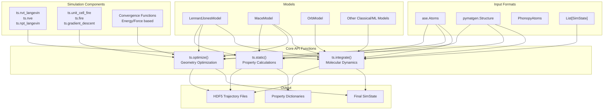
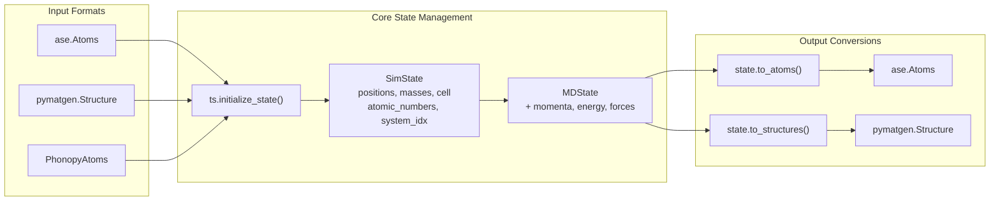
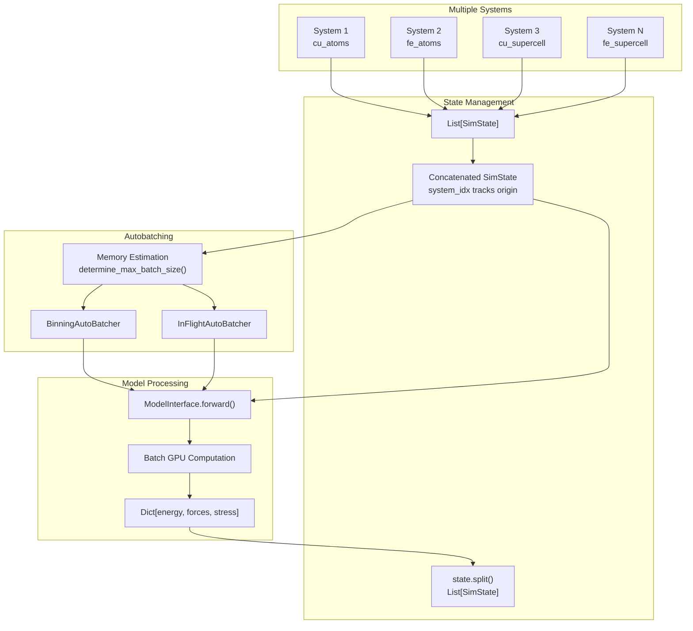

# Quick Start Tutorial

<details>
<summary>Relevant source files</summary>

The following files were used as context for generating this wiki page:

- [.github/workflows/test.yml](.github/workflows/test.yml)
- [README.md](README.md)
- [pyproject.toml](pyproject.toml)
- [tests/test_runners.py](tests/test_runners.py)
- [tests/test_state.py](tests/test_state.py)
- [tests/test_trajectory.py](tests/test_trajectory.py)
- [torch_sim/runners.py](torch_sim/runners.py)
- [torch_sim/state.py](torch_sim/state.py)
- [torch_sim/trajectory.py](torch_sim/trajectory.py)

</details>


This tutorial demonstrates how to run basic atomistic simulations using torch-sim's high-level API. It covers the three main functions (`integrate`, `optimize`, `static`) for molecular dynamics, geometry optimization, and property calculations using both classical and machine learning potentials.

For detailed installation instructions, see [Installation and Setup](#2.1). For advanced batching strategies, see [Autobatching and Memory Management](#6.1). For comprehensive trajectory analysis, see [Trajectory Management and I/O](#6.2).

## High-Level API Overview

The torch-sim high-level API provides three primary functions that handle state initialization, memory management, and trajectory reporting automatically:

## High-Level API Workflow



Sources: [examples/tutorials/high_level_tutorial.py:25-39]()

## Basic Molecular Dynamics

### Creating Models and Systems

The simplest workflow starts with creating a model and atomic structure:

```python
import torch_sim as ts
from ase.build import bulk
from torch_sim.models.lennard_jones import LennardJonesModel

# Create model
lj_model = LennardJonesModel(sigma=2.0, epsilon=0.1, device="cpu")

# Create atomic structure 
cu_atoms = bulk("Cu", "fcc", a=5.43, cubic=True)
```

The `LennardJonesModel` implements the `ModelInterface` and can compute energies and forces for any `SimState`. ASE's `bulk()` function creates common crystal structures.

Sources: [examples/tutorials/high_level_tutorial.py:55-64]()

### Running MD Simulations

The `ts.integrate()` function handles state initialization, integrator setup, and simulation execution:

```python
final_state = ts.integrate(
    system=cu_atoms,      # Input atomic system
    model=lj_model,       # Energy/force model  
    integrator=ts.nvt_langevin,  # Integrator function
    n_steps=50,           # Number of MD steps
    temperature=2000,     # Target temperature (K)
    timestep=0.002        # Integration timestep (ps)
)

# Convert back to ASE format
final_atoms = final_state.to_atoms()
```

The function automatically converts the ASE `Atoms` to a `SimState`, initializes the integrator state, and returns the final `SimState` after simulation.

Sources: [examples/tutorials/high_level_tutorial.py:75-87]()

## State and Format Conversion Flow



Sources: [examples/tutorials/high_level_tutorial.py:86-87](), [examples/tutorials/high_level_tutorial.py:493-494]()

## Trajectory Reporting

### Basic Trajectory Saving

The simplest way to save simulation data is using the `filenames` parameter:

```python
final_state = ts.integrate(
    system=cu_atoms,
    model=lj_model,
    integrator=ts.nvt_langevin,
    n_steps=50,
    temperature=2000,
    timestep=0.002,
    trajectory_reporter={"filenames": "trajectory.h5"}
)
```

This creates a `TrajectoryReporter` with default settings and saves to an HDF5 file.

Sources: [examples/tutorials/high_level_tutorial.py:100-109]()

### Custom Property Calculations

For more control, create a `TrajectoryReporter` with custom property calculators:

```python
# Define property calculators
prop_calculators = {
    10: {"potential_energy": lambda state: state.energy},
    20: {"kinetic_energy": lambda state: ts.calc_kinetic_energy(
        momenta=state.momenta, masses=state.masses)}
}

# Create reporter
reporter = ts.TrajectoryReporter(
    "trajectory.h5",
    state_frequency=10,    # Save state every 10 steps
    prop_calculators=prop_calculators
)

# Run simulation
final_state = ts.integrate(
    system=cu_atoms,
    model=lj_model, 
    integrator=ts.nvt_langevin,
    n_steps=50,
    temperature=2000,
    timestep=0.002,
    trajectory_reporter=reporter
)
```

Property calculators are functions that take a `SimState` and optionally a model, returning tensors to save.

Sources: [examples/tutorials/high_level_tutorial.py:131-162]()

### Trajectory Analysis

Access saved data using `TorchSimTrajectory`:

```python
with ts.TorchSimTrajectory("trajectory.h5") as traj:
    # Read property arrays
    kinetic_energies = traj.get_array("kinetic_energy")
    potential_energies = traj.get_array("potential_energy")
    
    # Get atomic configurations
    final_atoms = traj.get_atoms(-1)  # Last frame
```

Sources: [examples/tutorials/high_level_tutorial.py:173-183]()

## Machine Learning Potentials

### Using MACE Models

Replace classical potentials with machine learning models like MACE:

```python
from mace.calculators.foundations_models import mace_mp
from torch_sim.models.mace import MaceModel

# Load MACE foundation model
device = "cuda" if torch.cuda.is_available() else "cpu"
mace = mace_mp(model="small", return_raw_model=True)
mace_model = MaceModel(
    model=mace,
    device=device,
    dtype=torch.float64,
    compute_forces=True
)

# Use with same API
final_state = ts.integrate(
    system=cu_atoms,
    model=mace_model,  # Drop-in replacement
    integrator=ts.nvt_langevin,
    n_steps=50,
    temperature=2000,
    timestep=0.002
)
```

The `MaceModel` wrapper implements the same `ModelInterface` as classical models, enabling seamless integration.

Sources: [examples/tutorials/high_level_tutorial.py:195-221]()

## Batch Processing

### Multiple Systems Simulation

Simulate multiple systems simultaneously by passing a list:

```python
# Create multiple systems
fe_atoms = bulk("Fe", "fcc", a=5.26, cubic=True)
systems = [cu_atoms, fe_atoms, cu_atoms.repeat([2,2,2]), fe_atoms.repeat([2,2,2])]

# Batch simulation
final_state = ts.integrate(
    system=systems,        # List of systems
    model=mace_model,      # Single model for all
    integrator=ts.nvt_langevin,
    n_steps=50,
    temperature=2000,
    timestep=0.002
)

final_atoms = final_state.to_atoms()  # Returns list of Atoms
```

Sources: [examples/tutorials/high_level_tutorial.py:233-259]()

### Batch Trajectory Reporting

Save each system to separate files:

```python
filenames = [f"batch_traj_{i}.h5" for i in range(len(systems))]

batch_reporter = ts.TrajectoryReporter(
    filenames,
    state_frequency=10,
    prop_calculators=prop_calculators
)

final_state = ts.integrate(
    system=systems,
    model=mace_model,
    integrator=ts.nvt_langevin,
    n_steps=50,
    temperature=2000,
    timestep=0.002,
    trajectory_reporter=batch_reporter
)
```

Sources: [examples/tutorials/high_level_tutorial.py:269-288]()

## Model and Batching Integration



Sources: [examples/tutorials/high_level_tutorial.py:248-259](), [examples/tutorials/high_level_tutorial.py:332-341]()

## Autobatching

For large numbers of systems, enable automatic memory management:

```python
final_state = ts.integrate(
    system=systems,
    model=mace_model,
    integrator=ts.nvt_langevin,
    n_steps=50,
    temperature=2000,
    timestep=0.002,
    autobatcher=True        # Enable autobatching
)
```

The autobatcher automatically determines optimal batch sizes and splits work across GPU memory limits.

Sources: [examples/tutorials/high_level_tutorial.py:332-341]()

## Geometry Optimization

### Basic Structure Relaxation

Use `ts.optimize()` for geometry optimization:

```python
final_state = ts.optimize(
    system=systems,
    model=mace_model,
    optimizer=ts.unit_cell_fire   # FIRE algorithm with cell optimization
)
```

By default, optimization converges when energy changes are less than 1 meV between steps.

Sources: [examples/tutorials/high_level_tutorial.py:361-367]()

### Custom Convergence Criteria

Define custom convergence functions:

```python
# Force-based convergence
force_convergence_fn = ts.generate_force_convergence_fn(force_tol=1e-3)

final_state = ts.optimize(
    system=systems,
    model=mace_model,
    optimizer=ts.unit_cell_fire,
    convergence_fn=force_convergence_fn
)
```

Convergence functions take `(state, last_energy)` and return boolean tensors indicating convergence for each system.

Sources: [examples/tutorials/high_level_tutorial.py:404-415]()

## Static Calculations

### Property Evaluation

Use `ts.static()` for single-point calculations across multiple structures:

```python
prop_calculators = {
    10: {"potential_energy": lambda state: state.energy},
    20: {"stress": lambda state: state.stress}
}

results = ts.static(
    system=systems,
    model=mace_model,
    trajectory_reporter={"filenames": None, "prop_calculators": prop_calculators}
)

# Results is a list of property dictionaries
print(f"Cu energy: {results[0]['potential_energy'][-1].item()} eV")
```

Unlike `integrate` and `optimize`, `static` returns property dictionaries rather than final states.

Sources: [examples/tutorials/high_level_tutorial.py:432-455]()

## Format Compatibility

### PyMatGen Integration

torch-sim supports PyMatGen `Structure` objects directly:

```python
from pymatgen.core import Structure

# Create PyMatGen structure
lattice = [[5.43, 0, 0], [0, 5.43, 0], [0, 0, 5.43]]
species = ["Si"] * 8
coords = [[0.0, 0.0, 0.0], [0.25, 0.25, 0.25], ...]  # Diamond structure
structure = Structure(lattice, species, coords)

# Use directly with API
final_state = ts.integrate(
    system=structure,      # PyMatGen Structure
    model=lj_model,
    integrator=ts.nvt_langevin,
    n_steps=50,
    temperature=2000,
    timestep=0.002
)

# Convert back to PyMatGen
final_structure = final_state.to_structures()
```

Sources: [examples/tutorials/high_level_tutorial.py:466-494]()

## Summary

The high-level API provides three main functions:

| Function | Purpose | Key Parameters | Output |
|----------|---------|----------------|---------|
| `ts.integrate()` | Molecular dynamics | `integrator`, `n_steps`, `temperature`, `timestep` | Final `SimState` |
| `ts.optimize()` | Geometry optimization | `optimizer`, `convergence_fn` | Final `SimState` |
| `ts.static()` | Property calculations | `trajectory_reporter` with `prop_calculators` | Property dictionaries |

All functions support:
- Multiple input formats (ASE, PyMatGen, `SimState` lists)
- Batch processing of multiple systems
- Automatic memory management via autobatching
- Trajectory reporting with custom properties
- Both classical and machine learning potential models

Sources: [examples/tutorials/high_level_tutorial.py:499-516]()

---