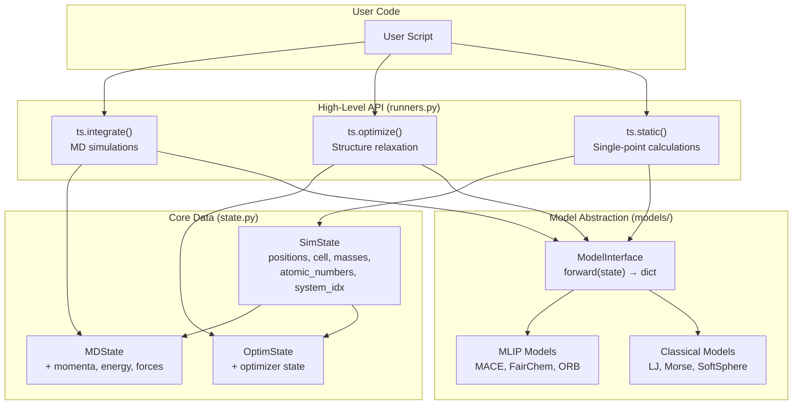
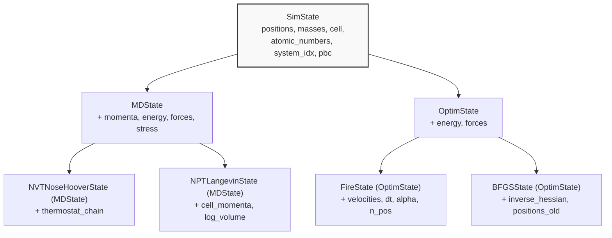
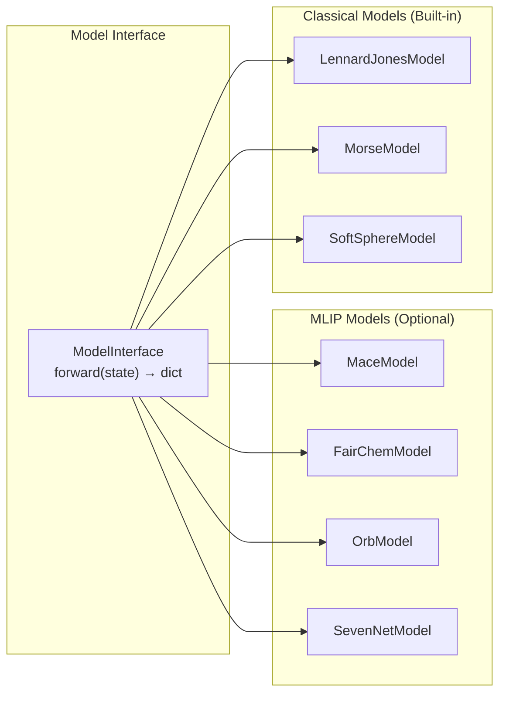
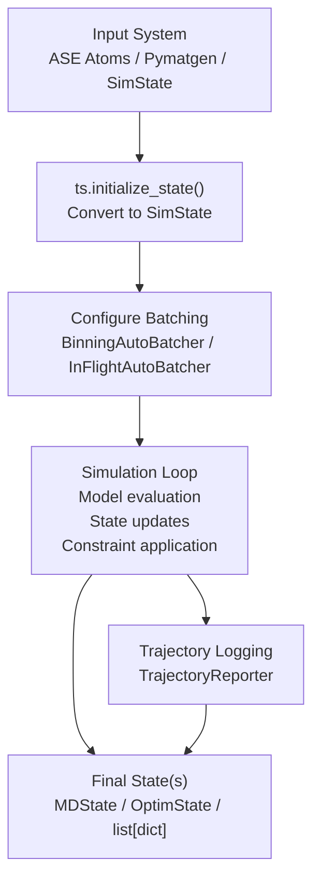
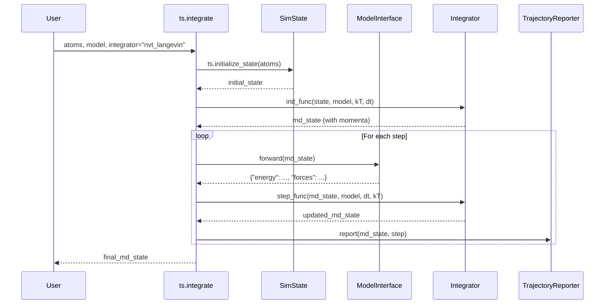

# Core Concepts

<details>
<summary>Relevant source files</summary>

The following files were used as context for generating this wiki page:

- [tests/test_runners.py](tests/test_runners.py)
- [tests/test_state.py](tests/test_state.py)
- [tests/test_trajectory.py](tests/test_trajectory.py)
- [torch_sim/runners.py](torch_sim/runners.py)
- [torch_sim/state.py](torch_sim/state.py)
- [torch_sim/trajectory.py](torch_sim/trajectory.py)

</details>


This page introduces the three foundational pillars of torch-sim: **SimState** (the core data representation), **ModelInterface** (the abstraction for force fields), and the **High-Level API** (the three primary simulation functions). Understanding these concepts is essential for using torch-sim effectively.

For detailed information about specific topics, see:
- State data structures and batching: [SimState and Data Structures](#3.1)
- Model implementation details: [Model Interface](#3.2)
- API function parameters and workflows: [High-Level API Functions](#3.3)
- Converting between formats: [I/O and Format Conversion](#3.4)

---

## The Three Pillars

torch-sim is built around three core concepts that work together to enable GPU-accelerated atomistic simulations:

| Pillar | Purpose | Key Type | Primary Location |
|--------|---------|----------|------------------|
| **State** | Represent atomic systems with positions, cells, and metadata | `SimState` | [torch_sim/state.py:70-685]() |
| **Models** | Compute energies, forces, and stresses | `ModelInterface` | [torch_sim/models/interface.py]() |
| **API** | Orchestrate simulations via simple functions | `integrate()`, `optimize()`, `static()` | [torch_sim/runners.py:252-853]() |

### Architecture Overview



**Sources:** [torch_sim/runners.py:1-853](), [torch_sim/state.py:1-685](), High-level architecture diagrams

---

## SimState: The Core Data Structure

`SimState` is a dataclass that represents one or more atomistic systems in a batched format. All atomic properties are stored as PyTorch tensors on a single device with consistent dtypes.

### Key Attributes

| Attribute | Shape | Description |
|-----------|-------|-------------|
| `positions` | `(n_atoms, 3)` | Atomic positions in Cartesian coordinates |
| `masses` | `(n_atoms,)` | Atomic masses |
| `cell` | `(n_systems, 3, 3)` | Unit cell vectors (column convention) |
| `atomic_numbers` | `(n_atoms,)` | Atomic numbers (elements) |
| `system_idx` | `(n_atoms,)` | Maps each atom to its system index |
| `pbc` | `(3,)` | Periodic boundary conditions per axis |

### Batching Multiple Systems

torch-sim processes multiple systems simultaneously using the `system_idx` tensor, which assigns each atom to a specific system. This enables efficient GPU batching:

```python
# Single system: system_idx = [0, 0, 0, 0, ...]
# Two systems:   system_idx = [0, 0, 0, 1, 1, 1, ...]
# Three systems: system_idx = [0, 0, 1, 1, 2, 2, 2, ...]
```

Systems are concatenated along the atom dimension, while system-level properties (like `cell`) use the first dimension for indexing.

**Sources:** [torch_sim/state.py:70-304](), [torch_sim/state.py:192-262]()

### State Hierarchy



Each subclass extends `SimState` with additional attributes needed for specific algorithms. For example:
- `MDState` adds `momenta`, `energy`, `forces` for dynamics
- `FireState` adds `velocities`, `alpha`, `n_pos` for FIRE optimization
- `NVTNoseHooverState` adds `thermostat_chain` for temperature control

**Sources:** [torch_sim/state.py:70-126](), [torch_sim/integrators/md.py](), [torch_sim/optimizers/state.py]()

---

## ModelInterface: Force Field Abstraction

All models in torch-sim implement a common interface centered on a single method: `forward(state: SimState) -> dict`. This abstraction allows seamless switching between machine learning potentials and classical force fields.

### Interface Contract

```python
class ModelInterface(Protocol):
    def forward(self, state: SimState) -> dict[str, torch.Tensor]:
        """Compute properties for the given state.
        
        Returns:
            dict with keys:
                - "energy": torch.Tensor of shape (n_systems,)
                - "forces": torch.Tensor of shape (n_atoms, 3) [optional]
                - "stress": torch.Tensor of shape (n_systems, 3, 3) [optional]
        """
        ...
    
    @property
    def device(self) -> torch.device: ...
    
    @property
    def dtype(self) -> torch.dtype: ...
    
    @property
    def compute_forces(self) -> bool: ...
    
    @property
    def compute_stress(self) -> bool: ...
```

### Model Ecosystem



Models return a dictionary containing at minimum the `"energy"` key. Forces and stresses are computed based on the model's capabilities (indicated by `compute_forces` and `compute_stress` properties).

**Sources:** [torch_sim/models/interface.py](), [torch_sim/models/lennard_jones.py](), High-level architecture diagram (Model Integration)

---

## High-Level API: Three Core Functions

torch-sim provides three primary functions that handle all simulation workflows. Each function coordinates integrators/optimizers, batching, trajectory logging, and model evaluation.

### Function Overview

| Function | Purpose | Returns | Primary Use Cases |
|----------|---------|---------|-------------------|
| `ts.integrate()` | Molecular dynamics | Final `MDState` | NVE, NVT, NPT simulations |
| `ts.optimize()` | Structure relaxation | Final `OptimState` | Geometry optimization, cell relaxation |
| `ts.static()` | Single-point properties | `list[dict]` | Energy/force calculations |

### Workflow Pattern

All three functions follow a similar pattern:



**Sources:** [torch_sim/runners.py:252-404](), [torch_sim/runners.py:551-732](), [torch_sim/runners.py:734-853]()

### Function Signatures

#### `ts.integrate()`

```python
def integrate(
    system: StateLike,                    # Input system
    model: ModelInterface,                # Force field
    integrator: Integrator,               # NVE, NVT, NPT variant
    n_steps: int,                         # Number of MD steps
    temperature: float | list | torch.Tensor,
    timestep: float,
    trajectory_reporter: TrajectoryReporter | dict | None = None,
    autobatcher: BinningAutoBatcher | bool = False,
    pbar: bool | dict = False,
    init_kwargs: dict | None = None,
    **integrator_kwargs
) -> MDState:
    ...
```

**Location:** [torch_sim/runners.py:252-404]()

#### `ts.optimize()`

```python
def optimize(
    system: StateLike,
    model: ModelInterface,
    optimizer: Optimizer,                 # FIRE, BFGS, L-BFGS
    convergence_fn: Callable | None = None,
    max_steps: int = 10_000,
    steps_between_swaps: int = 5,
    trajectory_reporter: TrajectoryReporter | dict | None = None,
    autobatcher: InFlightAutoBatcher | bool = False,
    pbar: bool | dict = False,
    init_kwargs: dict | None = None,
    **optimizer_kwargs
) -> OptimState:
    ...
```

**Location:** [torch_sim/runners.py:551-732]()

#### `ts.static()`

```python
def static(
    system: StateLike,
    model: ModelInterface,
    trajectory_reporter: TrajectoryReporter | dict | None = None,
    autobatcher: BinningAutoBatcher | bool = False,
    pbar: bool | dict = False,
) -> list[dict[str, torch.Tensor]]:
    ...
```

**Location:** [torch_sim/runners.py:734-853]()

### Common Parameters

All three functions share these common parameters:

- **`system`**: Input atomistic system. Can be:
  - ASE `Atoms` object(s)
  - Pymatgen `Structure` object(s)
  - Phonopy `PhonopyAtoms` object(s)
  - `SimState` (or subclass)
  - List of any of the above

- **`model`**: Any object implementing `ModelInterface`. See [Model Interface](#3.2) for details.

- **`trajectory_reporter`**: Optional trajectory logging. Can be:
  - `TrajectoryReporter` instance
  - `dict` of kwargs for `TrajectoryReporter` constructor
  - `None` (no logging)

- **`autobatcher`**: GPU memory management. Can be:
  - `True`: Auto-configure batching based on available memory
  - `False`: Process all systems together (may OOM)
  - `BinningAutoBatcher` / `InFlightAutoBatcher` instance

**Sources:** [torch_sim/runners.py:252-295](), [torch_sim/runners.py:551-595](), [torch_sim/runners.py:734-769]()

---

## Putting It Together: A Complete Example

Here's how the three pillars work together in a typical simulation:



**Code Example:**

```python
import torch_sim as ts
from ase.build import bulk

# 1. Create input system
atoms = bulk("Cu", "fcc", a=3.6, cubic=True)

# 2. Load model
model = ts.LennardJonesModel(epsilon=0.5, sigma=2.5)

# 3. Run simulation
final_state = ts.integrate(
    system=atoms,
    model=model,
    integrator=ts.Integrator.nvt_langevin,
    n_steps=1000,
    temperature=300.0,  # Kelvin
    timestep=0.001,     # ps
    trajectory_reporter={"filenames": "cu_nvt.h5md", "state_frequency": 10}
)

# 4. Access results
print(f"Final energy: {final_state.energy}")
print(f"Final positions shape: {final_state.positions.shape}")
```

**Sources:** [tests/test_runners.py:18-53](), [torch_sim/runners.py:252-404]()

---

## Type System: StateLike

The `StateLike` type alias represents all valid input types for simulation functions:

```python
StateLike = Union[
    SimState,              # torch-sim native format
    list[SimState],        # Multiple systems
    Atoms,                 # ASE single system
    list[Atoms],           # ASE multiple systems
    Structure,             # Pymatgen single system
    list[Structure],       # Pymatgen multiple systems
    PhonopyAtoms,          # Phonopy single system
    list[PhonopyAtoms],    # Phonopy multiple systems
]
```

The `ts.initialize_state()` function converts any `StateLike` input to a `SimState`:

```python
def initialize_state(
    system: StateLike,
    device: torch.device,
    dtype: torch.dtype,
) -> SimState:
    """Convert various input formats to SimState."""
    ...
```

**Location:** [torch_sim/typing.py](), [torch_sim/io.py]()

**Sources:** [torch_sim/runners.py:297](), [torch_sim/state.py:334-393](), [tests/test_state.py:334-393]()

---

## Key Design Principles

### 1. Batching by Concatenation

Multiple systems are concatenated along the atom dimension and tracked via `system_idx`:

```python
# System 1: 8 atoms, System 2: 12 atoms
# positions.shape = (20, 3)
# system_idx = [0,0,0,0,0,0,0,0, 1,1,1,1,1,1,1,1,1,1,1,1]
```

This enables efficient GPU parallelization while maintaining logical separation.

**Sources:** [torch_sim/state.py:96-98](), [torch_sim/state.py:281-293]()

### 2. Functional State Updates

States are immutable-like; transformations return new states:

```python
# Create new state from existing state with additional attributes
md_state = MDState.from_state(
    state=sim_state,
    energy=model_output["energy"],
    forces=model_output["forces"],
    momenta=initial_momenta
)
```

**Sources:** [torch_sim/state.py:459-492](), [tests/test_state.py:906-920]()

### 3. Device and Dtype Consistency

All tensors within a `SimState` must be on the same device with compatible dtypes:

```python
state = ts.initialize_state(atoms, device="cuda", dtype=torch.float32)
# All tensors are now on CUDA with float32 precision
assert state.positions.device.type == "cuda"
assert state.positions.dtype == torch.float32
```

**Sources:** [torch_sim/state.py:234-247](), [torch_sim/state.py:270-278]()

---

## Summary

The three core concepts work together seamlessly:

1. **SimState** provides a unified representation for atomic systems with GPU-friendly batching
2. **ModelInterface** abstracts force field computations behind a simple `forward()` method
3. **High-Level API** (`integrate`, `optimize`, `static`) orchestrates simulations with minimal user code

For in-depth coverage of each concept, see the child pages:
- [SimState and Data Structures](#3.1)
- [Model Interface](#3.2)
- [High-Level API Functions](#3.3)
- [I/O and Format Conversion](#3.4)

**Sources:** [torch_sim/runners.py:1-853](), [torch_sim/state.py:1-1400](), [torch_sim/models/interface.py](), High-level architecture diagrams

---