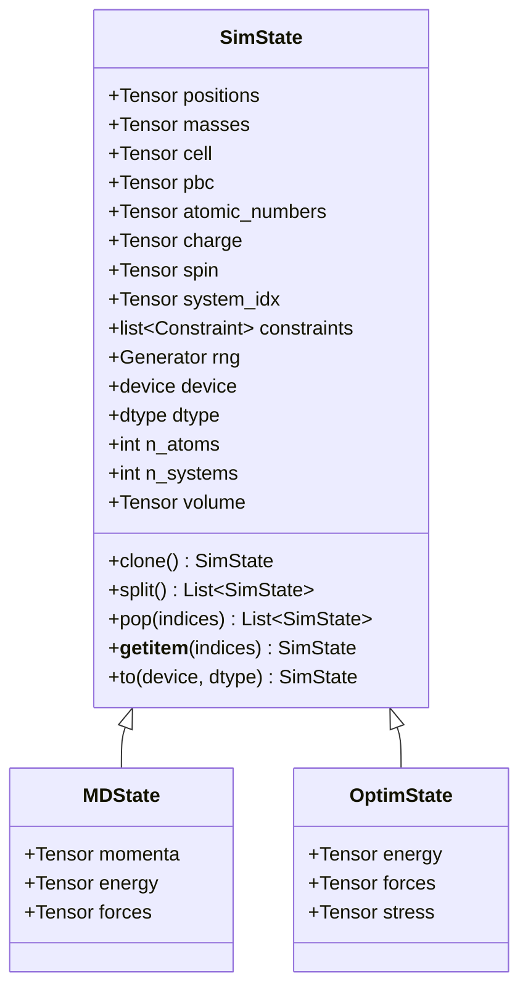
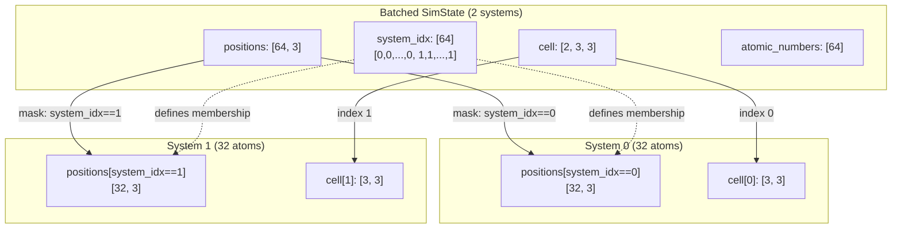
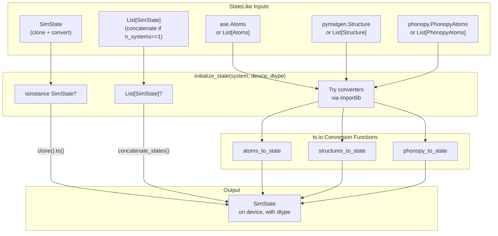
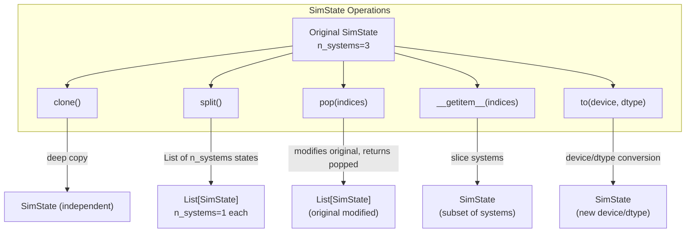
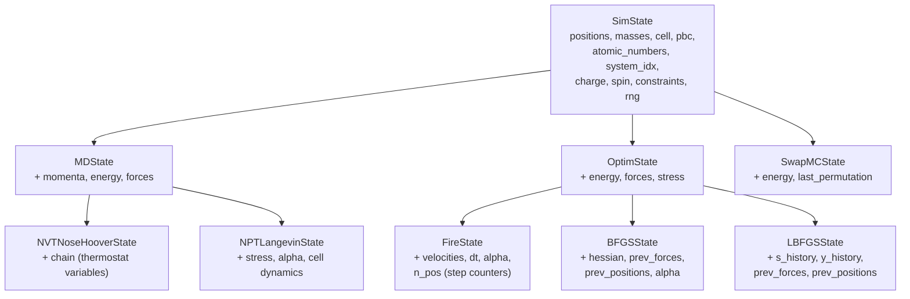
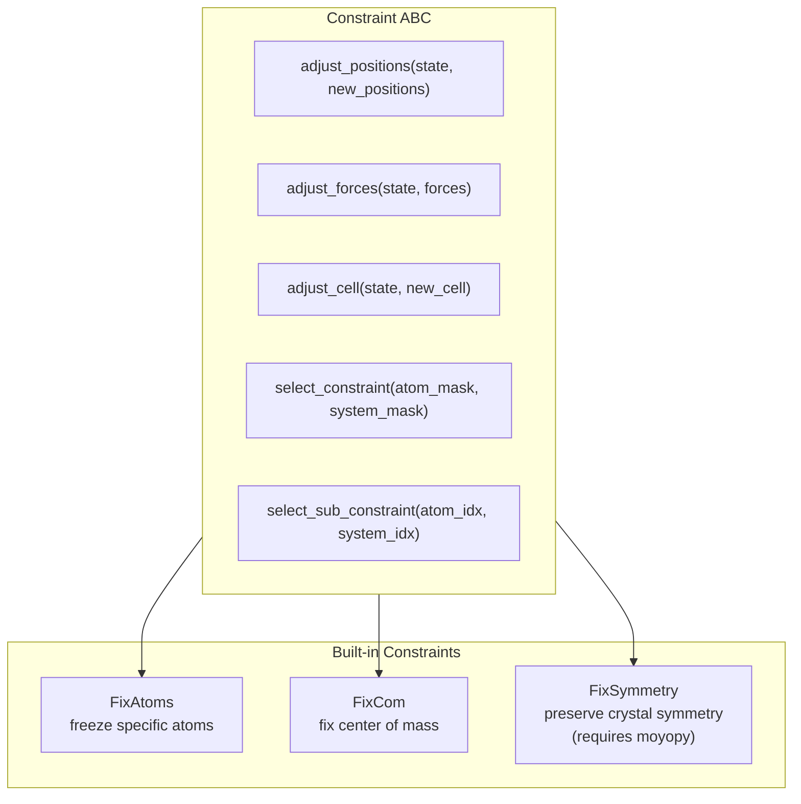

# SimState and Data Structures

<details>
<summary>Relevant source files</summary>

The following files were used as context for generating this wiki page:

- [tests/test_state.py](tests/test_state.py)
- [torch_sim/state.py](torch_sim/state.py)

</details>


This page documents the `SimState` class, the central data structure in torch-sim that represents atomistic systems. It covers the core fields, batching semantics, state hierarchies, constraints, and operations on simulation states.

For information about using SimState in molecular dynamics simulations, see page 4. For geometry optimization workflows, see page 5. For batch processing with autobatchers, see page 7.1. For I/O conversions, see page 3.4.

---

## Overview and Purpose

`SimState` is the core data structure in torch-sim, representing atomistic systems with positions, unit cells, masses, atomic numbers, and system indices stored as PyTorch tensors. It provides a GPU-accelerated, batchable representation that serves as the interface between external formats (ASE, Pymatgen, Phonopy) and torch-sim's simulation algorithms.

**Key Design Principles:**
- **GPU-first**: All data stored as PyTorch tensors on user-specified device
- **Batched operations**: Multiple independent systems can be concatenated and processed simultaneously
- **Extensible hierarchy**: Subclasses add simulation-specific fields (forces, velocities, energy, etc.)
- **Type-safe attributes**: Enforces classification of attributes into per-atom, per-system, or global scopes
- **Constraint support**: Applies physical restrictions like fixed atoms or symmetry preservation
- **Interoperable**: Bidirectional conversions with ASE, Pymatgen, and Phonopy

Sources: [torch_sim/state.py:70-125](), [torch_sim/state.py:192-248]()

---

## Core Data Fields

The `SimState` dataclass uses keyword-only arguments and stores all atomistic data as PyTorch tensors:



**Tensor Attributes:**

| Field | Shape | Dtype | Scope | Description |
|-------|-------|-------|-------|-------------|
| `positions` | `(n_atoms, 3)` | `float32/64` | per-atom | Cartesian coordinates in Ångströms |
| `masses` | `(n_atoms,)` | `float32/64` | per-atom | Atomic masses in AMU |
| `atomic_numbers` | `(n_atoms,)` | `int64` | per-atom | Atomic numbers (e.g., 14 for Si) |
| `system_idx` | `(n_atoms,)` | `int64` | per-atom | Maps each atom to its parent system (0-indexed) |
| `cell` | `(n_systems, 3, 3)` | `float32/64` | per-system | Unit cell vectors in column vector convention |
| `charge` | `(n_systems,)` | `float32/64` | per-system | Total charge per system (defaults to zero) |
| `spin` | `(n_systems,)` | `float32/64` | per-system | Total spin per system (defaults to zero) |
| `pbc` | `(3,)` | `bool` | global | Periodic boundary conditions per axis |

**Non-Tensor Attributes:**

| Field | Type | Scope | Description |
|-------|------|-------|-------------|
| `_constraints` | `list[Constraint]` | N/A | Physical restrictions (fixed atoms, symmetry, etc.) |
| `_rng` | `PRNGLike` | global | Random number generator (int seed, Generator, or None) |

**Properties:**

| Property | Type | Description |
|----------|------|-------------|
| `device` | `torch.device` | Device where tensors reside (derived from positions) |
| `dtype` | `torch.dtype` | Data type of floating-point tensors (derived from positions) |
| `n_atoms` | `int` | Total number of atoms: `positions.shape[0]` |
| `n_systems` | `int` | Number of independent systems: `torch.unique(system_idx).shape[0]` |
| `n_atoms_per_system` | `Tensor` | Atoms per system: `system_idx.bincount()` |
| `volume` | `Tensor` | Cell volume per system: `torch.det(cell)` |
| `wrap_positions` | `Tensor` | Positions wrapped according to PBC |
| `constraints` | `list[Constraint]` | Getter/setter for constraint list with validation |
| `rng` | `Generator` | Lazily initialized random number generator |

Sources: [torch_sim/state.py:70-163](), [torch_sim/state.py:259-298]()

---

## Batching Semantics

Torch-sim supports batching multiple independent systems into a single `SimState` for efficient GPU processing. The `system_idx` tensor maps each atom to its parent system using consecutive integers starting from 0.

**Diagram: Batched System Layout**



**system_idx Invariants:**

The `system_idx` tensor must satisfy:
- **Consecutive**: Systems are numbered `0, 1, 2, ..., n_systems-1`
- **Unique consecutive integers**: Enforced by `__setattr__` using `torch.unique_consecutive` and `torch.bincount`
- **Atom ordering**: Atoms are grouped by system (all atoms from system 0, then system 1, etc.)

**Batching Example:**

```python
# Create individual states
ar_state_1 = ts.initialize_state(ar_atoms, device, dtype)  # 32 atoms, system_idx=[0,0,...,0]
ar_state_2 = ts.initialize_state(ar_atoms, device, dtype)  # 32 atoms, system_idx=[0,0,...,0]

# Concatenate using concatenate_states
batched = ts.concatenate_states([ar_state_1, ar_state_2])
# batched.positions.shape: (64, 3)
# batched.cell.shape: (2, 3, 3)
# batched.system_idx: [0,0,...,0,1,1,...,1] (length 64)
# batched.n_systems: 2
# batched.n_atoms: 64

# Access per-system data
atoms_per_system = batched.n_atoms_per_system  # tensor([32, 32])

# Split back to individual systems
systems = batched.split()  # List[SimState], length 2
# systems[0].n_atoms: 32, systems[0].system_idx: all zeros
# systems[1].n_atoms: 32, systems[1].system_idx: all zeros
```

**Invalid system_idx:**

```python
# This raises ValueError: "System indices must be unique consecutive integers"
SimState(
    positions=torch.randn(8, 3),
    masses=torch.ones(8),
    cell=torch.eye(3).unsqueeze(0),
    pbc=True,
    atomic_numbers=torch.ones(8, dtype=torch.int),
    system_idx=torch.tensor([0, 0, 2, 2, 2, 2, 2, 2])  # Missing system 1!
)
```

Sources: [torch_sim/state.py:174-190](), [torch_sim/state.py:1054-1196](), [tests/test_state.py:146-179]()

---

## Attribute Classification

All `SimState` attributes must be classified into one of three scopes, enforced by `__init_subclass__`:

```mermaid
graph TB
    subgraph PerAtom["Per-Atom Attributes (_atom_attributes)"]
        direction TB
        pos["positions<br/>Shape: (n_atoms, ...)"]
        mass["masses"]
        atmnum["atomic_numbers"]
        sysidx["system_idx"]
        forces["forces*"]
        momenta["momenta*"]
    end
    
    subgraph PerSystem["Per-System Attributes (_system_attributes)"]
        direction TB
        cell["cell<br/>Shape: (n_systems, ...)"]
        charge["charge"]
        spin["spin"]
        energy["energy*"]
        stress["stress*"]
    end
    
    subgraph Global["Global Attributes (_global_attributes)"]
        direction TB
        pbc["pbc<br/>Shape: (3,)"]
        rng["_rng"]
    end
    
    note1["* Added by subclasses"]
```



**Scope Definitions:**

| Scope | ClassVar | Shape Convention | Concatenation Behavior | Split Behavior |
|-------|----------|------------------|------------------------|----------------|
| per-atom | `_atom_attributes` | `(n_atoms, ...)` | `torch.cat` along dim 0 | Index by atom mask |
| per-system | `_system_attributes` | `(n_systems, ...)` | `torch.cat` along dim 0 | Index by system index |
| global | `_global_attributes` | Arbitrary | Take from first state | Replicate to all splits |

**SimState Base Classification:**

```python
# From torch_sim/state.py
_atom_attributes: ClassVar[set[str]] = {
    "positions", "masses", "atomic_numbers", "system_idx"
}
_system_attributes: ClassVar[set[str]] = {
    "cell", "charge", "spin"
}
_global_attributes: ClassVar[set[str]] = {
    "pbc", "_rng"
}
```

**Extending in Subclasses:**

```python
# From torch_sim/integrators/md.py (simplified)
@dataclass(kw_only=True)
class MDState(SimState):
    momenta: torch.Tensor      # per-atom
    energy: torch.Tensor       # per-system
    forces: torch.Tensor       # per-atom
    
    _atom_attributes = SimState._atom_attributes | {"momenta", "forces"}
    _system_attributes = SimState._system_attributes | {"energy"}
```

**Validation:**

Two checks are enforced at class definition time:
1. **No duplicates**: An attribute cannot appear in multiple scopes
2. **Complete coverage**: All non-private, non-method attributes must be declared in exactly one scope

```python
# This raises TypeError at class definition:
class BadState(SimState):
    new_field: torch.Tensor  # Not declared in any scope!
```

Sources: [torch_sim/state.py:155-163](), [torch_sim/state.py:592-684](), [torch_sim/state.py:808-832](), [tests/test_state.py:42-73]()

---

## State Initialization

The primary entry point for creating `SimState` objects is the `initialize_state` function, which handles multiple input formats:

**Diagram: initialize_state Workflow**



**Function Signature:**

```python
def initialize_state(
    system: StateLike,              # Single or list of: SimState, Atoms, Structure, PhonopyAtoms
    device: torch.device | None = None,
    dtype: torch.dtype | None = None,
) -> SimState
```

**Usage Examples:**

```python
# From ASE Atoms (single system)
from ase.build import bulk
atoms = bulk("Si", "diamond", a=5.43)
state = ts.initialize_state(atoms, device="cuda", dtype=torch.float32)
# state.n_systems: 1

# From multiple Atoms (batched)
atoms_list = [bulk("Si"), bulk("Ge"), bulk("Cu")]
batched = ts.initialize_state(atoms_list, device="cuda", dtype=torch.float32)
# batched.n_systems: 3

# From existing SimState (clone + convert)
new_state = ts.initialize_state(existing_state, device="cpu", dtype=torch.float64)

# From list of SimStates with n_systems==1 (concatenates)
state1 = ts.initialize_state(atoms1, device, dtype)
state2 = ts.initialize_state(atoms2, device, dtype)
combined = ts.initialize_state([state1, state2], device, dtype)
# combined.n_systems: 2
```

**Error Handling:**

```python
# Raises ValueError if list contains SimStates with n_systems > 1
state_batch = ts.concatenate_states([atoms1, atoms2])  # n_systems=2
ts.initialize_state([state_batch], device, dtype)  # ValueError!

# Raises ValueError if list contains mixed types
ts.initialize_state([atoms_obj, structure_obj], device, dtype)  # ValueError!

# Raises ValueError for unsupported types
ts.initialize_state("unsupported.cif", device, dtype)  # ValueError!
```

Sources: [torch_sim/state.py:1199-1273](), [tests/test_state.py:334-393]()

---

## State Operations

`SimState` provides several methods for manipulating and querying batched systems:

**Diagram: State Operations**



### clone()

Creates a deep copy with independent tensors and RNG state:

```python
original = ts.initialize_state(atoms, device, dtype)
cloned = original.clone()
# cloned is independent: modifications don't affect original
# RNG state is cloned with same seed but independent generator
```

### split()

Divides a batched state into individual single-system states:

```python
batched = ts.concatenate_states([state1, state2, state3])  # n_systems=3
individual = batched.split()  # List[SimState], length 3
# individual[0].n_systems: 1, system_idx: all zeros
# individual[1].n_systems: 1, system_idx: all zeros
# individual[2].n_systems: 1, system_idx: all zeros
```

### pop(system_indices)

Removes specified systems from the state **in-place** and returns them:

```python
state = ts.concatenate_states([s0, s1, s2, s3])  # n_systems=4
popped = state.pop([1, 3])  # Returns [s1, s3]
# state.n_systems: 2 (now contains only s0, s2 with system_idx=[0,1])
# popped: [SimState(s1), SimState(s3)] (each with n_systems=1)
```

Supports multiple index formats: `int`, `list[int]`, `slice`, or `torch.Tensor`.

### __getitem__(system_indices)

Standard Python slicing to extract subsets **without modifying** the original:

```python
state = ts.concatenate_states([s0, s1, s2, s3])  # n_systems=4

# Integer indexing
single = state[1]  # SimState(s1), n_systems=1

# List indexing (preserves order)
subset = state[[3, 0, 1]]  # SimState containing s3, s0, s1 (in that order)

# Slice indexing
slice_state = state[1:3]  # SimState(s1, s2), n_systems=2

# Negative indexing
last = state[-1]  # SimState(s3)

# Step slicing
evens = state[::2]  # SimState(s0, s2), n_systems=2
```

**Note:** Unlike `pop()`, slicing creates a new state and leaves the original unchanged.

### to(device, dtype)

Moves all tensors to a new device and/or converts data types:

```python
cpu_state = ts.initialize_state(atoms, device="cpu", dtype=torch.float32)
gpu_state = cpu_state.to(device="cuda", dtype=torch.float64)
# gpu_state is a new state on CUDA with float64
# cpu_state is unchanged
```

Sources: [torch_sim/state.py:444-590](), [tests/test_state.py:275-530](), [tests/test_state.py:695-724]()

---

## concatenate_states Function

The top-level function `concatenate_states` combines multiple single-system or multi-system states into a single batched state:

**Function Signature:**

```python
def concatenate_states[T: SimState](
    states: Sequence[T],
    device: torch.device | None = None
) -> T
```

**Concatenation Rules:**

1. **Type preservation**: All states must be the same type; returns same type
2. **Global attributes**: Taken from the first state (e.g., `pbc`, `_rng`)
3. **Per-atom attributes**: Concatenated along dim 0 with `torch.cat`
4. **Per-system attributes**: Concatenated along dim 0 with `torch.cat`
5. **system_idx remapping**: Offset by cumulative system counts
6. **Constraints merging**: Combined using `merge_constraints` with offsets
7. **Padded attributes**: Special handling for BFGS/L-BFGS history tensors

**Example Usage:**

```python
# Basic concatenation
state1 = ts.initialize_state(atoms1, device, dtype)  # 8 atoms, n_systems=1
state2 = ts.initialize_state(atoms2, device, dtype)  # 12 atoms, n_systems=1
batched = ts.concatenate_states([state1, state2])
# batched.n_atoms: 20
# batched.n_systems: 2
# batched.system_idx: [0,0,0,0,0,0,0,0, 1,1,1,1,1,1,1,1,1,1,1,1]

# Concatenate already-batched states
batch1 = ts.concatenate_states([s1, s2])  # n_systems=2
batch2 = ts.concatenate_states([s3, s4])  # n_systems=2
combined = ts.concatenate_states([batch1, batch2])
# combined.n_systems: 4 (systems renumbered 0,1,2,3)

# Preserve type in hierarchy
md_state1 = MDState(...)
md_state2 = MDState(...)
combined_md = ts.concatenate_states([md_state1, md_state2])
# type(combined_md): MDState (not SimState)
```

**Special Handling for Optimizer States:**

```python
# BFGS hessians are padded to max DOF before concatenation
bfgs_state1 = BFGSState(..., hessian=torch.eye(12))  # 4 atoms × 3 dims
bfgs_state2 = BFGSState(..., hessian=torch.eye(18))  # 6 atoms × 3 dims
combined = ts.concatenate_states([bfgs_state1, bfgs_state2])
# combined.hessian.shape: (2, 18, 18) - padded to max size
```

Sources: [torch_sim/state.py:1054-1196](), [tests/test_state.py:146-273]()

---

## State Hierarchy and Subclassing

`SimState` is designed to be extended via dataclass inheritance, with strict enforcement of attribute classification:

**Diagram: State Hierarchy**



**Key State Types:**

| State Class | Module | Primary Use | Key Additional Fields |
|-------------|--------|-------------|----------------------|
| `SimState` | `torch_sim.state` | Base representation | (see Core Data Fields) |
| `MDState` | `torch_sim.integrators.md` | MD simulations | `momenta`, `energy`, `forces` |
| `OptimState` | `torch_sim.optimizers.state` | Geometry optimization | `energy`, `forces`, `stress` |
| `NVTNoseHooverState` | `torch_sim.integrators.nvt` | NVT ensemble | `chain` (thermostat) |
| `NPTLangevinState` | `torch_sim.integrators.npt` | NPT ensemble | `stress`, `cell_positions`, `cell_velocities` |
| `FireState` | `torch_sim.optimizers.state` | FIRE optimizer | `velocities`, `dt`, `alpha`, `n_pos` |
| `BFGSState` | `torch_sim.optimizers.state` | BFGS optimizer | `hessian`, `prev_forces`, `prev_positions` |
| `LBFGSState` | `torch_sim.optimizers.state` | L-BFGS optimizer | `s_history`, `y_history` |
| `SwapMCState` | `torch_sim.monte_carlo` | Monte Carlo | `energy`, `last_permutation` |

**Subclassing Requirements:**

1. **Use `@dataclass(kw_only=True)`**: All fields must be keyword-only
2. **Declare attribute scope**: Update `_atom_attributes`, `_system_attributes`, or `_global_attributes`
3. **No `Tensor | None` types**: Use dummy tensors instead (enforced by `__init_subclass__`)
4. **Call superclass `__post_init__`**: If overriding post-initialization

**Example: Creating a Custom State**

```python
from dataclasses import dataclass, field
from typing import ClassVar
import torch
from torch_sim.state import SimState

@dataclass(kw_only=True)
class CustomState(SimState):
    # Per-atom field
    custom_per_atom: torch.Tensor
    
    # Per-system field
    custom_per_system: torch.Tensor
    
    # Declare scopes (REQUIRED)
    _atom_attributes: ClassVar[set[str]] = (
        SimState._atom_attributes | {"custom_per_atom"}
    )
    _system_attributes: ClassVar[set[str]] = (
        SimState._system_attributes | {"custom_per_system"}
    )
```

**from_state() for Type Conversion:**

The `from_state` classmethod creates a new state type from an existing state:

```python
# Upcast: SimState -> MDState
sim_state = ts.initialize_state(atoms, device, dtype)
md_state = MDState.from_state(
    sim_state,
    momenta=torch.zeros_like(sim_state.positions),
    energy=torch.zeros(sim_state.n_systems, device=device),
    forces=torch.zeros_like(sim_state.positions)
)

# Downcast: MDState -> SimState
sim_state_back = SimState.from_state(md_state)
# Only SimState fields are copied

# Cross-cast: MDState -> OptimState
optim_state = OptimState.from_state(
    md_state,
    energy=md_state.energy,
    forces=md_state.forces,
    stress=torch.zeros(md_state.n_systems, 3, 3, device=device)
)
```

Sources: [torch_sim/state.py:459-492](), [tests/test_state.py:90-106](), [tests/test_state.py:1010-1209]()

---

## Cell Conventions and Properties

Torch-sim stores cell vectors using the **column vector convention** internally, but provides properties for both conventions:

**Cell Storage Format:**

```python
# Internal storage: cell.shape = (n_systems, 3, 3)
# Column vectors: [[a_x, b_x, c_x],
#                  [a_y, b_y, c_y],
#                  [a_z, b_z, c_z]]
# where a, b, c are the three lattice vectors
```

**Accessor Properties:**

```python
# Column vector convention (internal storage)
column_cell = state.column_vector_cell  # or just state.cell
# Same as state.cell

# Row vector convention (ASE-compatible)
row_cell = state.row_vector_cell
# Equivalent to state.cell.mT (matrix transpose)
# [[a_x, a_y, a_z],
#  [b_x, b_y, b_z],
#  [c_x, c_y, c_z]]

# Setting cells
state.column_vector_cell = new_column_cell
state.row_vector_cell = new_row_cell  # Internally transposes and stores
```

**Cell Operations:**

```python
# Compute cell volume
volume = state.volume  # torch.det(state.cell), shape: (n_systems,)

# Change cell with optional atom scaling
state.set_cell(
    new_cell,           # shape: (n_systems, 3, 3) in column convention
    scale_atoms=True    # Scale positions to preserve fractional coords
)

# With constraints
state.set_constrained_cell(
    new_cell,
    scale_atoms=True
)  # Applies constraints.adjust_cell() before setting
```

**Wrapped Positions:**

```python
# Get positions wrapped into primary cell
wrapped = state.wrap_positions  # Respects state.pbc
# Uses ts.transforms.pbc_wrap_batched() internally
# If pbc is all False, returns unwrapped positions
```

**DeformGradMixin for Strain Calculations:**

States can inherit from `DeformGradMixin` to track deformation gradients:

```python
from torch_sim.state import DeformGradMixin, SimState

@dataclass(kw_only=True)
class DeformState(SimState, DeformGradMixin):
    reference_cell: torch.Tensor
    
    _system_attributes = (
        SimState._system_attributes | DeformGradMixin._system_attributes
    )

# Usage
state = DeformState(
    positions=positions,
    masses=masses,
    cell=deformed_cell,
    pbc=True,
    atomic_numbers=atomic_numbers,
    reference_cell=original_cell
)

# Compute deformation gradient F = (h_0^-1 @ h)^T
deform_grad = state.deform_grad()  # shape: (n_systems, 3, 3)
```

Sources: [torch_sim/state.py:305-331](), [torch_sim/state.py:390-413](), [torch_sim/state.py:259-268](), [torch_sim/state.py:687-729](), [tests/test_state.py:532-680]()

---

## Constraints

`SimState` supports constraints that enforce physical restrictions during simulations. Constraints are stored in the `_constraints` field and validated during initialization and when set.

**Diagram: Constraint System**



**Setting Constraints:**

```python
from torch_sim.constraints import FixAtoms, FixCom

# Create state
state = ts.initialize_state(atoms, device, dtype)

# Apply single constraint
state.constraints = FixAtoms(atom_idx=torch.tensor([0, 1, 2]))

# Apply multiple constraints (as list)
state.constraints = [
    FixAtoms(atom_idx=torch.tensor([0, 1])),
    FixCom()
]

# Constraints are validated on assignment
# Raises ValueError if constraints are invalid or span multiple systems
```

**Using Constrained Setters:**

```python
# Set positions with constraint application
new_positions = state.positions + displacement
state.set_constrained_positions(new_positions)
# Calls constraint.adjust_positions() before setting

# Set cell with constraint application
new_cell = scale_factor * state.cell
state.set_constrained_cell(new_cell, scale_atoms=True)
# Calls constraint.adjust_cell() before setting
```

**Degrees of Freedom:**

```python
# Get DOF accounting for constraints
dof = state.get_number_of_degrees_of_freedom()
# Returns: torch.Tensor with shape (n_systems,)
# Base DOF: 3 * n_atoms_per_system
# Reduced by constraints (e.g., FixAtoms removes 3 DOF per fixed atom)
```

**Constraint Behavior in Operations:**

- **split()**: Each split state gets relevant constraints for its atoms
- **concatenate_states()**: Constraints are merged with index offsets applied
- **pop()**: Constraints are filtered to popped systems
- **__getitem__**: Constraints are filtered to sliced systems

**Example: FixAtoms**

```python
from torch_sim.constraints import FixAtoms

# Fix first 4 atoms
state.constraints = FixAtoms(atom_idx=torch.tensor([0, 1, 2, 3]))

# During integration, forces on fixed atoms are zeroed
# and positions are not updated
```

Sources: [torch_sim/state.py:99-101](), [torch_sim/state.py:333-389](), [torch_sim/state.py:415-431](), [torch_sim/constraints.py]()

---

## Common Patterns

**Pattern 1: Creating and Running MD Simulation**
```python
# Initialize from ASE
atoms = bulk("Cu", "fcc", a=3.6, cubic=True)
state = ts.io.atoms_to_state(atoms, device="cuda", dtype=torch.float32)

# Run MD
final_state = ts.integrate(
    system=state,
    model=model,
    integrator=ts.Integrator.nvt_langevin,
    n_steps=1000,
    temperature=300.0,
    timestep=0.001
)
```

**Pattern 2: Batch Processing Multiple Systems**
```python
# Load multiple structures
atoms_list = [bulk("Si"), bulk("Ge"), bulk("Cu")]
batched_state = ts.initialize_state(atoms_list, device="cuda", dtype=torch.float32)

# Process with autobatcher
final_state = ts.optimize(
    system=batched_state,
    model=model,
    optimizer=ts.Optimizer.fire,
    autobatcher=True  # Automatically manages memory
)

# Split results
final_systems = final_state.split()
```

**Pattern 3: Format Conversion Workflow**
```python
# Load from Pymatgen
structures = [Structure.from_file("POSCAR1"), Structure.from_file("POSCAR2")]
state = ts.io.structures_to_state(structures, device="cuda", dtype=torch.float32)

# Run simulation
optimized_state = ts.optimize(...)

# Export to Phonopy for phonon calculation
phonopy_atoms = ts.io.state_to_phonopy(optimized_state)
```

Sources: [tests/test_runners.py:17-52](), [tests/test_io.py:201-256](), [examples/]() (referenced)

---