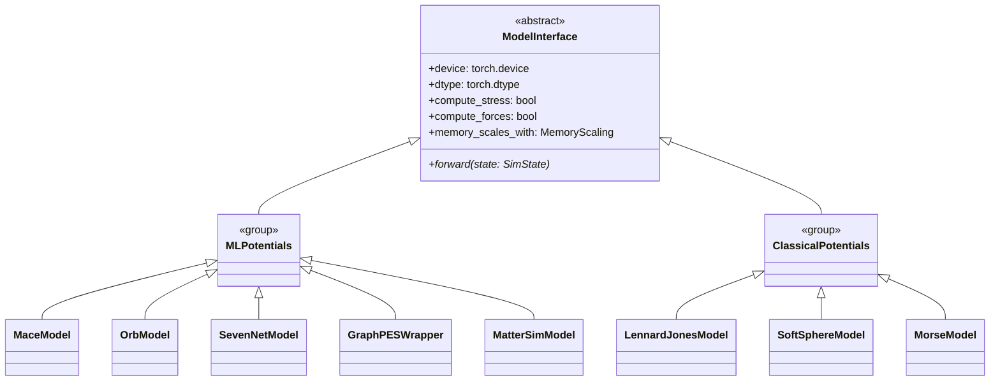
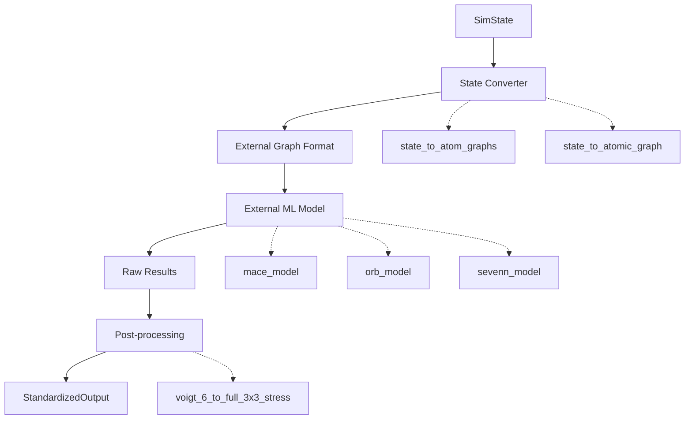
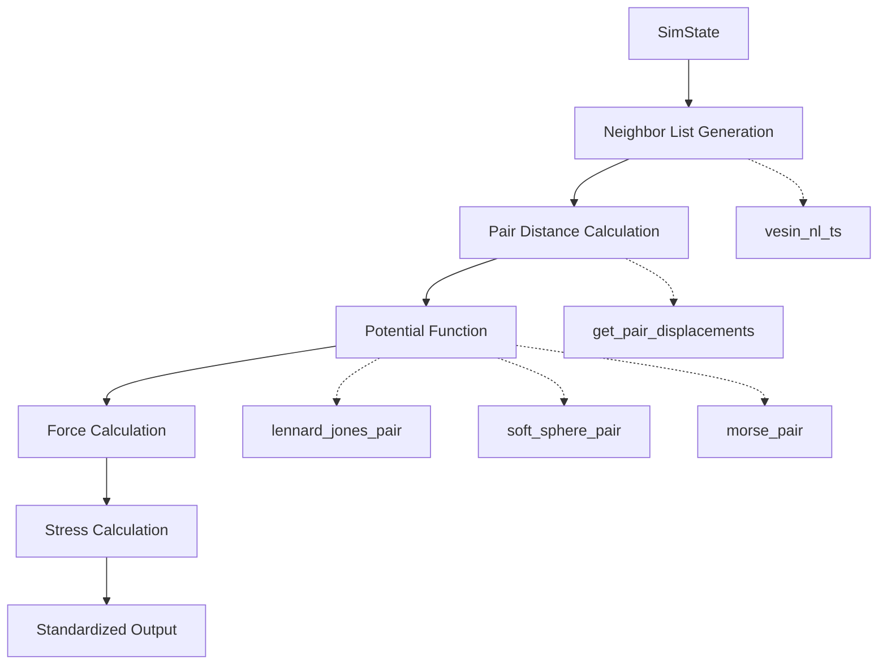
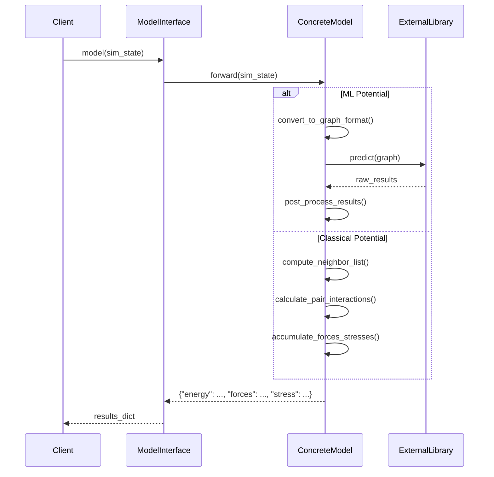

# Model Interface

<details>
<summary>Relevant source files</summary>

The following files were used as context for generating this wiki page:

- [tests/models/test_fairchem.py](tests/models/test_fairchem.py)
- [tests/models/test_orb.py](tests/models/test_orb.py)
- [tests/models/test_sevennet.py](tests/models/test_sevennet.py)
- [tests/test_elastic.py](tests/test_elastic.py)
- [torch_sim/models/fairchem.py](torch_sim/models/fairchem.py)
- [torch_sim/models/mace.py](torch_sim/models/mace.py)
- [torch_sim/models/orb.py](torch_sim/models/orb.py)

</details>


The Model Interface defines the abstract base class and contract that all energy and force models in torch-sim must implement. This interface ensures consistent behavior across different model types, from machine learning potentials to classical force fields, enabling them to be used interchangeably within simulation workflows.

For information about specific model implementations, see [Machine Learning Potentials](#4.1) and [Classical Potentials](#4.2). For details about the SimState data structure that models operate on, see [SimState and Data Structures](#3.1).

## Core Interface Definition

The `ModelInterface` abstract base class serves as the foundation for all models in torch-sim. It establishes the essential contract that enables different computational backends to work seamlessly within the simulation framework.



**Sources:** [torch_sim/models/interface.py:38-171](), [torch_sim/models/orb.py:250-433](), [torch_sim/models/sevennet.py:47-261](), [torch_sim/models/lennard_jones.py:122-414](), [torch_sim/models/soft_sphere.py:133-435](), [torch_sim/models/morse.py:115-401]()

### Required Properties

All models must implement these core properties:

| Property | Type | Description |
|----------|------|-------------|
| `device` | `torch.device` | Computation device (CPU/GPU) |
| `dtype` | `torch.dtype` | Data type for calculations |
| `compute_stress` | `bool` | Whether model computes stress tensors |
| `compute_forces` | `bool` | Whether model computes atomic forces |
| `memory_scales_with` | `MemoryScaling` | Memory scaling behavior for autobatching |

The `memory_scales_with` property indicates how the model's memory usage scales with system size:
- `"n_atoms"`: Memory scales linearly with atom count (models with fixed neighbor counts)
- `"n_atoms_x_density"`: Memory scales with atom count × density (models with radial cutoffs)

**Sources:** [torch_sim/models/interface.py:77-133]()

### Abstract Forward Method

The core computational method that all models must implement:

```python
@abstractmethod
def forward(self, state: SimState | StateDict, **kwargs) -> dict[str, torch.Tensor]:
    """Calculate energies, forces, and stresses for an atomistic system."""
```

**Input:**
- `state`: Either a `SimState` object or dictionary containing atomic positions, cell, system indices, and atomic numbers

**Output:**
- Dictionary containing computed properties:
  - `"energy"`: Potential energy with shape `[n_systems]`
  - `"forces"`: Atomic forces with shape `[n_atoms, 3]` (if `compute_forces=True`)
  - `"stress"`: Stress tensor with shape `[n_systems, 3, 3]` (if `compute_stress=True`)

**Sources:** [torch_sim/models/interface.py:135-170]()

## Model Implementation Patterns

### Machine Learning Potential Wrappers

ML potential models typically wrap external libraries and follow this pattern:



**Example from ORB implementation:**
1. Convert `SimState` to `AtomGraphs` using `state_to_atom_graphs()`
2. Run inference with the ORB model via `model.predict()`
3. Post-process outputs (e.g., convert Voigt stress to full tensor)
4. Return standardized dictionary format

**Sources:** [torch_sim/models/orb.py:64-248](), [torch_sim/models/sevennet.py:152-261](), [torch_sim/models/graphpes.py:58-191]()

### Classical Potential Models

Classical models implement analytical potentials directly:



**Example from Lennard-Jones implementation:**
1. Generate neighbor list using `vesin_nl_ts()` or compute all pairs
2. Calculate pair displacements with `get_pair_displacements()`
3. Compute pair energies using `lennard_jones_pair()`
4. Accumulate forces and stresses from pair contributions

**Sources:** [torch_sim/models/lennard_jones.py:223-354](), [torch_sim/models/soft_sphere.py:253-378](), [torch_sim/models/morse.py:230-344]()

## Data Flow Through the Interface

The model interface standardizes how atomic systems flow through different computational backends:



This unified interface allows models to be used interchangeably in high-level functions like `ts.integrate()`, `ts.optimize()`, and `ts.static()`.

**Sources:** [torch_sim/models/interface.py:136-170](), [examples/tutorials/low_level_tutorial.py:115-122]()

## Validation Framework

The interface includes validation utilities to ensure model implementations conform to the contract:

### Model Output Validation

The `validate_model_outputs()` function tests model implementations against the interface requirements:

```python
def validate_model_outputs(model: ModelInterface, device: torch.device, dtype: torch.dtype) -> None:
    """Validate model outputs against interface requirements."""
```

**Validation checks:**
- Required properties exist (`device`, `dtype`, `compute_stress`, `compute_forces`)
- Model doesn't mutate input `SimState`
- Output dictionary contains required keys (`"energy"`, optionally `"forces"`, `"stress"`)
- Output tensor shapes match expected dimensions
- Batch consistency (single system results match multi-batch results)

**Test systems:**
- Silicon diamond structure (8 atoms)
- Iron FCC structure (3 atoms)

**Sources:** [torch_sim/models/interface.py:173-289]()

### Memory Scaling Configuration

Models must correctly specify their memory scaling behavior for the autobatching system:

```python
@property
def memory_scales_with(self) -> MemoryScaling:
    """The metric that the model scales with."""
    return getattr(self, "_memory_scales_with", "n_atoms_x_density")
```

- **"n_atoms"**: For models with fixed connectivity (e.g., some graph neural networks)
- **"n_atoms_x_density"**: For models with radial cutoffs (most ML potentials and classical models)

**Sources:** [torch_sim/models/interface.py:125-133](), [torch_sim/models/sevennet.py:111](), [torch_sim/models/graphpes.py:174-175]()

## Implementation Examples

### Minimal Model Implementation

```python
class CustomModel(ModelInterface):
    def __init__(self, device=None, dtype=torch.float32):
        self._device = device or torch.device("cpu")
        self._dtype = dtype
        self._compute_forces = True
        self._compute_stress = True
    
    def forward(self, state: SimState) -> dict[str, torch.Tensor]:
        # Implement energy, force, and stress calculations
        results = {
            "energy": energy_tensor,      # shape: [n_systems]
            "forces": forces_tensor,      # shape: [n_atoms, 3]
            "stress": stress_tensor,      # shape: [n_systems, 3, 3]
        }
        return results
```

This interface design enables torch-sim's flexible simulation framework where any model implementing this contract can be used across different simulation types and optimization strategies.

**Sources:** [torch_sim/models/interface.py:8-27](), [examples/tutorials/low_level_tutorial.py:88-105]()

---