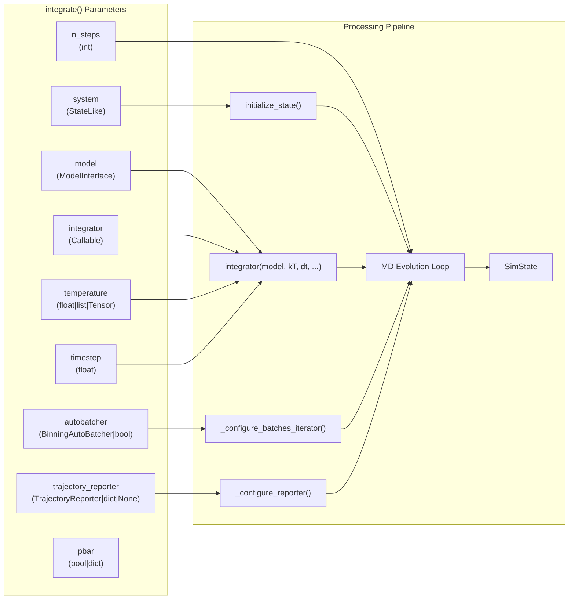
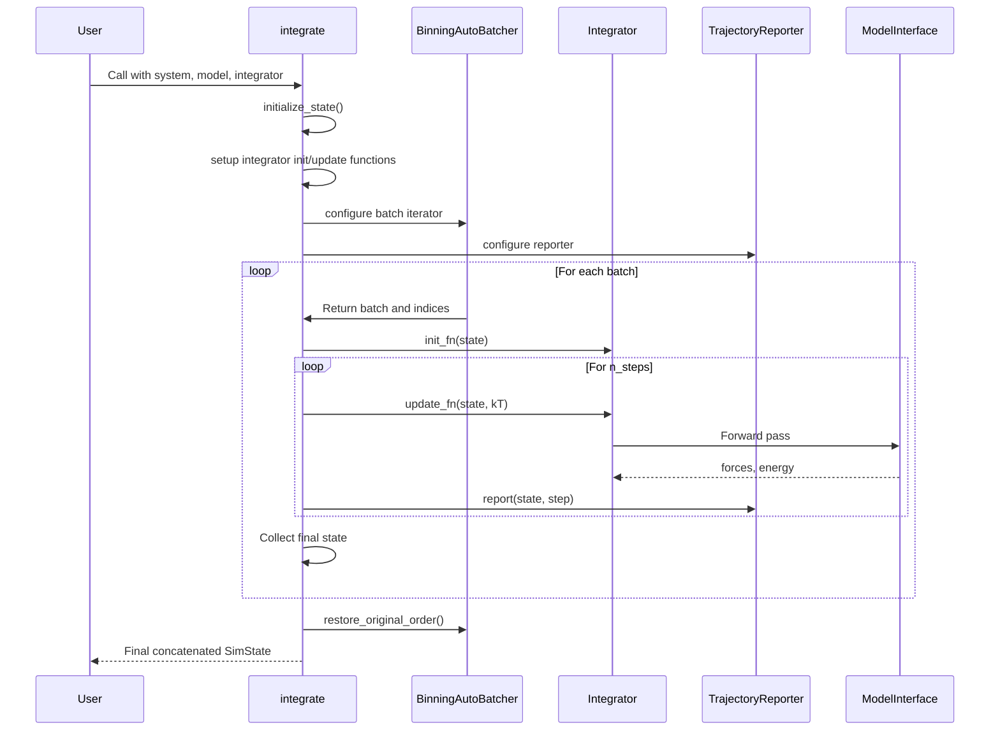
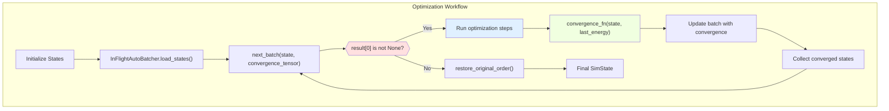
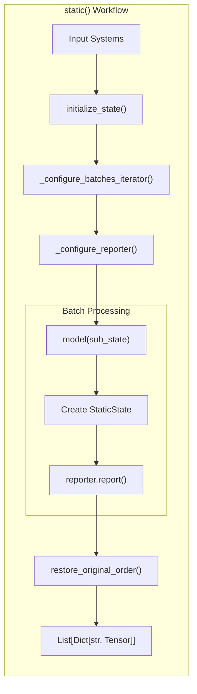
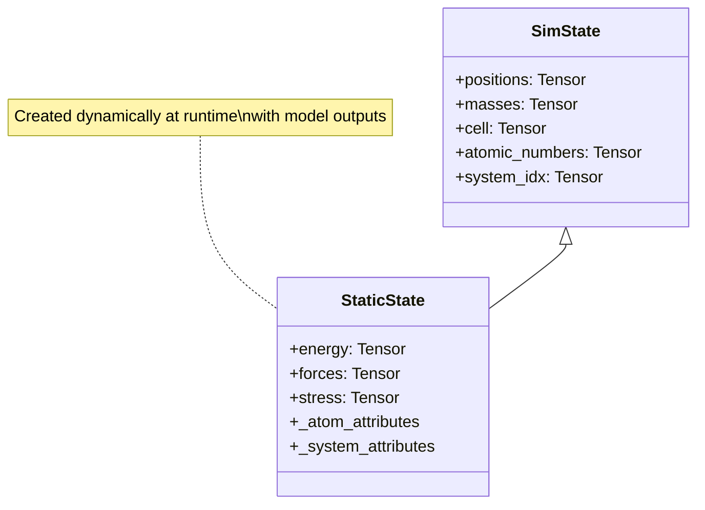
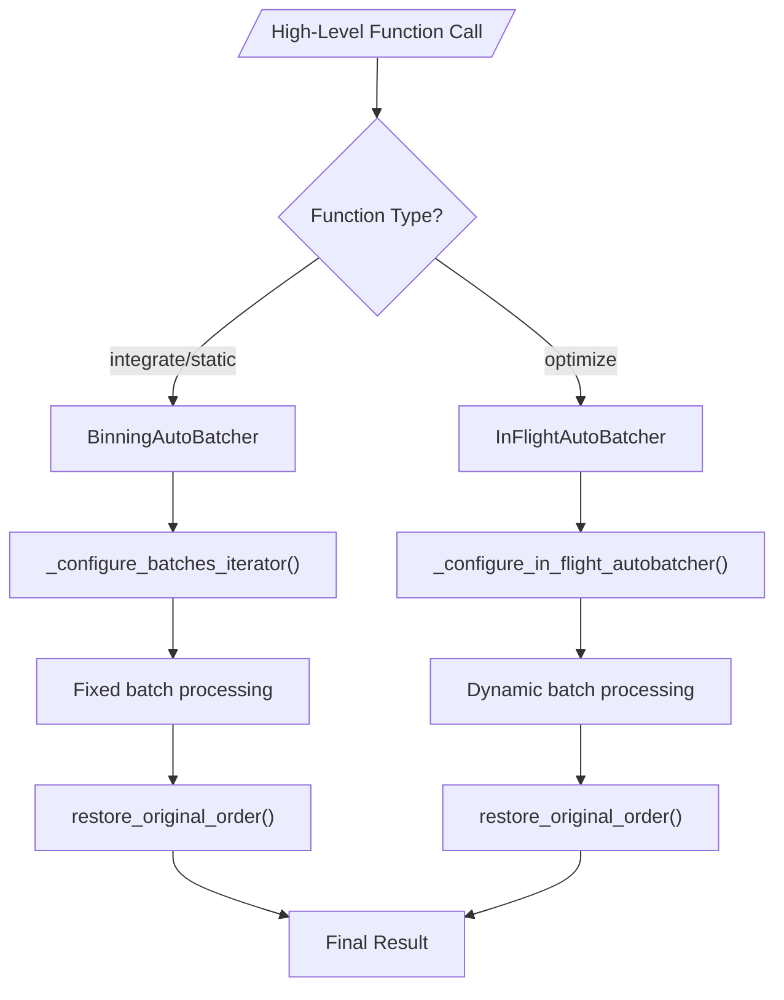
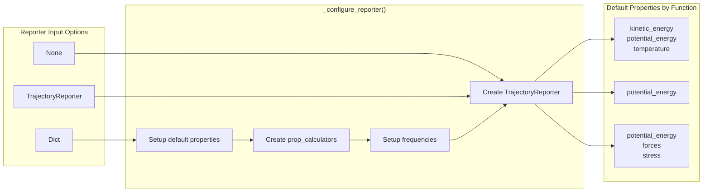
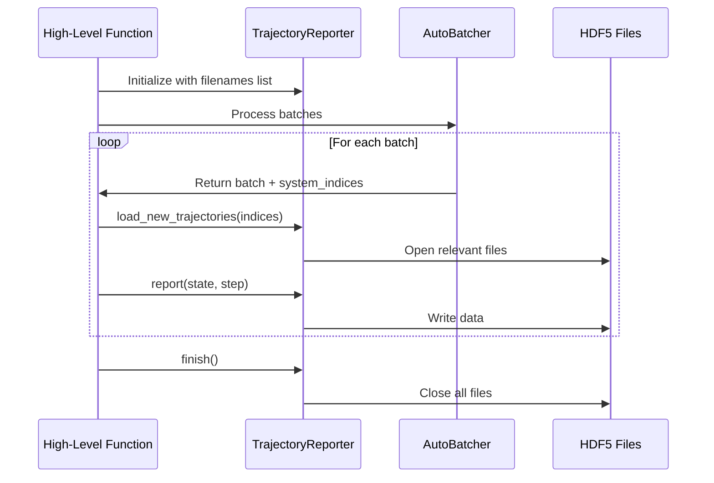

# High-Level API Functions

<details>
<summary>Relevant source files</summary>

The following files were used as context for generating this wiki page:

- [tests/test_runners.py](tests/test_runners.py)
- [tests/test_trajectory.py](tests/test_trajectory.py)
- [torch_sim/runners.py](torch_sim/runners.py)
- [torch_sim/trajectory.py](torch_sim/trajectory.py)

</details>


This page covers the three main entry points for running atomistic simulations in torch-sim: `integrate`, `optimize`, and `static`. These functions provide a simplified interface that abstracts away the complexity of state management, batching, and trajectory handling while still allowing customization through their parameters.

For details about the underlying simulation methods and algorithms, see [Simulation Methods](#5). For information about autobatching and memory management, see [Autobatching and Memory Management](#6.1).

## Overview

The high-level API consists of three primary functions in the `torch_sim.runners` module that handle different types of atomistic calculations:

| Function | Purpose | Returns | Primary Use Cases |
|----------|---------|---------|-------------------|
| `integrate` | Molecular dynamics simulations | Final `SimState` | MD trajectories, thermodynamic sampling |
| `optimize` | Geometry optimization | Optimized `SimState` | Structure relaxation, energy minimization |
| `static` | Single-point calculations | List of property dictionaries | Property evaluation, benchmarking |

## Function Architecture

The following diagram shows how the high-level API functions relate to the core torch-sim components:

```mermaid
graph TB
    subgraph "High-Level API"
        integrate["integrate()"]
        optimize["optimize()"] 
        static["static()"]
    end
    
    subgraph "Input Processing"
        initialize_state["initialize_state()"]
        configure_reporter["_configure_reporter()"]
        configure_batches["_configure_batches_iterator()"]
        configure_inflight["_configure_in_flight_autobatcher()"]
    end
    
    subgraph "Core Components"
        SimState["SimState"]
        ModelInterface["ModelInterface"]
        Integrators["Integrators<br/>(nvt_langevin, nve, etc.)"]
        Optimizers["Optimizers<br/>(fire, gradient_descent, etc.)"]
        TrajectoryReporter["TrajectoryReporter"]
    end
    
    subgraph "Execution Engines"
        BinningAutoBatcher["BinningAutoBatcher"]
        InFlightAutoBatcher["InFlightAutoBatcher"]
    end
    
    integrate --> initialize_state
    integrate --> configure_reporter
    integrate --> configure_batches
    integrate --> Integrators
    integrate --> BinningAutoBatcher
    integrate --> TrajectoryReporter
    
    optimize --> initialize_state
    optimize --> configure_reporter
    optimize --> configure_inflight
    optimize --> Optimizers
    optimize --> InFlightAutoBatcher
    optimize --> TrajectoryReporter
    
    static --> initialize_state
    static --> configure_reporter
    static --> configure_batches
    static --> BinningAutoBatcher
    static --> TrajectoryReporter
    
    initialize_state --> SimState
    Integrators --> ModelInterface
    Optimizers --> ModelInterface
    
    style integrate fill:#e1f5fe
    style optimize fill:#f3e5f5
    style static fill:#fff3e0
```



Sources: [torch_sim/runners.py:1-597]()

## integrate Function

The `integrate` function runs molecular dynamics simulations by repeatedly applying an integrator to evolve the system over time.

### Function Signature and Parameters



### Integration Workflow

The integration process follows this sequence:



Sources: [torch_sim/runners.py:111-210](), [examples/tutorials/high_level_tutorial.py:74-83]()

## optimize Function

The `optimize` function performs geometry optimization using algorithms like FIRE or gradient descent until convergence criteria are met.

### Dynamic Batch Management

Unlike `integrate`, `optimize` uses `InFlightAutoBatcher` to dynamically remove converged structures and add new ones:



### Convergence Functions

The `optimize` function supports custom convergence criteria through convergence functions:

| Function | Purpose | Signature |
|----------|---------|-----------|
| `generate_force_convergence_fn` | Force-based convergence | `(force_tol: float) -> Callable` |
| `generate_energy_convergence_fn` | Energy-based convergence | `(energy_tol: float) -> Callable` |
| Custom function | User-defined criteria | `(state: SimState, last_energy: Tensor) -> Tensor` |

Sources: [torch_sim/runners.py:358-480](), [torch_sim/runners.py:291-356](), [examples/tutorials/high_level_tutorial.py:383-413]()

## static Function

The `static` function performs single-point calculations on a collection of systems without any evolution, returning computed properties rather than states.

### Static Calculation Pipeline



### StaticState Construction

The `static` function dynamically creates a `StaticState` class that includes computed properties:



Sources: [torch_sim/runners.py:483-596](), [torch_sim/runners.py:538-549](), [examples/tutorials/high_level_tutorial.py:432-456]()

## Autobatching Integration

All three high-level functions integrate with the autobatching system to manage GPU memory efficiently:

### Autobatcher Selection



### Memory Management Configuration

| Parameter | Purpose | Functions |
|-----------|---------|-----------|
| `autobatcher=True` | Enable automatic memory management | All three |
| `autobatcher=False` | Disable batching (single batch) | All three |
| `autobatcher=BinningAutoBatcher(...)` | Custom binning configuration | `integrate`, `static` |
| `autobatcher=InFlightAutoBatcher(...)` | Custom in-flight configuration | `optimize` |

Sources: [torch_sim/runners.py:73-108](), [torch_sim/runners.py:213-254]()

## Trajectory Reporting Integration

All high-level functions support trajectory reporting through the `TrajectoryReporter` system:

### Reporter Configuration



### Multi-System Trajectory Handling

When processing multiple systems, the trajectory reporter handles file management automatically:



Sources: [torch_sim/runners.py:32-70](), [torch_sim/trajectory.py](), [examples/tutorials/high_level_tutorial.py:269-288]()

## Usage Patterns

### Basic Usage

```python
# Molecular dynamics
final_state = ts.integrate(
    system=atoms,
    model=model,
    integrator=ts.nvt_langevin,
    n_steps=1000,
    temperature=300,
    timestep=0.001
)

# Geometry optimization  
final_state = ts.optimize(
    system=atoms,
    model=model,
    optimizer=ts.fire
)

# Static calculation
results = ts.static(
    system=atoms_list,
    model=model
)
```

### Advanced Configuration

```python
# With autobatching and trajectory reporting
final_state = ts.integrate(
    system=many_systems,
    model=model,
    integrator=ts.nvt_langevin,
    n_steps=1000,
    temperature=300,
    timestep=0.001,
    autobatcher=True,
    trajectory_reporter={
        "filenames": ["traj_{i}.h5" for i in range(len(many_systems))],
        "state_frequency": 10
    }
)
```

Sources: [examples/tutorials/high_level_tutorial.py:74-516](), [examples/scripts/4_High_level_api/4.2_auto_batching_api.py:1-122]()

---