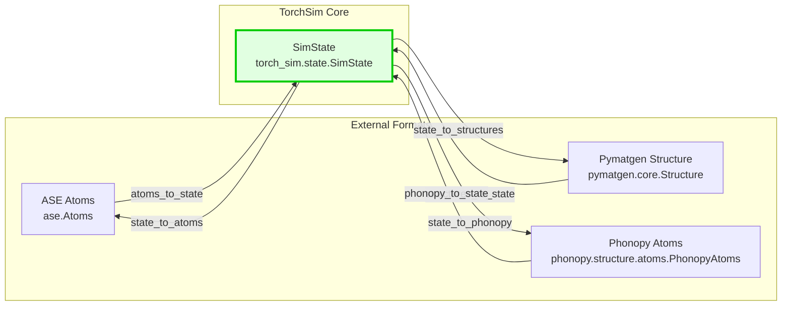
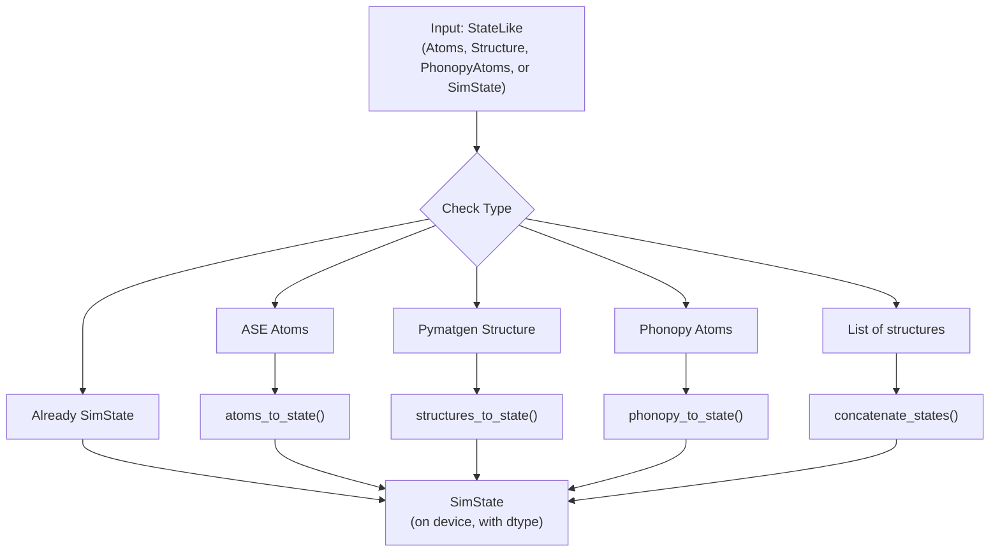
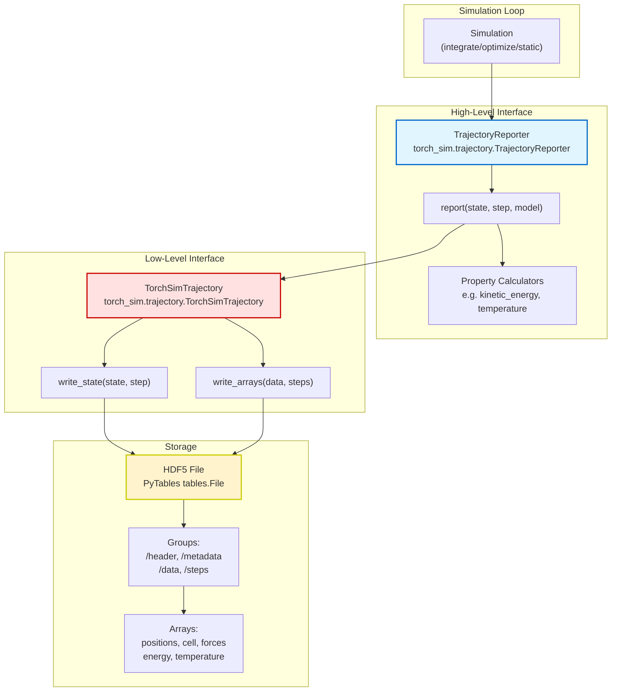
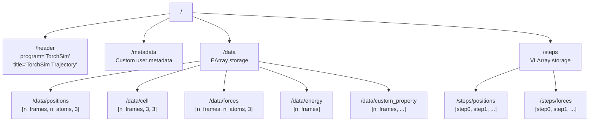
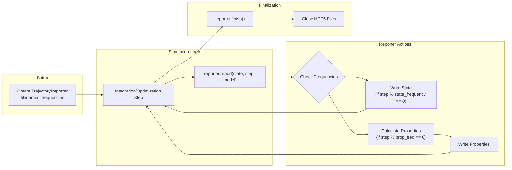

# I/O and Format Conversion

<details>
<summary>Relevant source files</summary>

The following files were used as context for generating this wiki page:

- [tests/conftest.py](tests/conftest.py)
- [tests/models/test_lennard_jones.py](tests/models/test_lennard_jones.py)
- [tests/models/test_mace.py](tests/models/test_mace.py)
- [tests/test_runners.py](tests/test_runners.py)
- [tests/test_trajectory.py](tests/test_trajectory.py)
- [torch_sim/io.py](torch_sim/io.py)
- [torch_sim/runners.py](torch_sim/runners.py)
- [torch_sim/trajectory.py](torch_sim/trajectory.py)

</details>


This document describes the input/output functionality in torch-sim, covering conversion between `SimState` objects and external atomistic formats (ASE, Pymatgen, Phonopy), as well as trajectory storage and retrieval using HDF5 files. For information about the `SimState` data structure itself, see [SimState and Data Structures](#3.1). For information about using these conversions in simulations, see [High-Level API Functions](#3.3).

## Overview

Torch-sim provides two main I/O capabilities:

1. **Format Conversion** - Bidirectional conversion between `SimState` and common atomistic formats via [torch_sim/io.py]()
2. **Trajectory I/O** - Efficient HDF5-based storage of simulation trajectories via [torch_sim/trajectory.py]()

All conversions preserve essential atomic properties (positions, cell, atomic numbers, masses) and handle batched systems (multiple structures in a single `SimState`). Optional properties like charge, spin, velocities, and forces are preserved when present.

---

## External Format Conversion

### Supported Formats and Conversion Functions



**Conversion Functions**

| Function | Input | Output | Location |
|----------|-------|--------|----------|
| `atoms_to_state` | `Atoms \| list[Atoms]` | `SimState` | [torch_sim/io.py:243-318]() |
| `state_to_atoms` | `SimState` | `list[Atoms]` | [torch_sim/io.py:35-102]() |
| `structures_to_state` | `Structure \| list[Structure]` | `SimState` | [torch_sim/io.py:325-398]() |
| `state_to_structures` | `SimState` | `list[Structure]` | [torch_sim/io.py:110-173]() |
| `phonopy_to_state` | `PhonopyAtoms \| list[PhonopyAtoms]` | `SimState` | [torch_sim/io.py:406-486]() |
| `state_to_phonopy` | `SimState` | `list[PhonopyAtoms]` | [torch_sim/io.py:186-235]() |

Sources: [torch_sim/io.py:1-487]()

---

### ASE Atoms Conversion

#### `atoms_to_state(atoms, device, dtype) → SimState`

Converts ASE `Atoms` objects to `SimState`. Handles both single structures and batched lists.

**Preserved Properties:**
- Positions (Å)
- Cell matrix (Å, transposed from ASE convention)
- Atomic numbers
- Masses (amu)
- Periodic boundary conditions
- Charge and spin (from `atoms.info`)

**Implementation Details:**
- Validates consistent PBC across all systems [torch_sim/io.py:298-299]()
- Creates `system_idx` via `torch.repeat_interleave` [torch_sim/io.py:292-295]()
- Extracts charge/spin from `atoms.info` dictionary [torch_sim/io.py:301-306]()

**Example:**
```python
import torch_sim as ts
from ase.build import bulk

# Single structure
cu_atoms = bulk("Cu", "fcc", a=3.61)
state = ts.io.atoms_to_state(cu_atoms, device="cuda", dtype=torch.float32)

# Multiple structures
atoms_list = [bulk("Cu", "fcc"), bulk("Si", "diamond")]
batched_state = ts.io.atoms_to_state(atoms_list, device="cuda", dtype=torch.float32)
assert batched_state.n_systems == 2
```

Sources: [torch_sim/io.py:243-318](), [tests/conftest.py:49-64]()

#### `state_to_atoms(state) → list[Atoms]`

Converts `SimState` to a list of ASE `Atoms` objects, one per system.

**Output Properties:**
- Positions and cell in Å
- Masses in amu
- Charge and spin written to `atoms.info`
- Cell matrix transposed to ASE convention

**Implementation:**
- Splits state by `system_idx` [torch_sim/io.py:78-100]()
- Transposes cell matrix: `cell[sys_idx].T` [torch_sim/io.py:82]()
- Converts atomic numbers to chemical symbols [torch_sim/io.py:85]()

Sources: [torch_sim/io.py:35-102]()

---

### Pymatgen Structure Conversion

#### `structures_to_state(structure, device, dtype) → SimState`

Converts Pymatgen `Structure` objects to `SimState`. Supports both single and batched structures.

**Key Features:**
- Extracts atomic masses from `site.specie.atomic_mass` [torch_sim/io.py:367-369]()
- Extracts atomic numbers from `site.specie.number` [torch_sim/io.py:371-375]()
- Validates consistent PBC [torch_sim/io.py:384-385]()
- Transposes cell matrix to torch-sim convention [torch_sim/io.py:361]()

Sources: [torch_sim/io.py:325-398]()

#### `state_to_structures(state) → list[Structure]`

Converts `SimState` to Pymatgen `Structure` objects.

**Implementation:**
- Creates `Lattice` with PBC from state [torch_sim/io.py:166]()
- Uses Cartesian coordinates (not fractional) [torch_sim/io.py:169]()
- Converts atomic numbers to `Element` objects [torch_sim/io.py:155]()

Sources: [torch_sim/io.py:110-173]()

---

### Phonopy Conversion

#### `phonopy_to_state(phonopy_atoms, device, dtype) → SimState`

Converts Phonopy `PhonopyAtoms` to `SimState`. Always assumes periodic boundary conditions (Phonopy convention).

**Notable Behavior:**
- PBC always set to `True` (Phonopy assumption) [torch_sim/io.py:472-477]()
- Extracts atomic numbers via `phonopy_atoms.numbers` [torch_sim/io.py:453]()

Sources: [torch_sim/io.py:406-486]()

#### `state_to_phonopy(state) → list[PhonopyAtoms]`

Converts `SimState` to Phonopy `PhonopyAtoms` objects.

Sources: [torch_sim/io.py:186-235]()

---

### State Initialization in Runners

The high-level API functions (`integrate`, `optimize`, `static`) use `ts.initialize_state` to automatically handle format conversion:

```python
def ts.initialize_state(
    system: StateLike,
    device: torch.device,
    dtype: torch.dtype
) -> SimState:
    """Convert ASE Atoms, Pymatgen Structure, or SimState to SimState.
    
    StateLike = Atoms | Structure | PhonopyAtoms | SimState | 
                list[Atoms | Structure | PhonopyAtoms | SimState]
    """
```

**Implementation:**


**Usage in Runners:**

All three main runner functions use `ts.initialize_state`:
- [torch_sim/runners.py:297]() in `integrate`
- [torch_sim/runners.py:602]() in `optimize`
- [torch_sim/runners.py:770]() in `static`

Sources: [torch_sim/runners.py:252-404](), [torch_sim/state.py]()

---

## Trajectory I/O

Torch-sim provides HDF5-based trajectory storage through two classes:
- `TorchSimTrajectory` - Low-level HDF5 file operations
- `TrajectoryReporter` - High-level reporting during simulations



Sources: [torch_sim/trajectory.py:1-1367]()

---

### TorchSimTrajectory

Low-level class for reading and writing HDF5 trajectory files.

**Class: `TorchSimTrajectory`**

**Constructor Parameters:**
| Parameter | Type | Default | Description |
|-----------|------|---------|-------------|
| `filename` | `str \| Path` | required | Path to HDF5 file |
| `mode` | `"r" \| "w" \| "a"` | `"r"` | Read, write (overwrite), or append |
| `compress_data` | `bool` | `True` | Use zlib compression |
| `coerce_to_float32` | `bool` | `True` | Convert float64 to float32 |
| `coerce_to_int32` | `bool` | `False` | Convert int64 to int32 |
| `metadata` | `dict[str, str]` | `None` | Custom metadata |

**Key Methods:**

```python
# Writing
trajectory.write_state(state: SimState, steps: int | list[int], **kwargs)
trajectory.write_arrays(data: dict[str, Tensor], steps: int | list[int])

# Reading
trajectory.get_state(frame: int, device: torch.device, dtype: torch.dtype) -> SimState
trajectory.get_atoms(frame: int) -> Atoms
trajectory.get_structure(frame: int) -> Structure
trajectory.get_array(name: str) -> np.ndarray
trajectory.get_steps(name: str) -> list[int]

# Utilities
len(trajectory)  # Number of frames
trajectory.last_step  # Last logged step number
trajectory.truncate_to_step(step: int)  # Remove data after step
```

Sources: [torch_sim/trajectory.py:467-1105]()

---

### HDF5 File Structure



**Structure Details:**
- `/header` - Program metadata [torch_sim/trajectory.py:565-567]()
- `/metadata` - User-defined key-value pairs [torch_sim/trajectory.py:569-572]()
- `/data` - Extensible arrays for trajectory data [torch_sim/trajectory.py:574]()
- `/steps` - Variable-length arrays storing step numbers [torch_sim/trajectory.py:575]()

**Array Registry:**
The `array_registry` tracks all arrays: `dict[str, tuple[tuple[int, ...], np.dtype]]` mapping array names to their shapes and dtypes [torch_sim/trajectory.py:532]().

Sources: [torch_sim/trajectory.py:556-575](), [torch_sim/trajectory.py:577-589]()

---

### Writing Trajectory Data

#### `write_state(state, steps, **kwargs)`

Writes a complete `SimState` to the trajectory.

**Always Written:**
- `positions` - Atomic positions [torch_sim/trajectory.py:897-906]()
- `cell` - Cell matrix [torch_sim/trajectory.py:907-920]()
- `atomic_numbers` - Element types [torch_sim/trajectory.py:921-934]()
- `masses` - Atomic masses [torch_sim/trajectory.py:935-948]()
- `pbc` - Periodic boundary conditions [torch_sim/trajectory.py:949-955]()

**Optional (via kwargs):**
- `save_velocities=True` - Write velocities [torch_sim/trajectory.py:864-877]()
- `save_forces=True` - Write forces [torch_sim/trajectory.py:878-891]()
- `variable_cell=True` - Save cell per frame [torch_sim/trajectory.py:907-920]()
- `variable_masses=True` - Save masses per frame [torch_sim/trajectory.py:935-948]()
- `variable_atomic_numbers=True` - Save atomic numbers per frame [torch_sim/trajectory.py:921-934]()

Sources: [torch_sim/trajectory.py:808-955]()

#### `write_arrays(data, steps)`

Writes arbitrary arrays to the trajectory.

**Parameters:**
- `data`: `dict[str, np.ndarray | torch.Tensor]` - Arrays to write
- `steps`: `int | list[int]` - Step number(s)

**Validation:**
- Checks shape compatibility with existing arrays [torch_sim/trajectory.py:668-682]()
- Ensures monotonically increasing steps [torch_sim/trajectory.py:705-707]()
- Coerces data types based on constructor settings [torch_sim/trajectory.py:709-727]()

Sources: [torch_sim/trajectory.py:615-737]()

---

### Reading Trajectory Data

#### `get_state(frame, device, dtype) → SimState`

Reconstructs a `SimState` from a trajectory frame.

**Implementation:**
- Reads all state arrays for the given frame [torch_sim/trajectory.py:1042-1105]()
- Converts to PyTorch tensors on specified device/dtype
- Handles optional arrays (velocities, forces) if present

Sources: [torch_sim/trajectory.py:1042-1105]()

#### `get_atoms(frame) → Atoms`

Converts a trajectory frame to ASE `Atoms`.

**Implementation:**
- Calls `get_state(frame)` then `state_to_atoms()` [torch_sim/trajectory.py:1000-1040]()

Sources: [torch_sim/trajectory.py:1000-1040]()

#### `get_structure(frame) → Structure`

Converts a trajectory frame to Pymatgen `Structure`.

**Implementation:**
- Calls `get_state(frame)` then `state_to_structures()` [torch_sim/trajectory.py:956-999]()

Sources: [torch_sim/trajectory.py:956-999]()

#### `get_array(name) → np.ndarray`

Reads a specific array from the trajectory.

**Returns:**
- Full array shape: `(n_frames, ...)` [torch_sim/trajectory.py:739-773]()

Sources: [torch_sim/trajectory.py:739-773]()

---

### TrajectoryReporter

High-level class for automatic trajectory logging during simulations.

**Class: `TrajectoryReporter`**

**Constructor Parameters:**
| Parameter | Type | Default | Description |
|-----------|------|---------|-------------|
| `filenames` | `str \| list[str] \| None` | required | Trajectory file paths (one per system) |
| `state_frequency` | `int` | `100` | Write full state every N steps |
| `prop_calculators` | `dict[int, dict[str, Callable]]` | `None` | Property functions to evaluate |
| `state_kwargs` | `dict` | `None` | Options for `write_state()` |
| `metadata` | `dict[str, str]` | `None` | Metadata for trajectory files |
| `trajectory_kwargs` | `dict` | `None` | Options for `TorchSimTrajectory` |

**Property Calculators:**

Property calculators are organized by frequency:
```python
prop_calculators = {
    1: {  # Every step
        "potential_energy": lambda state: state.energy,
        "max_force": lambda state: state.forces.abs().max(),
    },
    10: {  # Every 10 steps
        "temperature": lambda state: state.calc_temperature(),
    },
}
```

**Automatic Model Argument:**
If a calculator only accepts `state`, it's automatically wrapped to accept `(state, model)` [torch_sim/trajectory.py:246-265]().

Sources: [torch_sim/trajectory.py:69-465]()

---

### Using TrajectoryReporter in Simulations



**Example from Runner Functions:**

The `integrate` function demonstrates typical reporter usage:

```python
# Configure reporter with default properties
trajectory_reporter = _configure_reporter(
    trajectory_reporter,
    properties=["kinetic_energy", "potential_energy", "temperature"],
)

# Write initial state (step 0)
_write_initial_state(trajectory_reporter, state, model)

# Simulation loop
for step in range(initial_step, initial_step + n_steps):
    state = step_func(state, model, dt, kT)
    
    if trajectory_reporter:
        trajectory_reporter.report(state, step, model=model)

# Clean up
if trajectory_reporter:
    trajectory_reporter.finish()
```

Sources: [torch_sim/runners.py:328-395]()

---

### Batched Trajectory Reporting

When simulating multiple systems, `TrajectoryReporter` handles them automatically:

**Single File (Unbatched):**
```python
reporter = TrajectoryReporter(
    filenames="trajectory.h5",
    state_frequency=10,
)
# Writes to single file
```

**Multiple Files (Batched):**
```python
reporter = TrajectoryReporter(
    filenames=["system_0.h5", "system_1.h5", "system_2.h5"],
    state_frequency=10,
)
# Splits state and writes each system to its own file
```

**Implementation:**
- Validates `len(filenames) == state.n_systems` [torch_sim/trajectory.py:306-310]()
- Splits state via `state.split()` [torch_sim/trajectory.py:312]()
- Reopens correct files when autobatching [torch_sim/trajectory.py:359-363]()

Sources: [torch_sim/trajectory.py:267-343]()

---

### Resume and Append Modes

#### Resuming Integrations

The `integrate` function can resume from existing trajectories:

```python
# Initial run
reporter = TrajectoryReporter("trajectory.h5", mode="w")
ts.integrate(system, model, n_steps=100, trajectory_reporter=reporter)

# Resume run
reporter = TrajectoryReporter("trajectory.h5", mode="a")  # Append mode
ts.integrate(system, model, n_steps=50, trajectory_reporter=reporter)
# Automatically detects last_step and continues from step 101
```

**Implementation:**
- Detects resume via `trajectory_reporter.mode == "a"` [torch_sim/runners.py:121]()
- Gets last step from trajectory files [torch_sim/runners.py:122-126]()
- Validates consistent last steps across files [torch_sim/runners.py:127-134]()

Sources: [torch_sim/runners.py:108-142]()

#### Resuming Optimizations

Optimization resumes similarly but tracks per-system steps:

**Implementation:**
- Creates per-system step tensor [torch_sim/runners.py:160-162]()
- Loads last steps from trajectories [torch_sim/runners.py:164-169]()
- Continues each system from its last logged step

Sources: [torch_sim/runners.py:145-170]()

---

### Trajectory Truncation

The `truncate_to_step` method removes data after a specified step:

```python
reporter = TrajectoryReporter(["sys_0.h5", "sys_1.h5"], mode="a")

# Truncate both files to step 50
reporter.truncate_to_step(50)
```

**Implementation:**
- Iterates through all trajectory files [torch_sim/trajectory.py:238-244]()
- For each array, finds frame index matching step [torch_sim/trajectory.py:1341-1350]()
- Removes subsequent frames [torch_sim/trajectory.py:1357-1366]()

**Use Case:**
Useful when trajectories have inconsistent endpoints before resuming:
```python
# Synchronize trajectories before resuming
reporter.truncate_to_step(min(reporter.last_steps))
```

Sources: [torch_sim/trajectory.py:220-244](), [torch_sim/trajectory.py:1323-1366]()

---

## Usage Patterns

### Pattern 1: Convert External Format for Simulation

```python
import torch_sim as ts
from ase.build import bulk

# Create structure in ASE
atoms = bulk("Cu", "fcc", a=3.61, cubic=True)

# Convert to SimState
state = ts.io.atoms_to_state(atoms, device="cuda", dtype=torch.float32)

# Run simulation
final_state = ts.integrate(
    system=state,  # Can also pass atoms directly
    model=model,
    integrator=ts.Integrator.nvt_langevin,
    n_steps=1000,
    temperature=300,
    timestep=0.001,
)

# Convert back to ASE
final_atoms = ts.io.state_to_atoms(final_state)[0]
```

Sources: [tests/test_runners.py:877-915]()

---

### Pattern 2: Trajectory Recording During MD

```python
import torch_sim as ts

# Setup reporter
reporter = ts.TrajectoryReporter(
    filenames="md_trajectory.h5",
    state_frequency=100,  # Full state every 100 steps
    prop_calculators={
        1: {  # Every step
            "kinetic_energy": lambda s: ts.calc_kinetic_energy(s.momenta, s.masses),
            "potential_energy": lambda s: s.energy,
        },
        10: {  # Every 10 steps
            "temperature": lambda s: s.calc_temperature(),
        },
    },
)

# Run MD
final_state = ts.integrate(
    system=atoms,
    model=model,
    integrator=ts.Integrator.nvt_langevin,
    n_steps=10000,
    temperature=300,
    timestep=0.001,
    trajectory_reporter=reporter,
)

# Analyze trajectory
with ts.TorchSimTrajectory("md_trajectory.h5", mode="r") as traj:
    print(f"Trajectory length: {len(traj)} frames")
    
    # Get specific frame
    state_at_step_500 = traj.get_state(frame=50, device="cpu", dtype=torch.float64)
    
    # Get time series
    energies = traj.get_array("potential_energy")
    temps = traj.get_array("temperature")
    
    # Export to ASE for visualization
    ase_traj = traj.write_ase_trajectory("md_trajectory.traj")
```

Sources: [tests/test_runners.py:18-90](), [tests/test_trajectory.py:551-634]()

---

### Pattern 3: Batched Simulations with Individual Trajectories

```python
import torch_sim as ts
from ase.build import bulk

# Create multiple structures
structures = [
    bulk("Cu", "fcc", a=3.61),
    bulk("Si", "diamond", a=5.43),
    bulk("Fe", "bcc", a=2.87),
]

# Convert to batched state
batched_state = ts.io.atoms_to_state(structures, device="cuda", dtype=torch.float32)

# Setup individual trajectory files
trajectory_files = [f"system_{i}.h5" for i in range(len(structures))]
reporter = ts.TrajectoryReporter(
    filenames=trajectory_files,
    state_frequency=50,
    prop_calculators={
        1: {"energy": lambda s: s.energy},
    },
)

# Run all systems simultaneously
final_states = ts.integrate(
    system=batched_state,
    model=model,
    integrator=ts.Integrator.nve,
    n_steps=1000,
    temperature=300,
    timestep=0.001,
    trajectory_reporter=reporter,
    autobatcher=True,  # Automatically batch for GPU efficiency
)

# Analyze individual trajectories
for i, traj_file in enumerate(trajectory_files):
    with ts.TorchSimTrajectory(traj_file, mode="r") as traj:
        energies = traj.get_array("energy")
        print(f"System {i}: mean energy = {energies.mean():.3f}")
```

Sources: [tests/test_runners.py:208-253](), [tests/test_runners.py:288-343]()

---

### Pattern 4: Custom Property Calculation

```python
import torch_sim as ts
import torch

def radial_distribution(state: ts.SimState, model=None) -> torch.Tensor:
    """Custom property: simplified RDF at r=2.5 Å"""
    # Compute neighbor distances
    distances = ts.calc_pairwise_distances(state)
    
    # Count pairs near target distance
    target = 2.5
    width = 0.1
    mask = (distances > target - width) & (distances < target + width)
    return torch.tensor([mask.sum().item()], device=state.device)

# Use in trajectory
reporter = ts.TrajectoryReporter(
    filenames="trajectory.h5",
    state_frequency=100,
    prop_calculators={
        10: {
            "rdf_2.5": radial_distribution,
            "kinetic_energy": lambda s: ts.calc_kinetic_energy(s.momenta, s.masses),
        },
    },
)

final_state = ts.integrate(
    system=atoms,
    model=model,
    integrator=ts.Integrator.nvt_langevin,
    n_steps=5000,
    temperature=300,
    timestep=0.001,
    trajectory_reporter=reporter,
)

# Retrieve custom property
with ts.TorchSimTrajectory("trajectory.h5") as traj:
    rdf_values = traj.get_array("rdf_2.5")
```

Sources: [tests/test_trajectory.py:538-548](), [tests/test_trajectory.py:757-826]()

---

### Pattern 5: Optimization with Trajectory

```python
import torch_sim as ts

# Setup
reporter = ts.TrajectoryReporter(
    filenames="optimization.h5",
    state_frequency=1,  # Save every step for optimization
    prop_calculators={
        1: {
            "energy": lambda s: s.energy,
            "max_force": lambda s: s.forces.abs().max(dim=-1)[0].max(dim=-1)[0],
        },
    },
)

# Run optimization
final_state = ts.optimize(
    system=atoms,
    model=model,
    optimizer=ts.Optimizer.fire,
    convergence_fn=ts.generate_force_convergence_fn(force_tol=0.01),
    max_steps=1000,
    trajectory_reporter=reporter,
)

# Analyze convergence
with ts.TorchSimTrajectory("optimization.h5") as traj:
    energies = traj.get_array("energy")
    forces = traj.get_array("max_force")
    
    print(f"Initial energy: {energies[0]:.3f}")
    print(f"Final energy: {energies[-1]:.3f}")
    print(f"Converged in {len(traj)} steps")
```

Sources: [tests/test_runners.py:346-378]()

---

## Data Type Coercion

`TorchSimTrajectory` supports automatic type coercion to reduce file size:

```python
trajectory = TorchSimTrajectory(
    "trajectory.h5",
    mode="w",
    coerce_to_float32=True,   # float64 → float32
    coerce_to_int32=True,     # int64 → int32
)
```

**Type Mapping:**

| Input Type | Default Output | With Coercion |
|------------|----------------|---------------|
| `torch.float64` / `np.float64` | `Float64Atom` | `Float32Atom` |
| `torch.float32` / `np.float32` | `Float32Atom` | `Float32Atom` |
| `torch.int64` / `np.int64` | `Int64Atom` | `Int32Atom` |
| `torch.int32` / `np.int32` | `Int32Atom` | `Int32Atom` |
| `torch.bool` / `np.bool_` | `BoolAtom` | `BoolAtom` |

**Implementation:**
- Type map initialized in constructor [torch_sim/trajectory.py:540-542]()
- Coercion applied in `_initialize_type_map` [torch_sim/trajectory.py:591-613]()
- Types checked during write [torch_sim/trajectory.py:709-727]()

Sources: [torch_sim/trajectory.py:53-65](), [torch_sim/trajectory.py:591-613](), [tests/test_trajectory.py:147-167]()

---

## Summary

The I/O system in torch-sim provides:

1. **Bidirectional conversion** between `SimState` and ASE/Pymatgen/Phonopy formats
2. **Automatic format detection** via `ts.initialize_state` in runner functions
3. **Efficient HDF5 trajectory storage** with compression and type coercion
4. **Flexible property logging** with customizable frequencies and calculators
5. **Batched trajectory handling** for multiple systems
6. **Resume capability** for long-running simulations
7. **Format export** to ASE trajectory files for visualization

All conversions preserve essential atomic properties and support batched systems. The trajectory system uses PyTables for efficient HDF5 I/O and supports arbitrary user-defined properties.

Sources: [torch_sim/io.py:1-487](), [torch_sim/trajectory.py:1-1367](), [torch_sim/runners.py:1-854]()

---