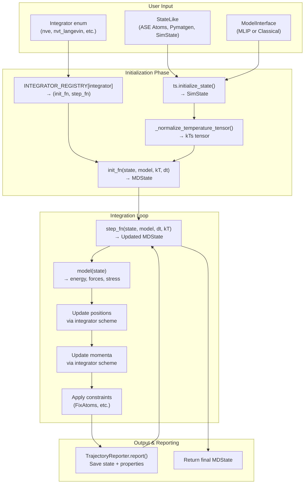
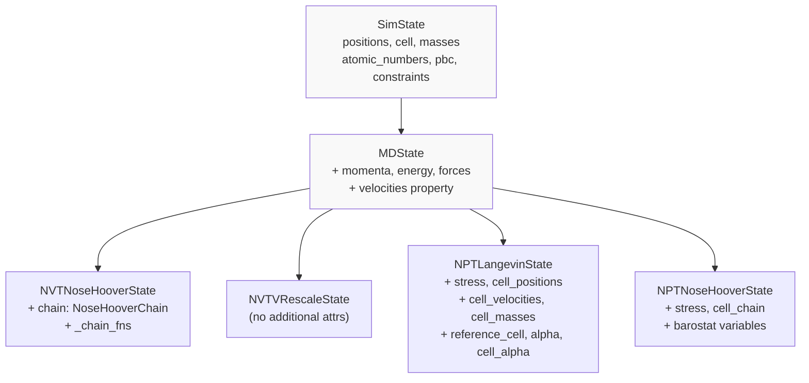
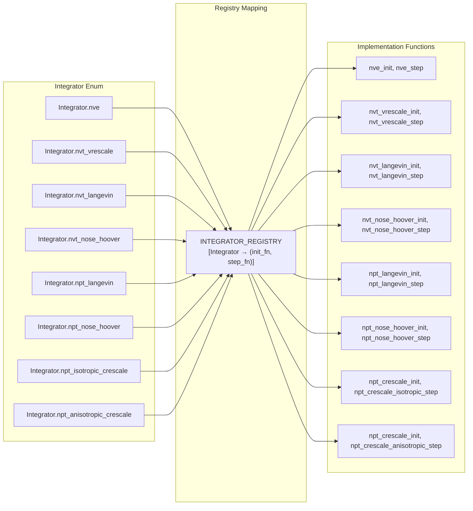
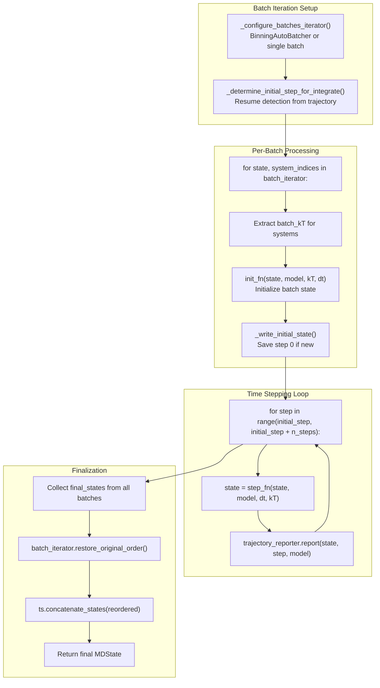

# Molecular Dynamics

<details>
<summary>Relevant source files</summary>

The following files were used as context for generating this wiki page:

- [tests/test_runners.py](tests/test_runners.py)
- [tests/test_trajectory.py](tests/test_trajectory.py)
- [torch_sim/integrators/__init__.py](torch_sim/integrators/__init__.py)
- [torch_sim/integrators/md.py](torch_sim/integrators/md.py)
- [torch_sim/integrators/npt.py](torch_sim/integrators/npt.py)
- [torch_sim/integrators/nve.py](torch_sim/integrators/nve.py)
- [torch_sim/integrators/nvt.py](torch_sim/integrators/nvt.py)
- [torch_sim/runners.py](torch_sim/runners.py)
- [torch_sim/trajectory.py](torch_sim/trajectory.py)

</details>


Molecular dynamics (MD) simulations in torch-sim propagate atomic systems through time by integrating Newton's equations of motion. This section covers the MD simulation workflow, state representations, integrator selection, and execution via the `ts.integrate()` function.

For structure optimization (finding energy minima), see [Structure Optimization](#5). For single-point energy/force calculations, see [Static Property Calculations](#8.2).

---

## MD Workflow and Core Components

Molecular dynamics simulations in torch-sim follow a standard workflow: initialize system state, select an integrator for the desired ensemble (NVE, NVT, or NPT), and propagate the state forward in time. The high-level API function `ts.integrate()` orchestrates this process.

### Integration Function Signature

The `ts.integrate()` function provides the primary interface for MD simulations:

```python
ts.integrate(
    system: StateLike,
    model: ModelInterface,
    integrator: Integrator | tuple[Callable, Callable],
    n_steps: int,
    temperature: float | list | torch.Tensor,
    timestep: float,
    trajectory_reporter: TrajectoryReporter | dict | None = None,
    autobatcher: BinningAutoBatcher | bool = False,
    pbar: bool | dict = False,
    init_kwargs: dict | None = None,
    **integrator_kwargs
) -> MDState
```

**Sources:** [torch_sim/runners.py:252-404]()

### MD Workflow Diagram



**Sources:** [torch_sim/runners.py:252-404](), [torch_sim/integrators/__init__.py:160-174]()

---

## State Hierarchy

MD simulations use specialized state classes that extend `SimState` with dynamics-specific attributes. The state hierarchy represents increasing levels of complexity for different ensemble types.

### State Class Hierarchy



| State Class | File Location | Key Attributes | Use Case |
|-------------|---------------|----------------|----------|
| `SimState` | [torch_sim/state.py]() | positions, cell, masses | Base atomic structure |
| `MDState` | [torch_sim/integrators/md.py:21-100]() | momenta, energy, forces | All MD simulations |
| `NVTNoseHooverState` | [torch_sim/integrators/nvt.py:201-248]() | chain (thermostat variables) | Deterministic NVT |
| `NVTVRescaleState` | [torch_sim/integrators/nvt.py:476-503]() | (minimal additions) | Stochastic NVT |
| `NPTLangevinState` | [torch_sim/integrators/npt.py:35-92]() | stress, cell dynamics | Langevin NPT |
| `NPTNoseHooverState` | [torch_sim/integrators/npt.py]() | cell_chain, barostat vars | Deterministic NPT |

**Sources:** [torch_sim/integrators/md.py:21-100](), [torch_sim/integrators/nvt.py:201-248](), [torch_sim/integrators/npt.py:35-92]()

### MDState Properties

The `MDState` class provides core MD functionality:

- **Attribute Storage**: `momenta`, `energy`, `forces` stored as tensor attributes
- **Computed Properties**: `velocities` calculated as `momenta / masses`
- **Constraint Application**: `set_constrained_momenta()` applies constraints before updating momenta
- **Temperature Calculation**: `calc_temperature()` and `calc_kT()` compute system temperature from kinetic energy

**Sources:** [torch_sim/integrators/md.py:21-100]()

---

## Integrator Registry System

Integrators in torch-sim follow a two-function pattern: an initialization function creates the initial MD state, and a step function advances the state by one timestep. The `INTEGRATOR_REGISTRY` maps ensemble names to these function pairs.

### Integrator Registry Mapping



**Sources:** [torch_sim/integrators/__init__.py:160-174]()

### Available Integrators

| Integrator | Ensemble | Thermostat/Barostat | State Type | Module |
|------------|----------|---------------------|------------|--------|
| `nve` | NVE (microcanonical) | None | `MDState` | [nve.py]() |
| `nvt_vrescale` | NVT (canonical) | Velocity rescaling | `NVTVRescaleState` | [nvt.py:476-503]() |
| `nvt_langevin` | NVT (canonical) | Langevin (BAOAB) | `MDState` | [nvt.py:86-198]() |
| `nvt_nose_hoover` | NVT (canonical) | Nosé-Hoover chain | `NVTNoseHooverState` | [nvt.py:250-397]() |
| `npt_langevin` | NPT (isothermal-isobaric) | Langevin thermostat + barostat | `NPTLangevinState` | [npt.py:507-685]() |
| `npt_nose_hoover` | NPT (isothermal-isobaric) | Nosé-Hoover thermostat + barostat | `NPTNoseHooverState` | [npt.py]() |
| `npt_isotropic_crescale` | NPT (isothermal-isobaric) | C-Rescale (isotropic) | `NPTCRescaleState` | [npt.py]() |
| `npt_anisotropic_crescale` | NPT (isothermal-isobaric) | C-Rescale (anisotropic) | `NPTCRescaleState` | [npt.py]() |

For detailed information on each ensemble, see:
- NVE: [NVE Ensemble](#4.2)
- NVT: [NVT Ensemble](#4.3)
- NPT: [NPT Ensemble](#4.4)

**Sources:** [torch_sim/integrators/__init__.py:97-132](), [torch_sim/integrators/nve.py](), [torch_sim/integrators/nvt.py](), [torch_sim/integrators/npt.py]()

---

## Integration Loop Mechanics

The integration loop in `ts.integrate()` repeatedly calls the step function while managing batching, trajectory reporting, and progress tracking.

### Integration Loop Data Flow



**Sources:** [torch_sim/runners.py:252-404]()

### Key Integration Parameters

**Temperature Specification**: The `temperature` parameter accepts:
- Scalar float: Single temperature for all steps and systems
- 1D tensor `[n_steps]`: Temperature schedule over time
- 1D tensor `[n_systems]`: Per-system temperatures
- 2D tensor `[n_steps, n_systems]`: Time-varying per-system temperatures

Temperature normalization is handled by `_normalize_temperature_tensor()` at [torch_sim/runners.py:173-225]().

**Timestep**: The `timestep` parameter specifies the integration time step in picoseconds (default units: METAL).

**Autobatching**: When `autobatcher=True`, `BinningAutoBatcher` groups systems by size for memory-efficient GPU processing. See [Autobatching and GPU Memory Management](#7.1).

**Trajectory Reporting**: The `trajectory_reporter` parameter controls output. Can be:
- `TrajectoryReporter` instance: Full control over reporting
- `dict`: Passed to `TrajectoryReporter` constructor
- `None`: No trajectory output

**Sources:** [torch_sim/runners.py:252-404](), [torch_sim/runners.py:173-225]()

---

## Running MD Simulations

### Basic Example: NVT Langevin Simulation

```python
import torch_sim as ts

# Initialize system
atoms = bulk("Cu", "fcc", a=3.58, cubic=True).repeat((2, 2, 2))
state = ts.initialize_state(atoms, device="cuda", dtype=torch.float32)

# Load model
model = ts.MaceModel.load_pretrained("small")

# Run MD simulation
final_state = ts.integrate(
    system=state,
    model=model,
    integrator=ts.Integrator.nvt_langevin,
    n_steps=1000,
    temperature=300.0,  # Kelvin
    timestep=0.001,     # picoseconds
    trajectory_reporter=dict(
        filenames="trajectory.h5md",
        state_frequency=10
    )
)
```

**Sources:** [tests/test_runners.py:55-90]()

### Batched Multi-System Simulation

```python
# Simulate multiple systems simultaneously
systems = [atoms1, atoms2, atoms3]
trajectory_files = ["traj1.h5md", "traj2.h5md", "traj3.h5md"]

final_states = ts.integrate(
    system=systems,
    model=model,
    integrator=ts.Integrator.nve,
    n_steps=1000,
    temperature=300.0,
    timestep=0.001,
    trajectory_reporter=dict(
        filenames=trajectory_files,
        state_frequency=100
    ),
    autobatcher=True  # Enable automatic batching
)
```

**Sources:** [tests/test_runners.py:208-253]()

### Resuming Simulations

To resume an interrupted simulation, open the trajectory in append mode:

```python
reporter = TrajectoryReporter(
    filenames="trajectory.h5md",
    mode="a"  # Append mode
)

# integrate() automatically detects last step and resumes
final_state = ts.integrate(
    system=state,
    model=model,
    integrator=ts.Integrator.nvt_langevin,
    n_steps=1000,  # Additional 1000 steps
    temperature=300.0,
    timestep=0.001,
    trajectory_reporter=reporter
)
```

The function `_determine_initial_step_for_integrate()` detects the last logged step and resumes from there.

**Sources:** [torch_sim/runners.py:108-142]()

---

## Constraints in MD

Constraints restrict atomic motion during MD simulations. Common use cases include freezing specific atoms, fixing the center of mass, or preserving crystal symmetry.

### Constraint Application Points

Constraints are applied at two points in the integration loop:
1. **Position updates**: `state.set_constrained_positions(new_positions)` 
2. **Momentum updates**: `state.set_constrained_momenta(new_momenta)`

Each constraint implements `adjust_positions()`, `adjust_momenta()`, `adjust_forces()`, and/or `adjust_cell()` methods.

### Available Constraints

| Constraint | Purpose | Module |
|------------|---------|--------|
| `FixAtoms` | Freeze specific atoms | [constraints.py]() |
| `FixCom` | Fix center of mass | [constraints.py]() |
| `FixSymmetry` | Preserve space group symmetry | [constraints.py]() |

For detailed constraint usage, see [Constraints](#4.5).

**Sources:** [torch_sim/integrators/md.py:69-73](), [torch_sim/state.py]()

---

## Trajectory Management

The `TrajectoryReporter` class manages trajectory output during MD simulations. It handles:
- Periodic saving of atomic configurations
- Custom property calculation and logging
- Multi-system trajectory management
- Resume capability via append mode

### TrajectoryReporter Configuration

```python
reporter = TrajectoryReporter(
    filenames="trajectory.h5md",
    state_frequency=100,  # Save state every 100 steps
    prop_calculators={
        10: {  # Calculate every 10 steps
            "kinetic_energy": lambda state: ts.calc_kinetic_energy(...),
            "temperature": lambda state: state.calc_temperature()
        }
    }
)
```

For detailed trajectory management, see [Trajectory Management](#7.2).

**Sources:** [torch_sim/trajectory.py:69-465](), [torch_sim/runners.py:34-68]()

---

## Common MD Workflows

### Energy Minimization Followed by MD

```python
# First, relax structure
relaxed_state = ts.optimize(
    system=initial_state,
    model=model,
    optimizer=ts.Optimizer.fire,
    convergence_fn=ts.generate_force_convergence_fn(force_tol=0.01)
)

# Then run MD from relaxed structure
final_state = ts.integrate(
    system=relaxed_state,
    model=model,
    integrator=ts.Integrator.nvt_langevin,
    n_steps=10000,
    temperature=300.0,
    timestep=0.001
)
```

**Sources:** [tests/test_runners.py:856-875]()

### Temperature Ramping

```python
# Create temperature schedule: 100K to 1000K over 1000 steps
temperatures = torch.linspace(100, 1000, steps=1000)

final_state = ts.integrate(
    system=state,
    model=model,
    integrator=ts.Integrator.nvt_langevin,
    n_steps=1000,
    temperature=temperatures,  # Time-varying temperature
    timestep=0.001
)
```

**Sources:** [torch_sim/runners.py:173-225]()

### Per-System Temperature Control

```python
# Different temperature for each system in batch
systems = [system1, system2, system3]
temperatures = [300.0, 500.0, 700.0]  # K

final_states = ts.integrate(
    system=systems,
    model=model,
    integrator=ts.Integrator.nvt_langevin,
    n_steps=1000,
    temperature=temperatures,  # Per-system temperatures
    timestep=0.001
)
```

**Sources:** [tests/test_runners.py:111-165]()

---