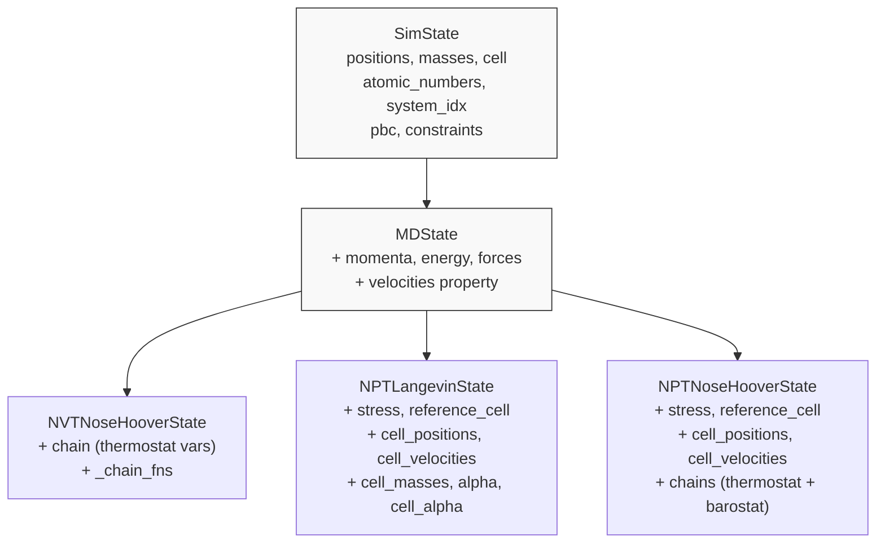
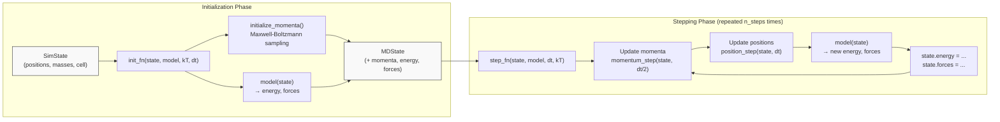
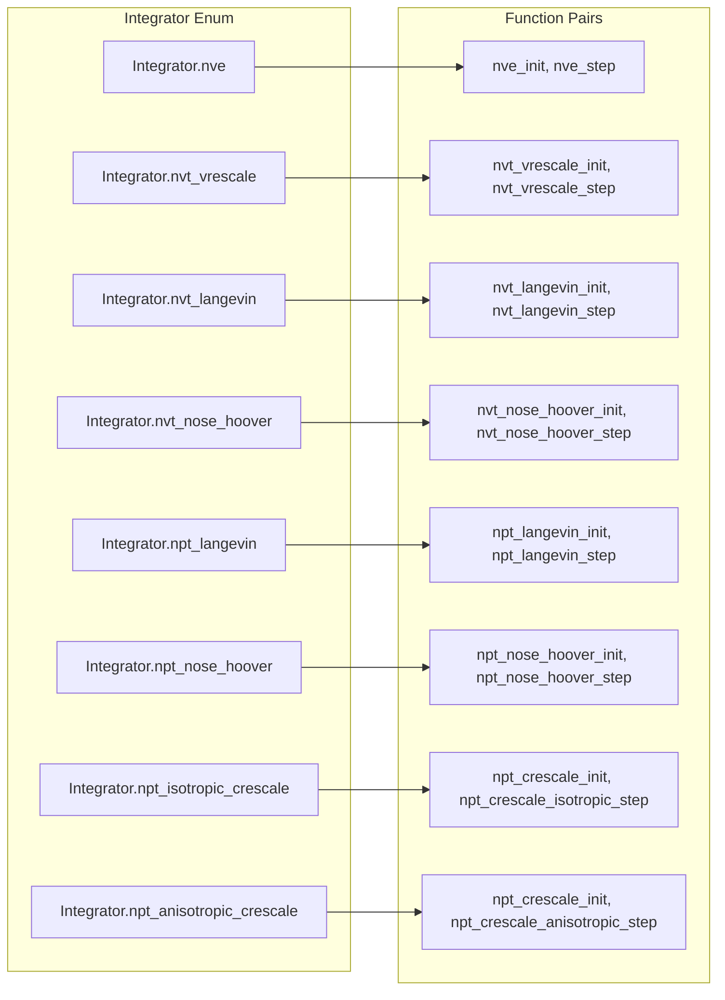
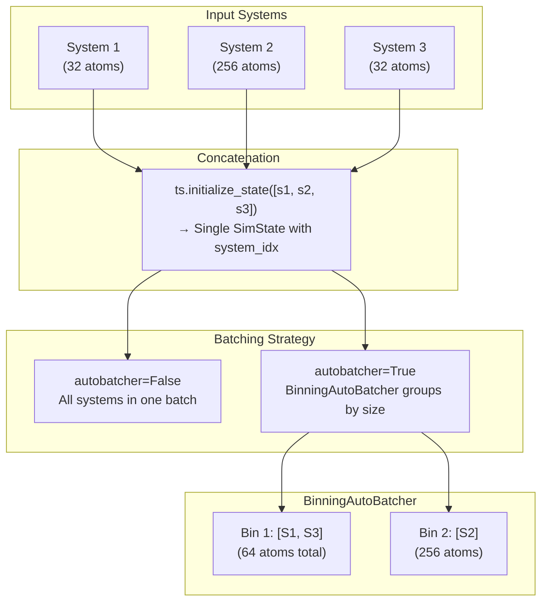
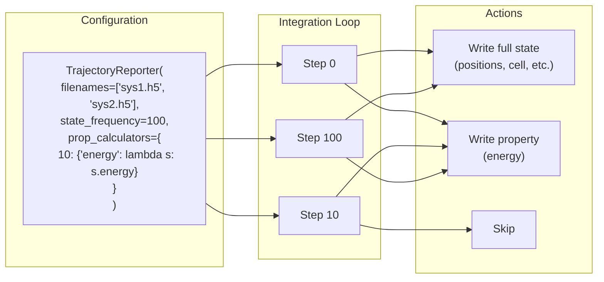

# MD Overview and Workflow

<details>
<summary>Relevant source files</summary>

The following files were used as context for generating this wiki page:

- [tests/test_integrators.py](tests/test_integrators.py)
- [tests/test_runners.py](tests/test_runners.py)
- [tests/test_trajectory.py](tests/test_trajectory.py)
- [torch_sim/integrators/__init__.py](torch_sim/integrators/__init__.py)
- [torch_sim/integrators/md.py](torch_sim/integrators/md.py)
- [torch_sim/integrators/npt.py](torch_sim/integrators/npt.py)
- [torch_sim/integrators/nve.py](torch_sim/integrators/nve.py)
- [torch_sim/integrators/nvt.py](torch_sim/integrators/nvt.py)
- [torch_sim/runners.py](torch_sim/runners.py)
- [torch_sim/trajectory.py](torch_sim/trajectory.py)

</details>


## Purpose and Scope

This page describes the overall workflow for running molecular dynamics (MD) simulations in torch-sim, focusing on state initialization, the integration loop, and state evolution. For details on specific ensembles (NVE, NVT, NPT), see [NVE Ensemble](#4.2), [NVT Ensemble](#4.3), and [NPT Ensemble](#4.4). For applying physical restrictions during MD, see [Constraints](#4.5).

## State Hierarchy

MD simulations in torch-sim are built on a hierarchy of state objects that progressively add functionality:



**State progression:**

| State Class | Purpose | Key Additions | Source File |
|-------------|---------|---------------|-------------|
| `SimState` | Base atomic structure | positions, masses, cell, pbc, constraints | [torch_sim/state.py]() |
| `MDState` | Basic MD dynamics | momenta, energy, forces, velocities | [torch_sim/integrators/md.py:20-100]() |
| `NVTNoseHooverState` | Deterministic thermostat | chain variables, chain functions | [torch_sim/integrators/nvt.py:200-248]() |
| `NPTLangevinState` | Stochastic barostat | cell dynamics, stress, friction params | [torch_sim/integrators/npt.py:34-92]() |
| `NPTNoseHooverState` | Deterministic barostat | thermostat + barostat chains | [torch_sim/integrators/npt.py]() |

**Sources:** [torch_sim/state.py](), [torch_sim/integrators/md.py:20-100](), [torch_sim/integrators/nvt.py:200-248](), [torch_sim/integrators/npt.py:34-92]()

## Complete MD Workflow

The end-to-end workflow for running MD simulations follows this pattern:

```mermaid
flowchart TB
    subgraph "Input"
        Input["User provides:<br/>• System (Atoms/Structure/SimState)<br/>• Model (MLIP or classical)<br/>• Integrator (NVE/NVT/NPT)<br/>• Parameters (n_steps, dt, temperature)"]
    end
    
    subgraph "Initialization (ts.integrate)"
        Init["ts.initialize_state()<br/>→ SimState"]
        Config["Configure:<br/>• AutoBatcher<br/>• TrajectoryReporter<br/>• Determine initial step"]
        IntegratorInit["integrator init_fn()<br/>→ Specialized state<br/>(MDState/NVTState/NPTState)"]
        
        Init --> Config
        Config --> IntegratorInit
    end
    
    subgraph "Integration Loop"
        Loop["for step in range(initial_step, n_steps)"]
        Step["integrator step_fn()<br/>→ Updated state"]
        Report["trajectory_reporter.report()<br/>Save state/properties"]
        
        Loop --> Step
        Step --> Report
        Report --> Loop
    end
    
    subgraph "Finalization"
        Final["Return final state(s)<br/>Close trajectories"]
    end
    
    Input --> Init
    IntegratorInit --> Loop
    Loop --> Final
    
    style Input fill:#f9f9f9,stroke:#333
    style Final fill:#f9f9f9,stroke:#333
```

**Sources:** [torch_sim/runners.py:252-404]()

## The integrate() Function

The `ts.integrate()` function is the primary entry point for MD simulations. Its signature and key parameters:

```python
ts.integrate(
    system: StateLike,              # ASE Atoms, Pymatgen Structure, or SimState
    model: ModelInterface,          # Force field (MLIP or classical)
    integrator: Integrator,         # NVE, NVT, NPT variant
    n_steps: int,                   # Number of integration steps
    temperature: float | Tensor,    # Target temperature(s)
    timestep: float,                # Integration timestep (ps in metal units)
    trajectory_reporter: TrajectoryReporter | dict | None = None,
    autobatcher: BinningAutoBatcher | bool = False,
    pbar: bool | dict = False,
    init_kwargs: dict | None = None,
    **integrator_kwargs
) -> MDState
```

**Parameter handling:**

| Parameter | Type Options | Behavior |
|-----------|-------------|----------|
| `system` | Single state or list | Batched into single `SimState` with `system_idx` |
| `temperature` | Scalar, 1D array (n_steps), 1D array (n_systems), or 2D (n_steps, n_systems) | Normalized to shape `(n_steps,)` or `(n_steps, n_systems)` |
| `autobatcher` | `True`, `False`, or `BinningAutoBatcher` instance | Controls memory-efficient batching |
| `trajectory_reporter` | `TrajectoryReporter` or dict | Handles HDF5 trajectory output |

**Sources:** [torch_sim/runners.py:252-264](), [torch_sim/runners.py:173-225]()

## Integration Loop Details

Each integration step follows a two-phase pattern: **initialization** (once) and **stepping** (repeated):



**Initialization phase** ([torch_sim/integrators/nve.py:17-67](), [torch_sim/integrators/md.py:102-157]()):
1. Call `model(state)` to compute initial energy and forces
2. Sample momenta from Maxwell-Boltzmann distribution: `p ~ N(0, m*kT)`
3. Remove center-of-mass momentum for each system
4. Construct specialized state (e.g., `MDState`, `NVTNoseHooverState`)

**Stepping phase** ([torch_sim/integrators/nve.py:70-106](), [torch_sim/integrators/md.py:159-237]()):
1. Half-step momentum update: `p += F * dt/2`
2. Full-step position update: `r += v * dt`
3. Apply constraints to new positions
4. Compute new forces: `model(state)`
5. Half-step momentum update: `p += F * dt/2`
6. Apply constraints to momenta

**Sources:** [torch_sim/integrators/nve.py:17-106](), [torch_sim/integrators/md.py:102-237]()

## Integrator Registry

All integrators are registered in `INTEGRATOR_REGISTRY`, which maps enum values to `(init_fn, step_fn)` pairs:



**Integrator selection:**

```python
# In ts.integrate():
if isinstance(integrator, Integrator):
    init_func, step_func = INTEGRATOR_REGISTRY[integrator]
elif isinstance(integrator, tuple) and len(integrator) == 2:
    init_func, step_func = integrator  # Custom integrator
```

**Sources:** [torch_sim/integrators/__init__.py:160-174](), [torch_sim/runners.py:310-322]()

## Batching and Autobatching

MD simulations support batching multiple systems for GPU efficiency:



**Batching behavior:**

| `autobatcher` Value | Behavior | Use Case |
|---------------------|----------|----------|
| `False` | All systems processed together | Small systems or unlimited memory |
| `True` | Auto-creates `BinningAutoBatcher` with `max_memory_padding=0.9` | Default GPU memory management |
| `BinningAutoBatcher` instance | User-configured batcher | Custom memory limits or binning strategy |

The `BinningAutoBatcher` groups systems by size (based on `model.memory_scales_with`, typically `"n_atoms"`) to maximize GPU utilization while staying within memory limits. After integration, results are reordered to match the original input order.

**Sources:** [torch_sim/runners.py:71-105](), [torch_sim/runners.py:324-404]()

## Trajectory Reporting

The `TrajectoryReporter` handles periodic saving of states and calculated properties:



**Reporting frequencies:**

- `state_frequency`: How often to save full atomic states (positions, cell, momenta, etc.)
- `prop_calculators`: Dictionary mapping `{frequency: {name: calculator_fn}}`
  - Each calculator is called at its specified frequency
  - Calculators receive `(state, model)` and return a tensor

**Special handling for batched systems:**

When integrating multiple systems with autobatching, the reporter:
1. Splits the batched state using `state.split()`
2. Writes each system to its corresponding trajectory file
3. Handles reopening files when systems are swapped in/out of batches

**Sources:** [torch_sim/trajectory.py:69-343](), [torch_sim/runners.py:34-68](), [torch_sim/runners.py:327-395]()

## Example: Basic NVT Simulation

```python
import torch_sim as ts
from ase.build import bulk

# 1. Create initial structure
atoms = bulk("Cu", "fcc", a=3.6, cubic=True)

# 2. Initialize model
model = ts.MaceModel.from_pretrained("small")

# 3. Run MD simulation
final_state = ts.integrate(
    system=atoms,
    model=model,
    integrator=ts.Integrator.nvt_langevin,
    n_steps=1000,
    temperature=300.0,  # K
    timestep=0.001,     # ps
    trajectory_reporter={
        "filenames": "trajectory.h5",
        "state_frequency": 10,
    }
)

# 4. Access final state
print(f"Final energy: {final_state.energy}")
print(f"Final temperature: {final_state.calc_temperature()}")
```

**Sources:** [tests/test_runners.py:55-90](), [torch_sim/runners.py:252-404]()

## Resuming Simulations

Simulations can be resumed from trajectory files by opening the reporter in append mode:

```python
# Initial run
reporter = ts.TrajectoryReporter(
    filenames="trajectory.h5",
    mode="w",  # Create new file
    state_frequency=100
)
state = ts.integrate(system, model, integrator=ts.Integrator.nve,
                     n_steps=1000, temperature=300, timestep=0.001,
                     trajectory_reporter=reporter)

# Resume from last step
reporter = ts.TrajectoryReporter(
    filenames="trajectory.h5",
    mode="a",  # Append mode
    state_frequency=100
)
# integrate() automatically detects last_step and continues from there
state = ts.integrate(state, model, integrator=ts.Integrator.nve,
                     n_steps=1000,  # Additional 1000 steps
                     temperature=300, timestep=0.001,
                     trajectory_reporter=reporter)
```

The `_determine_initial_step_for_integrate()` function checks `trajectory_reporter.last_steps` to detect where to resume. All trajectory files must have consistent last steps, or an error is raised.

**Sources:** [torch_sim/runners.py:108-142](), [torch_sim/trajectory.py:427-446]()

## State Evolution Mechanics

The core MD state evolution relies on three fundamental operations defined in `MDState`:

| Operation | Function | Equation | Purpose |
|-----------|----------|----------|---------|
| Position update | `position_step(state, dt)` | `r(t+dt) = r(t) + v(t)*dt` | Propagate particles |
| Momentum update | `momentum_step(state, dt)` | `p(t+dt) = p(t) + F(t)*dt` | Apply forces |
| Velocity Verlet | `velocity_verlet_step(state, dt, model)` | Combined B-A-B scheme | Full NVE step |

**Constraint application:**

All position and momentum updates automatically apply constraints:

```python
def set_constrained_positions(self, new_positions: torch.Tensor):
    for constraint in self.constraints:
        constraint.adjust_positions(self, new_positions)
    self.positions = new_positions

def set_constrained_momenta(self, new_momenta: torch.Tensor):
    for constraint in self.constraints:
        constraint.adjust_momenta(self, new_momenta)
    self.momenta = new_momenta
```

This ensures that constraints like `FixAtoms` or `FixSymmetry` are respected throughout the simulation.

**Sources:** [torch_sim/integrators/md.py:159-237](), [torch_sim/state.py]() (constraint methods)

---