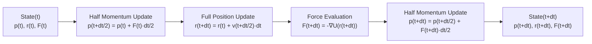
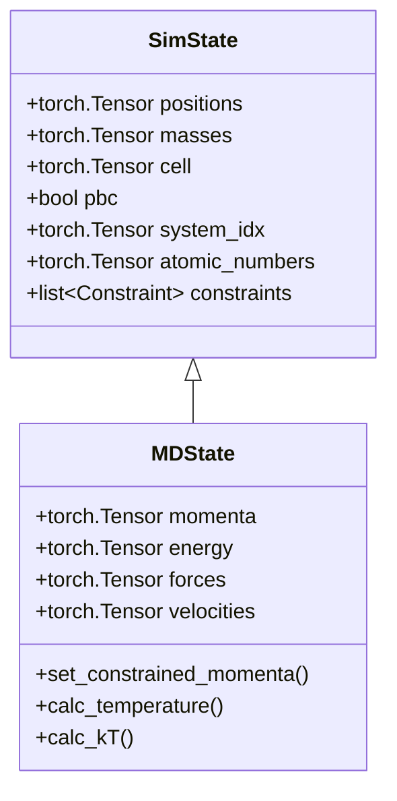
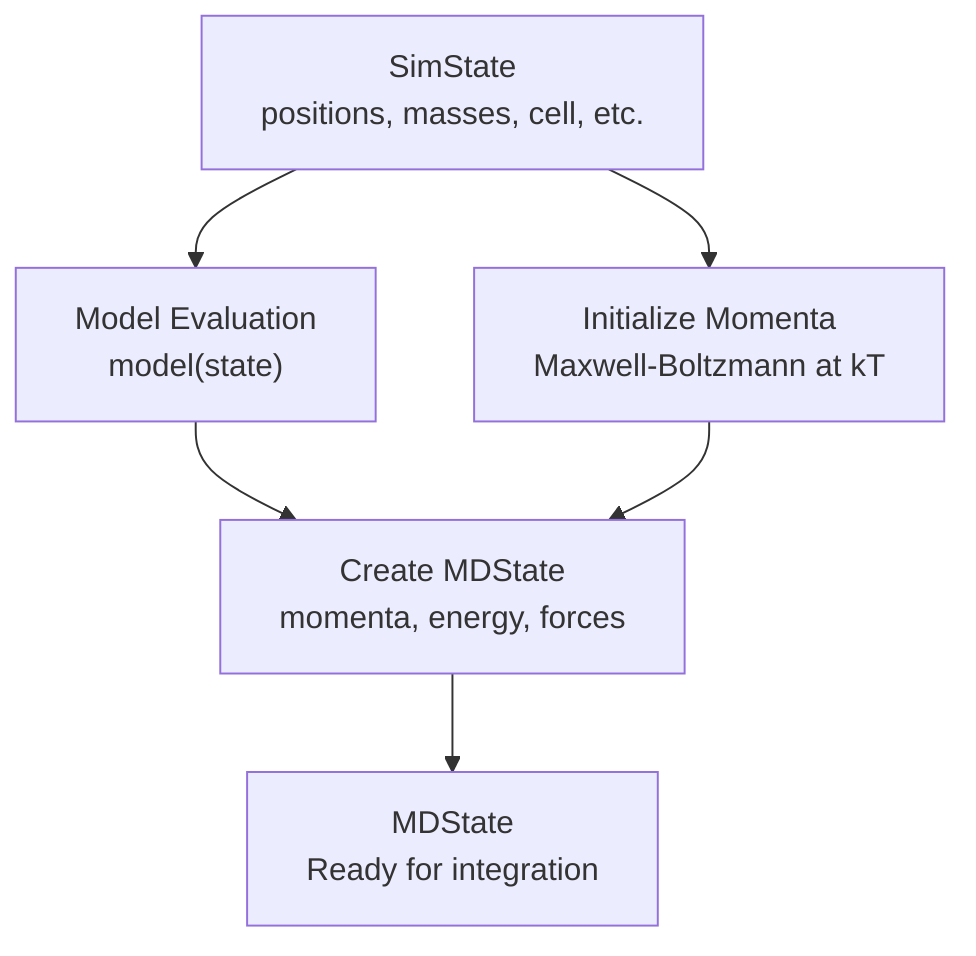
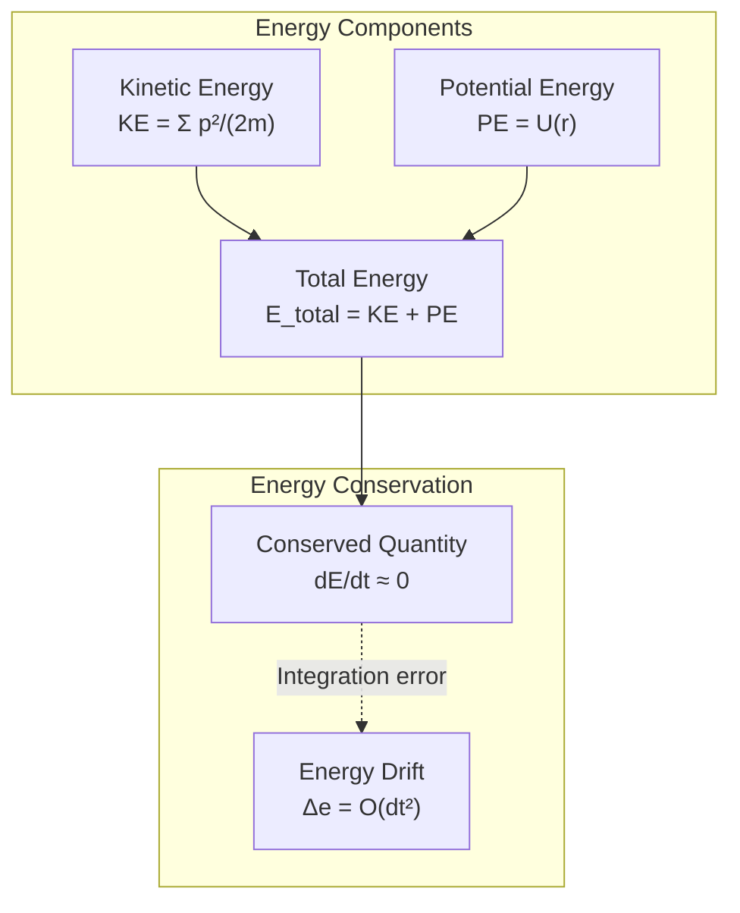
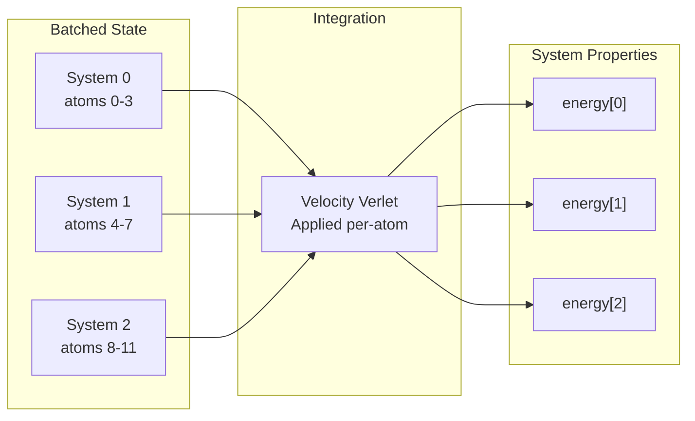
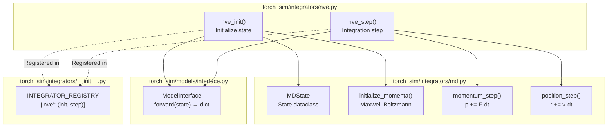

# NVE Ensemble

<details>
<summary>Relevant source files</summary>

The following files were used as context for generating this wiki page:

- [tests/test_integrators.py](tests/test_integrators.py)
- [torch_sim/integrators/__init__.py](torch_sim/integrators/__init__.py)
- [torch_sim/integrators/md.py](torch_sim/integrators/md.py)
- [torch_sim/integrators/npt.py](torch_sim/integrators/npt.py)
- [torch_sim/integrators/nve.py](torch_sim/integrators/nve.py)
- [torch_sim/integrators/nvt.py](torch_sim/integrators/nvt.py)

</details>


This page describes the NVE (microcanonical) ensemble implementation in torch-sim, which simulates systems with constant particle number (N), volume (V), and total energy (E). The NVE ensemble uses the velocity Verlet algorithm to provide energy-conserving time evolution of molecular dynamics systems.

For constant temperature simulations, see [NVT Ensemble](#4.3). For constant pressure and temperature simulations, see [NPT Ensemble](#4.4). For a general overview of molecular dynamics workflows, see [MD Overview and Workflow](#4.1).

## Overview

The NVE ensemble, also known as the microcanonical ensemble, maintains constant particle number, volume, and total energy throughout the simulation. This is the most fundamental MD ensemble since it directly integrates Newton's equations of motion without any external thermostats or barostats. The total energy (kinetic + potential) is conserved in the absence of numerical errors, making energy drift a key diagnostic for integration accuracy.

The torch-sim implementation uses the velocity Verlet algorithm, which is a time-reversible, symplectic integrator that preserves phase space volume and provides second-order accuracy in the timestep.

**Sources:** [torch_sim/integrators/nve.py:1-107](), [torch_sim/integrators/__init__.py:8-9]()

## Algorithm: Velocity Verlet

The velocity Verlet algorithm splits the integration into four steps per timestep:



The algorithm is implemented as:

1. **Half momentum step:** `p(t+dt/2) = p(t) + F(t)·dt/2`
2. **Full position step:** `r(t+dt) = r(t) + v(t+dt/2)·dt`
3. **Force update:** Evaluate `F(t+dt)` from model at new positions
4. **Half momentum step:** `p(t+dt) = p(t+dt/2) + F(t+dt)·dt/2`

This scheme is time-reversible and symplectic, which ensures excellent long-term energy conservation properties.

**Sources:** [torch_sim/integrators/nve.py:70-106](), [torch_sim/integrators/md.py:159-237]()

## State Representation

NVE dynamics uses the `MDState` class, which extends `SimState` with momentum, energy, and force attributes.



### MDState Attributes

| Attribute | Shape | Description |
|-----------|-------|-------------|
| `positions` | `[n_atoms, 3]` | Atomic positions in Cartesian coordinates |
| `momenta` | `[n_atoms, 3]` | Atomic momenta (mass × velocity) |
| `forces` | `[n_atoms, 3]` | Forces on each atom from model evaluation |
| `energy` | `[n_systems]` | Potential energy per system |
| `masses` | `[n_atoms]` | Atomic masses |
| `system_idx` | `[n_atoms]` | System index for each atom (for batching) |
| `cell` | `[n_systems, 3, 3]` | Simulation cell vectors per system |

The `velocities` property is computed on-the-fly as `momenta / masses`.

**Sources:** [torch_sim/integrators/md.py:20-100]()

## Initialization: nve_init

The `nve_init` function initializes an NVE simulation state from a `SimState` object.



### Function Signature

```python
def nve_init(
    state: SimState,
    model: ModelInterface,
    *,
    kT: float | torch.Tensor,
    **_kwargs: Any,
) -> MDState
```

### Parameters

- **`state`**: Input `SimState` with positions, masses, cell, and other atomic data
- **`model`**: Neural network or force field that computes energies and forces via `model(state)`
- **`kT`**: Temperature in energy units for initializing momenta. Can be scalar or shape `[n_systems]` for different temperatures per system
- **`**_kwargs`**: Additional keyword arguments (ignored)

### Initialization Process

1. **Model evaluation:** Calls `model(state)` to compute initial energy and forces
2. **Momenta initialization:** Samples momenta from Maxwell-Boltzmann distribution at temperature `kT` using `initialize_momenta()`
   - If `state` already has a `momenta` attribute, it uses that instead
   - Center of mass momentum is removed per system
3. **State construction:** Creates `MDState` combining input state with computed momenta, energy, and forces

### Random Number Generation

To control the random seed for reproducible momenta initialization, set `state.rng` before calling `nve_init`:

```python
state.rng = 42  # Set seed
md_state = ts.nve_init(state, model, kT=300.0 * units.temperature)
```

**Sources:** [torch_sim/integrators/nve.py:17-67](), [torch_sim/integrators/md.py:102-156]()

## Integration Step: nve_step

The `nve_step` function performs one complete velocity Verlet integration step.

### Function Signature

```python
def nve_step(
    state: MDState,
    model: ModelInterface,
    *,
    dt: float | torch.Tensor,
    **_kwargs: Any,
) -> MDState
```

### Parameters

- **`state`**: Current `MDState` with positions, momenta, forces
- **`model`**: Model interface for computing energies and forces
- **`dt`**: Integration timestep. Can be scalar or shape `[n_systems]` for per-system timesteps
- **`**_kwargs`**: Additional keyword arguments (ignored)

### Implementation Details

The function implements velocity Verlet as follows:

```python
dt = torch.as_tensor(dt, device=state.device, dtype=state.dtype)
state = momentum_step(state, dt / 2)      # p(t+dt/2) = p(t) + F(t)·dt/2
state = position_step(state, dt)          # r(t+dt) = r(t) + v(t+dt/2)·dt

model_output = model(state)               # Evaluate at new positions
state.energy = model_output["energy"]     # Update energy
state.forces = model_output["forces"]     # Update forces

return momentum_step(state, dt / 2)       # p(t+dt) = p(t+dt/2) + F(t+dt)·dt/2
```

### Helper Functions

The integration uses two helper functions from `torch_sim.integrators.md`:

- **`momentum_step(state, dt)`**: Updates momenta via `p += F·dt`, applying constraints
- **`position_step(state, dt)`**: Updates positions via `r += v·dt`, applying constraints and periodic boundary conditions

**Sources:** [torch_sim/integrators/nve.py:70-106](), [torch_sim/integrators/md.py:159-198]()

## Energy Conservation

A key property of NVE dynamics is energy conservation. The total energy (kinetic + potential) should remain constant throughout the simulation, with deviations only due to numerical integration errors.



### Monitoring Energy Conservation

Energy drift can be monitored by tracking the total energy over time:

```python
# During simulation
total_energy = state.energy + calc_kinetic_energy(
    masses=state.masses,
    momenta=state.momenta,
    system_idx=state.system_idx
)
```

The test suite validates energy conservation to within `1e-4` over 100 steps for typical systems:

```python
# From tests/test_integrators.py:947-949
assert torch.allclose(energies_tensor[:, 0], energies_tensor[0, 0], atol=1e-4)
assert torch.allclose(energies_tensor[:, 1], energies_tensor[0, 1], atol=1e-4)
```

**Sources:** [tests/test_integrators.py:929-950]()

## Constraints

NVE integration respects constraints defined in the state. Constraints are applied during position and momentum updates:

- **Position constraints:** Applied in `position_step()` via `state.set_constrained_positions()`
- **Momentum constraints:** Applied in `momentum_step()` via `state.set_constrained_momenta()`

Common constraints include:
- **FixAtoms:** Freezes specified atoms
- **FixCom:** Maintains center of mass
- **FixSymmetry:** Preserves crystal symmetry

For details on constraints, see [Constraints](#4.5).

**Sources:** [torch_sim/integrators/md.py:69-74, 159-198]()

## Batched Simulation Support

The NVE implementation fully supports batched simulations where multiple independent systems are integrated simultaneously. The `system_idx` tensor identifies which atoms belong to which system.



### Batching Features

- **System indexing:** `system_idx` tensor maps atoms to systems
- **Per-system properties:** Energy is computed per system (shape `[n_systems]`)
- **Per-system timesteps:** `dt` can be scalar or shape `[n_systems]`
- **Per-system temperatures:** `kT` for initialization can be scalar or shape `[n_systems]`

The test suite validates that batched and single-system integrations produce identical results:

**Sources:** [tests/test_integrators.py:952-1006]()

## Integration with High-Level API

The NVE integrator is accessible through the high-level `ts.integrate()` API and is registered in `INTEGRATOR_REGISTRY`.

### Registry Entry

```python
# From torch_sim/integrators/__init__.py
INTEGRATOR_REGISTRY: dict[Integrator, tuple[Callable, Callable]] = {
    Integrator.nve: (nve_init, nve_step),
    # ... other integrators
}
```

### Using via ts.integrate()

```python
import torch_sim as ts

# High-level API automatically handles initialization and stepping
trajectory = ts.integrate(
    state=initial_state,
    model=model,
    integrator="nve",
    dt=0.001,
    steps=1000,
    kT=300.0 * ts.units.MetalUnits.temperature,
    trajectory_reporter=reporter
)
```

The `ts.integrate()` function:
1. Looks up `(nve_init, nve_step)` from the registry
2. Calls `nve_init()` to initialize the state
3. Repeatedly calls `nve_step()` for the specified number of steps
4. Logs trajectory data via the reporter

For details on the high-level API, see [High-Level API Functions](#3.3).

**Sources:** [torch_sim/integrators/__init__.py:97-174]()

## Numerical Properties

### Time Reversibility

The velocity Verlet algorithm is time-reversible: running the integrator forward and then backward returns to the original state (within numerical precision).

### Symplectic Structure

Velocity Verlet is a symplectic integrator, meaning it preserves the symplectic structure of Hamiltonian mechanics. This ensures:
- Long-term stability
- No secular energy drift
- Preservation of phase space volume

### Accuracy

The integration error scales as **O(dt²)** per step, giving **O(dt)** global error over a fixed time interval. Position and momentum errors are synchronized, leading to better energy conservation than non-symplectic methods.

**Sources:** [torch_sim/integrators/nve.py:44-46, 93-96]()

## Code Structure Overview



### Key Files

| File | Key Components |
|------|----------------|
| `torch_sim/integrators/nve.py` | `nve_init()`, `nve_step()` |
| `torch_sim/integrators/md.py` | `MDState`, `initialize_momenta()`, `momentum_step()`, `position_step()` |
| `torch_sim/integrators/__init__.py` | `Integrator` enum, `INTEGRATOR_REGISTRY` |
| `tests/test_integrators.py` | `test_nve()`, `test_compare_single_vs_batched_integrators()` |

**Sources:** [torch_sim/integrators/nve.py:1-107](), [torch_sim/integrators/md.py:1-565](), [torch_sim/integrators/__init__.py:1-175]()

## Usage Example

Complete example of running an NVE simulation:

```python
import torch_sim as ts
from torch_sim.units import MetalUnits

# Initialize state from ASE Atoms or other format
state = ts.atoms_to_state(atoms)

# Load or create model
model = ts.LennardJonesModel(epsilon=1.0, sigma=1.0)

# Set random seed for reproducibility
state.rng = 42

# Initialize NVE state
md_state = ts.nve_init(
    state=state,
    model=model,
    kT=300.0 * MetalUnits.temperature  # Initial temperature
)

# Run simulation
dt = 0.001  # femtoseconds in Metal units
for step in range(1000):
    md_state = ts.nve_step(
        state=md_state,
        model=model,
        dt=dt
    )
    
    # Monitor energy conservation
    if step % 100 == 0:
        total_energy = (
            md_state.energy + 
            ts.calc_kinetic_energy(
                masses=md_state.masses,
                momenta=md_state.momenta,
                system_idx=md_state.system_idx
            )
        )
        print(f"Step {step}: Total Energy = {total_energy.item()}")
```

**Sources:** [torch_sim/integrators/nve.py:17-106]()

---