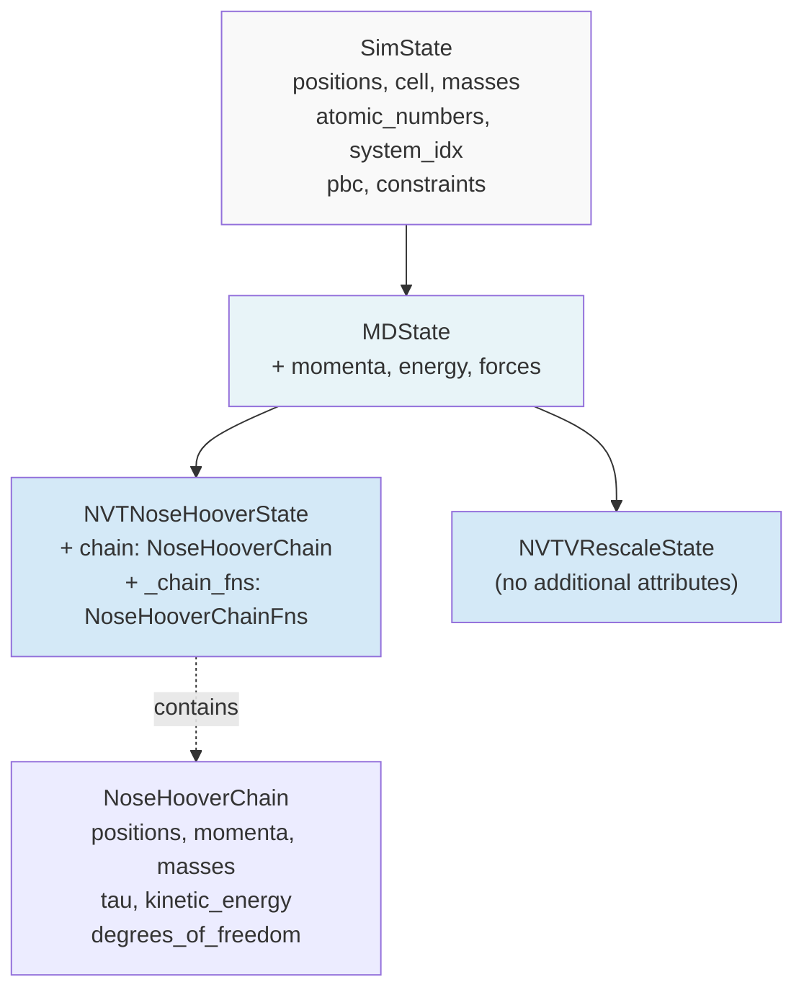
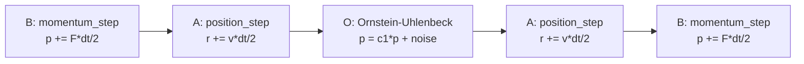
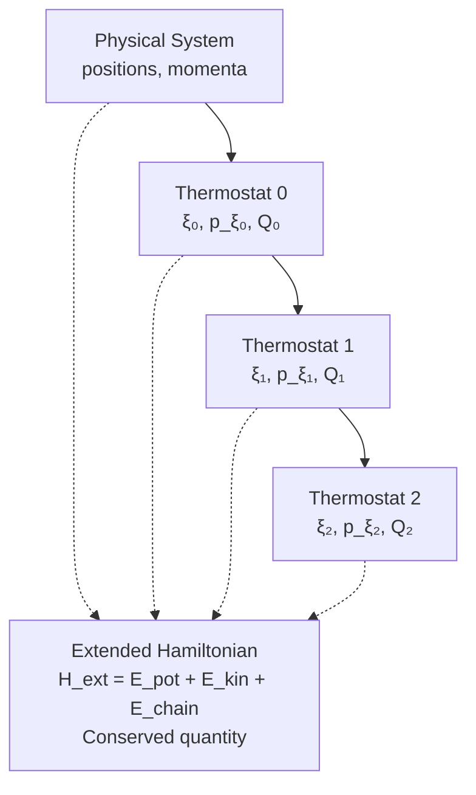
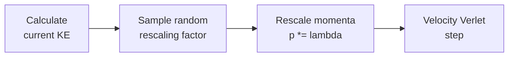

# NVT Ensemble

<details>
<summary>Relevant source files</summary>

The following files were used as context for generating this wiki page:

- [tests/test_integrators.py](tests/test_integrators.py)
- [torch_sim/integrators/__init__.py](torch_sim/integrators/__init__.py)
- [torch_sim/integrators/md.py](torch_sim/integrators/md.py)
- [torch_sim/integrators/npt.py](torch_sim/integrators/npt.py)
- [torch_sim/integrators/nve.py](torch_sim/integrators/nve.py)
- [torch_sim/integrators/nvt.py](torch_sim/integrators/nvt.py)

</details>


This page describes constant temperature (NVT/canonical ensemble) molecular dynamics simulations in torch-sim. The NVT ensemble maintains constant particle number (N), volume (V), and temperature (T) through the use of thermostats that control kinetic energy.

For constant energy simulations without temperature control, see [NVE Ensemble](#4.2). For constant pressure and temperature simulations, see [NPT Ensemble](#4.4). For information on the overall molecular dynamics workflow, see [MD Overview and Workflow](#4.1).

## Scope

This page covers:
- Three thermostat implementations: Langevin, Nose-Hoover, and V-Rescale
- State classes and their relationship to `MDState`
- Initialization and stepping functions for each thermostat
- Algorithm details, parameters, and usage patterns
- Integration scheme specifics (BAOAB, Suzuki-Yoshida, etc.)

## Available Thermostats

torch-sim provides three thermostat algorithms for NVT simulations, each with different properties and use cases:

| Thermostat | Type | State Class | Init Function | Step Function | Key Properties |
|------------|------|-------------|---------------|---------------|----------------|
| Langevin | Stochastic | `MDState` | `nvt_langevin_init` | `nvt_langevin_step` | BAOAB scheme, proper canonical sampling, simple to use |
| Nose-Hoover | Deterministic | `NVTNoseHooverState` | `nvt_nose_hoover_init` | `nvt_nose_hoover_step` | Extended system, conserves extended Hamiltonian, chain thermostat |
| V-Rescale | Stochastic | `NVTVRescaleState` | `nvt_vrescale_init` | `nvt_vrescale_step` | Velocity rescaling, proper canonical sampling, efficient |

**Sources:** [torch_sim/integrators/nvt.py:1-674](), [torch_sim/integrators/__init__.py:97-132]()

## State Class Hierarchy



All NVT thermostats extend `MDState`, which adds momenta, energy, and forces to the base `SimState`. The Langevin thermostat uses `MDState` directly, while Nose-Hoover and V-Rescale use specialized state classes.

**Sources:** [torch_sim/integrators/md.py:20-100](), [torch_sim/integrators/nvt.py:200-248](), [torch_sim/integrators/nvt.py:476-503]()

## Langevin Thermostat

### Algorithm

The Langevin thermostat implements stochastic dynamics with friction and random forces, following the BAOAB splitting scheme. This method provides proper canonical ensemble sampling while maintaining stability.



The BAOAB sequence (B=momentum, A=position, O=Ornstein-Uhlenbeck) ensures proper sampling of the canonical distribution with good numerical stability.

**Sources:** [torch_sim/integrators/nvt.py:139-198]()

### Usage

```python
import torch_sim as ts
from torch_sim.units import MetalUnits

# Initialize
state = ts.nvt_langevin_init(
    state=initial_state,
    model=model,
    kT=300.0 * MetalUnits.temperature
)

# Integration loop
dt = 0.001
for step in range(n_steps):
    state = ts.nvt_langevin_step(
        state=state,
        model=model,
        dt=dt,
        kT=300.0 * MetalUnits.temperature,
        gamma=1.0 / (100 * dt)  # Optional friction coefficient
    )
```

**Sources:** [tests/test_integrators.py:216-267]()

### Parameters

| Parameter | Type | Default | Description |
|-----------|------|---------|-------------|
| `kT` | `float \| Tensor` | Required | Target temperature in energy units (scalar or per-system) |
| `dt` | `float \| Tensor` | Required | Integration timestep |
| `gamma` | `float \| Tensor` | `1/(100*dt)` | Friction coefficient controlling thermostat coupling strength |

The friction coefficient `gamma` controls the strength of the coupling to the heat bath:
- Small `gamma`: Weak coupling, preserves dynamics but slower thermalization
- Large `gamma`: Strong coupling, faster thermalization but may distort dynamics

**Sources:** [torch_sim/integrators/nvt.py:140-198]()

### Implementation Details

The Ornstein-Uhlenbeck step [torch_sim/integrators/nvt.py:24-84]() applies:

```
p(t+dt) = c1*p(t) + c2*sqrt(m)*N(0,1)
```

where:
- `c1 = exp(-gamma*dt)` - damping factor
- `c2 = sqrt(kT*(1-c1²))` - noise amplitude satisfying fluctuation-dissipation theorem
- `N(0,1)` - standard normal random noise

This formulation ensures proper thermal sampling and detailed balance.

**Sources:** [torch_sim/integrators/nvt.py:24-84]()

## Nose-Hoover Thermostat

### Algorithm

The Nose-Hoover chain thermostat uses deterministic extended system dynamics to maintain constant temperature. A chain of thermostats (typically 3) is coupled to the physical system, with each thermostat regulating the one before it.



The chain thermostat maintains temperature by rescaling momenta while conserving an extended Hamiltonian that includes both physical and thermostat degrees of freedom.

**Sources:** [torch_sim/integrators/nvt.py:336-398](), [torch_sim/integrators/md.py:249-274]()

### Usage

```python
import torch_sim as ts
from torch_sim.units import MetalUnits

# Initialize with chain parameters
state = ts.nvt_nose_hoover_init(
    state=initial_state,
    model=model,
    kT=300.0 * MetalUnits.temperature,
    dt=0.001,
    tau=0.1,              # Relaxation time
    chain_length=3,       # Number of thermostats in chain
    chain_steps=3,        # Integration substeps
    sy_steps=3            # Suzuki-Yoshida order
)

# Integration loop
for step in range(n_steps):
    state = ts.nvt_nose_hoover_step(
        state=state,
        model=model,
        dt=0.001,
        kT=300.0 * MetalUnits.temperature
    )
    
    # Check conservation of extended Hamiltonian
    invariant = ts.nvt_nose_hoover_invariant(state, kT=300.0 * MetalUnits.temperature)
```

**Sources:** [tests/test_integrators.py:307-382]()

### Parameters

| Parameter | Type | Default | Description |
|-----------|------|---------|-------------|
| `kT` | `float \| Tensor` | Required | Target temperature in energy units |
| `dt` | `float \| Tensor` | Required | Integration timestep |
| `tau` | `float \| Tensor` | `100*dt` | Thermostat relaxation time (controls oscillation period) |
| `chain_length` | `int` | `3` | Number of thermostats in chain |
| `chain_steps` | `int` | `3` | Number of outer substeps for chain integration |
| `sy_steps` | `int` | `3` | Suzuki-Yoshida splitting order (1, 3, 5, or 7) |

The `tau` parameter controls the characteristic time scale of temperature fluctuations:
- Larger `tau`: Better stability, slower equilibration
- Smaller `tau`: Faster equilibration, may be less stable

**Sources:** [torch_sim/integrators/nvt.py:250-334]()

### Chain Structure and Integration

The Nose-Hoover chain [torch_sim/integrators/md.py:249-274]() consists of:

```python
@dataclass
class NoseHooverChain:
    positions: torch.Tensor      # ξ positions [n_systems, chain_length]
    momenta: torch.Tensor        # p_ξ momenta [n_systems, chain_length]
    masses: torch.Tensor         # Q masses [n_systems, chain_length]
    tau: torch.Tensor            # Relaxation time [n_systems]
    kinetic_energy: torch.Tensor # System KE [n_systems]
    degrees_of_freedom: torch.Tensor  # DOF [n_systems]
```

The chain is integrated using Suzuki-Yoshida composition [torch_sim/integrators/md.py:291-333]() for higher-order accuracy. The integration weights for different orders are:

| Order | Weights |
|-------|---------|
| 1 | `[1.0]` |
| 3 | `[0.829, -0.658, 0.829]` |
| 5 | `[0.297, 0.297, -0.187, 0.297, 0.297]` |
| 7 | `[0.785, 0.236, -1.178, 1.315, -1.178, 0.236, 0.785]` |

**Sources:** [torch_sim/integrators/md.py:249-334](), [torch_sim/integrators/md.py:336-564]()

### Integration Sequence


**Sources:** [torch_sim/integrators/nvt.py:336-398]()

### Conserved Quantity

The extended Hamiltonian [torch_sim/integrators/nvt.py:400-474]() is:

```
H_ext = E_pot + E_kin + Σᵢ(p_ξᵢ²/(2Qᵢ) + kT*ξᵢ)
```

where the sum runs over all chain thermostats. This quantity should remain approximately constant during simulation and provides a validation metric for the thermostat implementation.

**Sources:** [torch_sim/integrators/nvt.py:400-474]()

## V-Rescale Thermostat

### Algorithm

The V-Rescale (Velocity Rescale) thermostat implements canonical sampling through stochastic velocity rescaling. Unlike the Berendsen thermostat, V-Rescale samples the correct canonical distribution by using a properly chosen random rescaling factor.



The rescaling factor λ is drawn from a distribution derived in Bussi et al. (2007) that ensures proper canonical ensemble sampling.

**Sources:** [torch_sim/integrators/nvt.py:623-674]()

### Usage

```python
import torch_sim as ts
from torch_sim.units import MetalUnits

# Initialize
state = ts.nvt_vrescale_init(
    state=initial_state,
    model=model,
    kT=300.0 * MetalUnits.temperature
)

# Integration loop
dt = 0.001
for step in range(n_steps):
    state = ts.nvt_vrescale_step(
        model=model,
        state=state,
        dt=dt,
        kT=300.0 * MetalUnits.temperature,
        tau=100*dt  # Optional relaxation time
    )
```

**Sources:** [tests/test_integrators.py:491-542]()

### Parameters

| Parameter | Type | Default | Description |
|-----------|------|---------|-------------|
| `kT` | `float \| Tensor` | Required | Target temperature in energy units |
| `dt` | `float \| Tensor` | Required | Integration timestep |
| `tau` | `float \| Tensor` | `100*dt` | Thermostat relaxation time controlling coupling strength |

**Sources:** [torch_sim/integrators/nvt.py:623-674]()

### Implementation Details

The rescaling factor is computed [torch_sim/integrators/nvt.py:505-566]() as:

```
scale = c1 + c2*(r1² + r2) + 2*r1*sqrt(c1*c2)
lambda = sqrt(scale)
```

where:
- `c1 = exp(-dt/tau)` - damping factor
- `c2 = (1-c1)*KE_target/KE_current/dof` - correction factor
- `r1 ~ N(0,1)` - standard normal random number
- `r2 ~ Gamma((dof-1)/2, 2)` - gamma distributed random number

This formulation ensures the velocity distribution converges to the Maxwell-Boltzmann distribution at temperature `kT`.

**Sources:** [torch_sim/integrators/nvt.py:505-566]()

### Degrees of Freedom

Both `NVTNoseHooverState` and `NVTVRescaleState` subtract 3 degrees of freedom for center of mass motion [torch_sim/integrators/nvt.py:244-248](), [torch_sim/integrators/nvt.py:499-503](). This is because center of mass momentum is removed during initialization and remains removed throughout the simulation.

**Sources:** [torch_sim/integrators/nvt.py:244-248](), [torch_sim/integrators/nvt.py:499-503]()

## Common Patterns and Integration

### Initialization with RNG Seeding

All NVT thermostats support reproducible initialization by setting the RNG seed before calling the init function:

```python
# Set RNG seed for reproducibility
initial_state.rng = 42

# Initialize with seeded RNG
state = ts.nvt_langevin_init(
    state=initial_state,
    model=model,
    kT=300.0 * MetalUnits.temperature
)
```

The RNG state is stored in the `MDState` and advances consistently across steps, allowing for reproducible trajectories.

**Sources:** [torch_sim/integrators/nvt.py:86-137](), [torch_sim/integrators/md.py:102-157]()

### Batched Simulations

All thermostats support batched simulations with per-system temperature control:

```python
# Different temperatures for different systems
kT = torch.tensor([300.0, 400.0, 500.0]) * MetalUnits.temperature

state = ts.nvt_langevin_init(state=batched_state, model=model, kT=kT)

for step in range(n_steps):
    state = ts.nvt_langevin_step(
        state=state,
        model=model,
        dt=0.001,
        kT=kT  # Per-system temperatures
    )
```

**Sources:** [tests/test_integrators.py:269-305](), [tests/test_integrators.py:438-489]()

### Integration with High-Level API

The NVT thermostats are accessible through the high-level `ts.integrate()` function via the integrator registry:

```python
# Using integrator registry
from torch_sim.integrators import Integrator

trajectory = ts.integrate(
    state=initial_state,
    model=model,
    integrator=Integrator.nvt_langevin,
    dt=0.001,
    kT=300.0 * MetalUnits.temperature,
    n_steps=10000,
    trajectory_file="trajectory.h5"
)
```

The integrator registry [torch_sim/integrators/__init__.py:160-174]() maps integrator names to their corresponding init and step functions:

```python
INTEGRATOR_REGISTRY = {
    Integrator.nvt_vrescale: (nvt_vrescale_init, nvt_vrescale_step),
    Integrator.nvt_langevin: (nvt_langevin_init, nvt_langevin_step),
    Integrator.nvt_nose_hoover: (nvt_nose_hoover_init, nvt_nose_hoover_step),
    # ... other integrators
}
```

**Sources:** [torch_sim/integrators/__init__.py:160-174]()

### Momentum Initialization

All thermostats use `initialize_momenta()` [torch_sim/integrators/md.py:102-157]() to sample initial momenta from a Maxwell-Boltzmann distribution:

```
p_i ~ sqrt(m_i * kT) * N(0, I)
```

with center of mass momentum removed for multi-atom systems. This ensures proper initial thermal distribution.

**Sources:** [torch_sim/integrators/md.py:102-157]()

## Choosing a Thermostat

| Use Case | Recommended Thermostat | Reason |
|----------|------------------------|--------|
| General purpose NVT | Langevin | Simple, robust, proper canonical sampling |
| Long equilibration | Langevin or V-Rescale | Fast thermalization |
| Deterministic dynamics | Nose-Hoover | No stochastic forces, time-reversible |
| Validation/testing | Nose-Hoover | Conserved quantity for debugging |
| Fast thermalization | V-Rescale | Efficient velocity rescaling |

**Performance considerations:**
- Langevin: Simple O step overhead, BAOAB requires 2 extra position updates
- Nose-Hoover: Chain integration overhead scales with `chain_length * chain_steps * sy_steps`
- V-Rescale: Minimal overhead, single rescaling operation

**Sources:** [torch_sim/integrators/nvt.py:1-674](), [torch_sim/integrators/__init__.py:1-62]()

---