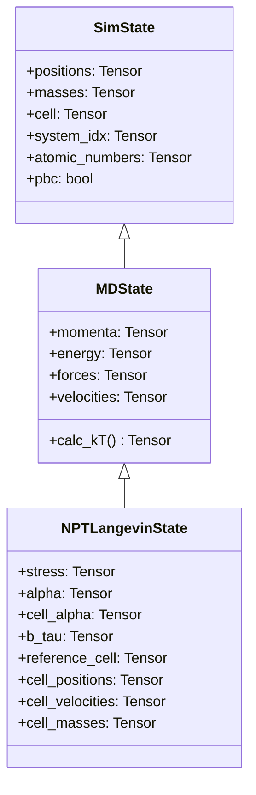
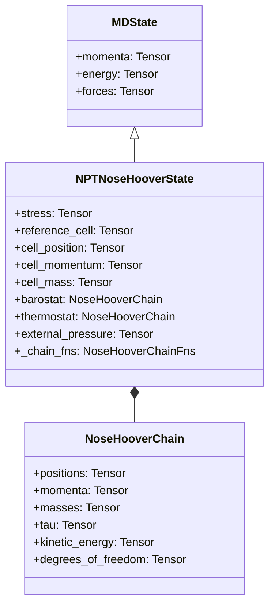
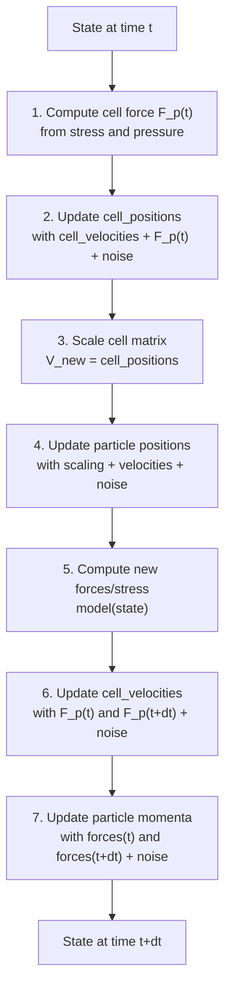
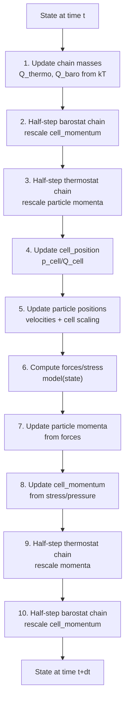
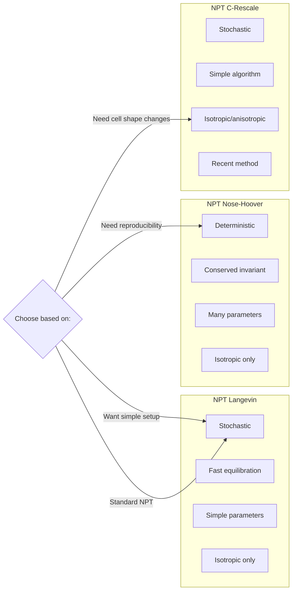

# NPT Ensemble

<details>
<summary>Relevant source files</summary>

The following files were used as context for generating this wiki page:

- [tests/test_integrators.py](tests/test_integrators.py)
- [torch_sim/integrators/__init__.py](torch_sim/integrators/__init__.py)
- [torch_sim/integrators/md.py](torch_sim/integrators/md.py)
- [torch_sim/integrators/npt.py](torch_sim/integrators/npt.py)
- [torch_sim/integrators/nve.py](torch_sim/integrators/nve.py)
- [torch_sim/integrators/nvt.py](torch_sim/integrators/nvt.py)

</details>


This page describes implementations of constant pressure and temperature (NPT) molecular dynamics in torch-sim. The NPT ensemble maintains a target temperature and pressure through thermostats and barostats, allowing both atomic positions and simulation cell dimensions to fluctuate. For constant energy simulations, see [NVE Ensemble](#4.2). For constant temperature simulations with fixed cell, see [NVT Ensemble](#4.3).

Sources: [torch_sim/integrators/__init__.py:1-62]()

## Overview

The NPT (isothermal-isobaric) ensemble maintains constant particle number (N), pressure (P), and temperature (T). Unlike NVE and NVT ensembles where the simulation cell is fixed, NPT simulations allow the cell to expand or contract in response to internal stress and external pressure. This makes NPT the preferred ensemble for studying systems at realistic experimental conditions.

torch-sim provides three NPT integrators:

| Integrator | State Class | Key Features | Registry Key |
|------------|-------------|--------------|--------------|
| NPT Langevin | `NPTLangevinState` | Stochastic barostat/thermostat, BAOAB-like scheme | `Integrator.npt_langevin` |
| NPT Nose-Hoover | `NPTNoseHooverState` | Deterministic thermostat/barostat chains, conserved invariant | `Integrator.npt_nose_hoover` |
| NPT C-Rescale (Isotropic) | `MDState` | Stochastic cell rescaling, fixed cell shape | `Integrator.npt_isotropic_crescale` |
| NPT C-Rescale (Anisotropic) | `MDState` | Stochastic cell rescaling, variable cell shape | `Integrator.npt_anisotropic_crescale` |

All NPT integrators require models that compute stress tensors in addition to energies and forces.

Sources: [torch_sim/integrators/__init__.py:96-174](), [torch_sim/integrators/npt.py:1-27]()

## State Classes

### NPTLangevinState



`NPTLangevinState` extends `MDState` with cell dynamics variables:

- **`stress`**: Stress tensor `[n_systems, 3, 3]` computed by the model
- **`alpha`**: Friction coefficient for particle thermostat `[n_systems]`
- **`cell_alpha`**: Friction coefficient for cell thermostat `[n_systems]`
- **`b_tau`**: Barostat time constant `[n_systems]`
- **`reference_cell`**: Original cell used as scaling reference `[n_systems, 3, 3]`
- **`cell_positions`**: Cell coordinate (volume) `[n_systems, 1, 1]`
- **`cell_velocities`**: Cell velocities `[n_systems, 3, 3]`
- **`cell_masses`**: Mass parameter for cell dynamics `[n_systems]`

Sources: [torch_sim/integrators/npt.py:34-92]()

### NPTNoseHooverState



`NPTNoseHooverState` uses Nose-Hoover chains for deterministic temperature and pressure control:

- **`cell_position`**: Logarithmic cell coordinate `(1/d)ln(V/V_0)` `[n_systems]`
- **`cell_momentum`**: Cell momentum conjugate to `cell_position` `[n_systems]`
- **`thermostat`**: Nose-Hoover chain for particle temperature control
- **`barostat`**: Nose-Hoover chain for cell pressure control

Sources: [torch_sim/integrators/npt.py:752-822]()

## NPT Langevin Barostat

### Integration Scheme

The NPT Langevin integrator implements a stochastic barostat based on Grønbech-Jensen & Farago (2014). The integration sequence per timestep is:



### Initialization

```python
# Function signature
npt_langevin_init(
    state: SimState,
    model: ModelInterface,
    *,
    kT: float | torch.Tensor,
    dt: float | torch.Tensor,
    alpha: float | torch.Tensor | None = None,
    cell_alpha: float | torch.Tensor | None = None,
    b_tau: float | torch.Tensor | None = None,
) -> NPTLangevinState
```

Initialization process:
1. Computes initial forces and stress via `model(state)`
2. Initializes particle momenta from Maxwell-Boltzmann distribution at `kT`
3. Sets `cell_positions` to current cell determinant (volume)
4. Initializes `cell_velocities` to zero
5. Computes `cell_masses = (n_atoms + 1) * kT * b_tau^2`

Default parameters:
- `alpha = 1/(100*dt)` (particle friction)
- `cell_alpha = alpha` (cell friction)
- `b_tau = 1/(1000*dt)` (barostat time constant)

Sources: [torch_sim/integrators/npt.py:507-634]()

### Integration Step

```python
# Function signature
npt_langevin_step(
    state: NPTLangevinState,
    model: ModelInterface,
    *,
    dt: float | torch.Tensor,
    kT: float | torch.Tensor,
    external_pressure: float | torch.Tensor,
) -> NPTLangevinState
```

The step function:
1. Updates `cell_masses` based on current `kT` and `b_tau`
2. Computes cell force from stress difference: `F_p = -V*(stress + P_ext) + kT*I*n_atoms`
3. Updates `cell_positions` (volume) with Langevin dynamics
4. Scales `cell` matrix isotropically: `cell = (V/V_0)^(1/3) * reference_cell`
5. Updates particle `positions` with cell scaling and Langevin dynamics
6. Recomputes `forces` and `stress` at new configuration
7. Updates `cell_velocities` and particle `momenta` with averaged forces

Sources: [torch_sim/integrators/npt.py:637-750]()

### Cell Force Computation

The cell force couples internal stress to external pressure:

```python
def _compute_cell_force(
    state: NPTLangevinState,
    external_pressure: float | torch.Tensor,
    kT: float | torch.Tensor,
) -> torch.Tensor
```

Formula: `F_cell = -V * (stress + P_ext * I) + kT * I * n_atoms`

Where:
- `V`: Cell volume (determinant of cell matrix)
- `stress`: Internal stress tensor from model
- `P_ext`: External pressure (scalar or tensor)
- `I`: 3×3 identity matrix
- `n_atoms`: Number of atoms per system

The kinetic term `kT * I * n_atoms` corrects for kinetic contributions to pressure.

Sources: [torch_sim/integrators/npt.py:446-505]()

### Usage Example

```python
import torch_sim as ts
from torch_sim.units import MetalUnits

# Initialize state and model
state = ts.SimState(...)
model = LennardJonesModel(...)

# Set temperature and pressure
kT = 300.0 * MetalUnits.temperature  # 300 K
P_ext = 1.0 * MetalUnits.pressure     # 1 bar
dt = 0.001 * MetalUnits.time

# Initialize NPT state
state.rng = 42  # Seed RNG for reproducibility
npt_state = ts.npt_langevin_init(
    state=state,
    model=model,
    kT=kT,
    dt=dt,
    alpha=40*dt,        # Particle friction
    cell_alpha=40*dt,   # Cell friction
    b_tau=1/(1000*dt),  # Barostat time constant
)

# Run NPT dynamics
for step in range(10000):
    npt_state = ts.npt_langevin_step(
        state=npt_state,
        model=model,
        dt=dt,
        kT=kT,
        external_pressure=P_ext,
    )
    
    # Monitor temperature and pressure
    if step % 100 == 0:
        temp = npt_state.calc_temperature()
        volume = torch.linalg.det(npt_state.cell)
```

Sources: [tests/test_integrators.py:83-156]()

## NPT Nose-Hoover Barostat

### Integration Scheme

The NPT Nose-Hoover integrator uses deterministic Nose-Hoover chains for both temperature and pressure control, based on Martyna et al. (1996):



### Initialization

```python
npt_nose_hoover_init(
    state: SimState,
    model: ModelInterface,
    *,
    kT: float | torch.Tensor,
    dt: float | torch.Tensor,
    external_pressure: float | torch.Tensor,
    tau: float | torch.Tensor | None = None,
    cell_tau: float | torch.Tensor | None = None,
    chain_length: int = 3,
    chain_steps: int = 3,
    sy_steps: int = 3,
) -> NPTNoseHooverState
```

Initialization creates two independent Nose-Hoover chains:
1. **Thermostat chain**: Controls particle temperature
2. **Barostat chain**: Controls cell (pressure)

Cell coordinate uses logarithmic parameterization:
- `cell_position = (1/d) * ln(V/V_0)` where `d=3` for 3D
- Ensures volume positivity: `V = V_0 * exp(d * cell_position)`

Sources: [torch_sim/integrators/npt.py:824-966]()

### Integration Step

```python
npt_nose_hoover_step(
    state: NPTNoseHooverState,
    model: ModelInterface,
    *,
    dt: float | torch.Tensor,
    kT: float | torch.Tensor,
    external_pressure: float | torch.Tensor,
) -> NPTNoseHooverState
```

The integration uses a symmetric splitting scheme with Suzuki-Yoshida weights for higher-order accuracy. Each step involves:
1. Updating chain masses from target `kT`
2. Evolving both thermostat and barostat chains
3. Propagating cell and particle coordinates
4. Recomputing forces and stress

Sources: [torch_sim/integrators/npt.py:968-1124]()

### Conserved Invariant

```python
def npt_nose_hoover_invariant(
    state: NPTNoseHooverState,
    kT: torch.Tensor,
    external_pressure: torch.Tensor,
) -> torch.Tensor
```

The NPT Nose-Hoover method conserves an extended Hamiltonian:

```
H_NPT = U + K + P_ext*V + sum(chain energies)
```

Where:
- `U`: Potential energy
- `K`: Kinetic energy
- `P_ext*V`: PV work term
- Chain energies: Thermostat and barostat contributions

This invariant should remain approximately constant during simulation and serves as a validation metric.

Sources: [torch_sim/integrators/npt.py:1126-1180]()

### Usage Example

```python
import torch_sim as ts

# Initialize state
state = ts.SimState(...)
model = ...

kT = 300.0 * units.temperature
P_ext = 0.0 * units.pressure
dt = 0.001 * units.time

# Initialize NPT Nose-Hoover
state.rng = 42
npt_state = ts.npt_nose_hoover_init(
    state=state,
    model=model,
    kT=kT,
    dt=dt,
    external_pressure=P_ext,
    tau=100*dt,        # Thermostat time constant
    cell_tau=1000*dt,  # Barostat time constant
    chain_length=3,
    chain_steps=3,
)

# Run dynamics
invariants = []
for step in range(1000):
    npt_state = ts.npt_nose_hoover_step(
        state=npt_state,
        model=model,
        dt=dt,
        kT=kT,
        external_pressure=P_ext,
    )
    
    # Check conserved quantity
    if step % 10 == 0:
        inv = ts.npt_nose_hoover_invariant(npt_state, kT, P_ext)
        invariants.append(inv)
```

Sources: [tests/test_integrators.py:690-771]()

## NPT C-Rescale Barostat

### Overview

The C-Rescale (Cell Rescale) barostat implements stochastic cell rescaling from Bernetti & Bussi (2020). Unlike Langevin and Nose-Hoover methods that add extra dynamical variables, C-Rescale directly rescales the cell matrix at each step.

Two variants are available:
- **Isotropic**: Scales all cell dimensions uniformly, preserving cell shape
- **Anisotropic**: Scales cell dimensions independently, allowing cell shape changes

Both use the standard `MDState` class rather than a specialized state.

Sources: [torch_sim/integrators/npt.py:1182-1204]()

### Initialization

```python
npt_crescale_init(
    state: SimState,
    model: ModelInterface,
    *,
    kT: float | torch.Tensor,
    dt: float | torch.Tensor,
    tau_p: float | torch.Tensor,
    isothermal_compressibility: float | torch.Tensor,
    **_kwargs,
) -> MDState
```

Parameters:
- **`tau_p`**: Barostat relaxation time (larger = slower pressure equilibration)
- **`isothermal_compressibility`**: Material compressibility (typical: `1e-4` for liquids)

Sources: [torch_sim/integrators/npt.py:1206-1268]()

### Isotropic Rescaling

```python
npt_crescale_isotropic_step(
    state: MDState,
    model: ModelInterface,
    *,
    dt: float | torch.Tensor,
    kT: float | torch.Tensor,
    external_pressure: float | torch.Tensor,
) -> MDState
```

Isotropic rescaling preserves cell shape:
1. Apply V-Rescale thermostat to particle velocities
2. Compute cell rescaling factor `μ` from stress and target pressure
3. Scale cell isotropically: `cell_new = μ^(1/3) * cell`
4. Scale positions accordingly: `pos_new = μ^(1/3) * pos`
5. Perform velocity Verlet step

The rescaling factor `μ` is sampled stochastically to ensure correct NPT ensemble distribution.

Sources: [torch_sim/integrators/npt.py:1270-1394]()

### Anisotropic Rescaling

```python
npt_crescale_anisotropic_step(
    state: MDState,
    model: ModelInterface,
    *,
    dt: float | torch.Tensor,
    kT: float | torch.Tensor,
    external_pressure: float | torch.Tensor,
) -> MDState
```

Anisotropic rescaling allows cell shape changes:
1. Apply V-Rescale thermostat
2. Compute 3×3 scaling matrix `M` from stress tensor components
3. Apply `M` to cell matrix: `cell_new = M @ cell`
4. Transform positions: `pos_new = M @ pos`
5. Perform velocity Verlet step

This is useful for studying phase transitions and structural relaxations where cell shape optimization is needed.

Sources: [torch_sim/integrators/npt.py:1396-1540]()

### Usage Example

```python
import torch_sim as ts

# Initialize for isotropic rescaling
state.rng = 42
npt_state = ts.npt_crescale_init(
    state=state,
    model=model,
    kT=300*units.temperature,
    dt=0.001*units.time,
    tau_p=0.1*units.time,
    isothermal_compressibility=1e-4,
)

# Run isotropic NPT
for step in range(1000):
    npt_state = ts.npt_crescale_isotropic_step(
        state=npt_state,
        model=model,
        dt=0.001*units.time,
        kT=300*units.temperature,
        external_pressure=10.0*units.pressure,
    )

# Or run anisotropic NPT (allows cell shape changes)
for step in range(1000):
    npt_state = ts.npt_crescale_anisotropic_step(
        state=npt_state,
        model=model,
        dt=0.001*units.time,
        kT=300*units.temperature,
        external_pressure=10.0*units.pressure,
    )
```

Sources: [tests/test_integrators.py:544-687]()

## Parameter Selection Guidelines

### Friction Coefficients (Langevin)

The friction coefficients `alpha` and `cell_alpha` control the strength of the thermostat/barostat coupling:

| Parameter | Typical Range | Effect |
|-----------|---------------|--------|
| `alpha` (particle) | `10*dt` to `100*dt` | Stronger coupling → faster thermalization, more perturbation |
| `cell_alpha` | Same as `alpha` | Controls cell dynamics damping |
| `b_tau` | `1/(100*dt)` to `1/(2000*dt)` | Smaller → slower pressure equilibration, more stable |

**Recommendations**:
- Start with defaults: `alpha=1/(100*dt)`, `b_tau=1/(1000*dt)`
- Increase `alpha` if temperature equilibration is too slow
- Decrease `b_tau` if pressure equilibration is too slow
- For production runs, use weaker coupling (larger denominators) to minimize perturbation

Sources: [torch_sim/integrators/npt.py:507-634]()

### Time Constants (Nose-Hoover)

Nose-Hoover chains use relaxation times `tau` and `cell_tau`:

| Parameter | Typical Range | Effect |
|-----------|---------------|--------|
| `tau` (thermostat) | `100*dt` to `500*dt` | Period of temperature oscillations |
| `cell_tau` (barostat) | `1000*dt` to `5000*dt` | Period of volume oscillations |
| `chain_length` | 3-5 | More chains → better sampling |
| `chain_steps` | 3-5 | More steps → better integration |

**Recommendations**:
- Use `tau ~ 100*dt` and `cell_tau ~ 1000*dt` as starting points
- Increase time constants for weaker coupling (less perturbation)
- Use `chain_length=3` and `chain_steps=3` for good accuracy/performance balance
- Monitor the conserved invariant to check integration accuracy

Sources: [torch_sim/integrators/npt.py:824-966]()

### Compressibility (C-Rescale)

The `isothermal_compressibility` parameter affects pressure control:

| Material Type | Typical Value | Notes |
|---------------|---------------|-------|
| Liquids | `1e-4` to `1e-3` | More compressible |
| Crystals | `1e-5` to `1e-4` | Less compressible |
| Metals | `5e-6` to `5e-5` | Least compressible |

Combined with `tau_p`, determines pressure equilibration rate. Larger `tau_p` → slower, more stable equilibration.

Sources: [torch_sim/integrators/npt.py:1206-1268]()

## Comparison of NPT Methods



| Feature | NPT Langevin | NPT Nose-Hoover | NPT C-Rescale |
|---------|--------------|-----------------|---------------|
| **Stochasticity** | Stochastic | Deterministic | Stochastic |
| **Conserved quantity** | None | Extended Hamiltonian | None |
| **Parameters** | 3 (α, α_cell, b_tau) | 7+ (tau, cell_tau, chain params) | 2 (τ_p, κ) |
| **Cell shape changes** | No | No | Yes (anisotropic) |
| **Typical use case** | Standard NPT | Validation, debugging | Shape optimization |
| **Computational cost** | Medium | High | Low |
| **Equilibration** | Fast | Medium | Fast |

Sources: [torch_sim/integrators/__init__.py:96-174](), [torch_sim/integrators/npt.py:1-27]()

## Multi-System Batching

All NPT integrators support batched simulations where each system can have different:
- Temperature (`kT` as `[n_systems]` tensor)
- Pressure (`external_pressure` as `[n_systems]` or `[n_systems, 3, 3]` tensor)
- Thermostat/barostat parameters

Example:

```python
# Different temperatures per system
kT = torch.tensor([200, 300, 400], dtype=torch.float32) * units.temperature

# Different pressures per system
P_ext = torch.tensor([0.0, 1.0, 10.0], dtype=torch.float32) * units.pressure

# Initialize batched state
state = ts.concatenate_states([state1, state2, state3])

# Run with per-system parameters
npt_state = ts.npt_langevin_init(state, model, kT=kT, dt=dt)
for step in range(1000):
    npt_state = ts.npt_langevin_step(
        npt_state, model, dt=dt, kT=kT, external_pressure=P_ext
    )
```

Sources: [tests/test_integrators.py:158-215](), [tests/test_integrators.py:865-927]()

## Constraints with NPT

Using constraints with NPT dynamics requires care. Cell volume changes can conflict with constraints like `FixAtoms` or `FixSymmetry`. The code issues warnings when constraints are detected:

```python
# From npt_langevin_init
if state.constraints:
    warnings.warn(
        "Constraints are present in the system. "
        "Make sure they are compatible with NPT Langevin dynamics. "
        "We recommend not using constraints with NPT dynamics for now.",
        UserWarning
    )
```

**Recommendations**:
- Avoid constraints in NPT simulations when possible
- If constraints are necessary, use NVT or NVE with manual cell optimization
- For symmetry preservation, consider using fixed cell (NVT) instead

For details on constraints, see [Constraints](#4.5).

Sources: [torch_sim/integrators/npt.py:610-618]()

## Validation and Testing

### Temperature Control

Test that mean temperature matches target:

```python
temperatures = []
for step in range(1000):
    state = ts.npt_langevin_step(state, model, dt=dt, kT=kT, 
                                   external_pressure=P_ext)
    temp = state.calc_temperature()
    temperatures.append(temp)

mean_temp = torch.stack(temperatures).mean(dim=0)
assert torch.allclose(mean_temp, kT/units.temperature, rtol=0.1)
```

### Pressure Equilibration

Monitor pressure via virial stress:

```python
pressures = []
for step in range(1000):
    state = ts.npt_langevin_step(state, model, dt=dt, kT=kT,
                                   external_pressure=P_ext)
    # Compute instantaneous pressure from stress
    volume = torch.linalg.det(state.cell)
    pressure = -torch.trace(state.stress) / 3
    pressures.append(pressure)
```

### Invariant Conservation (Nose-Hoover)

```python
invariants = []
for step in range(1000):
    state = ts.npt_nose_hoover_step(state, model, dt=dt, kT=kT,
                                      external_pressure=P_ext)
    inv = ts.npt_nose_hoover_invariant(state, kT, P_ext)
    invariants.append(inv)

# Check relative drift
inv_tensor = torch.stack(invariants)
drift = inv_tensor.std() / inv_tensor.mean()
assert drift < 0.15  # Less than 15% variation
```

Sources: [tests/test_integrators.py:83-156](), [tests/test_integrators.py:690-927]()

---