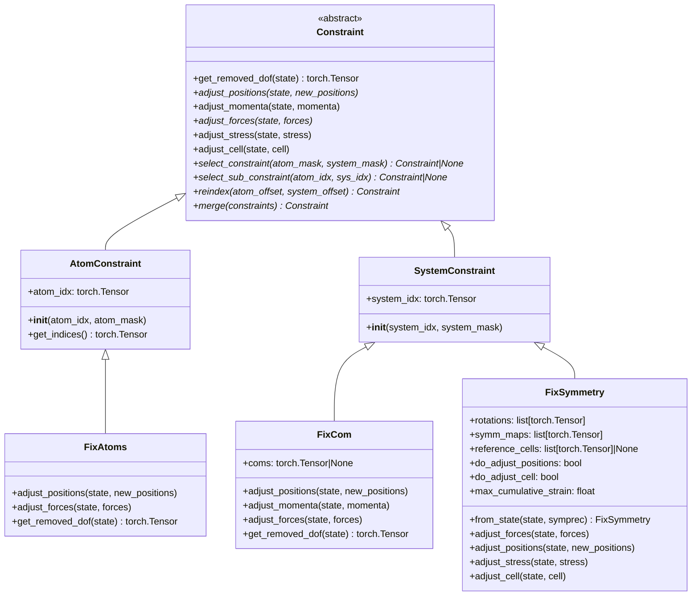
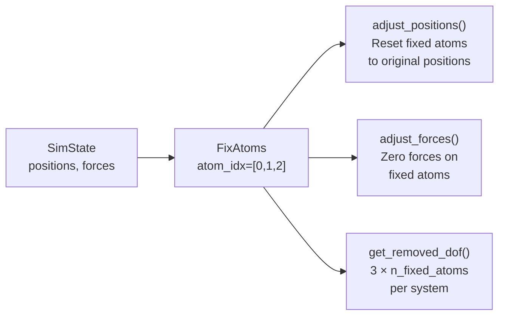
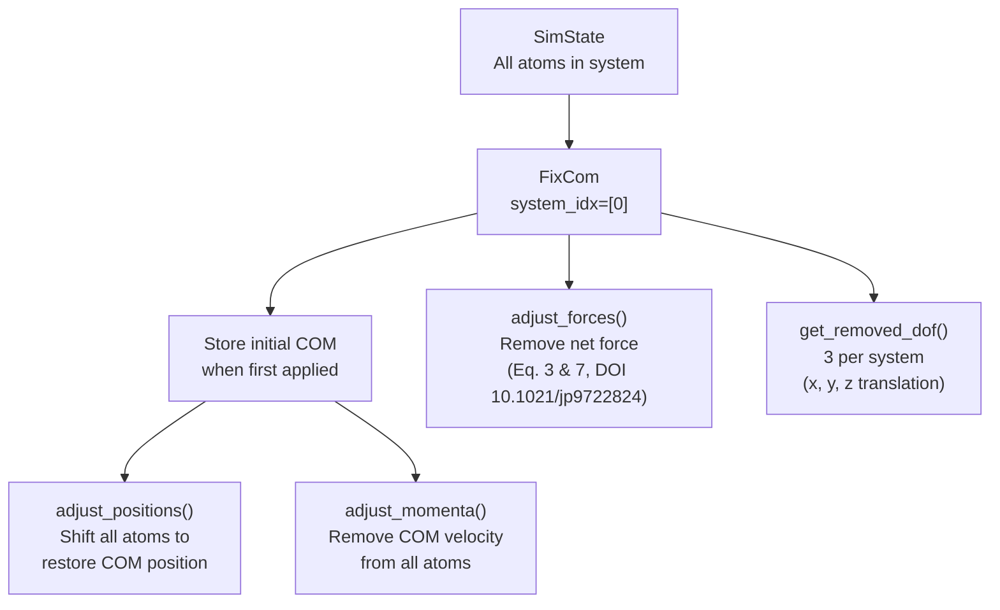
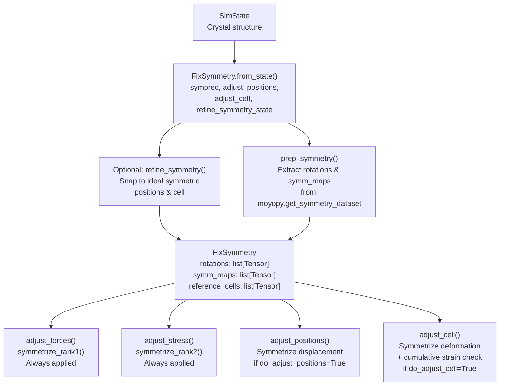
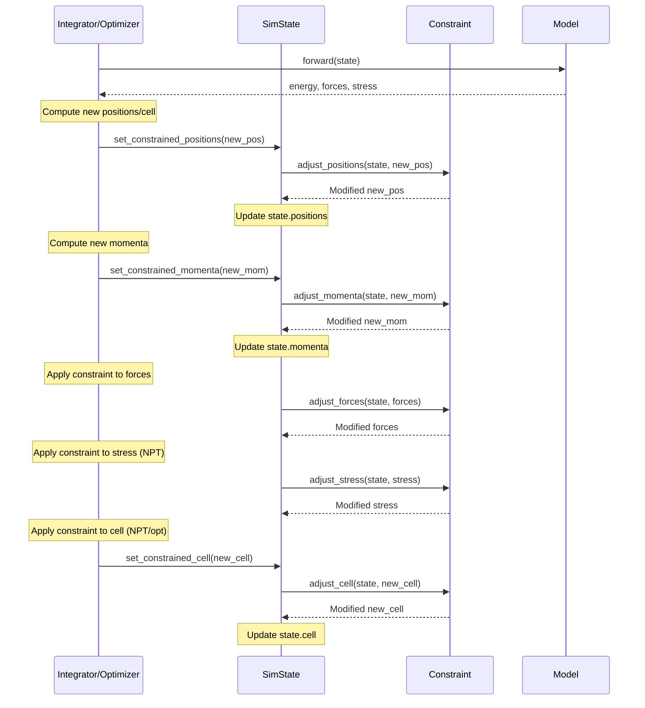
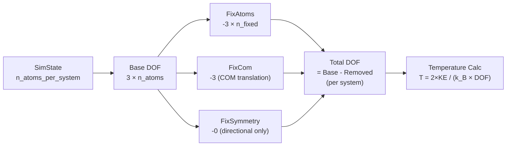
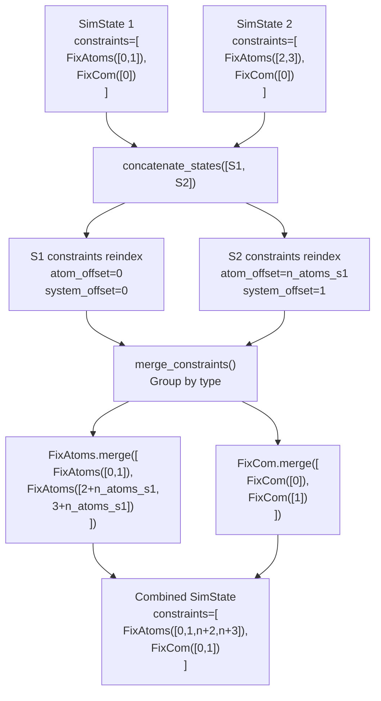

# Constraints

<details>
<summary>Relevant source files</summary>

The following files were used as context for generating this wiki page:

- [tests/test_constraints.py](tests/test_constraints.py)
- [tests/test_fix_symmetry.py](tests/test_fix_symmetry.py)
- [torch_sim/constraints.py](torch_sim/constraints.py)
- [torch_sim/testing.py](torch_sim/testing.py)

</details>


## Purpose and Scope

This page documents the constraint system for imposing physical restrictions during molecular dynamics simulations and structure optimization. Constraints modify forces, positions, momenta, stress tensors, and cell parameters to enforce conditions such as fixed atoms, center-of-mass constraints, or crystal symmetry preservation.

For information about the integrators and optimizers that apply constraints, see [MD Overview and Workflow](#4.1) and [Structure Optimization](#5). For general simulation state management, see [SimState and Data Structures](#3.1).

**Sources:** [torch_sim/constraints.py:1-9]()

## Constraint Interface

All constraints inherit from the `Constraint` abstract base class, which defines a standard interface for modifying simulation states. The interface includes methods for adjusting physical quantities, managing degrees of freedom, and handling state manipulation operations.



**Core Abstract Methods:**

| Method | Purpose | Return Type |
|--------|---------|-------------|
| `get_removed_dof(state)` | Calculate degrees of freedom removed by constraint | `torch.Tensor` |
| `adjust_positions(state, new_positions)` | Modify positions to satisfy constraint (in-place) | `None` |
| `adjust_forces(state, forces)` | Modify forces to satisfy constraint (in-place) | `None` |
| `select_constraint(atom_mask, system_mask)` | Filter constraint by atom/system masks | `Constraint \| None` |
| `select_sub_constraint(atom_idx, sys_idx)` | Extract constraint for single system | `Constraint \| None` |
| `reindex(atom_offset, system_offset)` | Shift indices for concatenation | `Constraint` |
| `merge(constraints)` | Combine multiple reindexed constraints | `Constraint` |

**Optional Methods:**

- `adjust_momenta(state, momenta)` - Default implementation calls `adjust_forces` [torch_sim/constraints.py:59-70]()
- `adjust_stress(state, stress)` - Default is no-op [torch_sim/constraints.py:84-94]()
- `adjust_cell(state, cell)` - Default is no-op [torch_sim/constraints.py:96-106]()

**Sources:** [torch_sim/constraints.py:28-153]()

## Base Constraint Classes

The system provides two base classes for common constraint patterns:

### AtomConstraint

`AtomConstraint` provides functionality for constraints that act on specific atom indices. It handles index conversion from boolean masks, validation, and automatic reindexing during state operations.

```python
# Initialize with atom indices
constraint = FixAtoms(atom_idx=[0, 1, 2])

# Or with boolean mask
mask = torch.tensor([True, True, True, False, False])
constraint = FixAtoms(atom_mask=mask)
```

**Key Features:**
- Accepts either `atom_idx` (tensor/list of integers) or `atom_mask` (boolean tensor)
- Validates indices are unique and within bounds
- Automatically adjusts indices during `select_constraint` and `select_sub_constraint`

**Sources:** [torch_sim/constraints.py:170-274]()

### SystemConstraint

`SystemConstraint` provides functionality for constraints that act on entire systems in batched states. It manages system-level indices and ensures proper constraint application across multiple systems.

**Key Features:**
- Accepts either `system_idx` or `system_mask`
- Validates system indices are unique
- Handles per-system constraint application in batched scenarios

**Sources:** [torch_sim/constraints.py:276-373]()

## Built-in Constraints

### FixAtoms

`FixAtoms` freezes specified atoms in place by resetting positions, zeroing forces, and removing 3 degrees of freedom per fixed atom.



**Implementation Details:**

| Method | Behavior |
|--------|----------|
| `adjust_positions` | `new_positions[atom_idx] = state.positions[atom_idx]` |
| `adjust_forces` | `forces[atom_idx] = 0.0` |
| `adjust_momenta` | Calls `adjust_forces` (zeroes momenta) |
| `get_removed_dof` | Returns `3 × n_fixed_atoms_per_system` |

**Example Usage:**
```python
# Fix surface atoms during bulk relaxation
state = ts.io.atoms_to_state(atoms, device, dtype)
state.constraints = [FixAtoms(atom_idx=[0, 1, 2, 3])]

# Run optimization - fixed atoms won't move
final_state = ts.optimize(
    state, model, optimizer=ts.Optimizer.fire, max_steps=500
)
```

**Sources:** [torch_sim/constraints.py:416-492](), [tests/test_constraints.py:59-96]()

### FixCom

`FixCom` prevents center-of-mass translation by adjusting positions to maintain the initial COM position, removing COM velocity from momenta, and removing net forces.



**Implementation Details:**

The constraint computes center-of-mass corrections using mass-weighted operations:

- **Position adjustment**: Computes displacement `Δ = COM_initial - COM_new`, then shifts all atom positions by `Δ`
- **Momenta adjustment**: Removes COM velocity: `p_i' = p_i - m_i × v_COM`
- **Force adjustment**: Implements constraint force from [DOI:10.1021/jp9722824](https://doi.org/10.1021/jp9722824): removes mass-weighted net force `λ` where `λ = Σ(F_i × m_i) / Σ(m_i²)`

**Example Usage:**
```python
# Prevent drift during MD simulation
state.constraints = [FixCom([0])]

# Run MD - COM will not drift
for _ in range(n_steps):
    state = ts.nve_step(state, model, dt=0.001)
```

**Sources:** [torch_sim/constraints.py:494-614](), [tests/test_constraints.py:98-143]()

### FixSymmetry

`FixSymmetry` preserves crystallographic symmetry during optimization by symmetrizing forces, stress, and optionally positions and cell parameters using spacegroup operations from `moyopy`.



**Symmetrization Operations:**

| Quantity | Tensor Rank | Symmetrization | Always Applied |
|----------|-------------|----------------|----------------|
| Forces | Rank-1 | `symmetrize_rank1()` | Yes |
| Momenta | Rank-1 | `symmetrize_rank1()` | Yes |
| Stress | Rank-2 | `symmetrize_rank2()` | Yes |
| Position displacements | Rank-1 | `symmetrize_rank1()` | If `adjust_positions=True` |
| Cell deformation | Rank-2 | `symmetrize_rank2()` | If `adjust_cell=True` |

**Cell Deformation Safety Mechanisms:**

The `adjust_cell` method implements two safeguards against non-physical deformations:

1. **Per-step clamping**: Large single-step deformations (>25% strain) are scaled down to 25% to prevent ill-conditioned symmetrization
2. **Cumulative strain limit**: Total deformation from `reference_cells` is clamped to `max_cumulative_strain` (default 0.5) to prevent phase transitions that would break symmetry (e.g., hexagonal → tetragonal collapse)

**Example Usage:**
```python
# Preserve FCC symmetry during relaxation
state = ts.io.atoms_to_state(fcc_atoms, device, dtype)

# Create constraint - automatically refines to ideal symmetry
constraint = FixSymmetry.from_state(
    state, 
    symprec=0.01,
    adjust_positions=True,
    adjust_cell=True,
    refine_symmetry_state=True  # Mutates state in-place
)
state.constraints = [constraint]

# Optimize with cell relaxation - symmetry preserved
final = ts.optimize(
    state, model, 
    optimizer=ts.Optimizer.fire,
    init_kwargs={"cell_filter": ts.CellFilter.frechet},
    max_steps=100
)

# Verify symmetry maintained
from torch_sim.symmetrize import get_symmetry_datasets
datasets = get_symmetry_datasets(final, symprec=0.01)
print(f"Spacegroup: {datasets[0].number}")
```

**Installation Requirements:**
`FixSymmetry` requires the optional `moyopy` dependency: `pip install torch-sim[symmetry]`

**Sources:** [torch_sim/constraints.py:725-1068](), [tests/test_fix_symmetry.py:1-709]()

## Constraint Application During Simulation

Constraints are applied at specific points during integration and optimization steps through the `SimState` constraint methods:



**Constraint Methods in SimState:**

| SimState Method | Calls | Used By |
|----------------|-------|---------|
| `set_constrained_positions(pos)` | `adjust_positions` | All integrators, all optimizers |
| `set_constrained_momenta(mom)` | `adjust_momenta` | All integrators |
| `set_constrained_cell(cell)` | `adjust_cell` | NPT integrators, cell optimizers |
| Direct force/stress modification | `adjust_forces`, `adjust_stress` | Applied in-place during integration |

**Sources:** [torch_sim/constraints.py:48-106](), [tests/test_constraints.py:552-622]()

## Degrees of Freedom

Constraints remove degrees of freedom from the system, which affects temperature calculations and thermodynamic properties. The `count_degrees_of_freedom` function computes per-system DOF counts after accounting for constraint removals.



**DOF Calculation:**

```python
# Manual DOF calculation with validation
dof_per_system = count_degrees_of_freedom(state, constraints)

# Or use SimState method (with attached constraints)
state.constraints = [FixAtoms([0, 1]), FixCom([0])]
dof_per_system = state.get_number_of_degrees_of_freedom()
```

**DOF Removal by Constraint Type:**

| Constraint | DOF Removed per System | Notes |
|-----------|------------------------|-------|
| `FixAtoms(atom_idx)` | `3 × n_fixed_atoms_in_system` | Counted per-system via `system_idx` |
| `FixCom(system_idx)` | `3` if system in `system_idx` else `0` | Removes x, y, z COM translation |
| `FixSymmetry(...)` | `0` | Constrains direction of forces, not DOF count |

**Temperature Calculation:**

The DOF count is used in temperature calculations:

```python
kT = ts.calc_kT(
    masses=state.masses,
    momenta=state.momenta,
    system_idx=state.system_idx,
    dof_per_system=state.get_number_of_degrees_of_freedom()
)
```

**Validation:**

- `count_degrees_of_freedom` clamps negative DOF to zero [torch_sim/constraints.py:636]()
- `SimState.get_number_of_degrees_of_freedom()` raises `ValueError` for non-positive DOF [tests/test_constraints.py:747-749]()
- Out-of-bounds constraint indices are rejected during validation [torch_sim/constraints.py:650-659]()

**Sources:** [torch_sim/constraints.py:616-648](), [tests/test_constraints.py:663-766]()

## State Manipulation and Constraint Propagation

Constraints are automatically propagated, reindexed, and merged during state manipulation operations like concatenation, splitting, and slicing.



**Key Operations:**

| Operation | Constraint Method | Purpose |
|-----------|------------------|---------|
| `concatenate_states([s1, s2])` | `reindex()` then `merge()` | Shift indices to global coordinates, merge same-type constraints |
| `state[0]` (single system) | `select_sub_constraint(atom_idx, sys_idx)` | Extract constraint for one system, renumber to start at 0 |
| `state[[0, 2]]` (slice) | `select_constraint(atom_mask, system_mask)` | Filter constraint by kept atoms/systems |
| `state.split()` | `select_sub_constraint()` | Split batched state into per-system constraints |

**Reindexing Example:**

```python
# Create two states with constraints
s1 = ts.SimState(...)  # 10 atoms, 1 system
s1.constraints = [FixAtoms([0, 1])]

s2 = ts.SimState(...)  # 8 atoms, 1 system  
s2.constraints = [FixAtoms([0, 1])]

# Concatenate - constraints are automatically reindexed
combined = ts.concatenate_states([s1, s2])

# Result: FixAtoms([0, 1, 10, 11])
# Indices [10, 11] = [0, 1] + atom_offset(10)
assert combined.constraints[0].atom_idx.tolist() == [0, 1, 10, 11]
```

**Slicing and Selection:**

```python
# Slice preserves constraints with adjusted indices
batched = ts.concatenate_states([state1, state2, state3])
batched.constraints = [FixAtoms([0, 20, 40])]  # One atom per system

# Reverse slice - constraint indices remapped
reversed_batch = batched[[2, 1, 0]]
# Constraint now targets different global indices but same physical atoms
```

**Sources:** [torch_sim/constraints.py:375-414](), [tests/test_constraints.py:178-239](), [tests/test_constraints.py:1017-1043](), [tests/test_constraints.py:1045-1113]()

## Constraint Validation

The `validate_constraints` function checks for common constraint configuration issues and raises errors or warnings as appropriate.

**Validation Checks:**

| Check | Severity | Condition |
|-------|----------|-----------|
| Out-of-bounds atom indices | Error | `atom_idx >= state.n_atoms` |
| Out-of-bounds system indices | Error | `system_idx >= state.n_systems` |
| Overlapping atom constraints | Warning | Multiple constraints affect same atoms |
| FixCom + other constraints | Warning | FixCom affects all atoms, may conflict |
| Duplicate indices | Error | Same index appears multiple times in single constraint |

**Automatic Validation:**

Validation is automatically performed during:
- `SimState.__post_init__()` when `_constraints` is set
- `SimState.constraints` setter
- `count_degrees_of_freedom(state, constraints)` when constraints provided

**Example Validation Errors:**

```python
# Out of bounds
state = ts.SimState(...)  # 10 atoms
state.constraints = [FixAtoms([0, 1, 100])]  
# Raises: ValueError: "Constraint FixAtoms has indices up to 100, 
#         but state only has 10 atoms"

# Duplicate indices  
constraint = FixAtoms([0, 0, 1])
# Raises: ValueError: "Duplicate atom indices found in FixAtoms constraint"
```

**Example Validation Warnings:**

```python
# Overlapping constraints
state.constraints = [
    FixAtoms([0, 1, 2]), 
    FixAtoms([2, 3, 4])
]
# Warning: "Multiple constraints are acting on the same atoms. 
#          This may lead to unexpected behavior."

# FixCom with other constraints
state.constraints = [FixCom([0]), FixAtoms([0, 1])]
# Warning: "Using FixCom together with other constraints may lead to 
#          unexpected behavior. The center of mass constraint is applied 
#          to all atoms, including those that may be constrained by other means."
```

**Sources:** [torch_sim/constraints.py:650-723](), [tests/test_constraints.py:517-550]()

## Usage with High-Level API

Constraints work seamlessly with the high-level `ts.integrate()` and `ts.optimize()` functions:

```python
# Molecular Dynamics with constraints
state = ts.io.atoms_to_state(atoms, device, dtype)
state.constraints = [FixAtoms([0, 1, 2])]  # Fix surface atoms

final_state = ts.integrate(
    system=state,
    model=model,
    integrator=ts.Integrator.nvt_langevin,
    n_steps=5000,
    timestep=0.001,
    temperature=300.0,
)

# Structure optimization with constraints
state.constraints = [
    FixSymmetry.from_state(state, symprec=0.01),
    FixAtoms([0, 1, 2])  # Can combine multiple constraints
]

final_state = ts.optimize(
    system=state,
    model=model,
    optimizer=ts.Optimizer.fire,
    convergence_fn=ts.generate_force_convergence_fn(force_tol=0.05),
    max_steps=500,
)

# Cell optimization with constraints
final_state = ts.optimize(
    system=state,
    model=model,
    optimizer=ts.Optimizer.lbfgs,
    init_kwargs={"cell_filter": ts.CellFilter.frechet},
    convergence_fn=ts.generate_force_convergence_fn(
        force_tol=0.01,
        include_cell_forces=True
    ),
    max_steps=200,
)
```

**Compatibility Matrix:**

| Integrator/Optimizer | FixAtoms | FixCom | FixSymmetry |
|---------------------|----------|---------|-------------|
| NVE | ✓ | ✓ | ✓ |
| NVT (all variants) | ✓ | ✓ | ✓ |
| NPT (all variants) | ✓ | ✓ | ✓ |
| FIRE | ✓ | ✓ | ✓ |
| BFGS/L-BFGS | ✓ | ✓ | ✓ |
| Gradient Descent | ✓ | ✓ | ✓ |
| Cell filters | ✓ | ✓ | ✓ (requires `adjust_cell=True`) |

**Sources:** [tests/test_constraints.py:875-912](), [tests/test_constraints.py:316-415](), [tests/test_constraints.py:776-834]()

## Complete Example: Multi-System Constrained Optimization

```python
import torch
import torch_sim as ts

# Create batch with different constraints per system
atoms_list = [bulk_crystal_1, bulk_crystal_2, surface_slab]
state = ts.io.atoms_to_state(atoms_list, device="cuda", dtype=torch.float32)

# System 0: Preserve symmetry
s0 = state[0]
s0.constraints = [FixSymmetry.from_state(s0, symprec=0.01)]

# System 1: Fix COM
s1 = state[1]
s1.constraints = [FixCom([0])]

# System 2: Fix bottom layer atoms
s2 = state[2]
bottom_atoms = torch.where(s2.positions[:, 2] < 2.0)[0]
s2.constraints = [FixAtoms(atom_idx=bottom_atoms)]

# Recombine - constraints automatically merged
batched = ts.concatenate_states([s0, s1, s2])

# Optimize all systems simultaneously with different constraints
model = ts.mace_model(model="medium", device="cuda")
final = ts.optimize(
    system=batched,
    model=model,
    optimizer=ts.Optimizer.fire,
    convergence_fn=ts.generate_force_convergence_fn(force_tol=0.05),
    max_steps=1000,
)

# Split to analyze per-system results
final_systems = final.split()
for i, s in enumerate(final_systems):
    print(f"System {i}: {len(s.constraints)} constraints")
    print(f"  Final energy: {s.energy:.4f}")
    print(f"  Max force: {s.forces.abs().max():.4f}")
```

**Sources:** [tests/test_constraints.py:178-239](), [tests/test_constraints.py:836-847]()

---