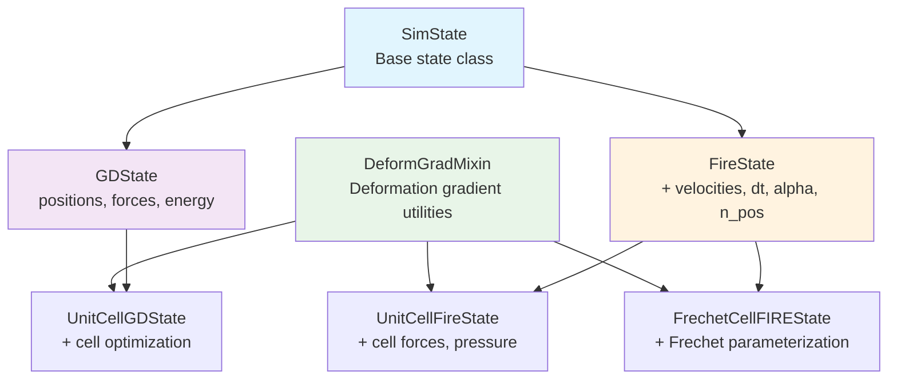
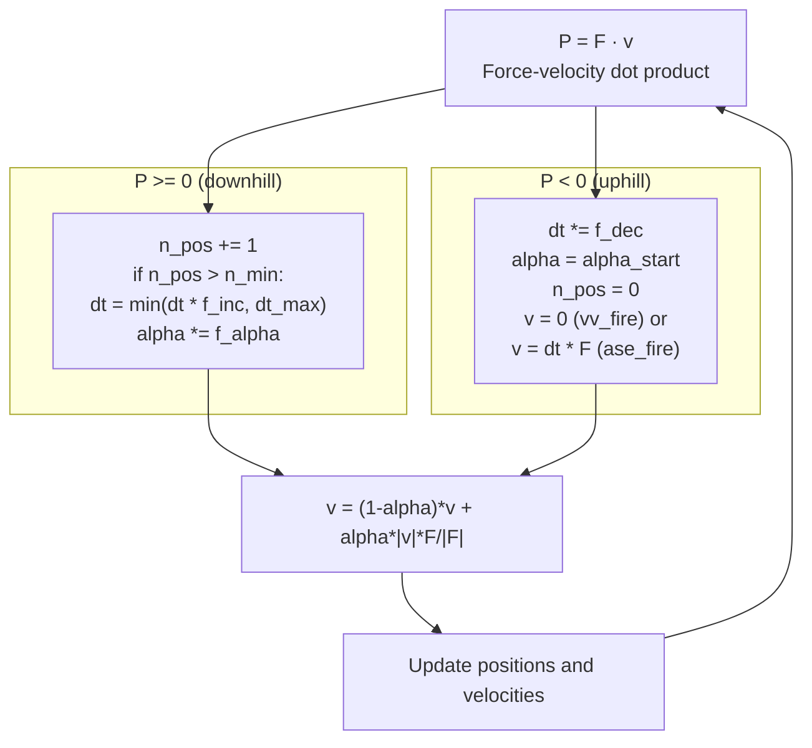
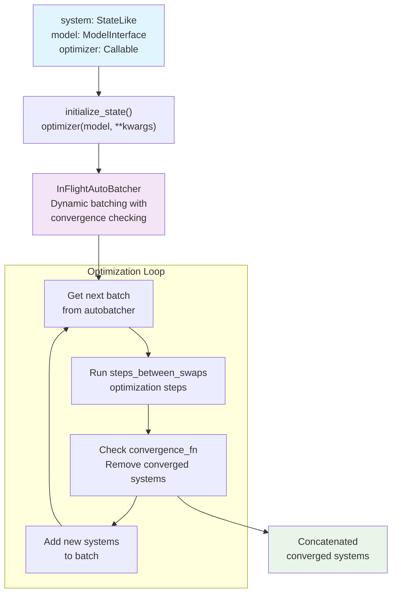
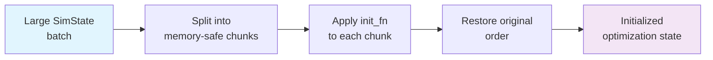

# Structure Optimization

<details>
<summary>Relevant source files</summary>

The following files were used as context for generating this wiki page:

- [tests/test_runners.py](tests/test_runners.py)
- [tests/test_trajectory.py](tests/test_trajectory.py)
- [torch_sim/runners.py](torch_sim/runners.py)
- [torch_sim/trajectory.py](torch_sim/trajectory.py)

</details>


Structure optimization in torch-sim provides algorithms for finding local minima of atomic systems by relaxing atomic positions and optionally unit cell parameters. This includes gradient-based methods for both atomic coordinates and lattice optimization, with support for various constraints and efficient batched processing.

For molecular dynamics simulations, see [Molecular Dynamics](#5.1). For single-point property calculations, see [Static Calculations](#5.3). For compositional changes using Monte Carlo methods, see [Monte Carlo Methods](#5.4).

## Overview

torch-sim implements several optimization algorithms that can minimize the potential energy of atomic systems:

| Algorithm | Atomic Positions | Unit Cell | Implementation |
|-----------|------------------|-----------|----------------|
| Gradient Descent | ✓ | ✗ | `gradient_descent()` |
| Unit Cell Gradient Descent | ✓ | ✓ | `unit_cell_gradient_descent()` |
| FIRE | ✓ | ✗ | `fire()` |
| Unit Cell FIRE | ✓ | ✓ | `unit_cell_fire()` |
| Frechet Cell FIRE | ✓ | ✓ (improved) | `frechet_cell_fire()` |

All optimizers support batched processing for simultaneous optimization of multiple structures and integrate with the autobatching system for efficient GPU memory utilization.

Sources: [torch_sim/optimizers.py:1-18](), [torch_sim/runners.py:358-400]()

## Optimization State Classes

### State Class Hierarchy



Each optimization algorithm uses a specialized state class that extends `SimState` with algorithm-specific parameters:

- **`GDState`**: Stores forces and energy for gradient descent optimization
- **`UnitCellGDState`**: Adds cell optimization parameters including stress, pressure, and cell forces
- **`FireState`**: Extends with FIRE algorithm parameters (velocities, timestep, mixing parameter)
- **`UnitCellFireState`**: Combines FIRE parameters with cell optimization capabilities
- **`FrechetCellFIREState`**: Uses matrix logarithm parameterization for improved cell optimization

Sources: [torch_sim/optimizers.py:60-84](), [torch_sim/optimizers.py:178-239](), [torch_sim/optimizers.py:483-537](), [torch_sim/optimizers.py:675-751](), [torch_sim/optimizers.py:966-1042]()

## Algorithm Implementations

### Gradient Descent

The `gradient_descent()` function implements basic steepest descent optimization for atomic positions:


The algorithm updates positions using: `positions = positions + lr * forces` where `lr` is the learning rate that can be specified per-system for batched optimization.

Sources: [torch_sim/optimizers.py:86-175]()

### Unit Cell Optimization

Unit cell optimization extends position optimization to simultaneously relax lattice parameters. The `unit_cell_gradient_descent()` function implements this using virial stress:

- **Cell forces**: Computed from virial stress and applied pressure
- **Constraints**: Support for hydrostatic strain and constant volume
- **Deformation parameterization**: Uses deformation gradient for stable cell updates

Sources: [torch_sim/optimizers.py:241-480]()

### FIRE Algorithm

FIRE (Fast Inertial Relaxation Engine) combines molecular dynamics with adaptive timestep and velocity mixing:



torch-sim supports two FIRE variants controlled by the `md_flavor` parameter:
- **`"vv_fire"`**: Follows the original paper with Velocity Verlet integration
- **`"ase_fire"`**: Mimics ASE implementation with different velocity update rules

Sources: [torch_sim/optimizers.py:539-672](), [torch_sim/optimizers.py:753-963]()

### Frechet Cell FIRE

The `frechet_cell_fire()` function uses matrix logarithm parameterization for cell degrees of freedom, providing improved numerical stability for large cell deformations:

- **Matrix logarithm**: Represents cell deformations using `log(deformation_gradient)`
- **Frechet derivatives**: Provides forces consistent with numerical derivatives
- **Robust optimization**: Better convergence for systems with significant cell changes

Sources: [torch_sim/optimizers.py:1044-1230]()

## High-Level Interface

### The `optimize()` Function

The main entry point for structure optimization is the `optimize()` function in `torch_sim.runners`:



Key parameters:
- **`optimizer`**: One of the optimizer functions (`fire`, `unit_cell_fire`, etc.)
- **`convergence_fn`**: Function returning boolean tensor for system convergence
- **`autobatcher`**: `InFlightAutoBatcher` for dynamic memory management
- **`max_steps`**: Maximum total optimization steps
- **`steps_between_swaps`**: Steps before convergence checking

Sources: [torch_sim/runners.py:358-480]()

## Convergence Criteria

### Force-Based Convergence

The `generate_force_convergence_fn()` creates convergence functions based on maximum forces:

```python
# Example usage
convergence_fn = generate_force_convergence_fn(
    force_tol=1e-1,  # Force tolerance
    include_cell_forces=True  # Check cell forces for cell optimization
)
```

### Energy-Based Convergence

The `generate_energy_convergence_fn()` checks energy differences between steps:

```python
convergence_fn = generate_energy_convergence_fn(energy_tol=1e-3)
```

Sources: [torch_sim/runners.py:291-355]()

## Batching and Performance

### Autobatching Integration

Structure optimization integrates with torch-sim's autobatching system:

- **`InFlightAutoBatcher`**: Dynamically manages batches as systems converge
- **Memory estimation**: Automatically determines optimal batch sizes
- **Hot swapping**: Removes converged systems and adds new ones during optimization

### Chunked Initialization

For large numbers of systems, the `_chunked_apply()` function prevents memory overflow during state initialization:



Sources: [torch_sim/runners.py:213-254](), [torch_sim/runners.py:257-288]()

## Usage Examples

### Basic FIRE Optimization

```python
import torch_sim as ts

# Load system and model
state = ts.initialize_state(atoms)
model = ts.models.MaceModel("small")

# Optimize with FIRE
optimized_state = ts.optimize(
    system=state,
    model=model,
    optimizer=ts.optimizers.fire,
    convergence_fn=ts.runners.generate_force_convergence_fn(force_tol=0.01),
    max_steps=1000
)
```

### Unit Cell Optimization with Constraints

```python
# Optimize with hydrostatic strain only
optimized_state = ts.optimize(
    system=state,
    model=model,
    optimizer=ts.optimizers.unit_cell_fire,
    hydrostatic_strain=True,  # Only isotropic scaling
    scalar_pressure=0.1,      # Applied pressure in GPa
    max_steps=2000
)
```

### Batched Optimization with Custom Convergence

```python
# Custom convergence combining force and energy criteria
def custom_convergence(state, last_energy):
    force_conv = ts.quantities.systemwise_max_force(state) < 0.05
    energy_conv = torch.abs(state.energy - last_energy) < 1e-4
    return force_conv & energy_conv

# Optimize multiple systems
optimized_state = ts.optimize(
    system=[structure1, structure2, structure3],
    model=model,
    optimizer=ts.optimizers.frechet_cell_fire,
    convergence_fn=custom_convergence,
    autobatcher=True,  # Enable automatic batching
    max_steps=5000
)
```

Sources: [tests/test_optimizers.py:26-63](), [tests/test_optimizers.py:113-178](), [tests/test_optimizers.py:327-402]()

---