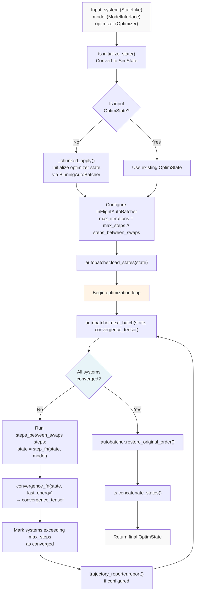
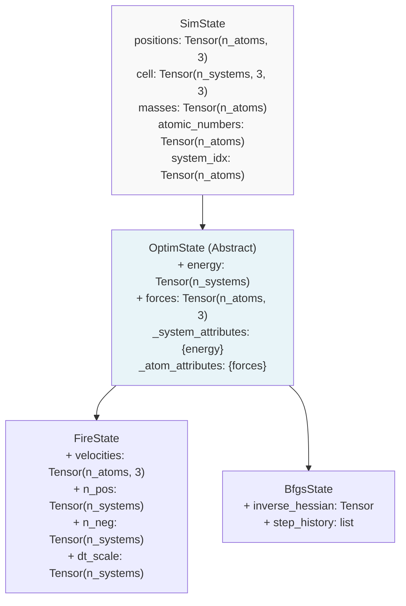
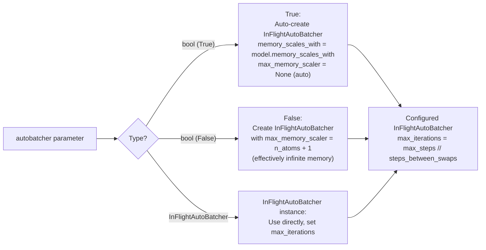

# Optimization Overview

<details>
<summary>Relevant source files</summary>

The following files were used as context for generating this wiki page:

- [tests/test_runners.py](tests/test_runners.py)
- [tests/test_trajectory.py](tests/test_trajectory.py)
- [torch_sim/runners.py](torch_sim/runners.py)
- [torch_sim/trajectory.py](torch_sim/trajectory.py)

</details>


This page describes the structure optimization system in torch-sim, which relaxes atomic geometries and unit cells to minimize energy. For details on specific optimization algorithms (FIRE, BFGS, L-BFGS), see [Optimizers](#5.2). For cell relaxation methods, see [Cell Filters](#5.3).

**Scope**: This page covers the high-level `ts.optimize()` API, convergence criteria, the optimization workflow, state management, and memory-efficient batching. It does not cover molecular dynamics simulations (see [MD Overview](#4.1)) or single-point calculations (see [Static Property Calculations](#8.2)).

## The `optimize()` Function

The primary interface for structure optimization is [`ts.optimize()`](torch_sim/runners.py:551-732)(), which relaxes one or more systems until convergence criteria are met or a maximum number of steps is reached.

### Function Signature

```python
def optimize[T: OptimState](
    system: StateLike,
    model: ModelInterface,
    *,
    optimizer: Optimizer | tuple[Callable[..., T], Callable[..., T]],
    convergence_fn: Callable[[T, torch.Tensor], torch.Tensor] | None = None,
    max_steps: int = 10_000,
    steps_between_swaps: int = 5,
    trajectory_reporter: TrajectoryReporter | dict | None = None,
    autobatcher: InFlightAutoBatcher | bool = False,
    pbar: bool | dict[str, Any] = False,
    init_kwargs: dict[str, Any] | None = None,
    **optimizer_kwargs: Any,
) -> T
```

**Key Parameters**:
- `system`: Input atomic structure(s) — ASE `Atoms`, Pymatgen `Structure`, or `SimState`
- `model`: Energy/force calculator implementing `ModelInterface`
- `optimizer`: Algorithm choice from `Optimizer` enum (e.g., `ts.Optimizer.fire`) or custom `(init_fn, step_fn)` tuple
- `convergence_fn`: Function returning per-system boolean convergence status; defaults to energy-based convergence
- `max_steps`: Maximum optimization steps per system
- `steps_between_swaps`: Steps before checking convergence and swapping converged systems out of memory
- `autobatcher`: `InFlightAutoBatcher` instance or `True` to enable automatic batching
- `init_kwargs`: Arguments passed to optimizer initialization (e.g., `{"cell_filter": ts.CellFilter.frechet}`)

**Return**: `OptimState` containing optimized positions, cell parameters, and optimizer state variables.

**Sources**: [torch_sim/runners.py:551-732]()

## Optimization Workflow

### High-Level Flow



**Key Workflow Steps**:
1. **Initialization** ([torch_sim/runners.py:602-646]()): Convert input to `SimState`, then initialize `OptimState` with optimizer-specific variables (e.g., FIRE velocity, BFGS history)
2. **Batching Setup** ([torch_sim/runners.py:625-627]()): Configure `InFlightAutoBatcher` to manage GPU memory by dynamically swapping systems
3. **Optimization Loop** ([torch_sim/runners.py:670-718]()): Repeatedly call `step_fn()`, check convergence, and swap out converged systems
4. **Result Assembly** ([torch_sim/runners.py:723-726]()): Restore original system order and concatenate final states

**Sources**: [torch_sim/runners.py:551-732]()

### Code Entity Mapping

```mermaid
graph TB
    subgraph "User API"
        optimize["ts.optimize()"]
    end
    
    subgraph "Optimizer Registry (torch_sim/optimizers/__init__.py)"
        OPTIM_REGISTRY["OPTIM_REGISTRY<br/>{Optimizer → (init_fn, step_fn)}"]
        FireInit["fire_init()"]
        FireStep["fire_step()"]
        BfgsInit["bfgs_init()"]
        BfgsStep["bfgs_step()"]
    end
    
    subgraph "State Hierarchy (torch_sim/state.py, torch_sim/optimizers/)"
        SimState["SimState<br/>positions, cell, masses,<br/>atomic_numbers, pbc"]
        OptimState["OptimState (ABC)<br/>+ energy, forces"]
        FireState["FireState<br/>+ velocities, n_pos, n_neg, dt_scale"]
        BfgsState["BfgsState<br/>+ inverse_hessian, step_history"]
    end
    
    subgraph "Convergence Functions (torch_sim/runners.py)"
        GenForceConv["generate_force_convergence_fn()"]
        GenEnergyConv["generate_energy_convergence_fn()"]
        ForceConvFn["force_convergence_fn(state, last_energy)<br/>→ bool tensor (n_systems,)"]
        EnergyConvFn["energy_convergence_fn(state, last_energy)<br/>→ bool tensor (n_systems,)"]
    end
    
    subgraph "Batching (torch_sim/autobatching.py)"
        InFlightAutoBatcher["InFlightAutoBatcher<br/>next_batch(state, convergence)<br/>restore_original_order()"]
        BinningAutoBatcher["BinningAutoBatcher<br/>(used for init only)"]
    end
    
    subgraph "Trajectory I/O (torch_sim/trajectory.py)"
        TrajectoryReporter["TrajectoryReporter<br/>report(state, step, model)"]
    end
    
    optimize --> OPTIM_REGISTRY
    OPTIM_REGISTRY --> FireInit
    OPTIM_REGISTRY --> FireStep
    OPTIM_REGISTRY --> BfgsInit
    OPTIM_REGISTRY --> BfgsStep
    
    optimize --> SimState
    FireInit --> FireState
    BfgsInit --> BfgsState
    SimState --> OptimState
    OptimState --> FireState
    OptimState --> BfgsState
    
    optimize --> GenForceConv
    optimize --> GenEnergyConv
    GenForceConv --> ForceConvFn
    GenEnergyConv --> EnergyConvFn
    
    optimize --> InFlightAutoBatcher
    optimize --> BinningAutoBatcher
    optimize --> TrajectoryReporter
    
    FireStep --> FireState
    BfgsStep --> BfgsState
    ForceConvFn --> optimize
    EnergyConvFn --> optimize
```



**Sources**: [torch_sim/runners.py:551-732](), [torch_sim/optimizers/__init__.py](), [torch_sim/autobatching.py]()

## Convergence Criteria

Convergence functions determine when optimization stops. They accept the current `OptimState` and previous energy, returning a boolean tensor of shape `(n_systems,)` indicating per-system convergence.

### Force-Based Convergence

[`generate_force_convergence_fn()`](torch_sim/runners.py:485-522)() creates a convergence function that checks if maximum forces fall below a threshold:

```python
convergence_fn = ts.generate_force_convergence_fn(
    force_tol=1e-2,  # eV/Å
    include_cell_forces=False  # Check cell stress if True
)
```

**Implementation**: [torch_sim/runners.py:485-522]()
- Computes `ts.system_wise_max_force(state)` for atomic forces
- Optionally checks `cell_forces.norm()` for cell relaxation
- Returns `force_conv & cell_force_conv` if `include_cell_forces=True`

**Sources**: [torch_sim/runners.py:485-522](), [tests/test_runners.py:940-1123]()

### Energy-Based Convergence

[`generate_energy_convergence_fn()`](torch_sim/runners.py:525-548)() creates a convergence function based on energy change between steps:

```python
convergence_fn = ts.generate_energy_convergence_fn(
    energy_tol=1e-3  # eV
)
```

**Implementation**: [torch_sim/runners.py:525-548]()
- Computes `torch.abs(state.energy - last_energy) < energy_tol`
- Used as default if no `convergence_fn` is provided ([torch_sim/runners.py:599-600]())

**Default Behavior**: If `convergence_fn=None`, `optimize()` uses energy-based convergence with `energy_tol=1e-3` eV.

**Sources**: [torch_sim/runners.py:525-548](), [torch_sim/runners.py:599-600]()

### Convergence Check Timing

| Parameter | Purpose | Effect on Convergence Checks |
|-----------|---------|------------------------------|
| `steps_between_swaps` | Steps before checking convergence | Checked every N steps; lower values increase overhead but allow faster system removal |
| `max_steps` | Global step limit per system | Systems exceeding this are marked converged regardless of criteria ([torch_sim/runners.py:699-714]()) |

**Sources**: [torch_sim/runners.py:689-718]()

## State Management

### State Hierarchy



**Key Attributes**:
- **`SimState`**: Core atomic data (positions, cell, masses, atomic numbers, periodic boundary conditions)
- **`OptimState`**: Adds `energy` and `forces` from model evaluation
- **Optimizer-Specific States**: Each optimizer extends `OptimState` with algorithm-specific variables (e.g., FIRE velocities, BFGS Hessian approximation)

**State Initialization**: If input is not already an `OptimState`, [`_chunked_apply()`](torch_sim/runners.py:451-482)() uses `BinningAutoBatcher` to initialize optimizer state in memory-efficient chunks:

```python
state = _chunked_apply(
    init_fn,
    initial_state,
    model,
    init_kwargs=dict(**init_kwargs or {}),
    max_memory_scaler=autobatcher.max_memory_scaler,
    memory_scales_with=autobatcher.memory_scales_with,
)
```

**Sources**: [torch_sim/runners.py:629-646](), [torch_sim/state.py](), [torch_sim/optimizers/]()

## Memory Management with InFlightAutoBatcher

The [`InFlightAutoBatcher`](torch_sim/autobatching.py)() enables memory-efficient optimization by:
1. **Dynamic Batching**: Keeps only a subset of systems in GPU memory at once
2. **Convergence-Based Swapping**: Removes converged systems and loads new ones every `steps_between_swaps` steps
3. **Automatic Sizing**: Estimates batch size based on GPU memory and model characteristics

### Autobatcher Configuration



**Configuration Logic** ([torch_sim/runners.py:407-448]()):

| `autobatcher` Value | Behavior |
|---------------------|----------|
| `True` | Auto-configure based on GPU memory and `model.memory_scales_with` |
| `False` | Create batcher with `max_memory_scaler = n_atoms + 1` (no batching, but still removes converged systems) |
| `InFlightAutoBatcher` instance | Use provided batcher, override `max_iterations` |

**Key Methods**:
- `next_batch(state, convergence_tensor)` ([torch_sim/runners.py:671]()): Returns next batch of unconverged systems
- `restore_original_order(states)` ([torch_sim/runners.py:723]()): Reorders final states to match input order

**Sources**: [torch_sim/runners.py:407-448](), [torch_sim/runners.py:625-677]()

## Trajectory Reporting

Optimization trajectories record energy, forces, and positions at specified intervals using [`TrajectoryReporter`](torch_sim/trajectory.py:69-465)().

### Basic Setup

```python
reporter = ts.TrajectoryReporter(
    filenames=["system1.h5", "system2.h5"],  # One file per system
    state_frequency=10,  # Save state every 10 steps
    prop_calculators={
        1: {"potential_energy": lambda state: state.energy}
    }
)

final_state = ts.optimize(
    system=systems,
    model=model,
    optimizer=ts.Optimizer.fire,
    trajectory_reporter=reporter,
)
```

**Automatic Configuration**: If `trajectory_reporter` is a `dict`, it's passed to `TrajectoryReporter` constructor with default `prop_calculators` including `"potential_energy"` ([torch_sim/runners.py:647-650]()).

**Resume Support**: Opening trajectories in `mode="a"` enables resuming optimizations:
- [`_determine_initial_step_for_optimize()`](torch_sim/runners.py:145-171)() detects last logged step
- Optimization continues from `last_step + 1`
- Multiple trajectory files must have consistent last steps or an error is raised

**Initial State Logging**: Step 0 is written via [`_write_initial_state()`](torch_sim/runners.py:228-250)() if trajectories are empty, ensuring pre-optimization structure is saved.

**Sources**: [torch_sim/runners.py:647-657](), [torch_sim/trajectory.py:69-465](), [tests/test_trajectory.py:858-903]()

## Usage Examples

### Basic Optimization

```python
import torch_sim as ts
from ase.build import bulk

# Create structure
atoms = bulk("Cu", "fcc", a=3.6, cubic=True)

# Load model (example uses LJ for simplicity)
model = ts.LennardJonesModel(epsilon=0.5, sigma=2.5)

# Optimize with force convergence
final_state = ts.optimize(
    system=atoms,
    model=model,
    optimizer=ts.Optimizer.fire,
    convergence_fn=ts.generate_force_convergence_fn(force_tol=1e-2),
    max_steps=1000,
)

# Convert back to ASE Atoms
final_atoms = ts.state_to_atoms(final_state)
```

**Sources**: [tests/test_runners.py:346-378]()

### Cell Relaxation with Trajectory

```python
# Optimize cell and atomic positions
final_state = ts.optimize(
    system=atoms,
    model=model,
    optimizer=ts.Optimizer.fire,
    convergence_fn=ts.generate_force_convergence_fn(
        force_tol=1e-2,
        include_cell_forces=True  # Check stress convergence
    ),
    trajectory_reporter=dict(
        filenames="relaxation.h5",
        state_frequency=10
    ),
    init_kwargs={"cell_filter": ts.CellFilter.frechet},  # See [Cell Filters](#5.3)
    max_steps=1000,
)

# Read trajectory
with ts.TorchSimTrajectory("relaxation.h5") as traj:
    energies = traj.get_array("potential_energy")
    final_structure = traj.get_structure(-1)
```

**Sources**: [tests/test_runners.py:346-378](), [torch_sim/runners.py]()

### Batched Optimization with Autobatching

```python
# Optimize multiple structures simultaneously
many_structures = [bulk("Cu", "fcc", a=3.6 + 0.1*i) for i in range(10)]

final_states = ts.optimize(
    system=many_structures,
    model=model,
    optimizer=ts.Optimizer.fire,
    convergence_fn=ts.generate_force_convergence_fn(force_tol=1e-2),
    autobatcher=True,  # Auto-configure based on GPU memory
    max_steps=1000,
    pbar=True,  # Show progress bar
)

# Access individual results
for i, final_state in enumerate(final_states.split()):
    print(f"System {i}: Energy = {final_state.energy.item():.3f} eV")
```

**Sources**: [tests/test_runners.py:462-490](), [tests/test_runners.py:590-623]()

---