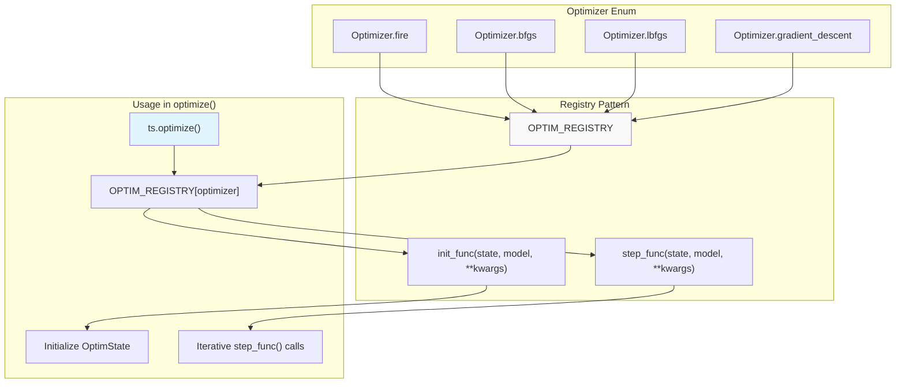
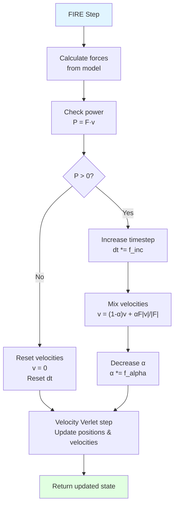
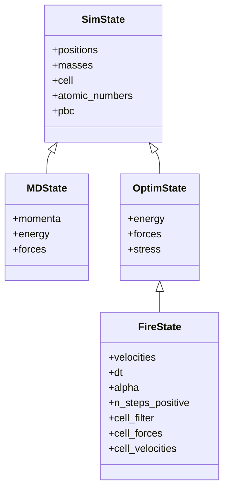
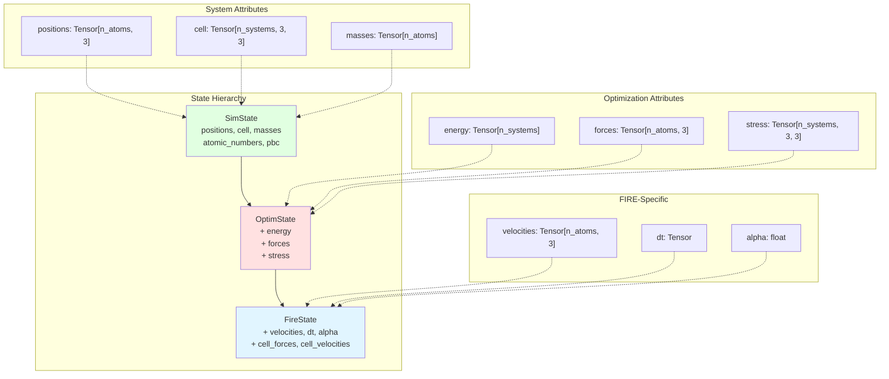
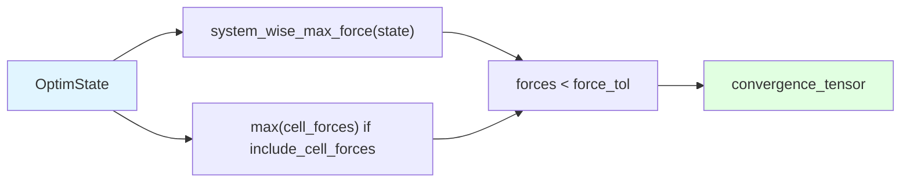
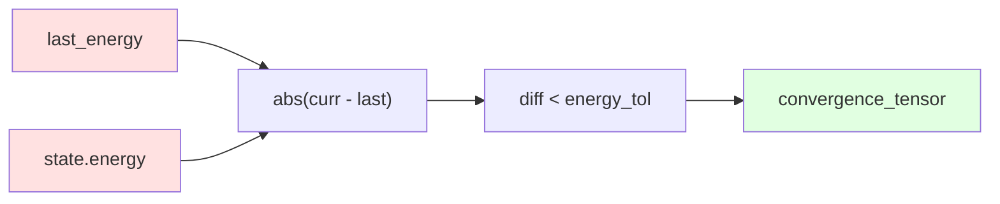
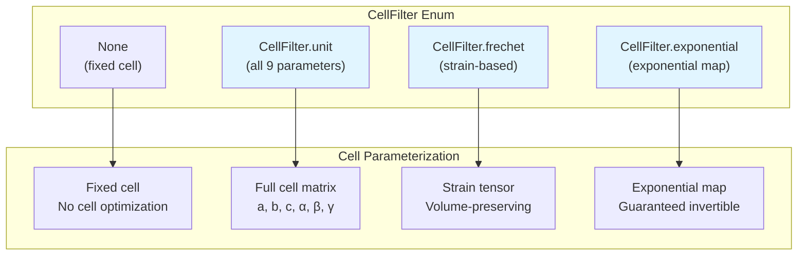
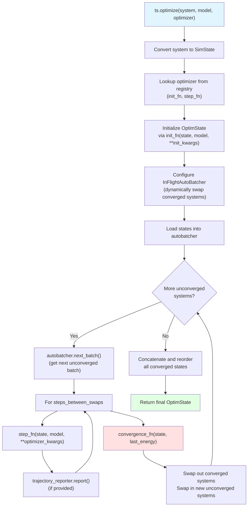

# Optimizers

<details>
<summary>Relevant source files</summary>

The following files were used as context for generating this wiki page:

- [tests/test_runners.py](tests/test_runners.py)
- [tests/test_trajectory.py](tests/test_trajectory.py)
- [torch_sim/models/lennard_jones.py](torch_sim/models/lennard_jones.py)
- [torch_sim/models/morse.py](torch_sim/models/morse.py)
- [torch_sim/models/particle_life.py](torch_sim/models/particle_life.py)
- [torch_sim/models/soft_sphere.py](torch_sim/models/soft_sphere.py)
- [torch_sim/runners.py](torch_sim/runners.py)
- [torch_sim/trajectory.py](torch_sim/trajectory.py)
- [torch_sim/workflows/a2c.py](torch_sim/workflows/a2c.py)

</details>


This page documents the optimization algorithms available in torch-sim for structure relaxation and geometry optimization. Optimizers minimize the potential energy of atomic systems by iteratively updating atomic positions and optionally cell parameters until convergence criteria are met.

For information about molecular dynamics integrators, see [NVE Ensemble](#4.2), [NVT Ensemble](#4.3), and [NPT Ensemble](#4.4). For the high-level optimization workflow and convergence criteria, see [Optimization Overview](#5.1).

## Purpose and Scope

This page covers:
- Available optimization algorithms (FIRE, BFGS, L-BFGS, Gradient Descent)
- The optimizer registry and state hierarchy
- Convergence functions for force and energy-based stopping criteria
- Cell filters for unit cell optimization
- Integration with the `ts.optimize()` API

## Optimizer Registry and Available Algorithms

torch-sim uses a registry pattern to manage optimization algorithms, similar to the integrator system. The `OPTIM_REGISTRY` maps `Optimizer` enum values to pairs of initialization and step functions.



**Available Optimizers:**

| Optimizer | Enum Value | Description | Best For |
|-----------|-----------|-------------|----------|
| **FIRE** | `Optimizer.fire` | Fast Inertial Relaxation Engine | General structure relaxation, robust convergence |
| **BFGS** | `Optimizer.bfgs` | Broyden-Fletcher-Goldfarb-Shanno | Small systems, high precision |
| **L-BFGS** | `Optimizer.lbfgs` | Limited-memory BFGS | Large systems, memory-efficient |
| **Gradient Descent** | `Optimizer.gradient_descent` | Simple steepest descent | Testing, simple cases |

**Sources:** [torch_sim/runners.py:24](), [torch_sim/runners.py:609-622]()

## FIRE Optimizer

The Fast Inertial Relaxation Engine (FIRE) is the most commonly used optimizer in torch-sim. It combines molecular dynamics with adaptive timestep control to efficiently find local energy minima.

### FIRE Algorithm Overview



### FireState Structure

The `FireState` class extends `OptimState` with FIRE-specific parameters:



### FIRE Initialization Parameters

The FIRE optimizer accepts the following initialization parameters via `init_kwargs`:

| Parameter | Type | Default | Description |
|-----------|------|---------|-------------|
| `dt_start` | float | 0.1 | Initial timestep |
| `dt_max` | float | 1.0 | Maximum timestep |
| `f_inc` | float | 1.1 | Timestep increase factor |
| `f_dec` | float | 0.5 | Timestep decrease factor |
| `f_alpha` | float | 0.99 | Alpha decrease factor |
| `alpha_start` | float | 0.1 | Initial velocity mixing parameter |
| `n_min` | int | 5 | Minimum steps before dt increase |
| `cell_filter` | CellFilter | None | Filter for cell optimization |

**Sources:** [torch_sim/runners.py:551-564](), [tests/test_runners.py:346-378]()

## BFGS and L-BFGS Optimizers

BFGS (Broyden-Fletcher-Goldfarb-Shanno) and L-BFGS (Limited-memory BFGS) are quasi-Newton methods that approximate the inverse Hessian matrix to find energy minima.

### BFGS vs L-BFGS

| Feature | BFGS | L-BFGS |
|---------|------|--------|
| Memory usage | O(N²) | O(mN) |
| Convergence speed | Faster | Slightly slower |
| Best for | Small systems (<100 atoms) | Large systems (>100 atoms) |
| Hessian approximation | Full matrix | Limited history |

### Usage Example

```python
# BFGS optimization
final_state = ts.optimize(
    system=initial_structure,
    model=model,
    optimizer=ts.Optimizer.bfgs,
    convergence_fn=ts.generate_force_convergence_fn(force_tol=0.01),
    max_steps=500
)

# L-BFGS optimization with memory parameter
final_state = ts.optimize(
    system=initial_structure,
    model=model,
    optimizer=ts.Optimizer.lbfgs,
    init_kwargs={"maxiter": 500, "history_size": 10},
    convergence_fn=ts.generate_force_convergence_fn(force_tol=0.01)
)
```

**Sources:** [torch_sim/runners.py:609-622]()

## OptimState Hierarchy

All optimizers work with state objects derived from `OptimState`, which extends `SimState` with optimization-specific attributes.



**Sources:** [torch_sim/runners.py:24](), [torch_sim/optimizers/__init__.py]()

## Convergence Criteria

torch-sim provides factory functions to generate convergence criteria for the `optimize()` function. Convergence functions take a state and optional last energy, returning a boolean tensor indicating which systems have converged.

### Force-Based Convergence

```python
def generate_force_convergence_fn(
    force_tol: float = 1e-1,
    *,
    include_cell_forces: bool = False
) -> Callable[[OptimState, torch.Tensor | None], torch.Tensor]:
    """Generate force-based convergence function.
    
    Returns True for each system when maximum force < force_tol.
    """
```

**Force Convergence Diagram:**



**Usage Example:**

```python
# Basic force convergence
conv_fn = ts.generate_force_convergence_fn(force_tol=0.05)

# Include cell forces for variable cell optimization
conv_fn = ts.generate_force_convergence_fn(
    force_tol=0.05,
    include_cell_forces=True
)

final_state = ts.optimize(
    system=structure,
    model=model,
    optimizer=ts.Optimizer.fire,
    convergence_fn=conv_fn,
    max_steps=1000
)
```

**Sources:** [torch_sim/runners.py:485-522]()

### Energy-Based Convergence

```python
def generate_energy_convergence_fn(
    energy_tol: float = 1e-3
) -> Callable[[OptimState, torch.Tensor], torch.Tensor]:
    """Generate energy-based convergence function.
    
    Returns True for each system when |E_new - E_old| < energy_tol.
    """
```

**Energy Convergence Logic:**



**Usage Example:**

```python
# Default energy tolerance (1e-3 eV)
final_state = ts.optimize(
    system=structure,
    model=model,
    optimizer=ts.Optimizer.fire,
    convergence_fn=ts.generate_energy_convergence_fn(energy_tol=1e-3),
    max_steps=1000
)
```

**Note:** If no convergence function is provided to `ts.optimize()`, it defaults to `generate_energy_convergence_fn(energy_tol=1e-3)`.

**Sources:** [torch_sim/runners.py:525-548](), [torch_sim/runners.py:598-600]()

## Cell Filters

Cell filters parameterize the unit cell degrees of freedom during optimization, allowing simultaneous optimization of atomic positions and cell parameters. They transform the cell tensor to ensure physically meaningful updates.

### Available Cell Filters



### Cell Filter Comparison

| Filter | Description | Constraints | Use Case |
|--------|-------------|-------------|----------|
| `None` | No cell optimization | Fixed cell | Optimize positions only |
| `unit` | Direct cell parameters | None | General variable cell optimization |
| `frechet` | Strain-based | Volume changes allowed | Minimize stress with cell relaxation |
| `exponential` | Exponential map | Guaranteed invertible | Prevent cell collapse |

### Usage with FIRE

Cell filters are passed to FIRE initialization via `init_kwargs`:

```python
# Optimize with unit cell filter
final_state = ts.optimize(
    system=structure,
    model=model,
    optimizer=ts.Optimizer.fire,
    init_kwargs={"cell_filter": ts.CellFilter.unit},
    convergence_fn=ts.generate_force_convergence_fn(force_tol=0.05),
    max_steps=500
)

# Optimize with Frechet cell filter
final_state = ts.optimize(
    system=structure,
    model=model,
    optimizer=ts.Optimizer.fire,
    init_kwargs={"cell_filter": ts.CellFilter.frechet},
    convergence_fn=ts.generate_force_convergence_fn(
        force_tol=0.05,
        include_cell_forces=True  # Check cell convergence too
    ),
    max_steps=500
)
```

**Cell Forces in FireState:**

When a cell filter is active, `FireState` includes additional attributes:
- `cell_forces`: Tensor[n_systems, 3, 3] - Forces on cell parameters
- `cell_velocities`: Tensor[n_systems, 3, 3] - Velocities for cell parameters

**Sources:** [torch_sim/runners.py:367-368](), [torch_sim/runners.py:417-418](), [torch_sim/runners.py:456](), [tests/test_runners.py:367-368](), [tests/test_runners.py:417-418](), [tests/test_runners.py:456](), [tests/test_runners.py:911](), [torch_sim/workflows/a2c.py:730]()

## Integration with optimize() Function

The `ts.optimize()` function orchestrates the optimization process, handling batching, convergence checking, and trajectory reporting.

### Optimization Workflow



### Key optimize() Parameters

| Parameter | Type | Description |
|-----------|------|-------------|
| `system` | StateLike | Input structure(s) to optimize |
| `model` | ModelInterface | Model for energy/force calculation |
| `optimizer` | Optimizer \| tuple | Optimizer enum or (init_fn, step_fn) |
| `convergence_fn` | Callable | Function returning convergence boolean |
| `max_steps` | int | Maximum total optimization steps |
| `steps_between_swaps` | int | Steps before checking convergence (default: 5) |
| `trajectory_reporter` | TrajectoryReporter \| dict | Optional trajectory logging |
| `autobatcher` | InFlightAutoBatcher \| bool | Dynamic batching for GPU memory |
| `init_kwargs` | dict | Passed to optimizer init function |
| `**optimizer_kwargs` | Any | Passed to optimizer step function |

**Sources:** [torch_sim/runners.py:551-732]()

## Optimization Examples

### Basic Structure Relaxation

```python
from ase.build import bulk
import torch_sim as ts

# Create initial structure
atoms = bulk("Cu", "fcc", a=3.6, cubic=True)
state = ts.initialize_state(atoms, device="cuda", dtype=torch.float32)

# Perturb to create non-equilibrium structure
state.positions += torch.randn_like(state.positions) * 0.1

# Optimize with FIRE
final_state = ts.optimize(
    system=state,
    model=model,
    optimizer=ts.Optimizer.fire,
    convergence_fn=ts.generate_force_convergence_fn(force_tol=0.05),
    max_steps=500
)
```

### Variable Cell Optimization

```python
# Optimize both positions and cell with trajectory logging
final_state = ts.optimize(
    system=structure,
    model=model,
    optimizer=ts.Optimizer.fire,
    init_kwargs={
        "cell_filter": ts.CellFilter.frechet,
        "dt_start": 0.1,
        "dt_max": 1.0
    },
    convergence_fn=ts.generate_force_convergence_fn(
        force_tol=0.01,
        include_cell_forces=True
    ),
    trajectory_reporter={
        "filenames": "optimization.h5md",
        "state_frequency": 10
    },
    max_steps=1000
)
```

### Batched Optimization with Autobatcher

```python
# Optimize multiple structures simultaneously
structures = [structure1, structure2, structure3]
batched_state = ts.initialize_state(structures, device="cuda")

final_states = ts.optimize(
    system=batched_state,
    model=model,
    optimizer=ts.Optimizer.fire,
    convergence_fn=ts.generate_force_convergence_fn(force_tol=0.05),
    autobatcher=True,  # Automatically manage GPU memory
    max_steps=1000,
    steps_between_swaps=10,  # Check convergence every 10 steps
    pbar=True  # Show progress bar
)
```

**Sources:** [tests/test_runners.py:346-426](), [tests/test_runners.py:462-554](), [tests/test_runners.py:856-875]()

## Custom Optimizer Functions

Users can provide custom optimizer implementations as tuples of `(init_func, step_func)`:

```python
def my_optimizer_init(state, model, **kwargs):
    """Initialize custom optimizer state."""
    # Add optimizer-specific attributes to state
    state = OptimState.from_state(
        state,
        energy=model(state)["energy"],
        forces=model(state)["forces"],
        # Add custom attributes here
    )
    return state

def my_optimizer_step(state, model, **kwargs):
    """Perform one optimization step."""
    # Update positions based on forces
    # Update velocities or other internal state
    # Recompute energy and forces
    results = model(state)
    state = state.replace(
        energy=results["energy"],
        forces=results["forces"]
    )
    return state

# Use custom optimizer
final_state = ts.optimize(
    system=structure,
    model=model,
    optimizer=(my_optimizer_init, my_optimizer_step),
    convergence_fn=convergence_fn,
    max_steps=500
)
```

**Sources:** [torch_sim/runners.py:609-622]()

## Optimizer State Persistence and Resumption

Optimizations can be resumed from trajectory files by opening them in append mode:

```python
# Initial optimization
reporter = ts.TrajectoryReporter(
    filenames="optimization.h5md",
    state_frequency=10,
    mode="w"
)

state = ts.optimize(
    system=structure,
    model=model,
    optimizer=ts.Optimizer.fire,
    trajectory_reporter=reporter,
    max_steps=500
)
reporter.close()

# Resume optimization
reporter = ts.TrajectoryReporter(
    filenames="optimization.h5md",
    state_frequency=10,
    mode="a"  # Append mode
)

# ts.optimize() detects existing trajectory and resumes
final_state = ts.optimize(
    system=state,
    model=model,
    optimizer=ts.Optimizer.fire,
    trajectory_reporter=reporter,
    max_steps=500  # Additional 500 steps
)
```

The `optimize()` function automatically detects existing trajectories and resumes from the last logged step via `_determine_initial_step_for_optimize()`.

**Sources:** [torch_sim/runners.py:145-171](), [torch_sim/runners.py:653]()

---