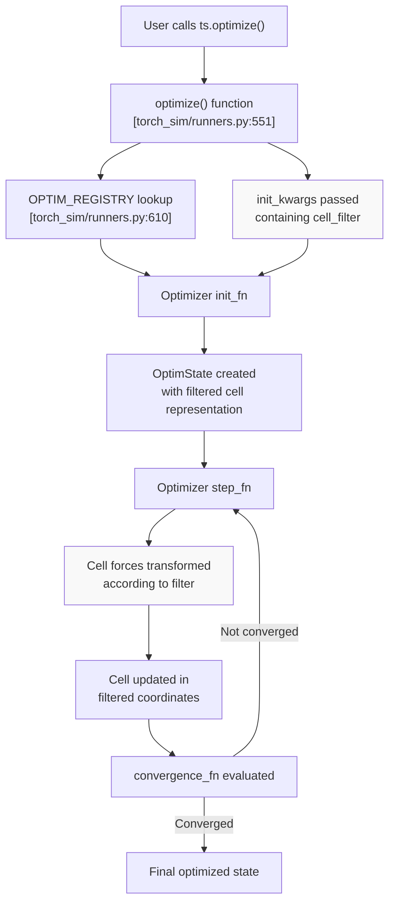

# Cell Filters

<details>
<summary>Relevant source files</summary>

The following files were used as context for generating this wiki page:

- [tests/test_runners.py](tests/test_runners.py)
- [tests/test_trajectory.py](tests/test_trajectory.py)
- [torch_sim/runners.py](torch_sim/runners.py)
- [torch_sim/trajectory.py](torch_sim/trajectory.py)

</details>


Cell filters are mathematical transformations that parameterize the simulation cell for structure optimization. They enable optimization of cell parameters (lattice vectors) during geometry relaxation while maintaining numerical stability and enforcing physical constraints. Cell filters are specified when initializing optimizers for variable-cell relaxation.

For information about optimizers themselves (FIRE, BFGS, L-BFGS), see [Optimizers](#5.2). For the overall optimization workflow and convergence criteria, see [Optimization Overview](#5.1).

---

## Purpose and Role in Optimization

During structure optimization, both atomic positions and cell parameters may need to be relaxed simultaneously. Direct optimization of cell vectors can lead to numerical instabilities, especially when cells become severely distorted or when volume changes rapidly. Cell filters address this by:

1. **Parameterizing the cell in a numerically stable coordinate system**
2. **Enforcing constraints** such as fixed volume or isotropic scaling
3. **Transforming forces on cell parameters** to match the chosen parameterization
4. **Enabling smooth convergence** during variable-cell relaxation

The cell filter is applied internally by the optimizer initialization function and affects how cell forces are computed and how the cell is updated at each optimization step.

**Sources:** [torch_sim/runners.py:551-732]()

---

## Available Cell Filters

torch-sim provides three cell filter implementations accessible via the `ts.CellFilter` enum:

| Filter Type | Enum Value | Use Case | Constraints |
|------------|------------|----------|-------------|
| **Frechet** | `ts.CellFilter.frechet` | Full cell relaxation with all degrees of freedom | None - allows anisotropic deformation and volume changes |
| **Unit** | `ts.CellFilter.unit` | Fixed-volume relaxation | Preserves cell volume while allowing shape changes |
| **Exponential** | `ts.CellFilter.exp` | Numerically stable cell parameterization | Uses exponential mapping for improved stability |

**Sources:** High-level architecture diagrams, [torch_sim/runners.py:368](), [tests/test_runners.py:911]()

---

## Cell Filter Integration in Optimization Workflow

The following diagram shows how cell filters integrate into the structure optimization process:



**Diagram: Cell Filter Application During Optimization**

**Sources:** [torch_sim/runners.py:551-732](), [torch_sim/runners.py:609-622]()

---

## Usage Examples

Cell filters are specified via the `init_kwargs` parameter when calling `ts.optimize()`:

### Full Cell Relaxation with Frechet Filter

```python
import torch_sim as ts

# Allow all cell degrees of freedom to relax
final_state = ts.optimize(
    system=initial_state,
    model=model,
    optimizer=ts.Optimizer.fire,
    init_kwargs={"cell_filter": ts.CellFilter.frechet},
    convergence_fn=ts.generate_force_convergence_fn(force_tol=0.05),
    max_steps=500
)
```

### Fixed-Volume Relaxation with Unit Filter

```python
# Optimize atomic positions and cell shape while preserving volume
final_state = ts.optimize(
    system=initial_state,
    model=model,
    optimizer=ts.Optimizer.fire,
    init_kwargs={"cell_filter": ts.CellFilter.unit},
    convergence_fn=ts.generate_force_convergence_fn(force_tol=0.05),
    max_steps=500
)
```

### Exponential Parameterization for Stability

```python
# Use exponential mapping for numerical stability
final_state = ts.optimize(
    system=initial_state,
    model=model,
    optimizer=ts.Optimizer.fire,
    init_kwargs={"cell_filter": ts.CellFilter.exp},
    convergence_fn=ts.generate_force_convergence_fn(force_tol=0.05),
    max_steps=500
)
```

**Sources:** [tests/test_runners.py:346-378](), [tests/test_runners.py:877-915]()

---

## Cell Filter and Convergence Checking

When using cell filters for variable-cell optimization, convergence checking should account for both atomic forces and cell forces. The `generate_force_convergence_fn()` utility provides an `include_cell_forces` parameter for this purpose:

```python
# Convergence criterion including cell forces
convergence_fn = ts.generate_force_convergence_fn(
    force_tol=0.05,
    include_cell_forces=True  # Check both atomic and cell forces
)

final_state = ts.optimize(
    system=initial_state,
    model=model,
    optimizer=ts.Optimizer.fire,
    init_kwargs={"cell_filter": ts.CellFilter.frechet},
    convergence_fn=convergence_fn,
    max_steps=500
)
```

The convergence function evaluates forces in the filtered coordinate system. If `include_cell_forces=False`, only atomic forces are checked, which is appropriate for fixed-cell optimizations.

**Sources:** [torch_sim/runners.py:485-522](), [tests/test_runners.py:940-1027]()

---

## Relationship Between Cell Filters and Optimizer State

The following diagram shows the data flow from cell filter specification to the optimizer state structure:

```mermaid
flowchart LR
    CellFilterEnum["ts.CellFilter enum<br/>(frechet, unit, exp)"]
    InitKwargs["init_kwargs dict<br/>{'cell_filter': filter_value}"]
    OptimInitFn["OPTIM_REGISTRY[optimizer][0]<br/>(init function)"]
    OptimState["OptimState subclass<br/>(FireState, BFGSState, etc.)"]
    CellRepresentation["Filtered cell representation<br/>stored in state"]
    ModelForward["model.forward(state)"]
    CellForces["cell_forces computed"]
    FilteredForces["Forces in filtered coordinates"]
    
    CellFilterEnum --> InitKwargs
    InitKwargs --> OptimInitFn
    OptimInitFn --> OptimState
    OptimState --> CellRepresentation
    CellRepresentation --> ModelForward
    ModelForward --> CellForces
    CellForces --> FilteredForces
    FilteredForces --> OptimState
    
    style CellFilterEnum fill:#f9f9f9
    style CellRepresentation fill:#f9f9f9
    style FilteredForces fill:#f9f9f9
```



**Diagram: Cell Filter Data Flow in Optimizer State**

**Sources:** [torch_sim/runners.py:609-646](), [torch_sim/optimizers:24]()

---

## When to Use Each Cell Filter

### Frechet Cell Filter (`ts.CellFilter.frechet`)

**Use when:**
- Relaxing crystal structures to find equilibrium lattice parameters
- Optimizing both volume and shape simultaneously
- No constraints on cell deformation are required
- Full anisotropic relaxation is desired

**Characteristics:**
- Most general cell filter
- Allows all 6 independent cell parameters to vary
- Suitable for most structure optimization tasks

### Unit Cell Filter (`ts.CellFilter.unit`)

**Use when:**
- Volume must remain constant during optimization
- Exploring different structural arrangements at fixed density
- Performing NVT-like relaxations
- Shape optimization without volume changes

**Characteristics:**
- Constrains cell volume to initial value
- Allows shape and orientation to change
- Useful for constant-volume optimizations

### Exponential Cell Filter (`ts.CellFilter.exp`)

**Use when:**
- Cells undergo large deformations
- Numerical stability is a concern
- Cells may become highly distorted during optimization
- Standard parameterizations lead to convergence issues

**Characteristics:**
- Uses exponential mapping of cell parameters
- Provides better numerical conditioning
- Prevents cell collapse or inversion
- Recommended for difficult optimization cases

**Sources:** High-level architecture diagrams, general optimization practices

---

## Integration with Batched Optimization

Cell filters work seamlessly with batched optimization when using `InFlightAutoBatcher`. Each system in a batch can have different cell parameters but uses the same filter type:

```python
# Optimize multiple structures with different initial cells
structures = [structure1, structure2, structure3]
batched_state = ts.initialize_state(structures, device, dtype)

autobatcher = ts.autobatching.InFlightAutoBatcher(
    model=model,
    memory_scales_with="n_atoms",
    max_memory_scaler=500
)

final_states = ts.optimize(
    system=batched_state,
    model=model,
    optimizer=ts.Optimizer.fire,
    autobatcher=autobatcher,
    init_kwargs={"cell_filter": ts.CellFilter.frechet},
    convergence_fn=ts.generate_force_convergence_fn(
        force_tol=0.05,
        include_cell_forces=True
    ),
    max_steps=500
)
```

All systems in the batch use the same cell filter specification. Different systems may converge at different rates and will be removed from the batch as they satisfy the convergence criteria.

**Sources:** [tests/test_runners.py:462-490](), [tests/test_runners.py:492-554]()

---

## Technical Notes

### Cell Filter Implementation Details

Cell filters are implemented as part of the optimizer initialization process. When an optimizer's `init_fn` is called with `cell_filter` in `init_kwargs`, the filter:

1. **Transforms the cell matrix** into filtered coordinates
2. **Stores the parameterization** in the `OptimState`
3. **Provides transformation functions** for forces and gradients
4. **Handles back-transformation** when writing output states

The specific mathematical transformations differ between filter types but are handled internally by the optimizer implementation.

### No Cell Filter Specified

If no cell filter is specified in `init_kwargs`, the cell is treated as fixed and will not be optimized. Only atomic positions will be relaxed:

```python
# Fixed-cell optimization (atoms only)
final_state = ts.optimize(
    system=initial_state,
    model=model,
    optimizer=ts.Optimizer.fire,
    # No init_kwargs or no cell_filter key
    max_steps=500
)
```

This is equivalent to geometry optimization with constraints applied to the cell.

### Compatibility with Optimizers

Cell filters are compatible with all optimizers in the `OPTIM_REGISTRY`:
- **FIRE** (`ts.Optimizer.fire`)
- **BFGS** (`ts.Optimizer.bfgs`)
- **L-BFGS** (`ts.Optimizer.lbfgs`)
- **Gradient Descent** (`ts.Optimizer.gd`)

The filter is applied consistently across all optimizer types through the common `init_kwargs` interface.

**Sources:** [torch_sim/runners.py:609-622](), [torch_sim/optimizers:24]()

---

## Summary Table

| Aspect | Frechet | Unit | Exponential |
|--------|---------|------|-------------|
| **Volume** | Variable | Fixed | Variable |
| **Shape** | Variable | Variable | Variable |
| **Use Case** | General relaxation | Fixed-density optimization | Stable parameterization |
| **Stability** | Standard | Standard | Enhanced |
| **Degrees of Freedom** | 6 (full cell) | 5 (volume-preserving) | 6 (full cell) |
| **Typical Applications** | Crystal structure relaxation | Constant-volume searches | Large deformations |

**Sources:** High-level architecture diagrams, [torch_sim/runners.py:551-732]()

---