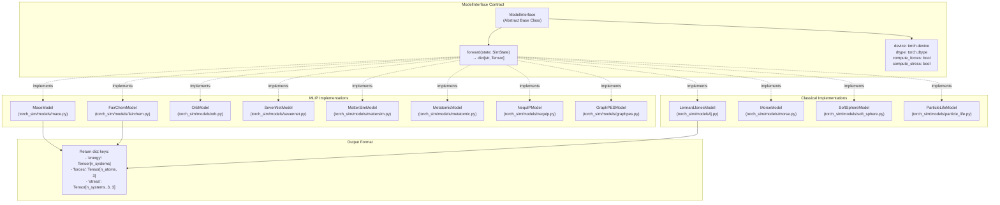
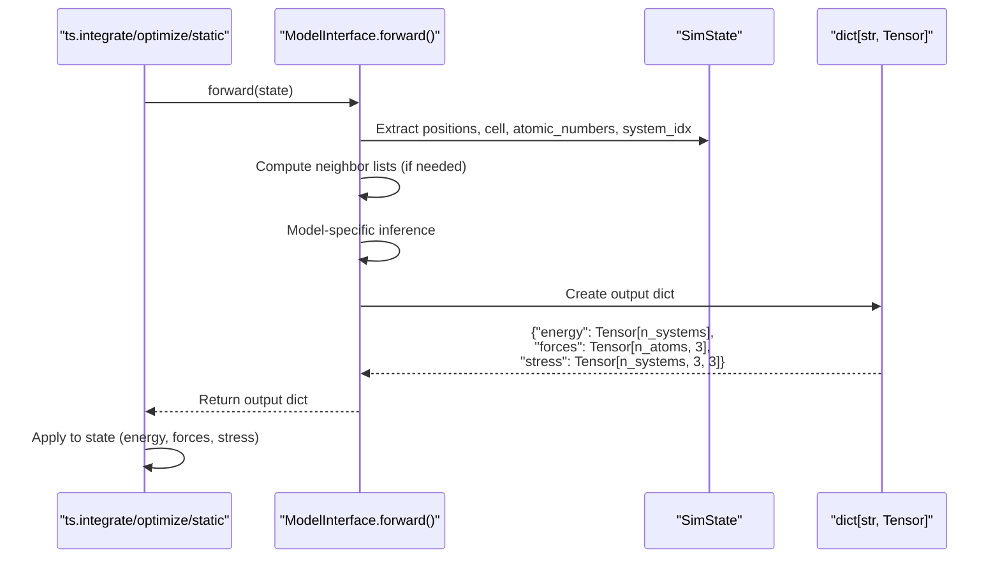
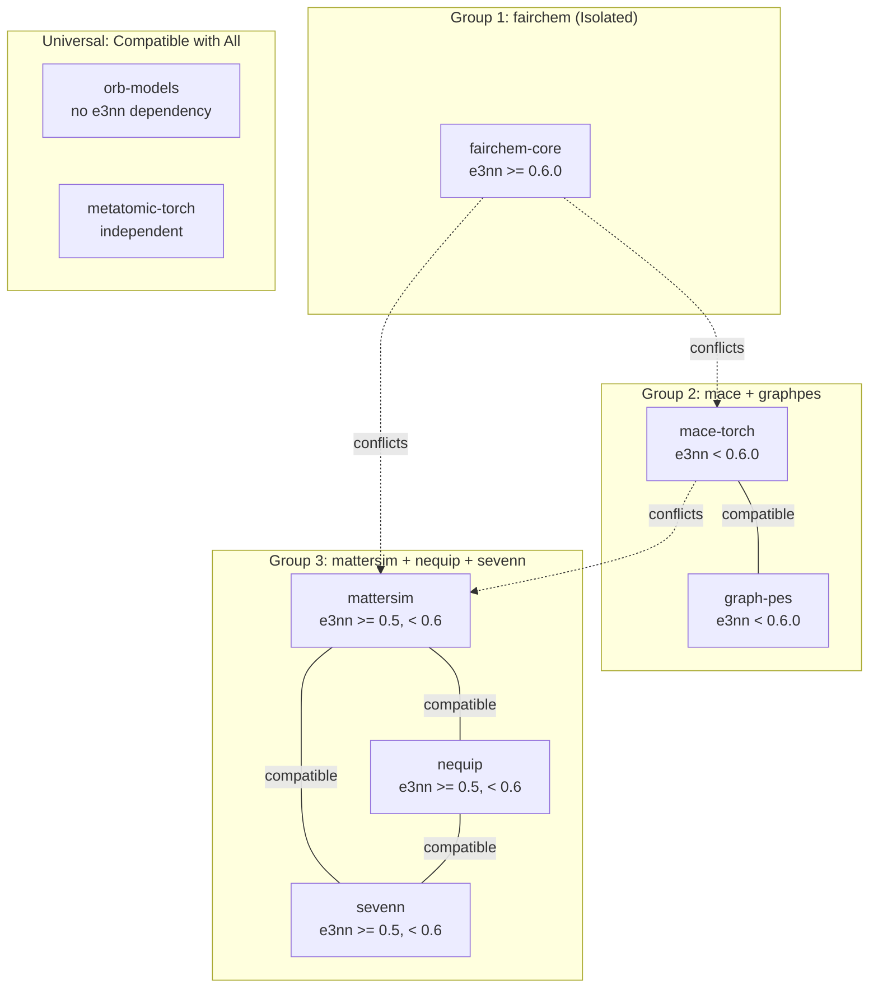
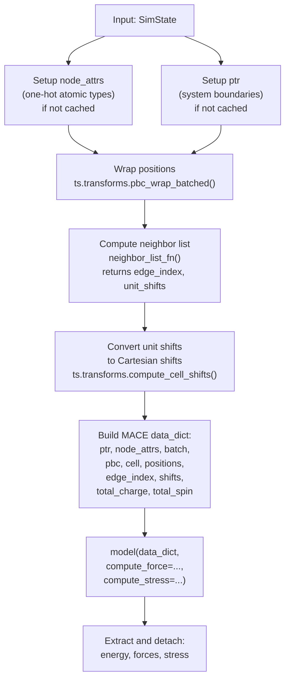
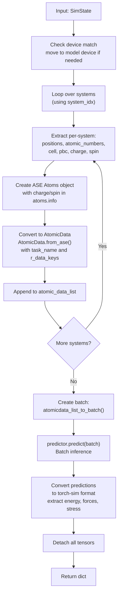
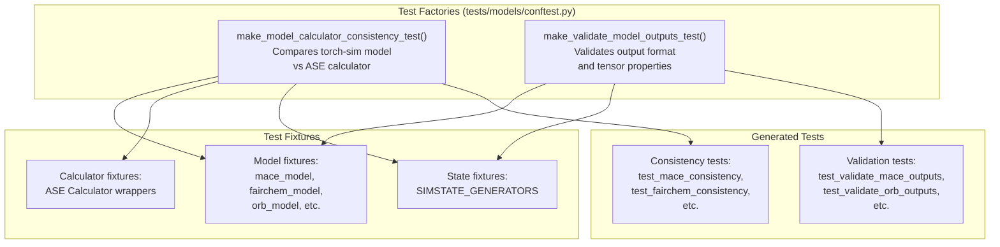
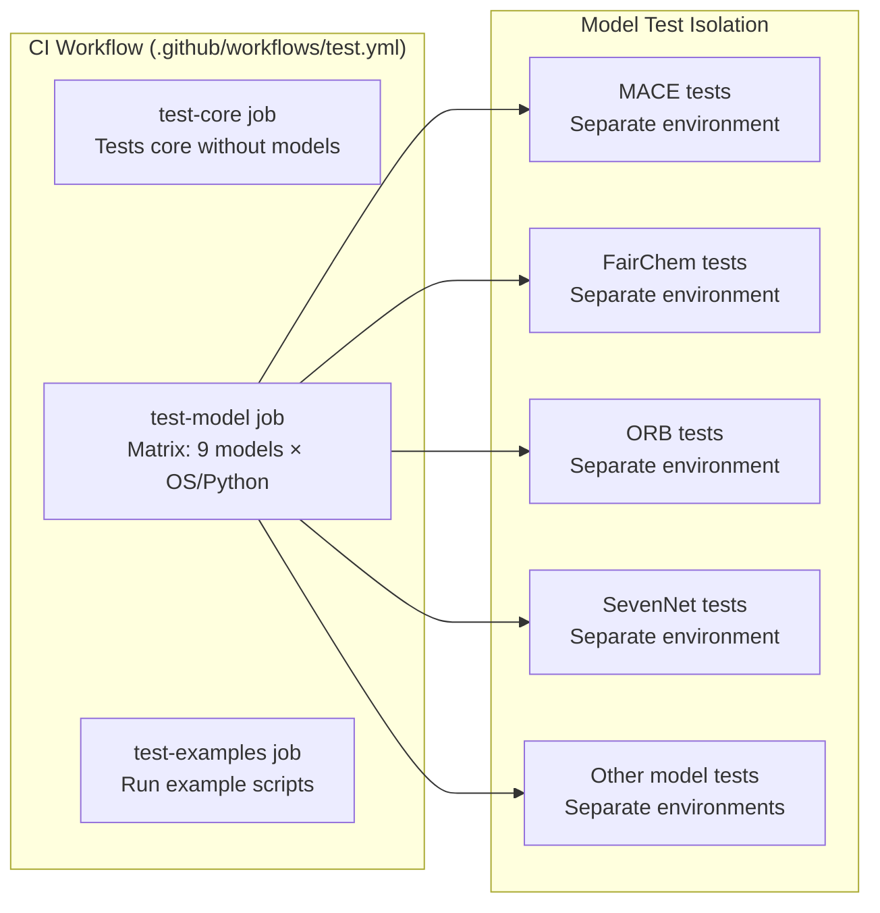

# Models and Potentials

<details>
<summary>Relevant source files</summary>

The following files were used as context for generating this wiki page:

- [tests/models/test_fairchem.py](tests/models/test_fairchem.py)
- [tests/models/test_orb.py](tests/models/test_orb.py)
- [tests/models/test_sevennet.py](tests/models/test_sevennet.py)
- [tests/test_elastic.py](tests/test_elastic.py)
- [torch_sim/models/fairchem.py](torch_sim/models/fairchem.py)
- [torch_sim/models/mace.py](torch_sim/models/mace.py)
- [torch_sim/models/orb.py](torch_sim/models/orb.py)

</details>


This page describes the model ecosystem in torch-sim, covering both Machine Learning Interatomic Potentials (MLIPs) and classical force fields. It explains the `ModelInterface` abstraction, available model backends, dependency management, and testing infrastructure.

For information about using models with MD simulations, see [Molecular Dynamics](#4). For structure optimization with models, see [Structure Optimization](#5). For the core API functions that orchestrate model evaluation, see [High-Level API Functions](#3.3).

## Purpose and Scope

torch-sim supports 8+ MLIP backends as optional dependencies, plus built-in classical potentials. All models implement the `ModelInterface` abstraction, which requires a `forward(state: SimState) -> dict` method that computes energies, forces, and optionally stresses. The modular design allows users to install only the models they need while avoiding dependency conflicts between incompatible MLIP packages.

## Model Interface Architecture

All models in torch-sim implement the `ModelInterface` abstraction, providing a unified API for computing atomic properties regardless of the underlying force field.



**Sources:** [torch_sim/models/interface.py](), [torch_sim/models/mace.py:79-351](), [torch_sim/models/fairchem.py:50-258]()

### ModelInterface Contract

The `ModelInterface` abstract base class defines the minimal contract all models must implement:

| Property/Method | Type | Description |
|----------------|------|-------------|
| `forward(state)` | Method | Takes `SimState`, returns `dict[str, Tensor]` with "energy", "forces", optionally "stress" |
| `device` | Property | `torch.device` where model performs computation |
| `dtype` | Property | `torch.dtype` used for model computations |
| `compute_forces` | Attribute | Whether model computes forces (usually `True`) |
| `compute_stress` | Attribute | Whether model computes stress tensor |

**Sources:** [torch_sim/models/interface.py]()

### Forward Pass Data Flow



**Sources:** [torch_sim/models/interface.py](), [torch_sim/runners.py]()

## Dependency Structure and Installation

torch-sim uses optional dependency groups to isolate incompatible MLIP packages. Users install only the models they need using pip extras.

### Installation Matrix

| Model | Install Command | Dependencies | Compatible Groups |
|-------|----------------|--------------|-------------------|
| MACE | `pip install torch-sim[mace]` | mace-torch, e3nn<0.6.0 | graphpes |
| FairChem | `pip install torch-sim[fairchem]` | fairchem-core | (isolated) |
| ORB | `pip install torch-sim[orb]` | orb-models | all groups |
| SevenNet | `pip install torch-sim[sevenn]` | sevenn | mattersim, nequip |
| MatterSim | `pip install torch-sim[mattersim]` | mattersim | sevenn, nequip |
| Metatomic | `pip install torch-sim[metatomic]` | metatomic-torch | all groups |
| NequIP | `pip install torch-sim[nequip]` | nequip | mattersim, sevenn |
| GraphPES | `pip install torch-sim[graphpes]` | graph-pes | mace |

**Sources:** [pyproject.toml]()

### Dependency Conflict Groups

The MLIP ecosystem has incompatible versions of `e3nn`, creating three mutually exclusive groups:



**Sources:** [pyproject.toml](), [.github/workflows/test.yml]()

### Graceful Import Handling

All MLIP model modules use graceful import fallbacks. If a package is not installed, the model class becomes a placeholder that raises `ImportError` on instantiation:

**Sources:** [torch_sim/models/mace.py:34-49](), [torch_sim/models/fairchem.py:23-42](), [torch_sim/models/orb.py:15-44]()

## MACE Models

`MaceModel` wraps models from the MACE (Multi-Atomic Cluster Expansion) package, supporting energy, force, and stress computation with optional CuEq acceleration.

### Initialization

```python
from torch_sim.models.mace import MaceModel

# Option 1: Load from checkpoint file
model = MaceModel(
    model="path/to/checkpoint.pt",
    device=torch.device("cuda"),
    dtype=torch.float64,
    compute_forces=True,
    compute_stress=True,
    enable_cueq=False  # CuEq acceleration
)

# Option 2: Pass torch.nn.Module directly
mace_model = torch.load("checkpoint.pt")
model = MaceModel(model=mace_model, device=device)
```

**Sources:** [torch_sim/models/mace.py:103-202]()

### MACE Model Configuration

| Parameter | Type | Default | Description |
|-----------|------|---------|-------------|
| `model` | `str | Path | torch.nn.Module` | Required | Checkpoint path or loaded model |
| `device` | `torch.device | None` | CUDA if available | Computation device |
| `dtype` | `torch.dtype` | `torch.float64` | Data type for tensors |
| `neighbor_list_fn` | `Callable` | `torchsim_nl` | Neighbor list implementation |
| `compute_forces` | `bool` | `True` | Whether to compute forces |
| `compute_stress` | `bool` | `True` | Whether to compute stress |
| `enable_cueq` | `bool` | `False` | Enable CuEq acceleration |
| `atomic_numbers` | `torch.Tensor | None` | `None` | Predefine atomic numbers (optional) |
| `system_idx` | `torch.Tensor | None` | `None` | Predefine system indices (optional) |

**Sources:** [torch_sim/models/mace.py:103-202]()

### MACE Forward Pass Implementation

The MACE model forward pass handles batched systems with periodic boundary conditions:



**Sources:** [torch_sim/models/mace.py:232-350]()

### Charge and Spin Support

MACE supports molecular charge and spin via `SimState.charge` and `SimState.spin`:

**Sources:** [torch_sim/models/mace.py:318-319]()

### CuEq Acceleration

Enable CuEq (CUDA-accelerated equivariant operations) for faster inference:

```python
model = MaceModel(
    model="checkpoint.pt",
    enable_cueq=True,
    device=torch.device("cuda")
)
```

**Sources:** [torch_sim/models/mace.py:170-172]()

### Pretrained MACE Models

The `MaceUrls` enum provides download URLs for pretrained MACE models:

| Model Name | URL Constant | Description |
|------------|--------------|-------------|
| `mace_mp_small` | `MaceUrls.mace_mp_small` | Small Materials Project model |
| `mace_mpa_medium` | `MaceUrls.mace_mpa_medium` | Medium MPA model |
| `mace_off_small` | `MaceUrls.mace_off_small` | Small OFF23 model |

**Sources:** [torch_sim/models/mace.py:353-359]()

## FairChem Models

`FairChemModel` wraps models from the FairChem/Open Catalyst Project, including the Universal Material-Molecule Atom (UMA) models that support different task types.

### Initialization

```python
from torch_sim.models.fairchem import FairChemModel

# Option 1: Use pretrained model name
model = FairChemModel(
    model="uma-s-1p1",
    task_name="omat",  # or "omol", "oc20"
    device=torch.device("cuda"),
    compute_stress=True
)

# Option 2: Load from checkpoint file
model = FairChemModel(
    model="path/to/checkpoint.pt",
    task_name="omat",
    device=device
)
```

**Sources:** [torch_sim/models/fairchem.py:71-160]()

### FairChem Configuration

| Parameter | Type | Default | Description |
|-----------|------|---------|-------------|
| `model` | `str | Path` | Required | Pretrained name or checkpoint path |
| `task_name` | `UMATask | str | None` | `None` | Task type: "omat", "omol", "oc20" (for UMA models) |
| `device` | `torch.device | None` | CUDA if available | Computation device |
| `dtype` | `torch.dtype | None` | `torch.float32` | Data type |
| `compute_stress` | `bool` | `False` | Whether to compute stress |
| `model_cache_dir` | `str | Path | None` | `None` | Cache directory for downloads |

**Sources:** [torch_sim/models/fairchem.py:71-160]()

### UMA Task Types

The Universal Material-Molecule Atom (UMA) models support three task types:

| Task Name | Purpose | Typical Systems | Supports Charge/Spin |
|-----------|---------|-----------------|----------------------|
| `omat` | Materials (periodic) | Crystals, periodic structures | Yes |
| `omol` | Molecules | Gas-phase molecules | Yes |
| `oc20` | Catalysis | Adsorbate + surface systems | Yes |

**Sources:** [torch_sim/models/fairchem.py:71-160](), [tests/models/test_fairchem.py:39-122]()

### FairChem Forward Pass

FairChem models use the predictor API for efficient batch inference:



**Sources:** [torch_sim/models/fairchem.py:171-257]()

### Charge and Spin Handling

FairChem models extract charge and spin from `atoms.info` and pass them to the model:

**Sources:** [torch_sim/models/fairchem.py:222-234](), [tests/models/test_fairchem.py:248-294]()

### Stress Computation

Stress is only computed when `compute_stress=True`. The stress tensor has shape `[batch_size, 3, 3]`:

**Sources:** [torch_sim/models/fairchem.py:250-255](), [tests/models/test_fairchem.py:167-187]()

## ORB Models

`OrbModel` wraps models from the orb-models package, which provides the ORB (Orbital Materials) force fields.

### Initialization

```python
from orb_models.forcefield import pretrained
from torch_sim.models.orb import OrbModel

# Load pretrained ORB model
orb_ff, atoms_adapter = pretrained.orb_v3_conservative_inf_omat(
    device=device,
    precision="float32-high"
)

model = OrbModel(orb_ff, atoms_adapter, device=device)
```

**Sources:** [torch_sim/models/orb.py:1-47](), [tests/models/test_orb.py:24-36]()

### ORB Model Integration

`OrbModel` re-exports the `OrbTorchSimModel` class from the orb-models package with automatic detachment of outputs:

**Sources:** [torch_sim/models/orb.py:15-27]()

### Available ORB Models

| Model Name | Function | Description |
|------------|----------|-------------|
| `orb_v3_conservative_inf_omat` | `pretrained.orb_v3_conservative_inf_omat()` | Conservative inference model for materials |
| `orb_v3_direct_20_omat` | `pretrained.orb_v3_direct_20_omat()` | Direct 20-parameter model for materials |

**Sources:** [tests/models/test_orb.py:24-54]()

## SevenNet Models

`SevenNetModel` wraps models from the sevenn package, which provides the SevenNet force fields.

### Initialization

```python
import sevenn.util
from torch_sim.models.sevennet import SevenNetModel

# Load pretrained SevenNet model
cp = sevenn.util.load_checkpoint("sevennet-mf-ompa")
model_loaded = cp.build_model()
model_loaded.set_is_batch_data(True)

model = SevenNetModel(
    model=model_loaded,
    modal="mpa",  # or "omat24"
    device=device
)
```

**Sources:** [tests/models/test_sevennet.py:34-47]()

### SevenNet Configuration

| Parameter | Type | Description |
|-----------|------|-------------|
| `model` | `AtomGraphSequential` | Loaded SevenNet model |
| `modal` | `str` | Modal type: "mpa", "omat24", etc. |
| `device` | `torch.device` | Computation device |

**Sources:** [tests/models/test_sevennet.py:45-62]()

## Other MLIP Integrations

torch-sim supports additional MLIP backends with similar interface patterns:

### MatterSim Models

```python
from torch_sim.models.mattersim import MatterSimModel

model = MatterSimModel(...)
```

**Sources:** [pyproject.toml]()

### Metatomic Models

```python
from torch_sim.models.metatomic import MetatomicModel

model = MetatomicModel(...)
```

**Sources:** [pyproject.toml]()

### NequIP Models

```python
from torch_sim.models.nequip import NequIPModel

model = NequIPModel(...)
```

**Sources:** [pyproject.toml]()

### GraphPES Models

```python
from torch_sim.models.graphpes import GraphPESModel

model = GraphPESModel(...)
```

**Sources:** [pyproject.toml]()

## Classical Potentials

torch-sim includes built-in classical force fields that are always available without additional dependencies.

### Available Classical Potentials

| Model | Module | Use Case |
|-------|--------|----------|
| `LennardJonesModel` | `torch_sim.models.lj` | Van der Waals interactions |
| `MorseModel` | `torch_sim.models.morse` | Chemical bonding |
| `SoftSphereModel` | `torch_sim.models.soft_sphere` | Overlap removal, random packing |
| `ParticleLifeModel` | `torch_sim.models.particle_life` | Artificial life simulations |

**Sources:** [README.md](), [examples/]()

### Lennard-Jones Model

The Lennard-Jones potential models van der Waals interactions between atoms:

```python
from torch_sim.models.lj import LennardJonesModel

model = LennardJonesModel(
    epsilon=...,  # Well depth
    sigma=...,    # Atomic diameter
    device=device
)
```

**Sources:** [torch_sim/models/lj.py]()

### Morse Model

The Morse potential models chemical bond formation and breaking:

```python
from torch_sim.models.morse import MorseModel

model = MorseModel(
    D_e=...,     # Dissociation energy
    alpha=...,   # Width parameter
    r_e=...,     # Equilibrium distance
    device=device
)
```

**Sources:** [torch_sim/models/morse.py]()

### Soft Sphere Model

The soft sphere potential is used for overlap removal and random packing:

```python
from torch_sim.models.soft_sphere import SoftSphereModel

model = SoftSphereModel(
    epsilon=...,
    sigma=...,
    device=device
)
```

**Sources:** [torch_sim/models/soft_sphere.py](), [torch_sim/workflows/structure_generation.py]()

### Particle Life Model

The particle life model implements artificial life dynamics:

```python
from torch_sim.models.particle_life import ParticleLifeModel

model = ParticleLifeModel(...)
```

**Sources:** [torch_sim/models/particle_life.py]()

## Model Testing and Validation

torch-sim provides a comprehensive testing framework for validating model implementations.

### Test Factory Pattern

The testing infrastructure uses factory functions to generate parameterized tests:



**Sources:** [tests/models/conftest.py](), [tests/models/test_mace.py](), [tests/models/test_fairchem.py](), [tests/models/test_orb.py]()

### Consistency Testing

Consistency tests compare torch-sim model outputs against ASE calculator implementations:

```python
# Example from tests/models/test_orb.py
test_orb_conservative_consistency = make_model_calculator_consistency_test(
    test_name="orbv3_conservative_inf_omat",
    model_fixture_name="orbv3_conservative_inf_omat_model",
    calculator_fixture_name="orbv3_conservative_inf_omat_calculator",
    sim_state_names=tuple(SIMSTATE_GENERATORS.keys()),
    energy_rtol=5e-5,
    energy_atol=5e-5,
)
```

**Sources:** [tests/models/test_orb.py:57-73](), [tests/models/test_sevennet.py:66-72]()

### Output Validation Testing

Output validation tests verify that models return correctly shaped and finite tensors:

```python
# Example from tests/models/test_orb.py
test_validate_conservative_model_outputs = make_validate_model_outputs_test(
    model_fixture_name="orbv3_conservative_inf_omat_model",
)
```

**Sources:** [tests/models/test_orb.py:75-81](), [tests/models/test_sevennet.py:75-77]()

### Test Coverage by Model

| Model | Consistency Tests | Validation Tests | Special Tests |
|-------|-------------------|------------------|---------------|
| MACE | ✓ | ✓ | CuEq, charge/spin |
| FairChem | ✓ | ✓ | Task types, stress, charge/spin, batching |
| ORB | ✓ | ✓ | Multiple model variants |
| SevenNet | ✓ | ✓ | Modal types |
| Classical | ✓ | ✓ | Basic functionality |

**Sources:** [tests/models/](), [.github/workflows/test.yml]()

### CI Test Matrix

The continuous integration workflow isolates model tests to avoid dependency conflicts:



**Sources:** [.github/workflows/test.yml]()

### SimState Test Generators

The `SIMSTATE_GENERATORS` fixture provides diverse atomic structures for testing:

**Sources:** [torch_sim/testing.py](), [tests/conftest.py]()

## Model Capabilities Matrix

| Capability | MACE | FairChem | ORB | SevenNet | Classical |
|------------|------|----------|-----|----------|-----------|
| Energy | ✓ | ✓ | ✓ | ✓ | ✓ |
| Forces | ✓ | ✓ | ✓ | ✓ | ✓ |
| Stress | ✓ | ✓ | ✗ | ✓ | ✓ |
| Charge/Spin | ✓ | ✓ | ✗ | ✗ | N/A |
| Batching | ✓ | ✓ | ✓ | ✓ | ✓ |
| PBC | ✓ | ✓ | ✓ | ✓ | ✓ |
| GPU | ✓ | ✓ | ✓ | ✓ | ✓ |
| Custom NL | ✓ | ✗ | ✗ | ✗ | ✓ |

**Sources:** [torch_sim/models/mace.py](), [torch_sim/models/fairchem.py](), [torch_sim/models/orb.py](), [torch_sim/models/sevennet.py]()

---