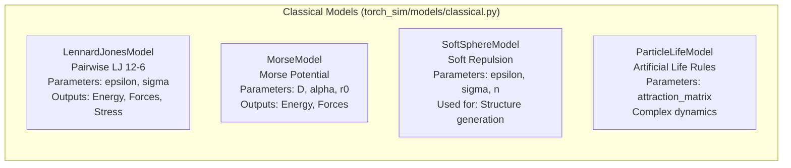
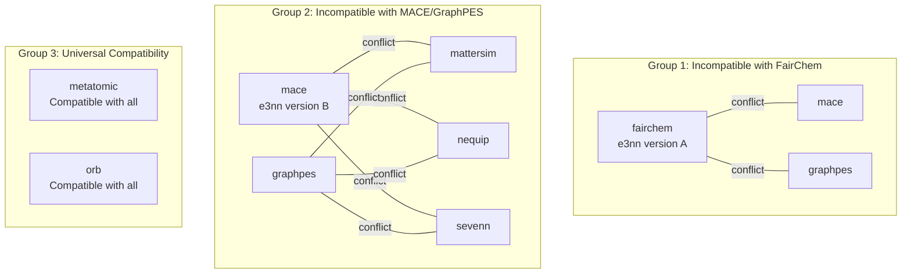
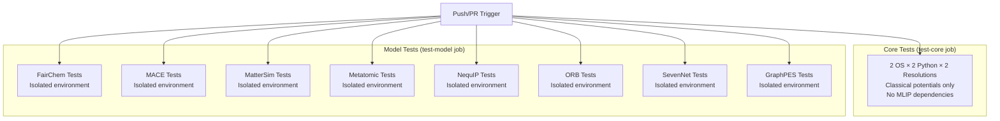

# Model Ecosystem Overview

<details>
<summary>Relevant source files</summary>

The following files were used as context for generating this wiki page:

- [.github/workflows/test.yml](.github/workflows/test.yml)
- [README.md](README.md)
- [pyproject.toml](pyproject.toml)
- [tests/models/test_fairchem.py](tests/models/test_fairchem.py)
- [torch_sim/models/fairchem.py](torch_sim/models/fairchem.py)
- [torch_sim/models/mace.py](torch_sim/models/mace.py)

</details>


This page provides an overview of the model ecosystem in torch-sim, including the unified interface for interatomic potentials, available model implementations, installation procedures, and dependency management strategies. For detailed information on using specific models, see the individual model pages ([MACE](#6.2), [FairChem](#6.3), [ORB](#6.4), [SevenNet](#6.5), [Other MLIPs](#6.6), [Classical Potentials](#6.7)). For model testing and validation procedures, see [Model Testing and Validation](#6.8).

---

## The ModelInterface Abstraction

All models in torch-sim implement the `ModelInterface` abstract base class, which defines a uniform API for computing energies, forces, and other atomistic properties. This abstraction enables seamless model interchangeability in simulation workflows.

### Core Interface Contract

The `ModelInterface` requires implementation of a single method:

```python
def forward(self, state: SimState, **kwargs) -> dict[str, torch.Tensor]
```

This method accepts a `SimState` object (see [SimState and Data Structures](#3.1)) and returns a dictionary containing computed properties. The standard output keys are:

| Property | Key | Shape | Description |
|----------|-----|-------|-------------|
| Energy | `"energy"` | `[n_systems]` | Total potential energy per system |
| Forces | `"forces"` | `[n_atoms, 3]` | Atomic forces in Cartesian coordinates |
| Stress | `"stress"` | `[n_systems, 3, 3]` | Virial stress tensor (optional) |

**Sources:** [torch_sim/models/interface.py](), [Diagram 2 from high-level architecture]

### Model Properties

Models expose several properties that inform simulation algorithms about their capabilities:

- **`device`**: The torch device where the model performs computation
- **`dtype`**: The data type used for tensor operations
- **`compute_forces`**: Boolean indicating force computation capability
- **`compute_stress`**: Boolean indicating stress computation capability  
- **`_memory_scales_with`**: String indicating memory scaling behavior (`"n_atoms"` or `"n_atoms_x_density"`)

**Sources:** [torch_sim/models/interface.py](), [torch_sim/models/mace.py:103-153](), [torch_sim/models/fairchem.py:71-114]()

---

## Model Ecosystem Architecture

```mermaid
graph TB
    subgraph "Interface Layer"
        MI["ModelInterface<br/>(Abstract Base Class)<br/>forward(state) → dict"]
    end
    
    subgraph "MLIP Backends (Optional Extras)"
        MACE["MaceModel<br/>torch-sim[mace]<br/>Energy/Forces/Stress<br/>Charge/Spin"]
        FC["FairChemModel<br/>torch-sim[fairchem]<br/>UMA Tasks: omat/omol/oc20<br/>Predictor API"]
        ORB["OrbModel<br/>torch-sim[orb]<br/>Energy/Forces"]
        SEVENN["SevenNetModel<br/>torch-sim[sevenn]<br/>Energy/Forces/Stress"]
        MATT["MatterSimModel<br/>torch-sim[mattersim]<br/>Energy/Forces/Stress"]
        META["MetatomicModel<br/>torch-sim[metatomic]<br/>PET Models"]
        NEQ["NequIPModel<br/>torch-sim[nequip]<br/>E3NN Architecture"]
        GRAPHPES["GraphPESModel<br/>torch-sim[graphpes]<br/>Graph Neural Network"]
    end
    
    subgraph "Classical Potentials (Built-in)"
        LJ["LennardJonesModel<br/>Always Available<br/>Energy/Forces/Stress"]
        MORSE["MorseModel<br/>Always Available<br/>Pairwise Potential"]
        SS["SoftSphereModel<br/>Always Available<br/>Overlap Removal"]
        PL["ParticleLifeModel<br/>Always Available<br/>Artificial Life"]
    end
    
    MI --> MACE
    MI --> FC
    MI --> ORB
    MI --> SEVENN
    MI --> MATT
    MI --> META
    MI --> NEQ
    MI --> GRAPHPES
    MI --> LJ
    MI --> MORSE
    MI --> SS
    MI --> PL
```



**Sources:** [pyproject.toml:39-74](), [README.md:17-18](), [Diagram 2 from high-level architecture]

---

## MLIP Models (Optional Dependencies)

Machine Learning Interatomic Potentials (MLIPs) are installed as optional extras. Each model backend has its own installation extra that pulls in the necessary dependencies.

### Supported MLIP Backends

| Model | Extra | Package | Capabilities | Memory Scaling |
|-------|-------|---------|--------------|----------------|
| MACE | `[mace]` | `mace-torch>=0.3.15` | Energy, Forces, Stress, Charge, Spin, CuEq | `n_atoms × density` |
| FairChem | `[fairchem]` | `fairchem-core>=2.7` | Energy, Forces, Stress, Charge, Spin, UMA tasks | `n_atoms` |
| ORB | `[orb]` | `orb-models>=0.6.0` | Energy, Forces | Compatible with all |
| SevenNet | `[sevenn]` | `sevenn[torchsim]>=0.12.1` | Energy, Forces, Stress | `n_atoms × density` |
| MatterSim | `[mattersim]` | `mattersim>=0.1.2` | Energy, Forces, Stress | `n_atoms × density` |
| Metatomic | `[metatomic]` | `metatomic-torch>=0.1.3` | Energy, Forces (PET models) | Compatible with all |
| NequIP | `[nequip]` | `nequip>=0.17.0` | Energy, Forces (E3NN architecture) | `n_atoms × density` |
| GraphPES | `[graphpes]` | `graph-pes>=0.1` | Energy, Forces (GNN) | `n_atoms × density` |

**Sources:** [pyproject.toml:51-58](), [README.md:17](), [torch_sim/models/mace.py:1-18](), [torch_sim/models/fairchem.py:1-7]()

### Installation Examples

Install a single model:
```bash
pip install torch-sim-atomistic[mace]
```

Install multiple compatible models:
```bash
pip install torch-sim-atomistic[metatomic,orb]
```

Install with I/O support:
```bash
pip install torch-sim-atomistic[mace,io]
```

**Sources:** [pyproject.toml:39-58](), [README.md:106-120]()

---

## Classical Potentials (Built-in)

Classical force fields are always available without additional installation. These are implemented entirely within torch-sim and have no external dependencies.

### Available Classical Models



**Classical Model Characteristics:**
- **No external dependencies**: Work immediately after installing torch-sim
- **Fast computation**: Optimized PyTorch implementations
- **Full batching support**: Leverage GPU acceleration
- **Stress tensor support**: Most models compute virial stress
- **Use cases**: Structure generation, overlap removal, soft-sphere packing, artificial life simulations

**Sources:** [README.md:18](), [torch_sim/models/classical.py](), [pyproject.toml:29-37]()

---

## Dependency Conflicts and Compatibility

MLIP models have complex dependency requirements, particularly around the `e3nn` (Euclidean neural network) library. Different models require incompatible versions of `e3nn`, making them mutually exclusive in the same environment.

### Conflict Groups

The dependency conflicts are explicitly declared in `pyproject.toml` using uv's conflict resolution feature:



**Explicit Conflict Declarations:**

The conflicts are declared in `[tool.uv].conflicts` to prevent incompatible combinations:

- FairChem ⚡ MACE
- FairChem ⚡ GraphPES  
- MACE ⚡ MatterSim
- MACE ⚡ NequIP
- MACE ⚡ SevenNet
- GraphPES ⚡ MatterSim
- GraphPES ⚡ NequIP
- GraphPES ⚡ SevenNet

**Compatible Models:**
- `metatomic` and `orb` are compatible with all other models
- Can be installed alongside any other MLIP backend

**Sources:** [pyproject.toml:142-186](), [Diagram 2 from high-level architecture]

### Testing Strategy for Incompatible Models

The CI system isolates model tests to work around dependency conflicts:



Each model test runs in a separate CI job with only that model's dependencies installed, preventing conflicts.

**Sources:** [.github/workflows/test.yml:54-145](), [Diagram 5 from high-level architecture]

---

## Model Capabilities

Different models support different output properties. The table below summarizes what each model can compute:

| Model | Energy | Forces | Stress | Charge | Spin | Special Features |
|-------|--------|--------|--------|--------|------|------------------|
| MACE | ✓ | ✓ | ✓ | ✓ | ✓ | CuEq acceleration |
| FairChem | ✓ | ✓ | ✓ | ✓ | ✓ | UMA multi-task (omat/omol/oc20) |
| ORB | ✓ | ✓ | ✗ | ✗ | ✗ | Universal compatibility |
| SevenNet | ✓ | ✓ | ✓ | ✗ | ✗ | - |
| MatterSim | ✓ | ✓ | ✓ | ✗ | ✗ | - |
| Metatomic | ✓ | ✓ | ✗ | ✗ | ✗ | PET architecture |
| NequIP | ✓ | ✓ | ✗ | ✗ | ✗ | E3NN architecture |
| GraphPES | ✓ | ✓ | ✗ | ✗ | ✗ | GNN architecture |
| Lennard-Jones | ✓ | ✓ | ✓ | ✗ | ✗ | Classical, always available |
| Morse | ✓ | ✓ | ✗ | ✗ | ✗ | Classical, always available |
| Soft Sphere | ✓ | ✓ | ✓ | ✗ | ✗ | Classical, structure generation |
| Particle Life | ✓ | ✓ | ✗ | ✗ | ✗ | Classical, artificial life |

**Charge and Spin Support:**

Models that support charge and spin (MACE, FairChem) extract these properties from the `SimState`:
- `state.charge`: Total charge per system, shape `[n_systems]`
- `state.spin`: Total spin multiplicity per system, shape `[n_systems]`

These properties are passed through to the model and can affect energy and force predictions for charged or spin-polarized systems.

**Sources:** [torch_sim/models/mace.py:79-102](), [torch_sim/models/fairchem.py:50-69](), [tests/models/test_fairchem.py:248-294]()

---

## Memory Scaling Characteristics

Models exhibit different memory scaling behaviors, which affects autobatching strategies (see [Autobatching and GPU Memory Management](#7.1)):

### Scaling Types

**`n_atoms` Scaling:**
- Memory grows linearly with total number of atoms
- Examples: FairChem models
- Optimal for: Systems with similar densities
- Autobatching strategy: Bin by total atom count

**`n_atoms_x_density` Scaling:**  
- Memory grows with both atom count and neighbor density
- Examples: MACE, SevenNet, MatterSim, NequIP, GraphPES
- Optimal for: Mixed density systems
- Autobatching strategy: Bin by atoms × density product

**Memory Scaling Property:**

Models expose their scaling behavior via the `_memory_scales_with` attribute:

```python
# In MaceModel.__init__()
self._memory_scales_with = "n_atoms_x_density"

# In FairChemModel.__init__()
self._memory_scales_with = "n_atoms"
```

This property is used by autobatchers to optimize batch composition and memory usage.

**Sources:** [torch_sim/models/mace.py:153](), [torch_sim/models/fairchem.py:109](), [torch_sim/autobatching.py]()

---

## Model Initialization Patterns

### MLIP Model Initialization

MLIP models follow common initialization patterns:

**MACE Example:**
```python
from torch_sim.models.mace import MaceModel
from mace.calculators.foundations_models import mace_mp

# Load pretrained foundation model
mace = mace_mp(model="small", return_raw_model=True)
model = MaceModel(
    model=mace,
    device=torch.device("cuda"),
    dtype=torch.float32,
    compute_stress=True,
    enable_cueq=False  # CuEq acceleration
)
```

**FairChem Example:**
```python
from torch_sim.models.fairchem import FairChemModel

# Load UMA model for materials (omat task)
model = FairChemModel(
    model="uma-s-1p1",
    task_name="omat",  # or "omol", "oc20"
    device=torch.device("cuda"),
    compute_stress=True
)
```

**Sources:** [README.md:36-47](), [torch_sim/models/mace.py:103-202](), [torch_sim/models/fairchem.py:71-160]()

### Classical Model Initialization

Classical models have simpler initialization:

```python
from torch_sim.models.classical import LennardJonesModel

model = LennardJonesModel(
    epsilon=0.01,  # LJ epsilon parameter
    sigma=3.0,     # LJ sigma parameter
    device=torch.device("cuda")
)
```

**Sources:** [torch_sim/models/classical.py]()

---

## Usage in Simulation Workflows

Models are used identically in high-level API functions regardless of type:

```python
# Molecular dynamics
final_state = ts.integrate(
    system=atoms_list,
    model=model,  # Any ModelInterface implementation
    n_steps=1000,
    timestep=0.001,
    temperature=300,
    integrator=ts.Integrator.nvt_langevin
)

# Structure optimization  
relaxed = ts.optimize(
    system=atoms_list,
    model=model,  # Same interface
    optimizer=ts.Optimizer.fire
)

# Single-point calculation
result = ts.static(
    system=atoms_list,
    model=model  # Same interface
)
```

The uniform `ModelInterface` abstraction enables seamless model swapping without changing simulation code.

**Sources:** [README.md:36-90](), [torch_sim/runners.py](), [Diagram 1 from high-level architecture]

---

## Summary

The torch-sim model ecosystem provides:

1. **Unified Interface**: `ModelInterface` abstraction for all models
2. **8+ MLIP Backends**: Optional extras for state-of-the-art ML potentials
3. **Built-in Classical Potentials**: Always-available force fields
4. **Explicit Conflict Management**: uv-based dependency resolution
5. **Isolated Testing**: Separate CI jobs per model to avoid conflicts
6. **Flexible Capabilities**: Energy, forces, stress, charge, spin support varies by model
7. **Optimized Memory Scaling**: Different strategies for different model architectures
8. **Seamless Integration**: Uniform API across all simulation workflows

For model-specific details, see the dedicated pages for [MACE](#6.2), [FairChem](#6.3), [ORB](#6.4), [SevenNet](#6.5), [other MLIPs](#6.6), [classical potentials](#6.7), and [testing](#6.8).

**Sources:** [pyproject.toml](), [README.md](), [torch_sim/models/](), [.github/workflows/test.yml](), [All architecture diagrams]

---