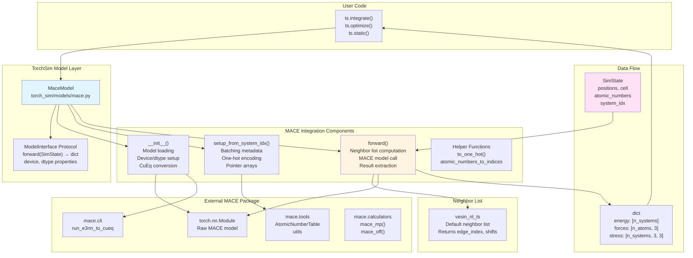
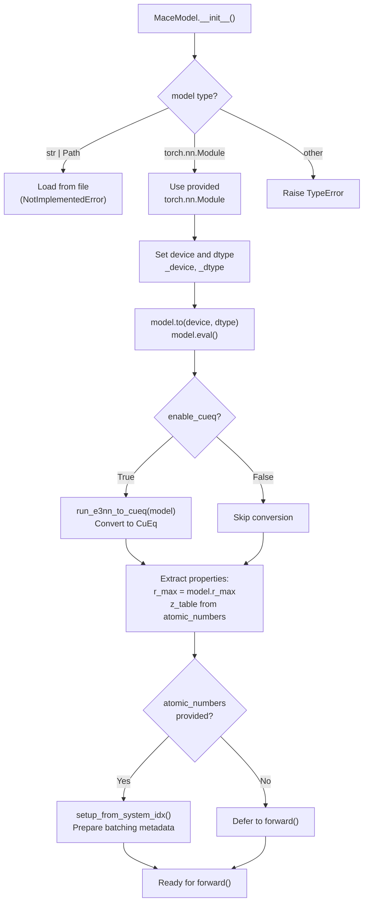
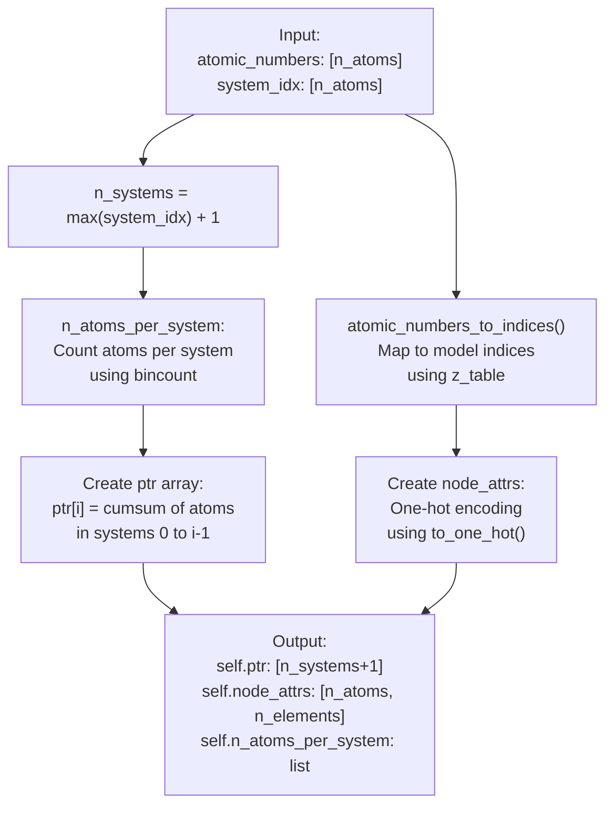
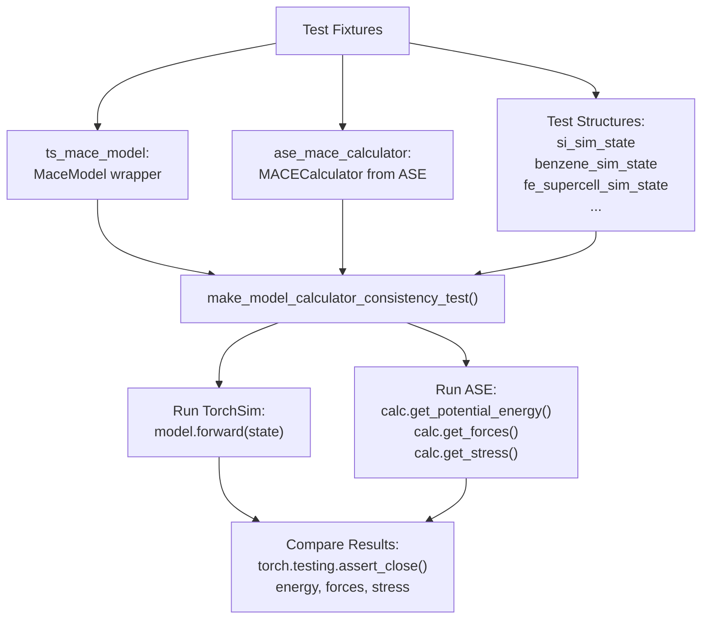

# MACE Integration

<details>
<summary>Relevant source files</summary>

The following files were used as context for generating this wiki page:

- [tests/conftest.py](tests/conftest.py)
- [tests/models/test_fairchem.py](tests/models/test_fairchem.py)
- [tests/models/test_lennard_jones.py](tests/models/test_lennard_jones.py)
- [tests/models/test_mace.py](tests/models/test_mace.py)
- [torch_sim/io.py](torch_sim/io.py)
- [torch_sim/models/fairchem.py](torch_sim/models/fairchem.py)
- [torch_sim/models/mace.py](torch_sim/models/mace.py)

</details>


This document describes the integration of MACE (Multi Atomic Cluster Expansion) models into TorchSim through the `MaceModel` wrapper class. It covers model initialization, configuration options, the forward pass computation pipeline, pretrained model access, and performance optimizations including CuEq acceleration.

For general information about the model integration architecture and the `ModelInterface` protocol, see [Overview and Model Interface](#5.1). For integration details of other MLIP models, see [Other Model Integrations](#5.4).

---

## Architecture Overview

The MACE integration follows TorchSim's model wrapper pattern, implementing the `ModelInterface` protocol to provide a unified API for energy, force, and stress calculations.



**Sources:** [torch_sim/models/mace.py:1-378](), [torch_sim/models/interface.py]()

---

## MaceModel Class

The `MaceModel` class wraps MACE neural network potentials for batched energy, force, and stress calculations.

### Key Attributes

| Attribute | Type | Description |
|-----------|------|-------------|
| `model` | `torch.nn.Module` | Underlying MACE neural network |
| `r_max` | `float` | Cutoff radius for neighbor interactions |
| `z_table` | `AtomicNumberTable` | Maps atomic numbers to model indices |
| `neighbor_list_fn` | `Callable` | Function for computing neighbor lists (default: `vesin_nl_ts`) |
| `atomic_numbers` | `torch.Tensor` | Cached atomic numbers `[n_atoms]` |
| `system_idx` | `torch.Tensor` | System membership indices `[n_atoms]` |
| `ptr` | `torch.Tensor` | Pointers to system boundaries `[n_systems + 1]` |
| `node_attrs` | `torch.Tensor` | One-hot encoded atomic types `[n_atoms, n_elements]` |
| `_memory_scales_with` | `str` | Set to `"n_atoms_x_density"` for autobatching |

**Sources:** [torch_sim/models/mace.py:80-102]()

---

## Initialization and Configuration

### Constructor Signature

```python
MaceModel(
    model: str | Path | torch.nn.Module | None = None,
    *,
    device: torch.device | None = None,
    dtype: torch.dtype = torch.float64,
    neighbor_list_fn: Callable = vesin_nl_ts,
    compute_forces: bool = True,
    compute_stress: bool = True,
    enable_cueq: bool = False,
    atomic_numbers: torch.Tensor | None = None,
    system_idx: torch.Tensor | None = None,
)
```

### Initialization Workflow



**Sources:** [torch_sim/models/mace.py:104-196]()

### Key Initialization Options

#### Device and Dtype
- **device**: Defaults to CUDA if available, otherwise CPU
- **dtype**: Defaults to `torch.float64`; models are automatically converted
- Both `float32` and `float64` tested and supported

**Sources:** [torch_sim/models/mace.py:146-169](), [tests/models/test_mace.py:59-70](), [tests/models/test_mace.py:115-122]()

#### Atomic Numbers and System Indices
Two initialization patterns are supported:

1. **Provided at init**: Atomic numbers and system indices cached, cannot be changed
2. **Provided at forward**: Flexible, allows different systems per call

```python
# Pattern 1: Fixed at init
model = MaceModel(
    model=raw_mace,
    atomic_numbers=torch.tensor([14, 14, 14, 14]),
    system_idx=torch.tensor([0, 0, 0, 0]),
)

# Pattern 2: Dynamic at forward
model = MaceModel(model=raw_mace)
result = model(state)  # state contains atomic_numbers
```

**Sources:** [torch_sim/models/mace.py:184-196](), [torch_sim/models/mace.py:270-298]()

#### Neighbor List Function
- **Default**: `vesin_nl_ts` from `torch_sim.neighbors`
- **Custom**: Can provide any callable with signature `(positions, cell, pbc, cutoff) -> (edge_index, shifts)`

**Sources:** [torch_sim/models/mace.py:110](), [torch_sim/models/mace.py:153]()

---

## System Setup and Batching

The `setup_from_system_idx()` method prepares internal state for efficient batched processing of multiple atomic systems.

### Batching Metadata Creation



**Sources:** [torch_sim/models/mace.py:197-239]()

### One-Hot Encoding Implementation

The `to_one_hot()` helper function converts atomic type indices to one-hot vectors:

```python
def to_one_hot(indices: torch.Tensor, num_classes: int, dtype: torch.dtype) -> torch.Tensor:
    shape = (*indices.shape[:-1], num_classes)
    oh = torch.zeros(shape, device=indices.device, dtype=dtype)
    oh.scatter_(dim=-1, index=indices, value=1)
    return oh
```

This is a modified version optimized for TorchSim's use case, with potential upstream contribution planned.

**Sources:** [torch_sim/models/mace.py:53-78]()

---

## Forward Pass Pipeline

The `forward()` method orchestrates the complete computation pipeline from `SimState` to energy, force, and stress predictions.

### Computation Flow

```mermaid
flowchart TD
    INPUT["forward(state: SimState)"]
    
    VALIDATE["Validate atomic_numbers:<br/>Must be in init OR forward,<br/>not both, not neither"]
    
    CHECK_SETUP{"system_idx<br/>changed?"}
    RUN_SETUP["setup_from_system_idx()<br/>Update batching metadata"]
    SKIP_SETUP["Use cached metadata"]
    
    INIT_NL["Initialize neighbor list<br/>edge_indices = []<br/>shifts_list = []<br/>offset = 0"]
    
    LOOP_START{"For each system"}
    
    EXTRACT_SYSTEM["Extract system data:<br/>system_mask = system_idx == sys_idx<br/>positions[system_mask]<br/>cell[sys_idx]"]
    
    COMPUTE_NL["neighbor_list_fn():<br/>edge_idx, shifts_idx<br/>for this system"]
    
    ADJUST_IDX["Adjust indices:<br/>edge_idx += offset<br/>shifts = shifts_idx @ cell"]
    
    APPEND["Append to lists:<br/>edge_indices.append()<br/>shifts_list.append()"]
    
    UPDATE_OFFSET["offset += n_atoms_in_system"]
    
    LOOP_END{"More systems?"}
    
    CONCAT["Concatenate all systems:<br/>edge_index = cat(edge_indices)<br/>shifts = cat(shifts_list)"]
    
    MODEL_CALL["self.model(dict(...))<br/>Pass: ptr, node_attrs, batch,<br/>pbc, cell, positions,<br/>edge_index, shifts"]
    
    EXTRACT_RESULTS["Extract results:<br/>energy, forces, stress<br/>from model output"]
    
    OUTPUT["Return dict:<br/>energy: [n_systems]<br/>forces: [n_atoms, 3]<br/>stress: [n_systems, 3, 3]"]
    
    INPUT --> VALIDATE
    VALIDATE --> CHECK_SETUP
    CHECK_SETUP -->|"Yes"| RUN_SETUP
    CHECK_SETUP -->|"No"| SKIP_SETUP
    
    RUN_SETUP --> INIT_NL
    SKIP_SETUP --> INIT_NL
    
    INIT_NL --> LOOP_START
    LOOP_START -->|"sys_idx"| EXTRACT_SYSTEM
    EXTRACT_SYSTEM --> COMPUTE_NL
    COMPUTE_NL --> ADJUST_IDX
    ADJUST_IDX --> APPEND
    APPEND --> UPDATE_OFFSET
    UPDATE_OFFSET --> LOOP_END
    
    LOOP_END -->|"Yes"| LOOP_START
    LOOP_END -->|"No"| CONCAT
    
    CONCAT --> MODEL_CALL
    MODEL_CALL --> EXTRACT_RESULTS
    EXTRACT_RESULTS --> OUTPUT
```



**Sources:** [torch_sim/models/mace.py:240-369]()

### Neighbor List Processing

Currently, neighbor lists are computed per-system in a loop (not batched):

```python
for sys_idx in range(self.n_systems):
    system_mask = sim_state.system_idx == sys_idx
    edge_idx, shifts_idx = self.neighbor_list_fn(
        positions=sim_state.positions[system_mask],
        cell=sim_state.row_vector_cell[sys_idx],
        pbc=sim_state.pbc,
        cutoff=self.r_max,
    )
    # Adjust indices and accumulate...
```

**Note**: Comment at line 305 indicates batched neighbor lists are a future enhancement.

**Sources:** [torch_sim/models/mace.py:299-329]()

### MACE Model Input Format

The model expects a dictionary with specific keys:

| Key | Shape | Description |
|-----|-------|-------------|
| `ptr` | `[n_systems + 1]` | Pointers to system boundaries |
| `node_attrs` | `[n_atoms, n_elements]` | One-hot atomic types |
| `batch` | `[n_atoms]` | System membership (system_idx) |
| `pbc` | `[3]` | Periodic boundary conditions |
| `cell` | `[n_systems, 3, 3]` | Unit cells (row vectors) |
| `positions` | `[n_atoms, 3]` | Atomic positions |
| `edge_index` | `[2, n_edges]` | Neighbor pairs |
| `unit_shifts` | `[n_edges, 3]` | Integer cell offsets |
| `shifts` | `[n_edges, 3]` | Cartesian shifts |

**Sources:** [torch_sim/models/mace.py:332-346]()

---

## Pretrained Models

### MaceUrls Enum

The `MaceUrls` enum provides convenient access to pretrained MACE models:

```python
class MaceUrls(StrEnum):
    mace_mp_small = "https://github.com/ACEsuit/mace-mp/releases/download/mace_mp_0b/mace_agnesi_small.model"
    mace_mpa_medium = "https://github.com/ACEsuit/mace-foundations/releases/download/mace_mpa_0/mace-mpa-0-medium.model"
    mace_off_small = "https://github.com/ACEsuit/mace-off/blob/main/mace_off23/MACE-OFF23_small.model?raw=true"
```

**Sources:** [torch_sim/models/mace.py:372-378]()

### Loading Pretrained Models

#### Using mace.calculators Functions

```python
from mace.calculators.foundations_models import mace_mp, mace_off
from torch_sim.models.mace import MaceModel, MaceUrls

# Load raw model (no ASE calculator wrapper)
raw_mace_mp = mace_mp(model=MaceUrls.mace_mp_small, return_raw_model=True)
raw_mace_off = mace_off(model=MaceUrls.mace_off_small, return_raw_model=True)

# Wrap in TorchSim interface
model_mp = MaceModel(model=raw_mace_mp, device="cuda", dtype=torch.float32)
model_off = MaceModel(model=raw_mace_off, device="cuda", dtype=torch.float32)
```

**Sources:** [tests/models/test_mace.py:17-28](), [tests/models/test_mace.py:40-47](), [tests/models/test_mace.py:98-99]()

### Model Variants

| Model | Description | Use Case |
|-------|-------------|----------|
| `mace_mp` | Materials Project trained | Inorganic materials, crystals |
| `mace_off` | OFF23 organic molecules | Molecular systems, organic chemistry |
| `mace_mpa` | MPA foundations model | Multi-purpose, expanded coverage |

**Sources:** [torch_sim/models/mace.py:372-378]()

---

## CuEq Acceleration

CuEq (CUDA Equivariance) provides performance optimization for equivariant neural networks on GPU.

### Enabling CuEq

```python
model = MaceModel(
    model=raw_mace,
    device="cuda",
    enable_cueq=True,  # Converts e3nn operations to CuEq
)
```

The conversion is performed via `mace.cli.convert_e3nn_cueq.run()`:

**Sources:** [torch_sim/models/mace.py:171-173](), [torch_sim/models/mace.py:36]()

### Performance Considerations

- **GPU-only**: CuEq optimizations only apply to CUDA devices
- **One-time cost**: Conversion happens at initialization
- **Inference speedup**: Improves throughput for batched forward passes
- **Memory**: Similar memory footprint to standard e3nn

**Sources:** [torch_sim/models/mace.py:171-173]()

---

## Testing and Validation

### Consistency Tests

The MACE integration includes comprehensive consistency tests against ASE's MACE calculator:



**Sources:** [tests/models/test_mace.py:50-56](), [tests/models/test_mace.py:102-108]()

### Test Coverage

| Test | Purpose | Source |
|------|---------|--------|
| `test_mace_consistency` | Verify energy/force/stress match ASE | [tests/models/test_mace.py:50-56]() |
| `test_mace_off_consistency` | Verify mace_off model accuracy | [tests/models/test_mace.py:102-108]() |
| `test_mace_dtype_working` | Test float32/float64 support | [tests/models/test_mace.py:59-70]() |
| `test_mace_off_dtype_working` | Test dtype for organic model | [tests/models/test_mace.py:115-122]() |
| `test_mace_urls_enum` | Validate pretrained model URLs | [tests/models/test_mace.py:124-129]() |
| Elastic property tests | Integration with elastic tensor calculations | [tests/test_elastic.py:257-411]() |

**Sources:** [tests/models/test_mace.py:1-129](), [tests/test_elastic.py:257-411]()

### Consistency Test Structure

The test framework uses parameterized fixtures to test multiple structures:

```python
consistency_test_simstate_fixtures = (
    "si_sim_state",
    "fe_supercell_sim_state", 
    "ar_supercell_sim_state",
    # ... more structures
)

test_mace_consistency = make_model_calculator_consistency_test(
    test_name="mace",
    model_fixture_name="ts_mace_model",
    calculator_fixture_name="ase_mace_calculator",
    sim_state_names=consistency_test_simstate_fixtures,
    dtype=DTYPE,
)
```

**Sources:** [tests/models/test_mace.py:50-56](), [tests/models/conftest.py]()

---

## Integration with TorchSim Workflows

### Molecular Dynamics

```python
from torch_sim.models.mace import MaceModel, MaceUrls
from mace.calculators.foundations_models import mace_mp
import torch_sim as ts

# Load model
raw_mace = mace_mp(model=MaceUrls.mace_mp_small, return_raw_model=True)
model = MaceModel(model=raw_mace, device="cuda", dtype=torch.float32)

# Run MD
state = ts.io.atoms_to_state(atoms, "cuda", torch.float32)
trajectory = ts.integrate(
    state=state,
    model=model,
    integrator=ts.integrators.NVTLangevin(dt=1.0, temperature=300, friction=0.01),
    n_steps=1000,
)
```

**Sources:** Example pattern from [torch_sim/models/mace.py:1-18]() docstring

### Geometry Optimization

```python
# Optimize with FIRE
optimized_state = ts.optimize(
    state=state,
    model=model,
    optimizer=ts.optimizers.FIRE(),
    fmax=0.01,
)
```

**Sources:** Integration pattern from [tests/test_elastic.py:310-326]()

### Elastic Property Calculations

```python
from torch_sim.elastic import calculate_elastic_tensor, get_bravais_type

# Relax structure first
state = ts.fire_init(
    state=initial_state,
    model=model,
    scalar_pressure=0.0,
    cell_filter=ts.CellFilter.frechet,
)

for _ in range(300):
    state = ts.fire_step(state=state, model=model)
    if max_force < 1e-5 and abs(pressure) < 1e-2:
        break

# Calculate elastic tensor
bravais_type = get_bravais_type(state)
elastic_tensor = calculate_elastic_tensor(
    state=state,
    model=model,
    bravais_type=bravais_type,
)
```

**Sources:** [tests/test_elastic.py:361-381]()

---

## Memory Scaling and Autobatching

The `MaceModel` sets `_memory_scales_with = "n_atoms_x_density"`, indicating that GPU memory usage scales with both the number of atoms and the system density (affecting neighbor list size).

This property is used by TorchSim's autobatching system to:
1. Estimate safe batch sizes during `estimate_max_memory_scaler()`
2. Bin systems appropriately in `BinningAutoBatcher`
3. Swap systems efficiently in `InFlightAutoBatcher`

**Sources:** [torch_sim/models/mace.py:154](), [Autobatching and Memory Management](#6.1)

---

## Common Usage Patterns

### Pattern 1: One-Time Setup for Fixed Systems

```python
# Atomic numbers known at init
atomic_numbers = torch.tensor([14, 14, 14, 14])  # Silicon
system_idx = torch.zeros(4, dtype=torch.long)

model = MaceModel(
    model=raw_mace,
    atomic_numbers=atomic_numbers,
    system_idx=system_idx,
    device="cuda",
)

# Forward pass only needs positions and cell
state = ts.SimState(positions=pos, cell=cell)
result = model(state)
```

### Pattern 2: Dynamic System Composition

```python
# No atomic numbers at init - flexible for different systems
model = MaceModel(model=raw_mace, device="cuda")

# Different structures in each call
state1 = ts.io.atoms_to_state(si_atoms, "cuda", torch.float32)
result1 = model(state1)

state2 = ts.io.atoms_to_state(cu_atoms, "cuda", torch.float32)
result2 = model(state2)
```

### Pattern 3: Batched Multi-System Calculation

```python
# Batch multiple systems
states = [state1, state2, state3]
batched_state = ts.concatenate_states(states, device="cuda")

# Single forward pass computes all systems
result = model(batched_state)

# Results automatically split by system:
# result["energy"] has shape [3]
# result["forces"] has shape [n_total_atoms, 3]
```

**Sources:** [torch_sim/models/mace.py:104-196](), [torch_sim/models/mace.py:240-369]()

---

## Limitations and Future Work

### Current Limitations

1. **File Loading**: Model loading from checkpoint files not yet implemented ([torch_sim/models/mace.py:157-159]())
2. **Neighbor List Batching**: Neighbor lists computed per-system in loop, not batched ([torch_sim/models/mace.py:305]())
3. **Atomic Number Flexibility**: Cannot change atomic numbers if provided at init ([torch_sim/models/mace.py:275-278]())

### Planned Enhancements

1. Implement checkpoint file loading
2. Batch neighbor list computation across systems
3. Consider upstreaming `to_one_hot()` optimization to MACE ([torch_sim/models/mace.py:58-60]())

**Sources:** [torch_sim/models/mace.py:53-60](), [torch_sim/models/mace.py:157-159](), [torch_sim/models/mace.py:305]()

---