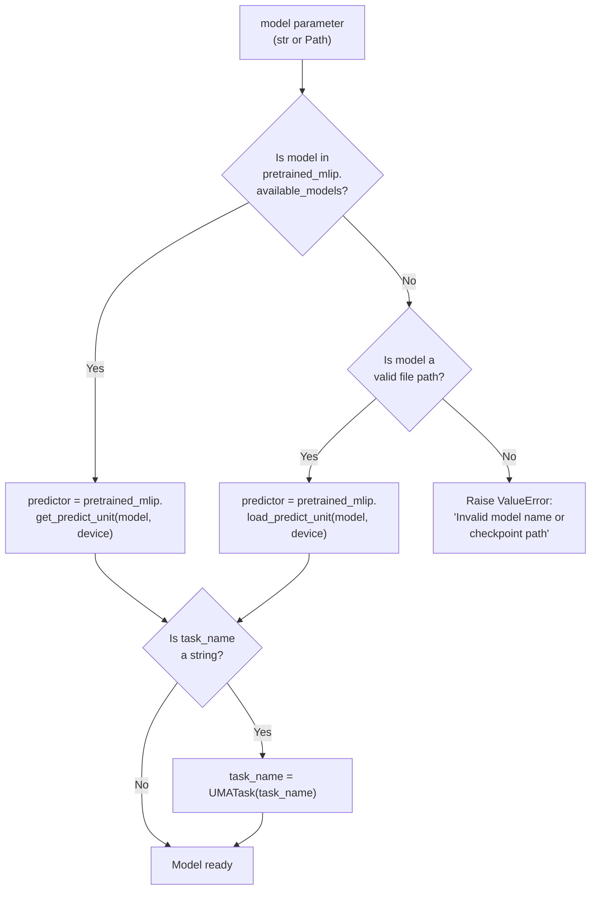
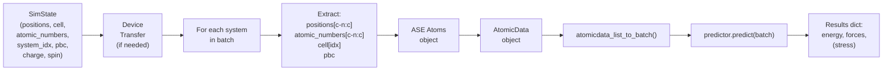
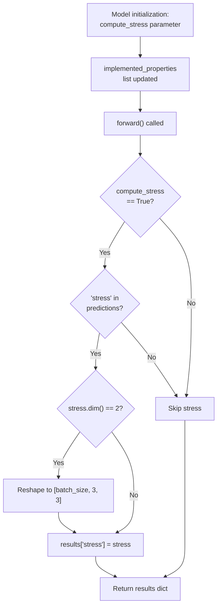

# FairChem Models

<details>
<summary>Relevant source files</summary>

The following files were used as context for generating this wiki page:

- [tests/models/test_fairchem.py](tests/models/test_fairchem.py)
- [torch_sim/models/fairchem.py](torch_sim/models/fairchem.py)
- [torch_sim/models/mace.py](torch_sim/models/mace.py)

</details>


This page describes the integration of FairChem models (formerly OCP models) into torch-sim for computing energies, forces, and stresses using machine learning interatomic potentials. The `FairChemModel` class provides a TorchSim-compatible wrapper around the fairchem-core library's predictor API.

For general information about the model interface abstraction, see [Model Interface](#3.2). For other MLIP integrations, see [Model Ecosystem Overview](#6.1).

**Sources:** [torch_sim/models/fairchem.py:1-7]()

## Overview

The `FairChemModel` class wraps FairChem models to enable:

- **Energy, force, and stress computation** for atomistic systems
- **Universal Multi-task Architecture (UMA)** support with task-specific model heads
- **Pretrained model access** via model names or checkpoint file paths
- **Batch inference** using the fairchem-core predictor API (version 2.2.0+)
- **Molecular property support** including charge and spin states
- **PBC handling** for periodic and non-periodic systems

The implementation uses the efficient `predictor` API from fairchem-core rather than direct model calls, optimizing batch processing and memory usage.

**Key attributes:**

| Attribute | Type | Description |
|-----------|------|-------------|
| `predictor` | FairChem predictor | Batch inference engine from fairchem-core |
| `task_name` | `UMATask` or None | Task type for UMA models (omat, omol, oc20) |
| `_device` | `torch.device` | Computation device (CPU or CUDA) |
| `_dtype` | `torch.dtype` | Tensor data type (default: float32) |
| `_compute_stress` | `bool` | Whether to compute stress tensor |
| `implemented_properties` | `list` | Available model outputs |

**Sources:** [torch_sim/models/fairchem.py:50-69](), [torch_sim/models/fairchem.py:154-160]()

## Model Initialization

### Pretrained Models vs Checkpoints

The `FairChemModel` constructor accepts either a pretrained model name or a path to a checkpoint file:

```python
FairChemModel(
    model: str | Path,
    neighbor_list_fn: Callable | None = None,
    *,
    model_cache_dir: str | Path | None = None,
    device: torch.device | None = None,
    dtype: torch.dtype | None = None,
    compute_stress: bool = False,
    task_name: UMATask | str | None = None,
)
```

**Initialization logic flow:**



**Model name resolution:**
- If `model` matches a known pretrained model name, it's downloaded and loaded via `pretrained_mlip.get_predict_unit()` [torch_sim/models/fairchem.py:132-145]()
- If `model` is a file path, it's loaded via `pretrained_mlip.load_predict_unit()` [torch_sim/models/fairchem.py:146-147]()
- Otherwise, a `ValueError` is raised [torch_sim/models/fairchem.py:149-152]()

**Sources:** [torch_sim/models/fairchem.py:71-101](), [torch_sim/models/fairchem.py:116-153]()

## UMA Task Types

Universal Multi-task Architecture (UMA) models support three task types via the `task_name` parameter:

| Task Type | `UMATask` Value | Purpose | Example Systems |
|-----------|----------------|---------|-----------------|
| Materials | `"omat"` | Bulk crystalline materials | Bulk Si, Al, Fe crystals |
| Molecules | `"omol"` | Molecular systems | H₂O, CO₂, CH₄, NH₃ |
| Catalysis | `"oc20"` | Adsorbate-surface systems | Cu slab with adsorbates |

**Task-specific behavior:**
- The `task_name` parameter is passed to `AtomicData.from_ase()` during data conversion [torch_sim/models/fairchem.py:232-234]()
- For non-UMA models, `task_name` should be `None` [torch_sim/models/fairchem.py:229-230]()
- Task selection affects which model head is used for predictions

**Sources:** [torch_sim/models/fairchem.py:120-129](), [tests/models/test_fairchem.py:39-47](), [tests/models/test_fairchem.py:98-122]()

## Forward Pass and Data Flow

The `forward()` method computes energies, forces, and optionally stresses for batched systems. The data flows through several transformation stages:



**Key transformation steps:**

1. **Device transfer**: State moved to model device if needed [torch_sim/models/fairchem.py:187-188]()
2. **System extraction**: Each system extracted from batched state using `system_idx` and `n_atoms` [torch_sim/models/fairchem.py:197-213]()
3. **ASE conversion**: Positions, atomic numbers, cell, and PBC converted to ASE `Atoms` [torch_sim/models/fairchem.py:215-220]()
4. **Molecular properties**: Charge and spin added to `atoms.info` dict [torch_sim/models/fairchem.py:222-225]()
5. **AtomicData creation**: ASE atoms converted to `AtomicData` with `r_data_keys=["charge", "spin"]` [torch_sim/models/fairchem.py:230-235]()
6. **Batching**: List of `AtomicData` objects batched via `atomicdata_list_to_batch()` [torch_sim/models/fairchem.py:238]()
7. **Prediction**: Batch processed by predictor [torch_sim/models/fairchem.py:242]()
8. **Result extraction**: Energy, forces, and stress extracted and detached [torch_sim/models/fairchem.py:244-256]()

**Sources:** [torch_sim/models/fairchem.py:171-257]()

## Stress Tensor Computation

Stress computation is optional and controlled by the `compute_stress` parameter:

```python
model = FairChemModel(
    model="uma-s-1p1",
    task_name="omat",
    compute_stress=True  # Enable stress calculation
)
```

**Stress handling logic:**



**Implementation details:**
- `compute_stress` is stored as `_compute_stress` attribute [torch_sim/models/fairchem.py:107]()
- `"stress"` is added to `implemented_properties` if enabled [torch_sim/models/fairchem.py:158-159]()
- Stress tensor is reshaped to `[batch_size, 3, 3]` if needed [torch_sim/models/fairchem.py:253-254]()
- Final stress tensor is detached before returning [torch_sim/models/fairchem.py:255]()

**Sources:** [torch_sim/models/fairchem.py:79](), [torch_sim/models/fairchem.py:107](), [torch_sim/models/fairchem.py:158-159](), [torch_sim/models/fairchem.py:250-255](), [tests/models/test_fairchem.py:167-186]()

## Charge and Spin Support

FairChem models support molecular properties (charge and spin) through the ASE `atoms.info` dictionary:

**Data flow for molecular properties:**

| Stage | Data Structure | Charge/Spin Location |
|-------|----------------|---------------------|
| ASE Input | `Atoms` object | `atoms.info["charge"]`, `atoms.info["spin"]` |
| SimState | `SimState` object | `state.charge`, `state.spin` (per-system tensors) |
| ASE Conversion | `Atoms` object | `atoms.info["charge"]`, `atoms.info["spin"]` (extracted from state) |
| AtomicData | `AtomicData` object | Read via `r_data_keys=["charge", "spin"]` |

**Property extraction in forward pass:**

```python
# Extract charge and spin from SimState
charge = sim_state.charge
spin = sim_state.spin

# Add to atoms.info for each system
atoms.info["charge"] = charge[idx].item() if charge is not None else 0.0
atoms.info["spin"] = spin[idx].item() if spin is not None else 0.0

# Create AtomicData with r_data_keys to read from atoms.info
atomic_data = AtomicData.from_ase(
    atoms,
    task_name=self.task_name,
    r_data_keys=["charge", "spin"]  # Required for charge/spin to be read
)
```

**Default values:**
- If `charge` is `None` in `SimState`, defaults to `0.0` (neutral)
- If `spin` is `None` in `SimState`, defaults to `0.0` (singlet)

**Sources:** [torch_sim/models/fairchem.py:222-235](), [tests/models/test_fairchem.py:248-293]()

## Usage Examples

### Basic Model Initialization and Inference

```python
import torch_sim as ts
from torch_sim.models.fairchem import FairChemModel
from ase.build import bulk

# Initialize model with pretrained weights
model = FairChemModel(
    model="uma-s-1p1",
    task_name="omat",  # Materials task
    device=torch.device("cuda"),
    compute_stress=True
)

# Create systems
systems = [
    bulk("Si", "diamond", a=5.43),
    bulk("Al", "fcc", a=4.05)
]

# Convert to SimState
state = ts.io.atoms_to_state(systems, device="cuda")

# Compute properties
results = model(state)
# results["energy"]: shape [2] - energy per system
# results["forces"]: shape [n_atoms, 3] - forces for all atoms
# results["stress"]: shape [2, 3, 3] - stress per system
```

**Sources:** [tests/models/test_fairchem.py:71-92]()

### Loading from Checkpoint File

```python
from fairchem.core.calculate.pretrained_mlip import (
    pretrained_checkpoint_path_from_name
)

# Get checkpoint path for a pretrained model
checkpoint_path = pretrained_checkpoint_path_from_name("uma-s-1p1")

# Load from checkpoint file
model = FairChemModel(
    model=str(checkpoint_path),
    task_name="omat",
    device=torch.device("cuda")
)
```

**Sources:** [tests/models/test_fairchem.py:216-232]()

### Molecular Systems with Charge and Spin

```python
from ase.build import molecule

# Create molecule with charge and spin
mol = molecule("H2O")
mol.info["charge"] = 1.0  # +1 charged
mol.info["spin"] = 1.0    # Doublet state

# Initialize model for molecules
model = FairChemModel(
    model="uma-s-1p1",
    task_name="omol",  # Molecule task
    device=torch.device("cuda")
)

# Convert to SimState (charge/spin extracted automatically)
state = ts.io.atoms_to_state([mol], device="cuda")

# Compute properties
results = model(state)
```

**Sources:** [tests/models/test_fairchem.py:257-293]()

### Batching Multiple Task Types

Each task type should be processed separately:

```python
# Materials batch
materials = [bulk("Si", "diamond"), bulk("Al", "fcc")]
mat_model = FairChemModel(model="uma-s-1p1", task_name="omat")
mat_state = ts.io.atoms_to_state(materials)
mat_results = mat_model(mat_state)

# Molecular batch
molecules = [molecule("H2O"), molecule("CO2")]
for mol in molecules:
    mol.info |= {"charge": 0, "spin": 1}
mol_model = FairChemModel(model="uma-s-1p1", task_name="omol")
mol_state = ts.io.atoms_to_state(molecules)
mol_results = mol_model(mol_state)
```

**Sources:** [tests/models/test_fairchem.py:71-92](), [tests/models/test_fairchem.py:98-122]()

### Integration with Structure Optimization

```python
import torch_sim as ts
from ase.build import bulk

# Create rattled structure
system = bulk("Si", "diamond", a=5.43)
state = ts.io.atoms_to_state([system])

# Initialize model
model = FairChemModel(
    model="uma-s-1p1",
    task_name="omat",
    device=torch.device("cuda")
)

# Initialize FIRE optimizer
opt_state = ts.fire_init(state, model)

# Run optimization step
opt_state = ts.fire_step(opt_state, model)

# Verify convergence
assert torch.isfinite(opt_state.energy).all()
```

**Sources:** [tests/models/test_fairchem.py:301-324]()

## Dependency Requirements

The `FairChemModel` class requires the `fairchem-core` package:

```bash
# Install torch-sim with FairChem support
pip install torch-sim[fairchem]
```

**Import handling:**
- If `fairchem-core` is not installed, imports fail gracefully [torch_sim/models/fairchem.py:23-30]()
- A placeholder class is created that raises `ImportError` on instantiation [torch_sim/models/fairchem.py:32-41]()
- Required imports: `pretrained_mlip`, `UMATask`, `AtomicData`, `atomicdata_list_to_batch` [torch_sim/models/fairchem.py:24-27]()

**Sources:** [torch_sim/models/fairchem.py:23-41]()

## Class Methods and Properties

### Properties

```python
@property
def dtype(self) -> torch.dtype:
    """Return the data type used by the model."""
    return self._dtype

@property
def device(self) -> torch.device:
    """Return the device where the model is located."""
    return self._device
```

**Sources:** [torch_sim/models/fairchem.py:161-169]()

### Forward Method Signature

```python
def forward(
    self,
    state: SimState,
    **_kwargs: object
) -> dict[str, torch.Tensor]:
    """Compute energies, forces, and other properties.
    
    Args:
        state: State object containing positions, cells, atomic numbers,
            and other system information.
        **_kwargs: Unused; accepted for interface compatibility.
    
    Returns:
        dict: Dictionary of model predictions with keys:
            - energy: Shape [batch_size]
            - forces: Shape [n_atoms, 3]
            - stress: Shape [batch_size, 3, 3] (if compute_stress=True)
    """
```

**Sources:** [torch_sim/models/fairchem.py:171-183]()

## Testing and Validation

The FairChem model integration includes comprehensive tests:

### Test Categories

| Test Name | Purpose | Location |
|-----------|---------|----------|
| `test_task_initialization` | Verify task name handling | [tests/models/test_fairchem.py:40-47]() |
| `test_homogeneous_batching` | Test batching same task type | [tests/models/test_fairchem.py:71-92]() |
| `test_heterogeneous_tasks` | Test different task types | [tests/models/test_fairchem.py:98-122]() |
| `test_batch_size_variations` | Test various batch sizes | [tests/models/test_fairchem.py:149-162]() |
| `test_stress_computation` | Verify stress tensor output | [tests/models/test_fairchem.py:168-186]() |
| `test_device_consistency` | Check device handling | [tests/models/test_fairchem.py:192-201]() |
| `test_load_from_checkpoint_path` | Test checkpoint loading | [tests/models/test_fairchem.py:216-232]() |
| `test_fairchem_charge_spin` | Verify charge/spin support | [tests/models/test_fairchem.py:257-293]() |
| `test_fairchem_single_step_relax` | Test optimization integration | [tests/models/test_fairchem.py:301-324]() |

### Validation Test Factory

The model uses the standard model validation framework:

```python
test_fairchem_uma_model_outputs = make_validate_model_outputs_test(
    model_fixture_name="eqv2_uma_model_pbc",
    device=DEVICE,
    dtype=DTYPE
)
```

This validates:
- Energy output shape and finiteness
- Force output shape and finiteness
- Stress output shape (if enabled)
- Gradient computation compatibility

**Sources:** [tests/models/test_fairchem.py:235-242](), [tests/models/conftest.py:8]()

## Limitations and Constraints

1. **No custom neighbor lists**: The `neighbor_list_fn` parameter is not supported [torch_sim/models/fairchem.py:111-114]()
2. **Task-specific batching**: Different UMA tasks should not be mixed in a single batch
3. **Authentication required**: UMA models require HuggingFace authentication token [tests/models/test_fairchem.py:36-38]()
4. **Empty batches**: Empty system lists raise errors [tests/models/test_fairchem.py:206-210]()
5. **System index dtype**: System indices must be `torch.int64` [torch_sim/models/fairchem.py:191-192]()

**Sources:** [torch_sim/models/fairchem.py:111-114](), [tests/models/test_fairchem.py:36-38](), [tests/models/test_fairchem.py:206-210]()

---