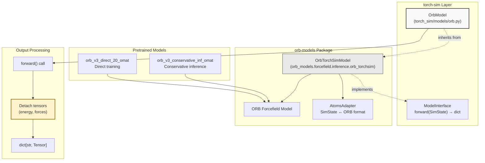
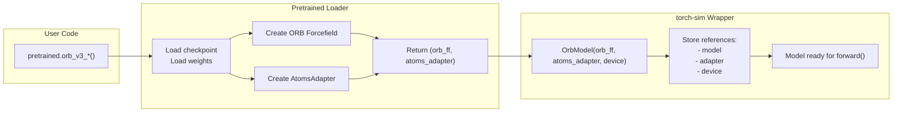
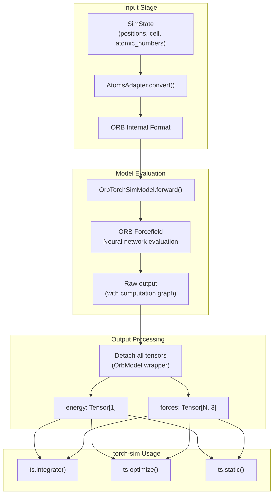
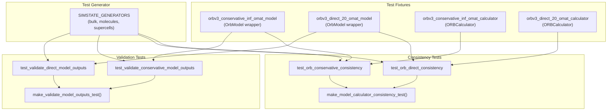

# ORB Models

<details>
<summary>Relevant source files</summary>

The following files were used as context for generating this wiki page:

- [tests/models/test_orb.py](tests/models/test_orb.py)
- [tests/models/test_sevennet.py](tests/models/test_sevennet.py)
- [tests/test_elastic.py](tests/test_elastic.py)
- [torch_sim/models/orb.py](torch_sim/models/orb.py)

</details>


This page describes the integration of ORB (Orbital Materials) models within torch-sim. ORB models are machine learning interatomic potentials trained on diverse materials datasets.

For general information about the model ecosystem and dependency management, see [Model Ecosystem Overview](#6.1). For testing strategies applicable to all models, see [Model Testing and Validation](#6.8).

## Overview

The ORB integration in torch-sim is a lightweight wrapper around the `orb-models` package maintained by Orbital Materials. The actual implementation resides in the upstream `orb-models` repository, and torch-sim re-exports it with minor modifications for compatibility.

**Key Characteristics:**
- **Dependency compatibility**: ORB is universally compatible with other MLIP models in torch-sim (no `e3nn` conflicts)
- **Capabilities**: Energy and forces computation (stress computation not currently supported)
- **Installation**: Optional dependency via `torch-sim[orb]` extra
- **Backend**: Uses `orb-models` package from Orbital Materials

Sources: [torch_sim/models/orb.py:1-47]()

## Installation

Install torch-sim with ORB support using:

```bash
pip install torch-sim[orb]
```

This installs the `orb-models` package from the Orbital Materials repository. ORB can be installed alongside other compatible models like `metatomic`, or independently.

Sources: [torch_sim/models/orb.py:1-8]()

## Model Architecture



Sources: [torch_sim/models/orb.py:16-28](), [tests/models/test_orb.py:14-16]()

## Model Initialization

The `OrbModel` class wraps the upstream `OrbTorchSimModel` and requires a forcefield model and atoms adapter obtained from the pretrained model loaders.

### Using Pretrained Models

The `orb-models` package provides a `pretrained` module for loading pre-configured models:

```python
from orb_models.forcefield import pretrained
from torch_sim.models.orb import OrbModel

# Load ORB v3 conservative inference model
orb_ff, atoms_adapter = pretrained.orb_v3_conservative_inf_omat(
    device="cuda",
    precision="float32-high"
)

model = OrbModel(orb_ff, atoms_adapter, device="cuda")
```

### Available Pretrained Models

| Model Name | Description | Use Case |
|------------|-------------|----------|
| `orb_v3_conservative_inf_omat` | Conservative inference model | Stable predictions with uncertainty awareness |
| `orb_v3_direct_20_omat` | Direct training (20-step) | Direct optimization workflow |

Sources: [tests/models/test_orb.py:24-36]()

### Model Initialization Flow



Sources: [tests/models/test_orb.py:24-36]()

## Model Interface Implementation

### Forward Pass

The `OrbModel.forward()` method accepts a `SimState` and returns energy and forces:

```python
output = model.forward(state)
# Returns: {"energy": Tensor, "forces": Tensor}
```

### Output Detachment

A key feature of the torch-sim wrapper is automatic tensor detachment. The upstream `OrbTorchSimModel` may return tensors with attached computation graphs, which can cause memory issues during long simulations. The wrapper detaches all outputs:

```python
def forward(self, *args, **kwargs):
    """Run forward pass, detaching outputs unless retain_graph is True."""
    output = super().forward(*args, **kwargs)
    return {
        k: v.detach() if hasattr(v, "detach") else v 
        for k, v in output.items()
    }
```

This prevents gradient accumulation across timesteps while maintaining numerical correctness.

Sources: [torch_sim/models/orb.py:22-27]()

## Data Flow



Sources: [torch_sim/models/orb.py:22-27]()

## Import Handling and Fallback

The module uses a try-except pattern to gracefully handle missing dependencies:

| Scenario | Behavior |
|----------|----------|
| `orb-models` installed | Import `OrbTorchSimModel` and create functional `OrbModel` wrapper |
| `orb-models` not installed | Create placeholder `OrbModel` that raises `ImportError` on instantiation |

This allows torch-sim code to import the module without errors while preventing runtime usage when the dependency is missing.

```python
try:
    from orb_models.forcefield.inference.orb_torchsim import OrbTorchSimModel
    
    class OrbModel(OrbTorchSimModel):
        # Functional implementation
        ...
        
except ImportError as exc:
    warnings.warn(f"Orb import failed: {traceback.format_exc()}", stacklevel=2)
    
    class OrbModel(ModelInterface):
        # Placeholder that raises ImportError
        def __init__(self, err=exc, *args, **kwargs):
            raise err
```

Sources: [torch_sim/models/orb.py:15-44]()

## Testing and Validation

### Test Structure

The ORB test suite validates both model variants against ASE's `ORBCalculator`:



Sources: [tests/models/test_orb.py:23-81]()

### Model-Calculator Consistency Tests

Consistency tests verify that `OrbModel` produces identical results to ASE's `ORBCalculator` for the same structures:

```python
test_orb_conservative_consistency = make_model_calculator_consistency_test(
    test_name="orbv3_conservative_inf_omat",
    model_fixture_name="orbv3_conservative_inf_omat_model",
    calculator_fixture_name="orbv3_conservative_inf_omat_calculator",
    sim_state_names=tuple(SIMSTATE_GENERATORS.keys()),
    energy_rtol=5e-5,
    energy_atol=5e-5,
)
```

These tests:
1. Load the same pretrained model in both torch-sim and ASE
2. Evaluate on all test structures (bulk crystals, molecules, supercells)
3. Compare energies and forces with tolerance `5e-5`

Sources: [tests/models/test_orb.py:57-73]()

### Output Validation Tests

Output validation tests check that the model produces properly formatted results:

```python
test_validate_conservative_model_outputs = make_validate_model_outputs_test(
    model_fixture_name="orbv3_conservative_inf_omat_model",
)
```

These verify:
- Energy is a scalar tensor
- Forces have shape `[N, 3]` matching number of atoms
- All tensors have correct dtype and device placement
- No NaN or Inf values in outputs

Sources: [tests/models/test_orb.py:75-81]()

### Test Fixtures

The test suite defines fixtures for both torch-sim and ASE interfaces:

| Fixture | Type | Purpose |
|---------|------|---------|
| `orbv3_conservative_inf_omat_model` | `OrbModel` | Conservative model for torch-sim integration tests |
| `orbv3_direct_20_omat_model` | `OrbModel` | Direct model for torch-sim integration tests |
| `orbv3_conservative_inf_omat_calculator` | `ORBCalculator` | Conservative model for ASE consistency validation |
| `orbv3_direct_20_omat_calculator` | `ORBCalculator` | Direct model for ASE consistency validation |

All fixtures use:
- Device: `DEVICE` (configurable via test infrastructure)
- Precision: `"float32-high"` for numerical accuracy

Sources: [tests/models/test_orb.py:24-54]()

## Usage Examples

### Molecular Dynamics

```python
import torch_sim as ts
from orb_models.forcefield import pretrained
from torch_sim.models.orb import OrbModel

# Load model
orb_ff, atoms_adapter = pretrained.orb_v3_conservative_inf_omat(
    device="cuda", precision="float32-high"
)
model = OrbModel(orb_ff, atoms_adapter, device="cuda")

# Initialize state from ASE
state = ts.atoms_to_state(atoms, device="cuda")

# Run NVT simulation
final_state, trajectory = ts.integrate(
    state=state,
    model=model,
    integrator="nvt_langevin",
    temperature=300.0,
    friction=0.01,
    timestep=1.0,
    steps=1000,
)
```

### Structure Optimization

```python
# Load model
orb_ff, atoms_adapter = pretrained.orb_v3_direct_20_omat(
    device="cuda", precision="float32-high"
)
model = OrbModel(orb_ff, atoms_adapter, device="cuda")

# Optimize structure
final_state, trajectory = ts.optimize(
    state=state,
    model=model,
    optimizer="fire",
    fmax=0.01,
    steps=500,
)
```

Sources: Based on integration pattern from [tests/models/test_orb.py:24-36]()

## Limitations and Considerations

| Aspect | Status | Notes |
|--------|--------|-------|
| **Stress computation** | Not supported | ORB models only provide energy and forces |
| **Periodic boundary conditions** | Supported | Handled by `AtomsAdapter` |
| **Charge/spin properties** | Not documented | Capability depends on upstream model training |
| **Batching** | Via autobatcher | Supports torch-sim's standard batching infrastructure |

### Stress Tensor Support

Unlike MACE and FairChem models, ORB does not currently expose stress tensor computation in the torch-sim integration. For NPT simulations or elastic property calculations, use alternative models like MACE (see [MACE Models](#6.2)).

Sources: Inferred from Diagram 2 in high-level architecture and absence in [torch_sim/models/orb.py:22-27]()

## Comparison with Other MLIP Models

| Feature | ORB | MACE | FairChem |
|---------|-----|------|----------|
| Energy | ✓ | ✓ | ✓ |
| Forces | ✓ | ✓ | ✓ |
| Stress | ✗ | ✓ | ✓ |
| Charge/Spin | ? | ✓ | ✓ |
| Dependency conflicts | None | e3nn group 2 | e3nn group 1 |
| Installation | `[orb]` | `[mace]` | `[fairchem]` |

Sources: Based on high-level architecture Diagram 2 and Diagram 6

## References

- **ORB Models Repository**: https://github.com/orbital-materials/orb-models
- **torch-sim Integration**: [torch_sim/models/orb.py]()
- **Testing Suite**: [tests/models/test_orb.py]()
- **Model Interface**: See [Model Interface](#3.2) for base abstraction

Sources: [torch_sim/models/orb.py:6-7]()

---