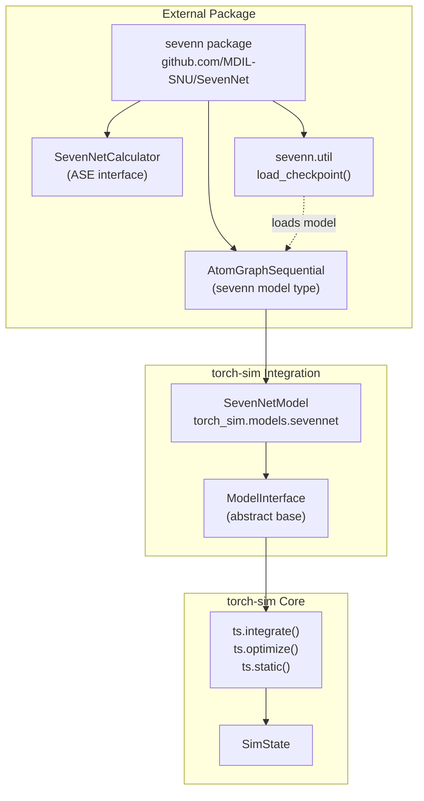
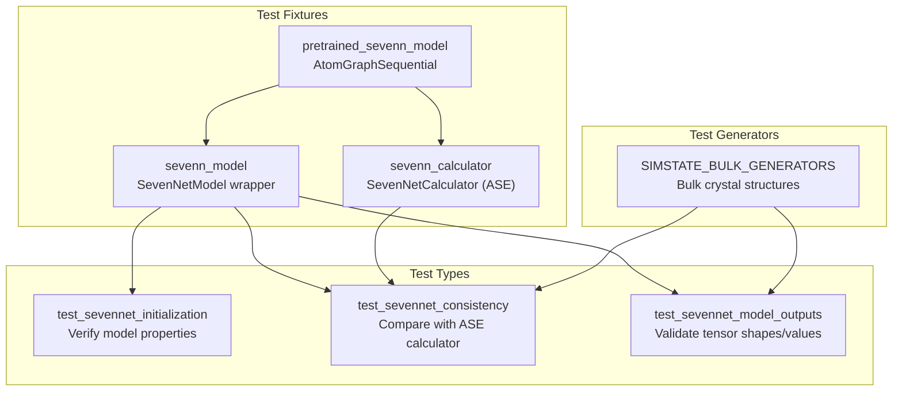

# SevenNet Models

<details>
<summary>Relevant source files</summary>

The following files were used as context for generating this wiki page:

- [tests/models/test_orb.py](tests/models/test_orb.py)
- [tests/models/test_sevennet.py](tests/models/test_sevennet.py)
- [tests/test_elastic.py](tests/test_elastic.py)
- [torch_sim/models/graphpes.py](torch_sim/models/graphpes.py)
- [torch_sim/models/orb.py](torch_sim/models/orb.py)
- [torch_sim/models/sevennet.py](torch_sim/models/sevennet.py)

</details>


This page describes the integration of SevenNet models into torch-sim. SevenNet is a machine learning interatomic potential (MLIP) developed by MDIL-SNU that provides energy, force, and stress predictions for atomistic systems. The torch-sim integration wraps the `sevenn` package to provide a unified interface through the `ModelInterface` abstraction.

For information about other MLIP integrations, see [Other MLIP Integrations](#6.6). For classical potentials, see [Classical Potentials](#6.7). For general model interface documentation, see [Model Interface](#3.2).

## Purpose and Scope

The SevenNet integration provides:
- A wrapper class `SevenNetModel` that implements the torch-sim `ModelInterface`
- Support for loading pretrained SevenNet models from checkpoints
- Modal-based task specification for different property predictions
- Compatibility with torch-sim's batching, trajectory logging, and simulation workflows

The actual model implementation is maintained in the external `sevenn` package. This module serves as a thin integration layer.

**Sources:** [torch_sim/models/sevennet.py:1-36]()

## Installation

SevenNet models are available as an optional dependency. Install with:

```bash
pip install torch-sim[sevenn]
```

This installs the `sevenn` package along with its dependencies. SevenNet is part of dependency Group 3 (compatible with MatterSim and NequIP) due to shared `e3nn` version requirements.

If `sevenn` is not installed, importing `SevenNetModel` will still succeed but instantiation will raise an `ImportError` with the original exception message.

**Sources:** [torch_sim/models/sevennet.py:15-32]()

## Integration Architecture

The SevenNet integration follows torch-sim's model wrapping pattern:



**Component Roles:**

| Component | Type | Purpose |
|-----------|------|---------|
| `SevenNetModel` | Wrapper Class | Adapts sevenn models to `ModelInterface` |
| `AtomGraphSequential` | External Model | Native sevenn model type from the package |
| `SevenNetCalculator` | ASE Calculator | Reference implementation for validation |
| `sevenn.util.load_checkpoint()` | Loader Function | Loads pretrained model checkpoints |

**Sources:** [torch_sim/models/sevennet.py:1-36](), [tests/models/test_sevennet.py:14-26]()

## Model Initialization Workflow

Loading a SevenNet model involves two stages: checkpoint loading and wrapper instantiation.

```mermaid
flowchart LR
    subgraph "Stage 1: Load Checkpoint"
        CKPT["Model checkpoint name<br/>'sevennet-mf-ompa'"]
        LOAD["sevenn.util.load_checkpoint()"]
        CP["Checkpoint object"]
        BUILD["checkpoint.build_model()"]
        NATIVE["AtomGraphSequential<br/>(native model)"]
    end
    
    subgraph "Stage 2: Configure & Wrap"
        BATCH["model.set_is_batch_data(True)"]
        DEVICE["model.to(device)"]
        WRAP["SevenNetModel(model, modal, device)"]
        READY["torch-sim compatible model"]
    end
    
    CKPT --> LOAD
    LOAD --> CP
    CP --> BUILD
    BUILD --> NATIVE
    NATIVE --> BATCH
    BATCH --> DEVICE
    DEVICE --> WRAP
    WRAP --> READY
```



### Loading Pretrained Models

The typical pattern for loading a pretrained SevenNet model:

```python
import sevenn.util
from torch_sim.models.sevennet import SevenNetModel

# Load checkpoint
checkpoint = sevenn.util.load_checkpoint("sevennet-mf-ompa")

# Build native model
model = checkpoint.build_model()

# Configure for batched inference
model.set_is_batch_data(True)

# Move to device
model = model.to("cuda")

# Wrap for torch-sim
sevenn_model = SevenNetModel(
    model=model,
    modal="mpa",  # Task-specific modal
    device="cuda"
)
```

**Required Configuration Steps:**

1. **`build_model()`**: Constructs the model from checkpoint metadata
2. **`set_is_batch_data(True)`**: Enables batched processing required by torch-sim
3. **`to(device)`**: Moves model parameters to target device before wrapping
4. **`SevenNetModel()` constructor**: Wraps native model with torch-sim interface

**Sources:** [tests/models/test_sevennet.py:34-47]()

## SevenNetModel Class

### Constructor Parameters

```python
SevenNetModel(
    model: AtomGraphSequential,  # Native sevenn model
    modal: str,                   # Task specification
    device: str | torch.device    # Computation device
)
```

| Parameter | Type | Description |
|-----------|------|-------------|
| `model` | `AtomGraphSequential` | Pre-loaded and configured sevenn model |
| `modal` | `str` | Modal identifier specifying the task type (e.g., "mpa", "omat24") |
| `device` | `str` or `torch.device` | Device for computation ("cuda" or "cpu") |

**Sources:** [tests/models/test_sevennet.py:45-47]()

### Forward Method

The `forward` method implements the `ModelInterface` contract:

```python
def forward(state: SimState) -> dict[str, torch.Tensor]:
    """
    Returns:
        dict with keys:
            - "energy": Total energy [n_systems]
            - "forces": Atomic forces [n_atoms, 3]
            - "stress": Stress tensor [n_systems, 3, 3] (if supported)
    """
```

The implementation is provided by the `sevenn.torchsim` module and handles:
- Conversion from `SimState` to sevenn's internal graph representation
- Model evaluation with the specified modal
- Extraction of energy, forces, and stress from model outputs

**Sources:** [torch_sim/models/sevennet.py:16]()

## Modal Types

The `modal` parameter specifies the task type and determines which properties the model predicts. Common modals include:

| Modal | Description | Typical Use Case |
|-------|-------------|------------------|
| `"mpa"` | Multi-property atomic | General-purpose materials prediction |
| `"omat24"` | OpenCatalyst materials (2024) | Materials property prediction |
| `"omol"` | OpenCatalyst molecular | Molecular systems |

The modal should match the checkpoint's training configuration. Using an incorrect modal may result in runtime errors or unreliable predictions.

**Sources:** [tests/models/test_sevennet.py:28-29](), [tests/models/test_sevennet.py:58-61]()

## Usage in Simulations

Once initialized, `SevenNetModel` can be used with any torch-sim workflow:

### Molecular Dynamics

```python
import torch_sim as ts

# Initialize state
state = ts.initialize_state(atoms, dtype=torch.float32, device="cuda")

# Run NVT simulation
trajectory = ts.integrate(
    state=state,
    model=sevenn_model,
    integrator="nvt_langevin",
    temperature=300.0,
    time_step=1.0,
    n_steps=1000
)
```

### Structure Optimization

```python
# Relax structure
optimized_state = ts.optimize(
    state=state,
    model=sevenn_model,
    optimizer="fire",
    fmax=1e-3,
    max_steps=500
)
```

### Static Calculations

```python
# Single-point energy/force evaluation
results = ts.static(
    state=state,
    model=sevenn_model
)
energy = results["energy"]
forces = results["forces"]
stress = results["stress"]
```

**Sources:** [tests/models/test_sevennet.py:66-77]()

## Capabilities and Limitations

### Supported Features

| Feature | Support | Notes |
|---------|---------|-------|
| Energy Prediction | ✓ | Total system energy |
| Force Prediction | ✓ | Per-atom forces |
| Stress Prediction | ✓ | Cell stress tensor |
| Batched Systems | ✓ | Requires `set_is_batch_data(True)` |
| GPU Acceleration | ✓ | CUDA-compatible |
| Molecular Systems | ⚠️ | See limitations below |

### Known Limitations

**Molecular System Stress**: SevenNet models exhibit numerical instability in stress predictions for molecular systems, specifically in the off-diagonal xy component when computing stress via the epsilon volume method. This is a known issue tracked at https://github.com/MDIL-SNU/SevenNet/issues/212.

Due to this limitation, torch-sim's SevenNet tests only validate bulk crystalline systems using `SIMSTATE_BULK_GENERATORS` and exclude molecular systems:

```python
# From tests/models/test_sevennet.py:64-72
# NOTE: we do not test on the molecule sim states due to eps volume giving 
# numerically unstable stress off diagonal in xy. 
# See: https://github.com/MDIL-SNU/SevenNet/issues/212

test_sevennet_consistency = make_model_calculator_consistency_test(
    sim_state_names=tuple(SIMSTATE_BULK_GENERATORS.keys()),  # Bulk only
    # ...
)
```

**Recommendation**: For simulations requiring accurate stress tensors (e.g., NPT dynamics), use bulk crystalline systems. For molecular systems, consider using energy and forces only, or alternative models.

**Sources:** [tests/models/test_sevennet.py:64-72]()

## Testing and Validation

### Test Structure

The SevenNet integration includes comprehensive tests validating:

1. **Model Initialization**: Correct construction and configuration
2. **Calculator Consistency**: Agreement with `SevenNetCalculator` (ASE reference)
3. **Output Validation**: Energy, force, and stress tensor shapes and properties



### Test Factory Usage

Tests are generated using factory functions from the model testing framework:

```python
# Consistency test with ASE calculator
test_sevennet_consistency = make_model_calculator_consistency_test(
    test_name="sevennet",
    model_fixture_name="sevenn_model",
    calculator_fixture_name="sevenn_calculator",
    sim_state_names=tuple(SIMSTATE_BULK_GENERATORS.keys()),
    dtype=torch.float32
)

# Output validation test
test_sevennet_model_outputs = make_validate_model_outputs_test(
    model_fixture_name="sevenn_model",
    dtype=torch.float32
)
```

**Test Coverage:**

| Test Type | Purpose | File Reference |
|-----------|---------|----------------|
| Initialization | Verify modal and device assignment | [tests/models/test_sevennet.py:56-62]() |
| Consistency | Compare with ASE calculator outputs | [tests/models/test_sevennet.py:66-72]() |
| Output Validation | Check tensor shapes and properties | [tests/models/test_sevennet.py:75-77]() |

**Sources:** [tests/models/test_sevennet.py:1-78]()

## Comparison with Other MLIP Integrations

The SevenNet integration follows the same pattern as other external MLIP packages:

| Model | Integration Style | External Package | Modal Support |
|-------|------------------|------------------|---------------|
| SevenNet | Re-export from external | `sevenn` | Yes (modal parameter) |
| ORB | Re-export from external | `orb-models` | No |
| MACE | Direct integration | `mace-torch` | No (charge/spin instead) |
| FairChem | Direct integration | `fairchem-core` | Yes (task parameter) |

All integrations provide:
- `ModelInterface` implementation with `forward(state: SimState) -> dict` method
- Energy, force, and stress computation
- Graceful import failure handling (dummy class with ImportError)

The key distinguishing features of SevenNet are:
1. **Batch mode requirement**: Must call `set_is_batch_data(True)` before use
2. **Modal-based task specification**: Similar to FairChem's task system
3. **Bulk-optimized**: Best performance on crystalline systems

**Sources:** [torch_sim/models/sevennet.py:1-36](), [torch_sim/models/orb.py:1-47]()

---