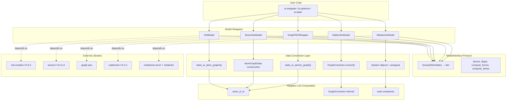
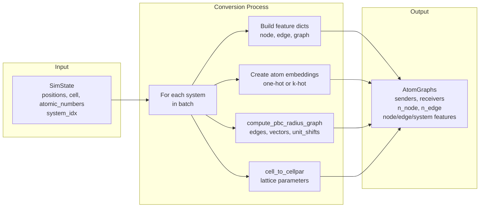
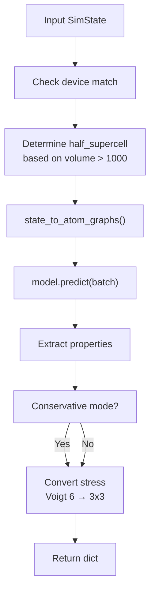
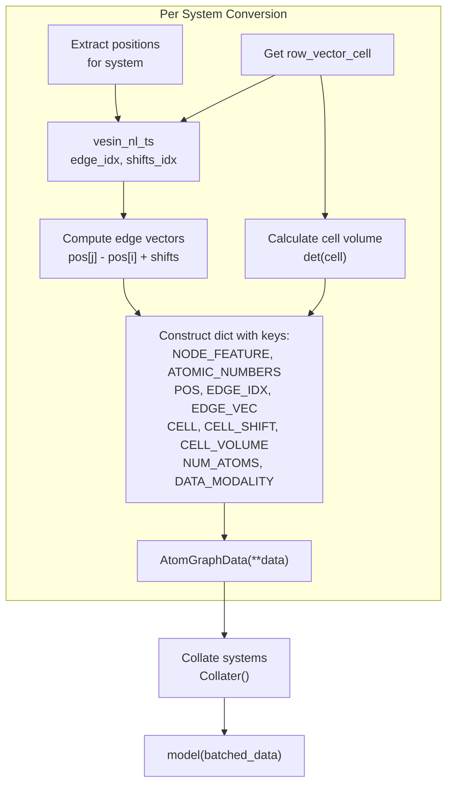
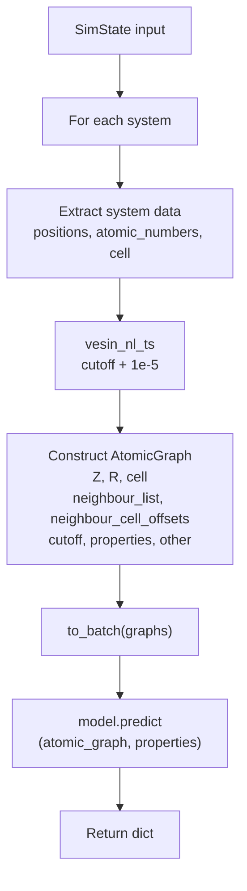
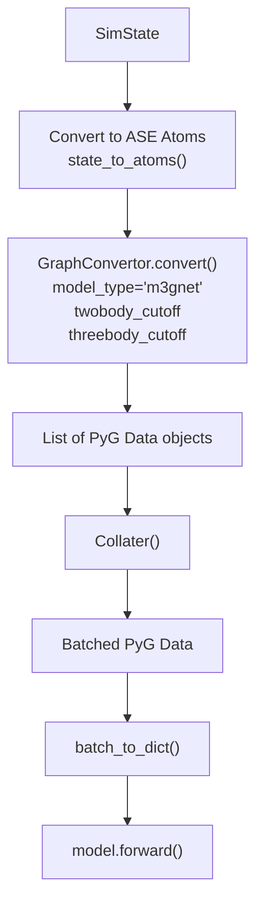
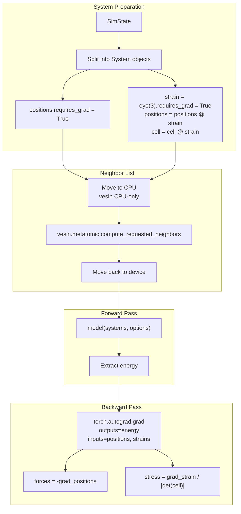

# Other Model Integrations

<details>
<summary>Relevant source files</summary>

The following files were used as context for generating this wiki page:

- [.github/workflows/test.yml](.github/workflows/test.yml)
- [README.md](README.md)
- [pyproject.toml](pyproject.toml)
- [tests/models/test_orb.py](tests/models/test_orb.py)
- [tests/models/test_sevennet.py](tests/models/test_sevennet.py)
- [tests/test_elastic.py](tests/test_elastic.py)
- [torch_sim/models/orb.py](torch_sim/models/orb.py)

</details>


This page documents TorchSim's integration with five additional Machine Learning Interatomic Potential (MLIP) frameworks: ORB, SevenNet, GraphPES, MatterSim, and Metatomic. These integrations complement the primary MACE and FairChem models covered in [5.2](#5.2) and [5.3](#5.3). Each wrapper provides specialized data conversion, neighbor list handling, and configuration options tailored to the specific requirements of its underlying MLIP library.

For the general model interface protocol that all wrappers implement, see [5.1](#5.1). For model testing and validation strategies, see [5.5](#5.5).

## Model Comparison Overview

The following table summarizes the key characteristics and requirements of each model integration:

| Model | Wrapper Class | Data Format | Neighbor List Strategy | Default dtype | Notable Features |
|-------|--------------|-------------|----------------------|---------------|------------------|
| **ORB** | `OrbModel` | `AtomGraphs` | vesin_nl_ts or internal | float32 | Conservative forces/stress option, half-supercell optimization |
| **SevenNet** | `SevenNetModel` | `AtomGraphData` | vesin_nl_ts | float32 (only) | Multi-modal support (mpa, omat24) |
| **GraphPES** | `GraphPESWrapper` | `AtomicGraph` | vesin_nl_ts | float64 | Supports multiple architectures (SchNet, PaiNN, MACE, etc.) |
| **MatterSim** | `MatterSimModel` | PyG `Data` | Internal (GraphConvertor) | float32 | M3GNet-based, requires stress weight conversion |
| **Metatomic** | `MetatomicModel` | `System` | vesin.metatomic | Model-specific | Autograd-based forces/stress, PET-MAD pre-defined model |

**Sources:** [torch_sim/models/orb.py:250-274](), [torch_sim/models/sevennet.py:47-59](), [torch_sim/models/graphpes.py:95-124](), [torch_sim/models/mattersim.py:42-53](), [torch_sim/models/metatomic.py:51-61]()

## Integration Architecture

The following diagram illustrates how each model wrapper integrates with TorchSim's core simulation engine:



**Sources:** [torch_sim/models/orb.py:1-14](), [torch_sim/models/sevennet.py:1-14](), [torch_sim/models/graphpes.py:1-14](), [torch_sim/models/mattersim.py:1-14](), [torch_sim/models/metatomic.py:1-12]()

## ORB Integration

### OrbModel Wrapper

The `OrbModel` class wraps ORB (Orbital-based) models, which use graph neural networks to predict energies and forces. ORB models can be loaded from model objects or checkpoint files.

**Key initialization parameters:**

```python
model = OrbModel(
    model: GraphRegressor | ConservativeForcefieldRegressor | str | Path,
    conservative: bool | None = None,  # Use conservative force calculation
    compute_stress: bool = True,
    compute_forces: bool = True,
    system_config: SystemConfig | None = None,  # radius=6.0, max_num_neighbors=20
    max_num_neighbors: int | None = None,
    edge_method: EdgeCreationMethod | None = None,
    half_supercell: bool | None = None,  # Optimization for large systems
    device: torch.device | str | None = None,
    dtype: torch.dtype = torch.float32,
)
```

**Sources:** [torch_sim/models/orb.py:275-313]()

### Data Format Conversion

ORB models require input in the `AtomGraphs` format. The conversion function `state_to_atom_graphs()` handles the transformation:



The conversion occurs at [torch_sim/models/orb.py:64-248]() and handles:
- **Atom embeddings**: One-hot encoding or k-hot diffusion (based on `system_config.diffuse_atom_types`)
- **PBC wrapping**: Optional wrapping to central unit cell via `batch_map_to_pbc_cell`
- **Neighbor list**: Uses `compute_pbc_radius_graph` from ORB's featurization utilities
- **Batch processing**: Processes each system separately, then concatenates edges and features

**Sources:** [torch_sim/models/orb.py:64-248]()

### Conservative Force Calculation

ORB supports two modes for force and stress calculation:

1. **Direct prediction**: Model has explicit `forces` and `stress` output heads
2. **Conservative mode**: Forces/stresses computed as gradients of energy (for `ConservativeForcefieldRegressor` models)

The wrapper detects the model type automatically via `hasattr(self.model, "grad_forces_name")` at [torch_sim/models/orb.py:348-356]().

**Sources:** [torch_sim/models/orb.py:348-364](), [torch_sim/models/orb.py:428-430]()

### Forward Pass Implementation



**Sources:** [torch_sim/models/orb.py:365-439]()

## SevenNet Integration

### SevenNetModel Wrapper

SevenNet is an E(3)-equivariant graph neural network model that supports multi-modal (multi-fidelity) training. The wrapper handles both single-fidelity and multi-modal models.

**Key initialization parameters:**

```python
model = SevenNetModel(
    model: AtomGraphSequential,  # Loaded SevenNet model
    modal: str | None = None,  # 'mpa' or 'omat24' for 7net-mf-ompa
    neighbor_list_fn: Callable = vesin_nl_ts,
    device: torch.device | str | None = None,
    dtype: torch.dtype = torch.float32,  # Only float32 supported
)
```

**Important constraint**: SevenNet models currently only support `torch.float32`. Attempting to use a different dtype raises a warning at [torch_sim/models/sevennet.py:98-104]().

**Sources:** [torch_sim/models/sevennet.py:60-89]()

### Multi-Modal Support

For multi-modal models (e.g., `7net-mf-ompa`), the `modal` parameter is required:

- `modal='mpa'`: Use MPtrj + sAlex training data fidelity
- `modal='omat24'`: Use OMat24 training data fidelity

The wrapper validates modal configuration at initialization [torch_sim/models/sevennet.py:125-138]():

```python
modal_map = self.model.modal_map
if modal_map:
    if not modal:
        raise ValueError(f"modal argument missing (avail: {modal_ava})")
    if modal not in modal_ava:
        raise ValueError(f"unknown modal {modal} (not in {modal_ava})")
```

**Sources:** [torch_sim/models/sevennet.py:125-138]()

### Data Format Conversion

SevenNet uses the `AtomGraphData` format from `torch_geometric`. The conversion process:



The implementation at [torch_sim/models/sevennet.py:182-220]() constructs a list of `AtomGraphData` objects, one per system, then collates them into a batch using PyTorch Geometric's `Collater`.

**Sources:** [torch_sim/models/sevennet.py:148-258]()

### Output Processing

SevenNet models output energies, forces, and stresses in Voigt notation. The wrapper:

1. Extracts total energy from `output[key.PRED_TOTAL_ENERGY]`
2. Extracts forces from `output[key.PRED_FORCE]`
3. Converts stress from Voigt-6 to full 3×3 tensor with sign correction: `-voigt_6_to_full_3x3_stress(stress[..., [0, 1, 2, 4, 5, 3]])`

The reordering `[0, 1, 2, 4, 5, 3]` is necessary to match SevenNet's Voigt convention at [torch_sim/models/sevennet.py:254-256]().

**Sources:** [torch_sim/models/sevennet.py:239-257]()

## GraphPES Integration

### GraphPESWrapper

GraphPES is a flexible training framework that supports multiple architectures (SchNet, PaiNN, MACE, NequIP, TensorNet, EDDP). The wrapper accepts any `GraphPESModel` instance.

**Key initialization parameters:**

```python
wrapper = GraphPESWrapper(
    model: GraphPESModel | str | Path,  # Model instance or path to .pt file
    device: torch.device | None = None,
    dtype: torch.dtype = torch.float64,  # Default to float64
    compute_forces: bool = True,
    compute_stress: bool = True,
)
```

**Sources:** [torch_sim/models/graphpes.py:126-143]()

### Supported Architectures

According to the documentation at [torch_sim/models/graphpes.py:101-104](), GraphPES supports:

- **SchNet**: Continuous-filter convolutional neural network
- **PaiNN**: Polarizable atom interaction neural network
- **MACE**: Multi-Atomic Cluster Expansion
- **NequIP**: E(3)-equivariant neural network
- **TensorNet**: Tensor field networks
- **EDDP**: Energy-derivative decomposition potentials

All models trained with `graph-pes` can be loaded via `load_model()` from the graph-pes package.

**Sources:** [torch_sim/models/graphpes.py:95-124]()

### Data Format Conversion



The conversion function `state_to_atomic_graph()` at [torch_sim/models/graphpes.py:57-92]() handles the transformation. Note the cutoff bump (`cutoff + 1e-5`) to avoid edge effects where atoms at exactly the cutoff distance might be inconsistently included/excluded.

**Sources:** [torch_sim/models/graphpes.py:57-92](), [torch_sim/models/graphpes.py:165-179]()

### Memory Optimization

GraphPES models with very short cutoffs (< 0.5 Å) have memory scaling primarily with `n_atoms` rather than `n_atoms × density`. The wrapper detects this at initialization:

```python
if self._gp_model.cutoff.item() < 0.5:
    self._memory_scales_with = "n_atoms"
```

**Sources:** [torch_sim/models/graphpes.py:162-163]()

## MatterSim Integration

### MatterSimModel Wrapper

MatterSim is an M3GNet-based universal model trained on diverse materials data. The wrapper handles the specific data format and unit conversions required by MatterSim.

**Key initialization parameters:**

```python
model = MatterSimModel(
    model: Potential,  # MatterSim Potential instance
    stress_weight: float = MetalUnits.pressure * 1e4,  # ~160.21766208 GPa
    device: torch.device | str | None = None,
    dtype: torch.dtype | None = None,  # Defaults to float32
)
```

**Stress unit handling**: MatterSim requires a `stress_weight` parameter to convert stress units. The default matches ASE's GPa unit (10 kbar) at [torch_sim/models/mattersim.py:59]().

**Sources:** [torch_sim/models/mattersim.py:55-74]()

### Data Conversion via GraphConvertor

MatterSim uses a specialized `GraphConvertor` for data preparation:



The conversion at [torch_sim/models/mattersim.py:144-152]() goes through ASE as an intermediate format, then uses MatterSim's built-in `GraphConvertor` to create PyTorch Geometric graphs.

**Configuration**: The `GraphConvertor` is initialized with:
- `model_type="m3gnet"`
- Two-body and three-body cutoffs from `model.model.model_args`
- `has_threebody=True` for triplet interactions

**Sources:** [torch_sim/models/mattersim.py:96-106](), [torch_sim/models/mattersim.py:113-159]()

### Memory Scaling

MatterSim models use three-body interactions (triplets), so memory scales approximately with density squared. The wrapper sets `_memory_scales_with = "n_atoms_x_density"` with a comment noting it should theoretically be `density^2` at [torch_sim/models/mattersim.py:84]().

**Sources:** [torch_sim/models/mattersim.py:84]()

## Metatomic Integration

### MetatomicModel Wrapper

Metatomic provides a unified interface for models trained with `metatrain`. The TorchSim wrapper supports automatic differentiation-based force and stress calculation.

**Key initialization parameters:**

```python
model = MetatomicModel(
    model: str | Path | None = None,  # Path to .ckpt/.pt or "pet-mad"
    extensions_path: str | Path | None = None,  # For compiled extensions
    device: torch.device | str | None = None,
    check_consistency: bool = False,  # Performance penalty if enabled
    compute_forces: bool = True,
    compute_stress: bool = True,
)
```

**Pre-defined models**: The wrapper supports `model="pet-mad"` as a shorthand for loading the PET-MAD model (https://arxiv.org/abs/2503.14118) from HuggingFace at [torch_sim/models/metatomic.py:105-107]().

**Sources:** [torch_sim/models/metatomic.py:63-96]()

### Autograd-Based Forces and Stresses

Unlike other models, Metatomic computes forces and stresses via automatic differentiation rather than direct prediction:



The implementation at [torch_sim/models/metatomic.py:194-291]() uses:
1. `positions.requires_grad_()` for force calculation
2. Strain tensor `torch.eye(3, requires_grad=True)` for stress calculation
3. `torch.autograd.grad()` to compute derivatives
4. Stress normalization by cell volume: `stress = grad_strain / |det(cell)|`

**Sources:** [torch_sim/models/metatomic.py:145-291]()

### Neighbor List Computation

Metatomic uses `vesin.metatomic.compute_requested_neighbors()` which:
- Currently only supports CPU computation
- Automatically determines required neighbor lists from model capabilities
- Systems are temporarily moved to CPU, neighbors computed, then moved back to GPU

The neighbor list computation occurs at [torch_sim/models/metatomic.py:226-232]():

```python
# move data to CPU because vesin only supports CPU for now
systems = [system.to(device="cpu") for system in systems]
vesin.metatomic.compute_requested_neighbors(
    systems, system_length_unit="Angstrom", model=self._model
)
# move back to the proper device
systems = [system.to(device=self.device) for system in systems]
```

**Sources:** [torch_sim/models/metatomic.py:224-232]()

### Model Capabilities and Validation

The wrapper validates model capabilities at initialization:

1. **Energy output**: Required (`model.capabilities().outputs` must include "energy")
2. **Device support**: Model must support requested device
3. **dtype**: Automatically detected from `model.capabilities().dtype`

Validation occurs at [torch_sim/models/metatomic.py:117-134]().

**Sources:** [torch_sim/models/metatomic.py:99-143]()

## Usage Examples

### Basic Model Loading and Inference

```python
# ORB Model
from torch_sim.models.orb import OrbModel
orb_model = OrbModel(model="path/to/orb_model.pt", device="cuda")

# SevenNet Model (multi-modal)
from torch_sim.models.sevennet import SevenNetModel
sevennet_model = SevenNetModel(model=loaded_model, modal="omat24")

# GraphPES Model
from torch_sim.models.graphpes import GraphPESWrapper
graphpes_model = GraphPESWrapper(model="path/to/model.pt", compute_stress=True)

# MatterSim Model
from torch_sim.models.mattersim import MatterSimModel
mattersim_model = MatterSimModel(model=potential, stress_weight=160.21766208)

# Metatomic Model (PET-MAD)
from torch_sim.models.metatomic import MetatomicModel
metatomic_model = MetatomicModel(model="pet-mad")
```

See [examples/tutorials/metatomic_tutorial.py]() and [examples/tutorials/using_graphpes_tutorial.py]() for complete tutorials.

**Sources:** [examples/tutorials/metatomic_tutorial.py:26-29](), [examples/tutorials/using_graphpes_tutorial.py:49-56]()

## Error Handling and Import Guards

All model wrappers implement graceful fallback when dependencies are missing:

```python
try:
    from external_library import ModelClass
except ImportError as exc:
    warnings.warn(f"Library import failed: {traceback.format_exc()}", stacklevel=2)
    
    class ModelWrapper(ModelInterface):
        def __init__(self, err: ImportError = exc, *_args, **_kwargs):
            raise err
```

This pattern is implemented in:
- [torch_sim/models/orb.py:31-52]()
- [torch_sim/models/sevennet.py:25-44]()
- [torch_sim/models/graphpes.py:29-54]()
- [torch_sim/models/mattersim.py:16-33]()
- [torch_sim/models/metatomic.py:27-48]()

**Sources:** [torch_sim/models/orb.py:31-52](), [torch_sim/models/sevennet.py:25-44](), [torch_sim/models/graphpes.py:29-54](), [torch_sim/models/mattersim.py:16-33](), [torch_sim/models/metatomic.py:27-48]()

## Testing and Validation

Each model wrapper includes comprehensive tests following the pattern defined in [5.5](#5.5):

| Model | Test Module | Key Fixtures | Consistency Tests |
|-------|-------------|--------------|-------------------|
| ORB | Not shown in files | - | - |
| SevenNet | Not shown in files | - | - |
| GraphPES | Not shown in files | - | - |
| MatterSim | `test_mattersim.py` | `pretrained_mattersim_model`, `mattersim_calculator` | ASE calculator consistency |
| Metatomic | `test_metatomic.py` | `metatomic_model`, `metatomic_calculator` | ASE calculator consistency |

The test modules use factories `make_model_calculator_consistency_test()` and `make_validate_model_outputs_test()` to generate parameterized tests across multiple structures.

**Sources:** [tests/models/test_mattersim.py:1-71](), [tests/models/test_metatomic.py:1-64]()

## Installation Requirements

Install these models as optional dependencies:

```bash
# ORB
pip install torch-sim[orb]

# SevenNet  
pip install torch-sim[sevennet]

# GraphPES
pip install torch-sim[graphpes]

# MatterSim
pip install torch-sim[mattersim]

# Metatomic
pip install torch-sim[metatomic]
```

See [2.1](#2.1) for dependency conflict resolution strategies when using multiple models simultaneously.

**Sources:** Based on optional dependency patterns shown in model import guards.

---