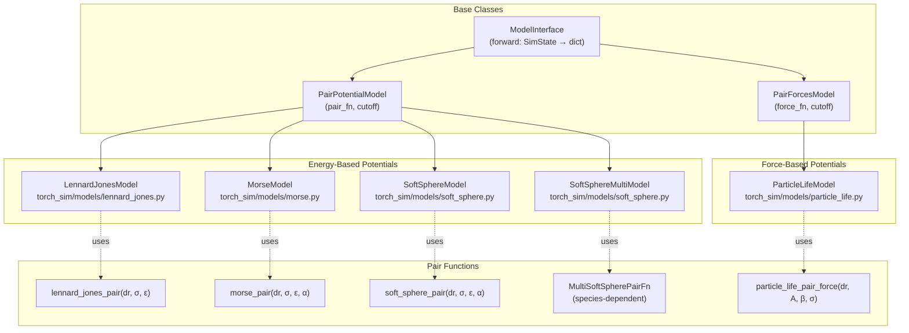
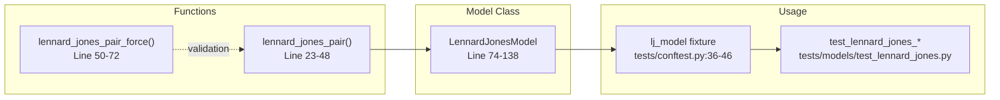
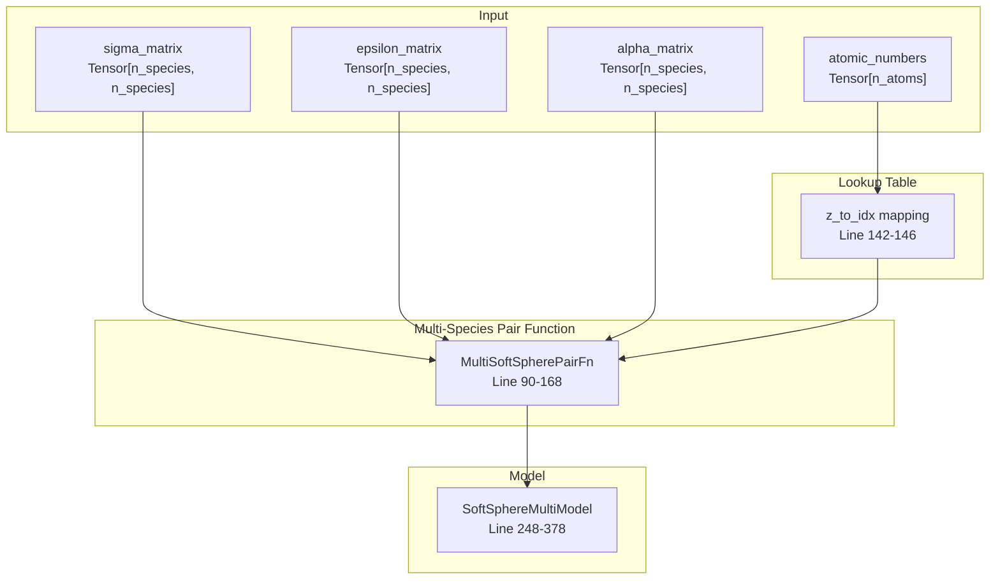
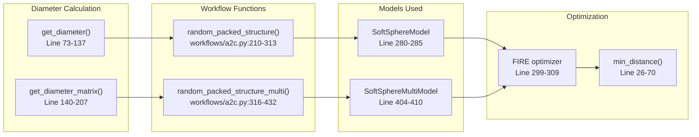
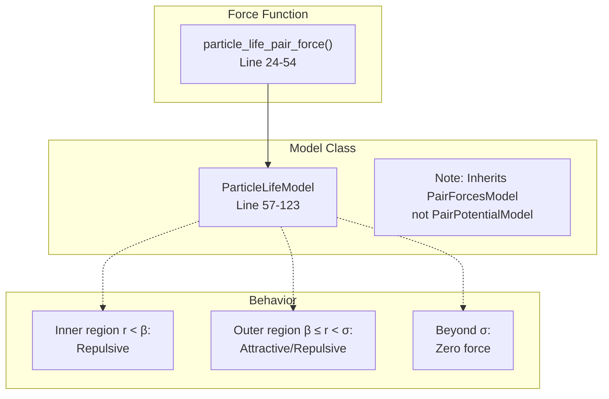
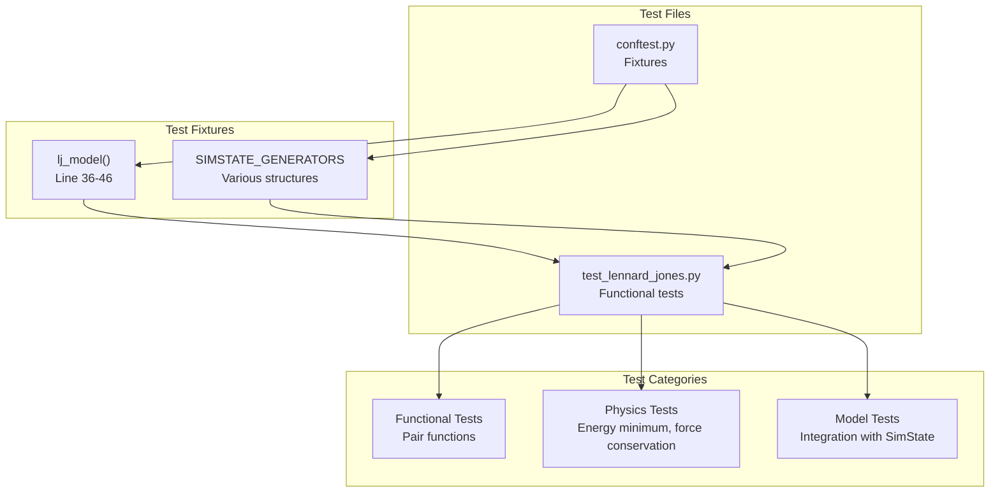

# Classical Potentials

<details>
<summary>Relevant source files</summary>

The following files were used as context for generating this wiki page:

- [tests/conftest.py](tests/conftest.py)
- [tests/models/test_lennard_jones.py](tests/models/test_lennard_jones.py)
- [tests/models/test_mace.py](tests/models/test_mace.py)
- [torch_sim/io.py](torch_sim/io.py)
- [torch_sim/models/lennard_jones.py](torch_sim/models/lennard_jones.py)
- [torch_sim/models/morse.py](torch_sim/models/morse.py)
- [torch_sim/models/particle_life.py](torch_sim/models/particle_life.py)
- [torch_sim/models/soft_sphere.py](torch_sim/models/soft_sphere.py)
- [torch_sim/workflows/a2c.py](torch_sim/workflows/a2c.py)

</details>


This page documents the built-in classical force fields available in torch-sim. These potentials are always available without additional dependencies and are primarily used for rapid prototyping, structure generation, and testing. For machine learning interatomic potentials (MLIPs), see [Model Ecosystem Overview](#6.1).

## Overview

torch-sim provides four classical pair potentials implemented as PyTorch models:

| Model | Primary Use Case | Energy Function | Multi-Species |
|-------|------------------|-----------------|---------------|
| `LennardJonesModel` | Noble gases, van der Waals systems | 12-6 potential | No |
| `MorseModel` | Covalent bonds, diatomics | Exponential well | No |
| `SoftSphereModel` | Overlap removal, random packing | Repulsive power law | Yes (`SoftSphereMultiModel`) |
| `ParticleLifeModel` | Artificial life simulations | Asymmetric forces | No |

All classical potentials are built on the pair potential framework defined in `torch_sim.models.pair_potential` and support forces, stress tensors, and GPU acceleration. They do not require external model files or training data.

**Sources:** [torch_sim/models/lennard_jones.py:1-142](), [torch_sim/models/morse.py:1-145](), [torch_sim/models/soft_sphere.py:1-378](), [torch_sim/models/particle_life.py:1-123]()

## Architecture

### Class Hierarchy



**Sources:** [torch_sim/models/lennard_jones.py:74-138](), [torch_sim/models/morse.py:78-145](), [torch_sim/models/soft_sphere.py:175-246](), [torch_sim/models/soft_sphere.py:248-378](), [torch_sim/models/particle_life.py:57-123]()

### Base Class Pattern

Classical potentials follow a two-layer design:

1. **Pair function layer**: Pure functions computing pair energies or forces from scalar distances
   - Signature: `(dr: Tensor, zi: Tensor, zj: Tensor, **params) → Tensor`
   - Examples: `lennard_jones_pair`, `morse_pair`, `soft_sphere_pair`

2. **Model wrapper layer**: `ModelInterface` implementations handling neighbor lists, batching, and autograd
   - Inherit from `PairPotentialModel` (energy-based) or `PairForcesModel` (force-based)
   - Examples: `LennardJonesModel`, `MorseModel`, `ParticleLifeModel`

This separation allows pair functions to be used independently or composed into custom potentials.

**Sources:** [torch_sim/models/lennard_jones.py:23-48](), [torch_sim/models/pair_potential.py]() (implied from inheritance patterns)

## Lennard-Jones Potential

### Functional Form

The Lennard-Jones 12-6 potential represents van der Waals interactions:

```
V(r) = 4ε[(σ/r)¹² - (σ/r)⁶]
F(r) = 24ε/r [2(σ/r)¹² - (σ/r)⁶]
```

**Parameters:**
- `σ` (sigma): Length scale where V(r) = 0 (Å)
- `ε` (epsilon): Depth of the potential well (eV)
- `cutoff`: Interaction cutoff radius (Å), defaults to 2.5σ

**Physical interpretation:** Minimum occurs at r = 2^(1/6)σ ≈ 1.122σ with energy -ε.

**Sources:** [torch_sim/models/lennard_jones.py:23-48](), [tests/models/test_lennard_jones.py:17-32]()

### Implementation



**Sources:** [torch_sim/models/lennard_jones.py:23-138](), [tests/conftest.py:36-46]()

### Usage Example

```python
# Initialize model for Argon (typical parameters)
model = LennardJonesModel(
    sigma=3.405,      # Argon atom diameter in Å
    epsilon=0.0104,   # Well depth in eV
    cutoff=2.5 * 3.405,  # 8.5 Å cutoff
    compute_forces=True,
    compute_stress=True,
    dtype=torch.float64
)

# Evaluate on a SimState
results = model(sim_state)
# Returns: {"energy": Tensor[n_systems], 
#           "forces": Tensor[n_atoms, 3],
#           "stress": Tensor[n_systems, 3, 3]}
```

**Sources:** [torch_sim/models/lennard_jones.py:82-90](), [tests/conftest.py:36-46]()

### Validation Tests

| Test | Property | Location |
|------|----------|----------|
| `test_lennard_jones_pair_minimum` | Minimum at r = 2^(1/6)σ | [tests/models/test_lennard_jones.py:17-23]() |
| `test_lennard_jones_pair_energy_at_minimum` | E(r_min) = -ε | [tests/models/test_lennard_jones.py:26-31]() |
| `test_lennard_jones_force_energy_consistency` | F = -dV/dr | [tests/models/test_lennard_jones.py:87-97]() |
| `test_lennard_jones_model_force_conservation` | ΣF = 0 (Newton III) | [tests/models/test_lennard_jones.py:119-137]() |

**Sources:** [tests/models/test_lennard_jones.py:1-138]()

## Morse Potential

### Functional Form

The Morse potential models covalent bonds with anharmonic behavior:

```
V(r) = ε(1 - exp(-α(r - σ)))² - ε
F(r) = -2αε exp(-α(r-σ)) (1 - exp(-α(r-σ)))
```

**Parameters:**
- `σ` (sigma): Equilibrium bond distance (Å)
- `ε` (epsilon): Well depth / dissociation energy (eV)
- `α` (alpha): Width parameter controlling potential steepness (Å⁻¹)
- `cutoff`: Interaction cutoff radius (Å), defaults to 2.5σ

**Physical interpretation:** At r = σ, the potential reaches its minimum at V = -ε. Larger α produces a narrower, stiffer potential well.

**Sources:** [torch_sim/models/morse.py:23-48]()

### Implementation Structure

The Morse potential follows the same design pattern as Lennard-Jones:

- Pair function: `morse_pair()` at [torch_sim/models/morse.py:23-48]()
- Force function: `morse_pair_force()` at [torch_sim/models/morse.py:50-76]()
- Model wrapper: `MorseModel` at [torch_sim/models/morse.py:78-145]()

**Sources:** [torch_sim/models/morse.py:1-145]()

### Usage Example

```python
# Cu-Cu bond parameters (example)
model = MorseModel(
    sigma=2.55,    # Equilibrium distance in Å
    epsilon=0.436, # Well depth in eV
    alpha=1.359,   # Width parameter in Å⁻¹
    cutoff=6.0,    # Cutoff in Å
    compute_forces=True,
    dtype=torch.float64
)

results = model(sim_state)
```

**Sources:** [torch_sim/models/morse.py:84-93]()

## Soft Sphere Potential

### Functional Form

The soft sphere potential provides purely repulsive interactions for overlap removal:

```
V(r) = ε/α * (1 - r/σ)^α  for r < σ, else 0
F(r) = (ε/σ) (1 - r/σ)^(α-1)  for r < σ, else 0
```

**Parameters:**
- `σ` (sigma): Effective particle diameter / cutoff (Å)
- `ε` (epsilon): Energy scale parameter (eV)
- `α` (alpha): Repulsion exponent, defaults to 2.0
- `cutoff`: Interaction cutoff radius (Å), defaults to σ

**Physical interpretation:** The potential is zero beyond σ and increases as atoms approach. It is used to prevent atomic overlaps in structure generation rather than for accurate energy calculations.

**Sources:** [torch_sim/models/soft_sphere.py:35-60]()

### Single-Species Model

```python
# Basic overlap removal
model = SoftSphereModel(
    sigma=3.405,   # Minimum separation in Å
    epsilon=1.0,   # Energy scale
    alpha=2.0,     # Quadratic repulsion
    compute_forces=True
)
```

**Sources:** [torch_sim/models/soft_sphere.py:175-246]()

### Multi-Species Model

`SoftSphereMultiModel` supports species-dependent interaction parameters via symmetric matrices:



**Usage:**

```python
# Fe-B binary system
model = SoftSphereMultiModel(
    atomic_numbers=torch.tensor([26, 5]),  # Fe, B
    sigma_matrix=torch.tensor([
        [2.48, 2.15],  # Fe-Fe, Fe-B
        [2.15, 1.82]   # B-Fe,  B-B
    ]),
    epsilon_matrix=torch.ones(2, 2),
    compute_forces=True
)
```

**Sources:** [torch_sim/models/soft_sphere.py:90-168](), [torch_sim/models/soft_sphere.py:248-378]()

### Application in Structure Generation

The soft sphere potential is extensively used in the A2C workflow for random structure generation:



The workflow uses soft sphere repulsion to iteratively move atoms apart until minimum distance criteria are satisfied.

**Sources:** [torch_sim/workflows/a2c.py:26-70](), [torch_sim/workflows/a2c.py:73-137](), [torch_sim/workflows/a2c.py:140-207](), [torch_sim/workflows/a2c.py:210-313](), [torch_sim/workflows/a2c.py:316-432]()

## Particle Life Potential

### Functional Form

The particle life model implements asymmetric forces inspired by artificial life simulations:

```
         ⎧ dr/β - 1                     for r < β
F(r) =   ⎨ A(1 - |2dr - 1 - β|/(1-β))  for β ≤ r < σ
         ⎩ 0                            for r ≥ σ
```

**Parameters:**
- `sigma`: Outer interaction radius (cutoff)
- `epsilon`: Interaction amplitude (A parameter)
- `beta`: Inner radius separating repulsive/attractive regimes
- `cutoff`: Interaction cutoff radius, defaults to 2.5σ

**Key difference:** This is a **force-based model** (inherits from `PairForcesModel`) that directly computes forces without an underlying energy function. Energy is always returned as zero.

**Sources:** [torch_sim/models/particle_life.py:24-54]()

### Implementation



**Sources:** [torch_sim/models/particle_life.py:1-123]()

### Usage Example

```python
model = ParticleLifeModel(
    sigma=1.0,    # Outer radius
    epsilon=1.0,  # Amplitude
    beta=0.3,     # Inner radius
    cutoff=1.0,   # Usually set to sigma
    compute_stress=False,
    dtype=torch.float64
)

results = model(sim_state)
# Returns: {"energy": zeros,  # No energy function
#           "forces": Tensor[n_atoms, 3],
#           "stress": Tensor[n_systems, 3, 3] (if enabled)}
```

**Sources:** [torch_sim/models/particle_life.py:64-72](), [torch_sim/models/particle_life.py:75-123]()

## Common Features

### Model Initialization Parameters

All classical potentials support the following common parameters:

| Parameter | Type | Default | Description |
|-----------|------|---------|-------------|
| `device` | `torch.device` | CPU | Computation device |
| `dtype` | `torch.dtype` | `torch.float64` | Floating-point precision |
| `compute_forces` | `bool` | `True` | Enable force computation |
| `compute_stress` | `bool` | `False` | Enable stress tensor computation |
| `per_atom_energies` | `bool` | `False` | Return per-atom energies |
| `per_atom_stresses` | `bool` | `False` | Return per-atom stresses |
| `neighbor_list_fn` | `Callable` | `torchsim_nl` | Neighbor list backend |
| `cutoff` | `float` | Model-specific | Interaction cutoff radius |
| `retain_graph` | `bool` | `False` | Keep autograd graph for differentiable simulation |

**Sources:** [torch_sim/models/lennard_jones.py:92-121](), [torch_sim/models/morse.py:96-126](), [torch_sim/models/soft_sphere.py:192-225]()

### Neighbor List Integration

Classical potentials automatically handle neighbor list construction via the `neighbor_list_fn` parameter:

```python
from torch_sim.neighbors import torchsim_nl, vesin_nl

# Default: pure PyTorch implementation
model1 = LennardJonesModel(
    neighbor_list_fn=torchsim_nl,
    cutoff=8.5
)

# Alternative: Vesin backend (requires vesin package)
model2 = LennardJonesModel(
    neighbor_list_fn=vesin_nl,
    cutoff=8.5
)
```

For details on neighbor list backends, see [Neighbor Lists](#7.3).

**Sources:** [torch_sim/models/lennard_jones.py:103-104]()

### Stress Tensor Computation

When `compute_stress=True`, models return the virial stress tensor via automatic differentiation:

```python
model = LennardJonesModel(compute_stress=True)
results = model(state)

stress = results["stress"]  # Shape: [n_systems, 3, 3]
pressure = -torch.trace(stress) / (3 * state.volume)
```

**Sources:** [tests/conftest.py:44](), [tests/models/test_lennard_jones.py:113]()

## Testing and Validation

### Test Organization



**Sources:** [tests/conftest.py:36-46](), [tests/models/test_lennard_jones.py:1-138]()

### Key Validation Tests

**Lennard-Jones validation:**
- Energy minimum location and depth: [tests/models/test_lennard_jones.py:17-31]()
- Force-energy consistency via autograd: [tests/models/test_lennard_jones.py:87-97]()
- Force conservation (Newton's third law): [tests/models/test_lennard_jones.py:119-137]()

**General pair potential validation:**
- Zero-distance handling: [tests/models/test_lennard_jones.py:53-59]()
- Parameter scaling: [tests/models/test_lennard_jones.py:34-40]()
- Repulsive/attractive regimes: [tests/models/test_lennard_jones.py:43-50]()

**Sources:** [tests/models/test_lennard_jones.py:1-138]()

### Model-Calculator Consistency

Classical potentials can be validated against ASE calculators using the test factory pattern:

```python
from tests.models.conftest import make_model_calculator_consistency_test

test_lj_consistency = make_model_calculator_consistency_test(
    test_name="lj",
    model_fixture_name="ts_lj_model",
    calculator_fixture_name="ase_lj_calculator",
    sim_state_names=tuple(SIMSTATE_GENERATORS.keys()),
    dtype=torch.float64
)
```

This pattern is extensively used for MLIP testing but is also applicable to classical potentials. See [Model Testing and Validation](#6.8) for details.

**Sources:** [tests/models/test_mace.py:59-65]()

## Comparison with MLIP Models

| Feature | Classical Potentials | MLIP Models |
|---------|---------------------|-------------|
| Dependencies | None (built-in) | Requires model-specific packages |
| Installation | Always available | Optional extras: `[mace]`, `[fairchem]`, etc. |
| Training | Analytical form (no training) | Pre-trained on DFT data |
| Accuracy | Low (simple functional forms) | High (learned from quantum mechanics) |
| Speed | Very fast | Model-dependent |
| Elements | Limited physical accuracy | Element-specific training |
| Use Cases | Testing, structure generation, demos | Production simulations |

For machine learning potentials, see [MACE Models](#6.2), [FairChem Models](#6.3), [ORB Models](#6.4), [SevenNet Models](#6.5), and [Other MLIP Integrations](#6.6).

**Sources:** Overall architecture from Diagram 2 in high-level architecture overview

---