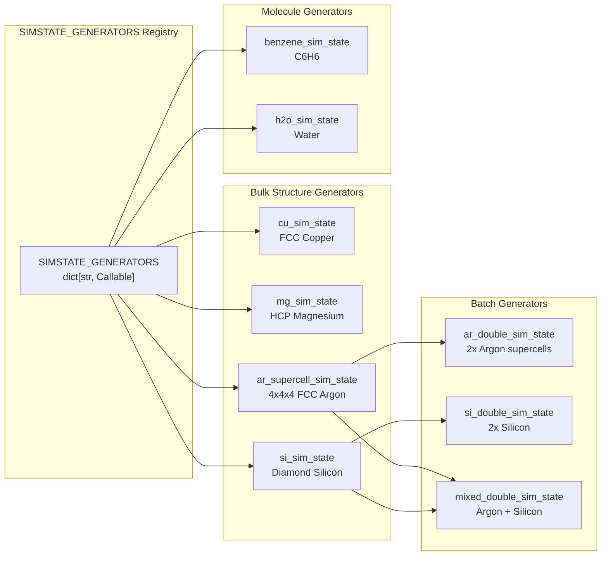
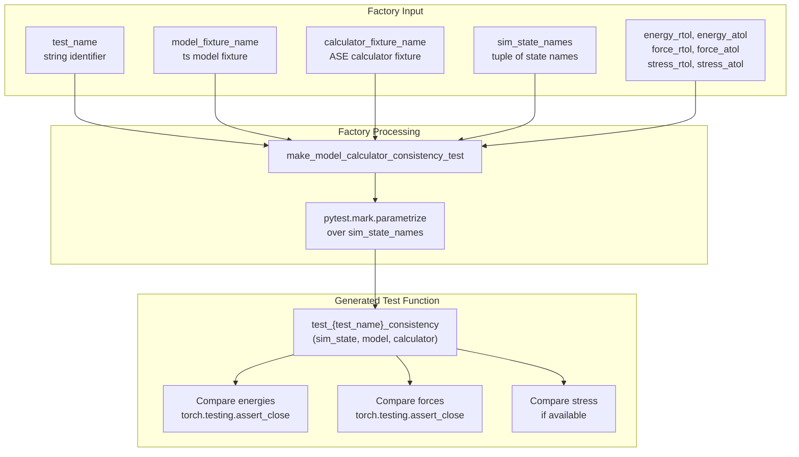
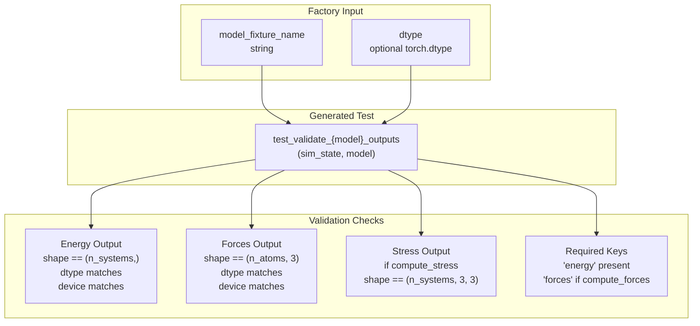
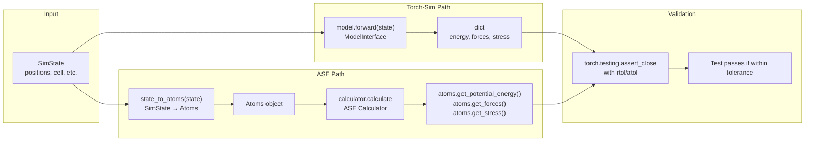
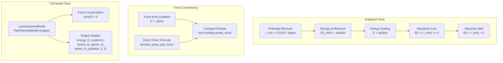
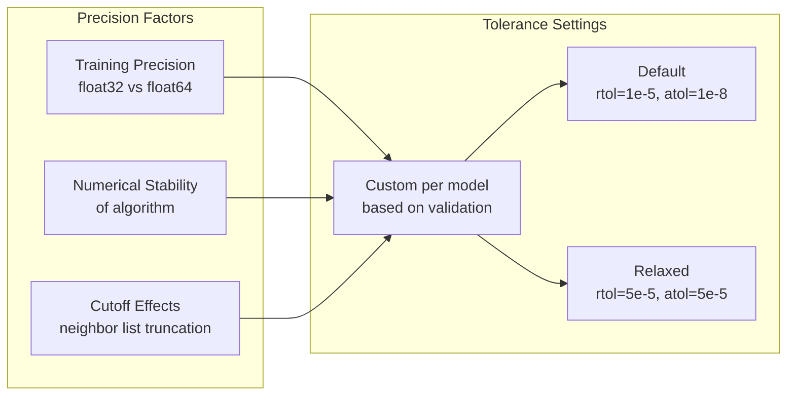
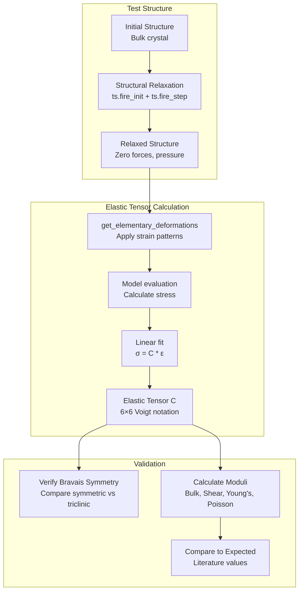

# Model Testing and Validation

<details>
<summary>Relevant source files</summary>

The following files were used as context for generating this wiki page:

- [tests/conftest.py](tests/conftest.py)
- [tests/models/test_lennard_jones.py](tests/models/test_lennard_jones.py)
- [tests/models/test_mace.py](tests/models/test_mace.py)
- [tests/models/test_orb.py](tests/models/test_orb.py)
- [tests/models/test_sevennet.py](tests/models/test_sevennet.py)
- [tests/test_elastic.py](tests/test_elastic.py)
- [torch_sim/io.py](torch_sim/io.py)
- [torch_sim/models/orb.py](torch_sim/models/orb.py)

</details>


## Purpose and Scope

This page documents the testing framework used to validate model implementations in torch-sim. It covers the test infrastructure for ensuring that Machine Learning Interatomic Potentials (MLIPs) and classical force fields produce correct energies, forces, and stresses, and that they are consistent with reference implementations.

For information about physics-based validation of simulation algorithms (energy conservation, temperature control, pressure maintenance), see [Physics Validation](#10.2). For the overall testing framework and CI infrastructure, see [Testing Framework](#10.1).

## Test Infrastructure Architecture

The model testing infrastructure is built around three core components: test generators that create diverse atomic structures, model fixtures that instantiate pre-configured models, and test factories that generate parameterized consistency tests.

```mermaid
graph TB
    subgraph "Test Data Generation"
        SIMSTATE_GEN["SIMSTATE_GENERATORS<br/>dict[str, Callable]"]
        BULK_GEN["SIMSTATE_BULK_GENERATORS"]
        MOL_GEN["SIMSTATE_MOLECULE_GENERATORS"]
        CUSTOM_FIX["Custom Fixtures<br/>ar_atoms, si_atoms, etc."]
    end
    
    subgraph "Model Fixtures"
        LJ["lj_model<br/>LennardJonesModel"]
        MACE["ts_mace_model<br/>MaceModel"]
        ORB["orbv3_conservative_inf_omat_model<br/>OrbModel"]
        SEVENN["sevenn_model<br/>SevenNetModel"]
    end
    
    subgraph "Reference Calculators"
        ASE_MACE["ase_mace_calculator<br/>MACECalculator"]
        ASE_ORB["orbv3_conservative_inf_omat_calculator<br/>ORBCalculator"]
        ASE_SEVENN["sevenn_calculator<br/>SevenNetCalculator"]
    end
    
    subgraph "Test Factories"
        CONSISTENCY["make_model_calculator_consistency_test<br/>Compare model vs calculator"]
        VALIDATE["make_validate_model_outputs_test<br/>Check output structure"]
    end
    
    subgraph "Generated Tests"
        TEST_MACE["test_mace_consistency"]
        TEST_ORB["test_orb_conservative_consistency"]
        TEST_SEVENN["test_sevennet_consistency"]
        TEST_VALIDATE["test_validate_conservative_model_outputs"]
    end
    
    SIMSTATE_GEN --> BULK_GEN
    SIMSTATE_GEN --> MOL_GEN
    SIMSTATE_GEN --> CONSISTENCY
    
    LJ --> CONSISTENCY
    MACE --> CONSISTENCY
    ORB --> CONSISTENCY
    SEVENN --> CONSISTENCY
    
    ASE_MACE --> CONSISTENCY
    ASE_ORB --> CONSISTENCY
    ASE_SEVENN --> CONSISTENCY
    
    MACE --> VALIDATE
    ORB --> VALIDATE
    
    CONSISTENCY --> TEST_MACE
    CONSISTENCY --> TEST_ORB
    CONSISTENCY --> TEST_SEVENN
    VALIDATE --> TEST_VALIDATE
```



Sources: [tests/conftest.py:1-151](), [tests/models/test_mace.py:1-176](), [tests/models/test_orb.py:1-82](), [tests/models/test_sevennet.py:1-78]()

## Test Generators and Fixtures

### SIMSTATE_GENERATORS Dictionary

The `SIMSTATE_GENERATORS` dictionary provides a centralized registry of functions that create standardized `SimState` objects for testing. Each generator function takes `device` and `dtype` parameters and returns a configured simulation state.



The generators are automatically converted to pytest fixtures using a factory pattern:

[tests/conftest.py:20-32]()
```python
def _make_simstate_fixture(name: str) -> Callable[[], ts.SimState]:
    """Create a pytest fixture for a sim_state generator."""
    
    @pytest.fixture(name=name)
    def _fixture() -> ts.SimState:
        return SIMSTATE_GENERATORS[name](DEVICE, DTYPE)
    
    return _fixture

# Programmatically generate fixtures for all sim_state generators
for _name in SIMSTATE_GENERATORS:
    globals()[_name] = _make_simstate_fixture(_name)
```

This pattern allows tests to access any generated state by name as a fixture parameter.

Sources: [tests/conftest.py:1-32]()

### Model Fixtures

Model fixtures instantiate pre-configured force field models for testing. Each fixture follows a consistent pattern of loading the model, setting computational flags, and configuring device/dtype.

| Fixture Name | Model Class | Purpose |
|-------------|-------------|---------|
| `lj_model` | `LennardJonesModel` | Classical Lennard-Jones potential for Argon |
| `ts_mace_model` | `MaceModel` | MACE-MP small model with forces and stress |
| `ts_mace_off_model` | `MaceModel` | MACE-OFF small model for molecules |
| `orbv3_conservative_inf_omat_model` | `OrbModel` | ORB conservative inference model |
| `orbv3_direct_20_omat_model` | `OrbModel` | ORB direct 20-step model |
| `sevenn_model` | `SevenNetModel` | SevenNet multi-fidelity model |

Example model fixture:

[tests/conftest.py:35-46]()
```python
@pytest.fixture
def lj_model() -> LennardJonesModel:
    """Create a Lennard-Jones model with reasonable parameters for Ar."""
    return LennardJonesModel(
        sigma=3.405,
        epsilon=0.0104,
        device=DEVICE,
        dtype=DTYPE,
        compute_forces=True,
        compute_stress=True,
        cutoff=2.5 * 3.405,
    )
```

Sources: [tests/conftest.py:35-46](), [tests/models/test_mace.py:40-56](), [tests/models/test_orb.py:23-36](), [tests/models/test_sevennet.py:44-47]()

### State-Specific Fixtures

In addition to the programmatically generated fixtures, some tests define custom state fixtures for specific testing scenarios:

[tests/conftest.py:49-151]()
- `ar_atoms`, `fe_atoms`, `si_atoms`, `benzene_atoms`: ASE `Atoms` objects
- `si_structure`: Pymatgen `Structure` object
- `si_phonopy_atoms`: Phonopy `PhonopyAtoms` object
- `cu_supercell_sim_state`: 4×4×4 FCC Copper with random displacements
- `ar_double_sim_state`, `si_double_sim_state`: Batched states for testing multi-system handling
- `mixed_double_sim_state`: Heterogeneous batch (Argon + Silicon)

Sources: [tests/conftest.py:49-151]()

## Test Factory Pattern

The test factory pattern allows generating parameterized tests that validate multiple model-calculator pairs against multiple simulation states without code duplication.

### Consistency Test Factory



The factory generates a parameterized test that:
1. Loads both the torch-sim model and ASE calculator via fixture injection
2. Loads each specified simulation state
3. Converts the `SimState` to ASE `Atoms` format
4. Computes results with both the torch-sim model and ASE calculator
5. Compares energies, forces, and (optionally) stress tensors within specified tolerances

Example usage:

[tests/models/test_orb.py:57-64]()
```python
test_orb_conservative_consistency = make_model_calculator_consistency_test(
    test_name="orbv3_conservative_inf_omat",
    model_fixture_name="orbv3_conservative_inf_omat_model",
    calculator_fixture_name="orbv3_conservative_inf_omat_calculator",
    sim_state_names=tuple(SIMSTATE_GENERATORS.keys()),
    energy_rtol=5e-5,
    energy_atol=5e-5,
)
```

This generates a test that validates the ORB model against its ASE calculator for all available simulation states.

Sources: [tests/models/test_orb.py:57-73](), [tests/models/test_mace.py:59-65](), [tests/models/test_sevennet.py:66-72]()

### Output Validation Test Factory



The output validation factory generates tests that verify:
- All required output keys are present
- Tensor shapes match expected dimensions
- Tensor dtypes and devices match the model configuration
- Values are finite (no NaN or Inf)

Example usage:

[tests/models/test_orb.py:75-81]()
```python
test_validate_conservative_model_outputs = make_validate_model_outputs_test(
    model_fixture_name="orbv3_conservative_inf_omat_model",
)

test_validate_direct_model_outputs = make_validate_model_outputs_test(
    model_fixture_name="orbv3_direct_20_omat_model",
)
```

Sources: [tests/models/test_orb.py:75-81](), [tests/models/test_mace.py:104-106](), [tests/models/test_sevennet.py:75-77]()

## Consistency Testing with ASE Calculators

The consistency testing strategy validates torch-sim model implementations against their corresponding ASE calculator implementations. This ensures that the torch-sim wrappers correctly interface with the underlying models.

### Test Workflow



### Tolerance Specification

Different models require different numerical tolerances based on their precision and numerical stability. Tests specify tolerances explicitly:

| Model | Energy rtol | Energy atol | Force rtol | Force atol | Notes |
|-------|-------------|-------------|------------|------------|-------|
| MACE | default | default | default | default | High precision |
| ORB | 5e-5 | 5e-5 | default | default | Conservative model |
| SevenNet | default | default | default | default | Float32 precision |

Sources: [tests/models/test_mace.py:59-65](), [tests/models/test_orb.py:57-73](), [tests/models/test_sevennet.py:66-72]()

### State-Specific Testing

Some models are only validated on specific types of structures due to their training domains:

[tests/models/test_mace.py:59-65]()
- `MACE-MP` models: Tested on `SIMSTATE_BULK_GENERATORS` (bulk crystals)
- `MACE-OFF` models: Tested on `SIMSTATE_MOLECULE_GENERATORS` (molecules)

[tests/models/test_sevennet.py:66-72]()
- SevenNet: Tested only on bulk structures due to numerical instability in stress tensor for molecules

Sources: [tests/models/test_mace.py:59-102](), [tests/models/test_sevennet.py:66-72]()

## Model Output Validation

### Output Structure Checks

Model output validation ensures that the returned dictionaries conform to the expected structure:

**Required Keys:**
- `"energy"`: Always present, shape `(n_systems,)`
- `"forces"`: Present if `compute_forces=True`, shape `(n_atoms, 3)`
- `"stress"`: Present if `compute_stress=True`, shape `(n_systems, 3, 3)`

**Dtype and Device Consistency:**
- All tensors must have the same dtype as the model configuration
- All tensors must be on the same device as the model
- Tensors should be detached (no gradient tracking in forward pass output)

### Charge and Spin Support Testing

Some models (e.g., MACE-OMOL) support molecular charge and spin states. These are tested by creating `SimState` objects with `charge` and `spin` attributes:

[tests/models/test_mace.py:124-176]()
```python
@pytest.mark.skipif(not HAS_MACE_OMOL, reason="mace_omol not available")
@pytest.mark.parametrize(
    ("charge", "spin"),
    [
        (0.0, 0.0),  # Neutral, no spin
        (1.0, 1.0),  # +1 charge, spin=1 (doublet)
        (-1.0, 0.0),  # -1 charge, no spin (singlet)
        (0.0, 2.0),  # Neutral, spin=2 (triplet)
    ],
)
def test_mace_charge_spin(
    benzene_sim_state: ts.SimState, charge: float, spin: float
) -> None:
    benzene_sim_state = ts.SimState.from_state(
        benzene_sim_state,
        charge=torch.tensor([charge], device=DEVICE, dtype=DTYPE),
        spin=torch.tensor([spin], device=DEVICE, dtype=DTYPE),
    )
    # ... test model forward pass
```

The test verifies that:
1. Charge/spin attributes are correctly extracted from `SimState`
2. The model accepts these attributes without errors
3. Output shapes and dtypes remain consistent

Sources: [tests/models/test_mace.py:124-176]()

### Dtype Flexibility Testing

Models should support multiple precision levels (float32, float64). These are tested explicitly:

[tests/models/test_mace.py:68-79]()
```python
@pytest.mark.parametrize("dtype", [torch.float32, torch.float64])
def test_mace_dtype_working(si_atoms: Atoms, dtype: torch.dtype) -> None:
    model = MaceModel(
        model=raw_mace_mp,
        device=DEVICE,
        dtype=dtype,
        compute_forces=True,
    )
    
    state = ts.io.atoms_to_state([si_atoms], DEVICE, dtype)
    model.forward(state)
```

Sources: [tests/models/test_mace.py:68-115]()

## Testing Classical Potentials

Classical potentials (Lennard-Jones, Morse, Soft Sphere) have analytical properties that can be tested directly without ASE comparison.

### Analytical Property Tests



Example tests:

[tests/models/test_lennard_jones.py:17-24]()
```python
def test_lennard_jones_pair_minimum() -> None:
    """Minimum of LJ is at r = 2^(1/6) * sigma."""
    dr = torch.linspace(0.9, 1.5, 500)
    z = _dummy_z(len(dr))
    energies = lennard_jones_pair(dr, z, z, sigma=1.0, epsilon=1.0)
    min_r = dr[energies.argmin()]
    assert abs(min_r.item() - 2 ** (1 / 6)) < 0.01
```

[tests/models/test_lennard_jones.py:87-98]()
```python
def test_lennard_jones_force_energy_consistency() -> None:
    """Force is consistent with the energy gradient."""
    dr = torch.linspace(0.8, 2.0, 100, requires_grad=True)
    z = _dummy_z(len(dr))
    
    force_direct = lennard_jones_pair_force(dr)
    
    energy = lennard_jones_pair(dr, z, z)
    force_from_grad = -torch.autograd.grad(energy.sum(), dr, create_graph=True)[0]
    
    torch.testing.assert_close(force_direct, force_from_grad, rtol=1e-4, atol=1e-4)
```

### Newton's Third Law Verification

Forces in a closed system must sum to zero (Newton's third law):

[tests/models/test_lennard_jones.py:119-138]()
```python
def test_lennard_jones_model_force_conservation(
    si_double_sim_state: ts.SimState,
) -> None:
    """LennardJonesModel forces sum to zero (Newton's third law)."""
    model = LennardJonesModel(...)
    results = model(si_double_sim_state)
    for sys_idx in range(si_double_sim_state.n_systems):
        mask = si_double_sim_state.system_idx == sys_idx
        assert torch.allclose(
            results["forces"][mask].sum(dim=0),
            torch.zeros(3, dtype=torch.float64),
            atol=1e-10,
        )
```

Sources: [tests/models/test_lennard_jones.py:1-138]()

## Special Testing Considerations

### Handling Import Errors

Model tests must gracefully handle missing optional dependencies:

[tests/models/test_orb.py:13-20]()
```python
try:
    from orb_models.forcefield import pretrained
    from orb_models.forcefield.inference.calculator import ORBCalculator
    from torch_sim.models.orb import OrbModel
except ImportError:
    pytest.skip(
        f"ORB not installed: {traceback.format_exc()}", 
        allow_module_level=True
    )
```

This pattern ensures that:
1. Tests are automatically skipped if the model package is not installed
2. The skip message includes the full traceback for debugging
3. Other tests in the suite continue to run

Sources: [tests/models/test_orb.py:13-20](), [tests/models/test_mace.py:16-23](), [tests/models/test_sevennet.py:14-25]()

### Model-Specific Tolerances

Different models require different numerical tolerances based on their precision:



Example: ORB models use relaxed tolerances due to their numerical characteristics:

[tests/models/test_orb.py:57-64]()
```python
test_orb_conservative_consistency = make_model_calculator_consistency_test(
    test_name="orbv3_conservative_inf_omat",
    model_fixture_name="orbv3_conservative_inf_omat_model",
    calculator_fixture_name="orbv3_conservative_inf_omat_calculator",
    sim_state_names=tuple(SIMSTATE_GENERATORS.keys()),
    energy_rtol=5e-5,  # Relaxed from default
    energy_atol=5e-5,  # Relaxed from default
)
```

Sources: [tests/models/test_orb.py:57-73]()

### Conditional Testing

Some tests are conditionally run based on model availability or known issues:

[tests/models/test_mace.py:124-125]()
```python
@pytest.mark.skipif(not HAS_MACE_OMOL, reason="mace_omol not available")
```

[tests/models/test_sevennet.py:64-72]()
```python
# NOTE: we do not test on the molecule sim states due to eps volume giving 
# numerically unstable stress off diagonal in xy. 
# See: https://github.com/MDIL-SNU/SevenNet/issues/212
test_sevennet_consistency = make_model_calculator_consistency_test(
    test_name="sevennet",
    model_fixture_name="sevenn_model",
    calculator_fixture_name="sevenn_calculator",
    sim_state_names=tuple(SIMSTATE_BULK_GENERATORS.keys()),  # Bulk only
    dtype=DTYPE,
)
```

Sources: [tests/models/test_mace.py:124-176](), [tests/models/test_sevennet.py:64-77]()

## Integration with Material Property Testing

Model validation extends to material properties calculated using the models, such as elastic tensors and moduli. These tests validate not just the model outputs but also the derived physical properties.

### Elastic Property Validation



Example test:

[tests/test_elastic.py:355-412]()
```python
def test_copper_elastic_properties(
    mace_model: MaceModel, cu_sim_state: ts.SimState
) -> None:
    """Test calculation of elastic properties for copper."""
    
    # Relax structure
    state = ts.fire_init(...)
    for _ in range(300):
        if converged:
            break
        state = ts.fire_step(state=state, model=mace_model)
    
    # Calculate elastic tensor
    elastic_tensor = calculate_elastic_tensor(
        state=state, model=mace_model, bravais_type=bravais_type
    )
    
    # Calculate elastic moduli
    bulk_modulus, shear_modulus, _, _ = calculate_elastic_moduli(elastic_tensor)
    
    # Assert against expected values
    assert torch.allclose(elastic_tensor, expected_elastic_tensor, rtol=1e-2)
    assert abs(bulk_modulus - expected_bulk_modulus) < 1e-2 * expected_bulk_modulus
```

These tests validate:
1. Model accuracy for computing stress tensors under deformation
2. Consistency of stress-strain relationships
3. Correctness of elastic property calculations
4. Agreement with literature values for known materials

Sources: [tests/test_elastic.py:1-412]()

## Summary

The model testing framework in torch-sim provides comprehensive validation through:

| Component | Purpose | Key Files |
|-----------|---------|-----------|
| `SIMSTATE_GENERATORS` | Standardized test structures | [tests/conftest.py:1-151]() |
| Test factories | Automated consistency test generation | [tests/models/conftest.py]() (referenced) |
| ASE comparison | Reference implementation validation | [tests/models/test_mace.py](), [tests/models/test_orb.py]() |
| Output validation | Structure and type checking | All model test files |
| Analytical tests | Physics-based property verification | [tests/models/test_lennard_jones.py]() |
| Property tests | Material property accuracy | [tests/test_elastic.py]() |

This multi-layered approach ensures that model implementations are correct, consistent with reference implementations, and produce physically meaningful results across diverse atomic structures and simulation conditions.

---