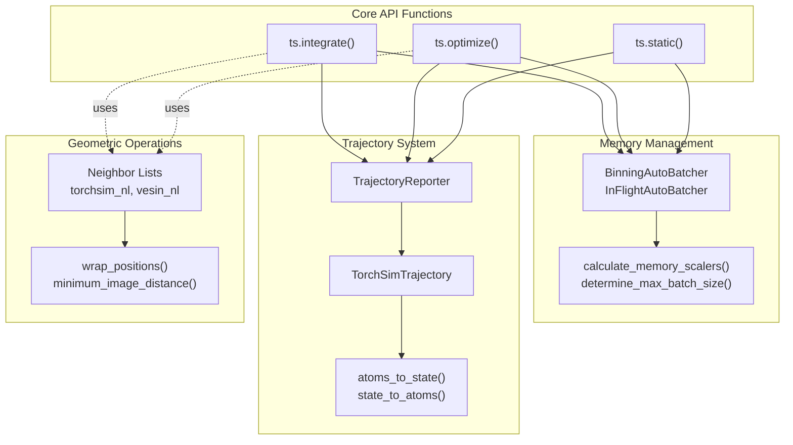
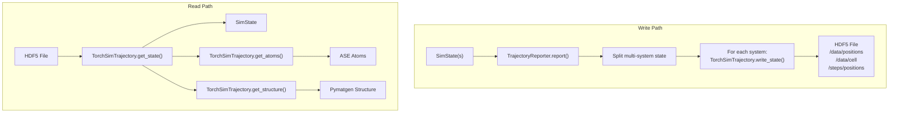
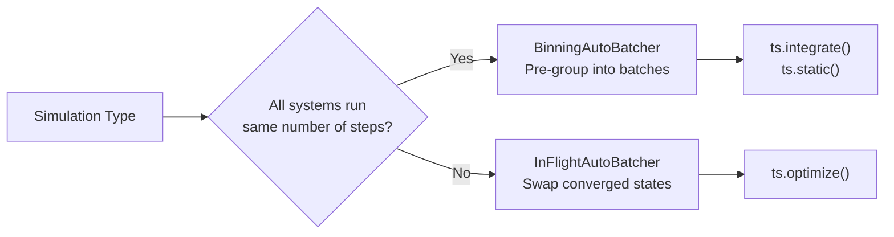
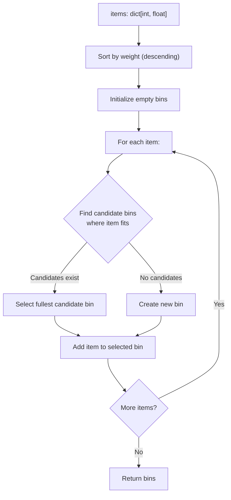
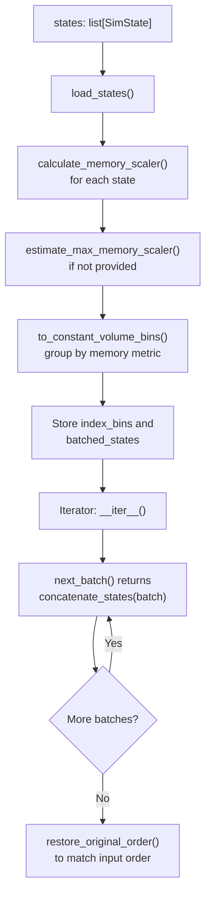
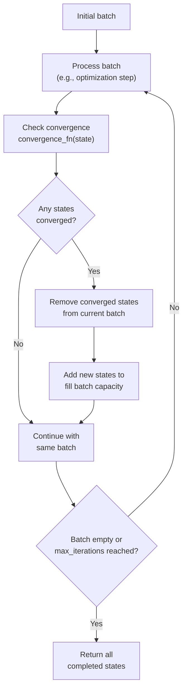
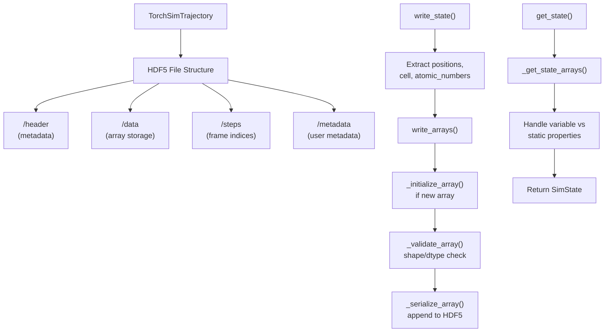
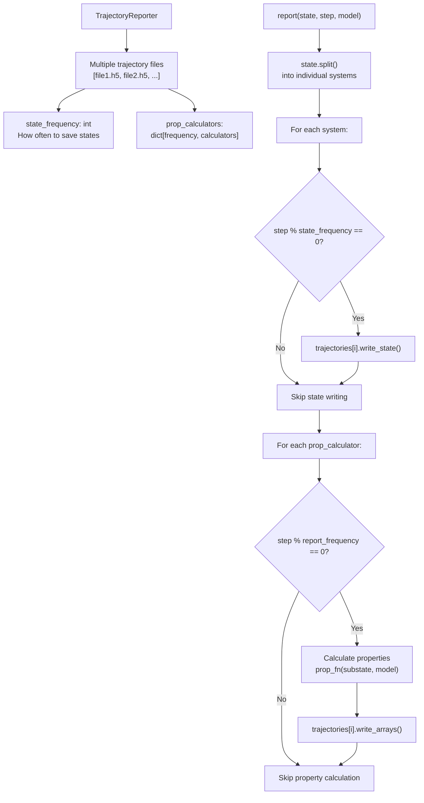
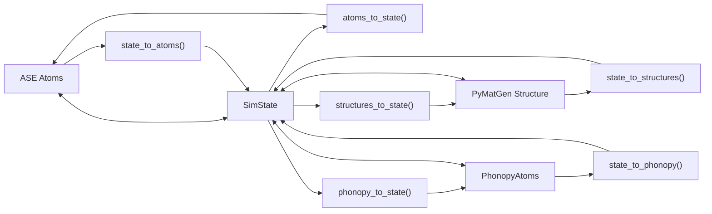

# Advanced Features

<details>
<summary>Relevant source files</summary>

The following files were used as context for generating this wiki page:

- [tests/test_autobatching.py](tests/test_autobatching.py)
- [tests/test_runners.py](tests/test_runners.py)
- [tests/test_trajectory.py](tests/test_trajectory.py)
- [torch_sim/autobatching.py](torch_sim/autobatching.py)
- [torch_sim/runners.py](torch_sim/runners.py)
- [torch_sim/trajectory.py](torch_sim/trajectory.py)
- [torch_sim/typing.py](torch_sim/typing.py)

</details>


This page provides an overview of torch-sim's advanced capabilities that enable efficient GPU-accelerated simulations and comprehensive data management. These systems work together to optimize memory usage, manage simulation trajectories, and handle coordinate transformations across periodic boundaries.

**Child Pages:**
- **[7.1 Autobatching and GPU Memory Management](#7.1)**: Automatic batch sizing and memory optimization strategies
- **[7.2 Trajectory Management](#7.2)**: HDF5-based trajectory storage and multi-format I/O
- **[7.3 Neighbor Lists](#7.3)**: Efficient neighbor finding algorithms and backends
- **[7.4 Coordinate Transforms and PBC](#7.4)**: Periodic boundary conditions and coordinate transformations

## Architecture Overview

The advanced features form an infrastructure layer that supports the core simulation API. These components handle GPU memory constraints, data persistence, and geometric computations that are essential for production-scale molecular simulations.

**Advanced Infrastructure Layer**


Sources: [torch_sim/runners.py:252-405](), [torch_sim/autobatching.py:520-689](), [torch_sim/trajectory.py:69-465]()
</old_str>

<old_str>
## Trajectory Management

The trajectory system provides HDF5-based storage for simulation data with compression, multi-format I/O, and support for arbitrary property arrays. This enables efficient storage of large simulation trajectories and seamless interoperability with ASE, Pymatgen, and Phonopy.

### Core Components

| Component | Purpose | Key Classes |
|-----------|---------|-------------|
| Low-level storage | HDF5 file I/O with compression and type coercion | `TorchSimTrajectory` |
| Multi-file management | Coordinate writing to multiple trajectory files | `TrajectoryReporter` |
| Format conversion | Convert between SimState and external formats | `atoms_to_state`, `state_to_atoms`, etc. |
| Property logging | Calculate and store custom properties at intervals | `prop_calculators` parameter |

**Trajectory Data Flow**


The trajectory system integrates with simulation runners via the `trajectory_reporter` parameter in `ts.integrate()`, `ts.optimize()`, and `ts.static()`. Property calculators can be configured to compute and log custom properties at specified intervals.

For details on HDF5 file structure, property calculator configuration, compression options, and format conversion utilities, see **[7.2 Trajectory Management](#7.2)**.

Sources: [torch_sim/trajectory.py:467-905](), [torch_sim/trajectory.py:69-465](), [tests/test_trajectory.py:600-755]()
</old_str>
<new_str>
## Autobatching and GPU Memory Management

The autobatching system automatically determines optimal batch sizes and groups simulation states to maximize GPU utilization while avoiding out-of-memory errors. This is critical for running multiple simulations efficiently on GPU hardware with limited memory.

### Core Components

| Component | Purpose | Key Classes |
|-----------|---------|-------------|
| Memory Estimation | Measure GPU memory usage and determine safe batch sizes | `measure_model_memory_forward`, `determine_max_batch_size` |
| Memory Scaling | Calculate per-system memory metrics | `calculate_memory_scalers` |
| Bin Packing | Group systems into memory-constrained batches | `to_constant_volume_bins` |
| Static Batching | Fixed batches for uniform workloads | `BinningAutoBatcher` |
| Dynamic Batching | Hot-swap states based on convergence | `InFlightAutoBatcher` |

**Batching Strategy Selection**


The autobatching system integrates transparently with `ts.integrate()`, `ts.optimize()`, and `ts.static()` through the `autobatcher` parameter. Users can pass `autobatcher=True` for automatic configuration or provide a configured batcher instance for manual control.

For detailed information on memory estimation strategies, bin packing algorithms, and batcher configuration options, see **[7.1 Autobatching and GPU Memory Management](#7.1)**.

Sources: [torch_sim/autobatching.py:520-689](), [torch_sim/runners.py:71-106](), [torch_sim/runners.py:407-449]()

## Autobatching and Memory Management

torch-sim provides sophisticated automatic batching systems that optimize GPU memory utilization by intelligently grouping simulation states. The autobatching system includes memory estimation, bin packing algorithms, and two complementary batching strategies.

### Memory Estimation and Batch Size Determination

The autobatching system begins with memory estimation to determine optimal batch sizes. The `measure_model_memory_forward` function [torch_sim/autobatching.py:202-247]() performs actual GPU memory measurements during model forward passes, while `determine_max_batch_size` [torch_sim/autobatching.py:250-307]() uses geometric scaling to find the maximum number of systems that fit in available memory.

Memory scaling is calculated using `calculate_memory_scaler` [torch_sim/autobatching.py:310-356](), which provides two metrics: `"n_atoms"` for models with fixed neighbor counts, and `"n_atoms_x_density"` for models with radial cutoffs where memory scales with local atomic density.

### Bin Packing Algorithm

The core batching logic uses a bin packing algorithm implemented in `to_constant_volume_bins` [torch_sim/autobatching.py:34-199](). This function distributes items into the minimum number of bins while respecting volume constraints, using a descending weight sorting strategy for optimal packing efficiency.

**Bin Packing Algorithm Flow**


Sources: [torch_sim/autobatching.py:34-199]()

### BinningAutoBatcher

`BinningAutoBatcher` [torch_sim/autobatching.py:417-701]() groups states into fixed batches based on memory requirements. This approach is ideal for scenarios where all states need identical processing, such as fixed-step molecular dynamics simulations.

**BinningAutoBatcher Workflow**


Sources: [torch_sim/autobatching.py:417-701](), [tests/test_autobatching.py:127-166]()

### InFlightAutoBatcher

`InFlightAutoBatcher` [torch_sim/autobatching.py:704-946]() provides dynamic state swapping based on convergence criteria. Converged states are removed from batches and replaced with new states, maximizing GPU utilization during iterative processes like geometry optimization.

**InFlightAutoBatcher Hot-Swapping**


Sources: [torch_sim/autobatching.py:704-946](), [tests/test_autobatching.py:460-507]()

### Integration with High-Level API

Both batchers integrate seamlessly with torch-sim's high-level functions. The `integrate`, `optimize`, and `static` functions accept `autobatcher` parameters that can be `True` (for automatic selection), a specific batcher instance, or `None` to disable batching.

```python
# Automatic batching selection
final_state = ts.integrate(
    system=states,
    model=model,
    integrator=nve,
    autobatcher=True  # Automatically determines optimal batcher
)

# Custom batcher configuration
batcher = BinningAutoBatcher(
    model=model,
    memory_scales_with="n_atoms",
    max_memory_scaler=1000.0
)
final_state = ts.optimize(
    system=states,
    model=model,
    optimizer=fire,
    autobatcher=batcher
)
```

Sources: [tests/test_runners.py:198-287](), [tests/test_runners.py:384-476]()

## Trajectory Management and I/O

torch-sim provides comprehensive trajectory storage and analysis capabilities through HDF5-based file formats and conversion utilities for popular molecular modeling frameworks.

### TorchSimTrajectory

`TorchSimTrajectory` [torch_sim/trajectory.py:318-895]() serves as the core trajectory storage class, providing efficient HDF5-based storage with compression and type coercion capabilities. It supports arbitrary property arrays and maintains automatic registry management for consistent data validation.

**TorchSimTrajectory Architecture**


Sources: [torch_sim/trajectory.py:318-895](), [torch_sim/trajectory.py:673-773]()

### TrajectoryReporter

`TrajectoryReporter` [torch_sim/trajectory.py:65-316]() manages multiple trajectory files simultaneously, handling periodic state saving and custom property calculations. It automatically splits multi-system states across separate files and supports configurable reporting frequencies.

**TrajectoryReporter Multi-File Management**


Sources: [torch_sim/trajectory.py:65-316](), [torch_sim/trajectory.py:203-282]()

### Format Conversion System

torch-sim provides bidirectional conversion between `SimState` objects and external format representations through dedicated I/O functions in `torch_sim/io.py`.

**I/O Conversion Functions**


Sources: [torch_sim/io.py:29-392]()

### Data Type Management and Compression

The trajectory system includes sophisticated data type management with optional coercion for reduced file sizes. The `coerce_to_float32` and `coerce_to_int32` options [torch_sim/trajectory.py:342-454]() can significantly reduce storage requirements while maintaining acceptable precision for most applications.

| Feature | Configuration | Impact |
|---------|---------------|---------|
| Compression | `compress_data=True` | ~50-70% size reduction |
| Float32 coercion | `coerce_to_float32=True` | ~50% reduction in float storage |
| Int32 coercion | `coerce_to_int32=True` | ~50% reduction in integer storage |

Sources: [torch_sim/trajectory.py:342-454](), [tests/test_trajectory.py:147-167]()

### Integration with Simulation Runners

The trajectory system integrates seamlessly with torch-sim's simulation runners through the `trajectory_reporter` parameter. Reporters can handle both single-system and multi-system simulations with automatic file splitting.

```python
# Multi-system simulation with trajectory reporting
trajectory_files = [f"system_{i}.h5md" for i in range(n_systems)]
reporter = TrajectoryReporter(
    filenames=trajectory_files,
    state_frequency=100,  # Save state every 100 steps
    prop_calculators={
        10: {"kinetic_energy": calc_kinetic_energy},  # Every 10 steps
        1: {"potential_energy": lambda state: state.energy}  # Every step
    }
)

final_state = ts.integrate(
    system=batched_states,
    model=model,
    integrator=nvt_langevin,
    n_steps=1000,
    trajectory_reporter=reporter
)
```

Sources: [tests/test_runners.py:110-149](), [tests/test_runners.py:231-287]()

## Neighbor Lists and Transforms

torch-sim provides neighbor list algorithms and coordinate transformation utilities optimized for periodic boundary conditions and various simulation geometries. These components support both traditional linked-cell algorithms and modern GPU-accelerated neighbor finding through the Vesin library.

For detailed coverage of neighbor list implementations and coordinate transforms, see the specialized documentation in [Neighbor Lists and Transforms](#6.3).

Sources: Referenced from table of contents structure

---