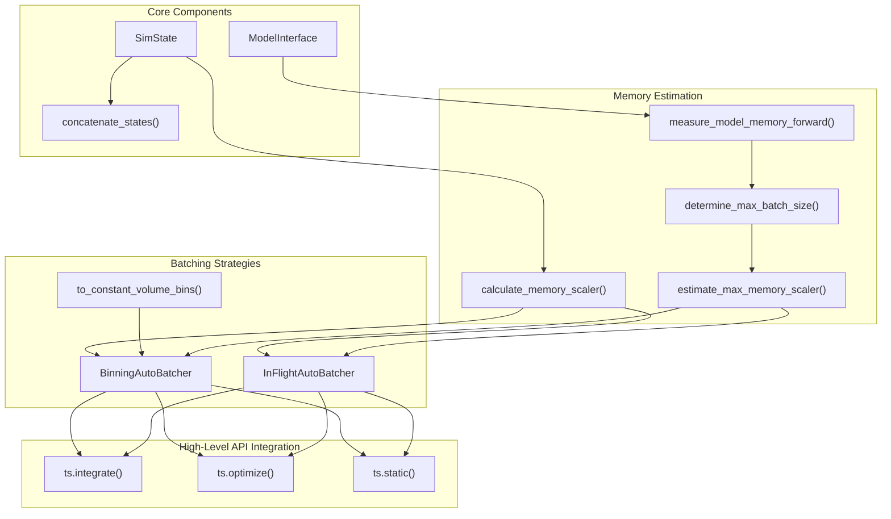
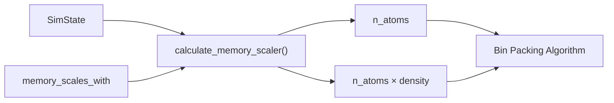
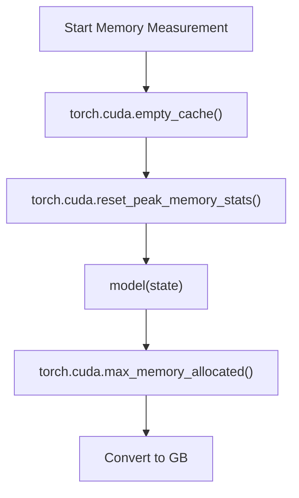
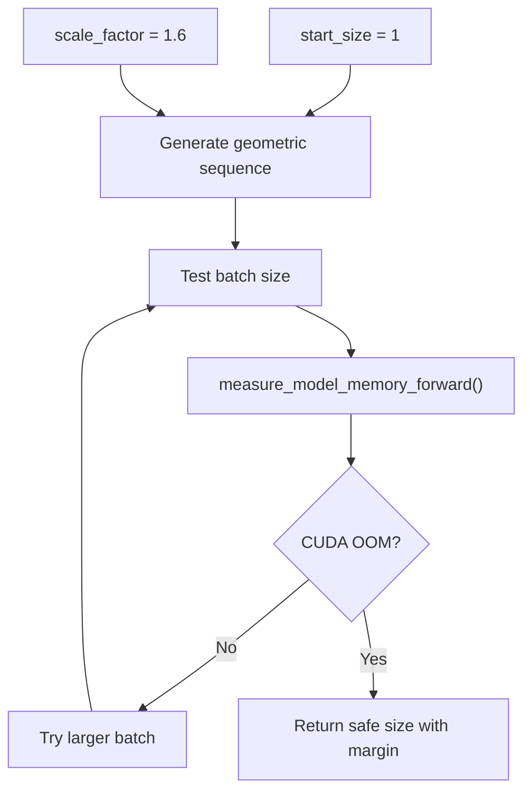
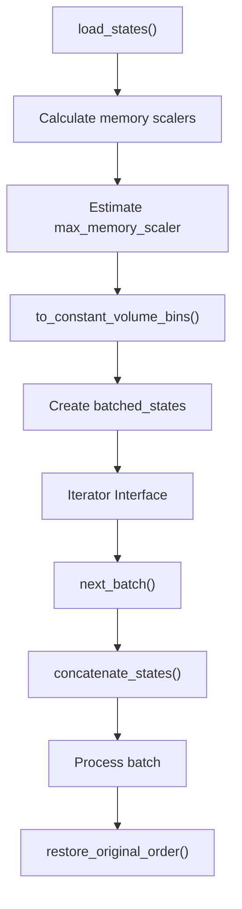
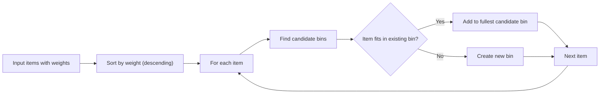
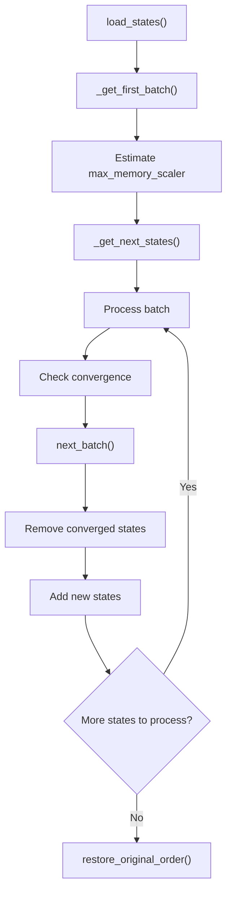
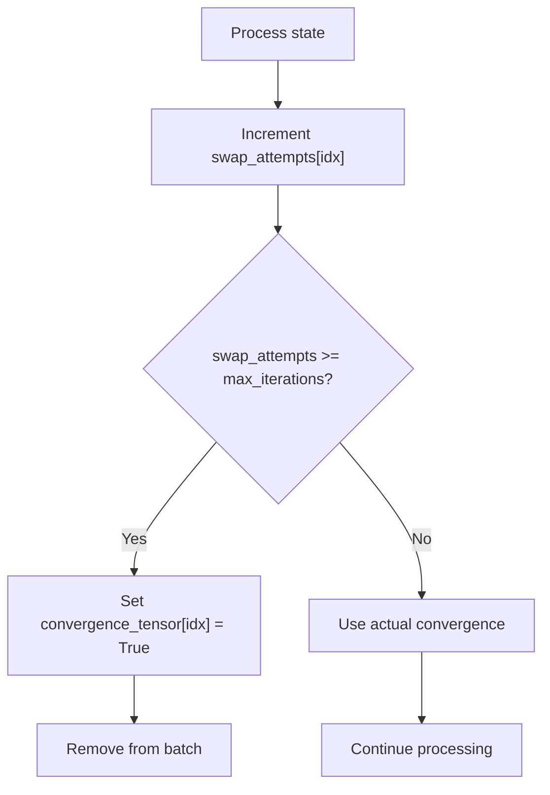
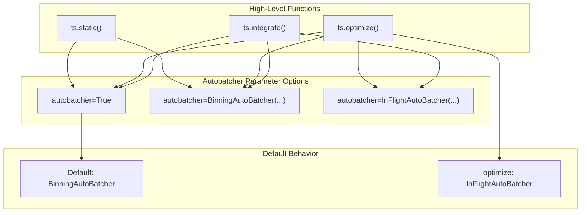

# Autobatching and Memory Management

<details>
<summary>Relevant source files</summary>

The following files were used as context for generating this wiki page:

- [tests/test_autobatching.py](tests/test_autobatching.py)
- [torch_sim/autobatching.py](torch_sim/autobatching.py)
- [torch_sim/typing.py](torch_sim/typing.py)

</details>


This document covers torch-sim's automatic batching system for efficient GPU memory management and utilization. The autobatching system dynamically determines optimal batch sizes based on GPU memory constraints and provides two complementary strategies for processing multiple simulation states efficiently.

For information about trajectory management and HDF5 storage during simulations, see [Trajectory Management and I/O](#6.2). For details about the core simulation methods that use autobatching, see [Molecular Dynamics](#5.1), [Structure Optimization](#5.2), and [Static Calculations](#5.3).

## System Overview

The autobatching system consists of two main strategies for managing GPU memory and batch processing:



**Sources:** [torch_sim/autobatching.py:1-32](), [tests/test_runners.py:198-230]()

## Memory Estimation and Scaling

The autobatching system uses memory scaling metrics to estimate GPU memory requirements and determine optimal batch sizes without exhausting available memory.

### Memory Scaling Metrics

Two primary metrics are supported for estimating memory requirements:

| Metric | Description | Use Case |
|--------|-------------|----------|
| `n_atoms` | Uses only atom count | Models with fixed neighbor counts |
| `n_atoms_x_density` | Atom count × number density | Models with radial cutoffs |

The `calculate_memory_scaler()` function computes these metrics for individual states:



**Sources:** [torch_sim/autobatching.py:310-357](), [tests/test_autobatching.py:92-107]()

### GPU Memory Measurement

The `measure_model_memory_forward()` function measures actual GPU memory usage during model forward passes:



**Sources:** [torch_sim/autobatching.py:202-247]()

### Batch Size Determination

The `determine_max_batch_size()` function uses a geometric sequence to find the maximum batch size that fits in GPU memory:



**Sources:** [torch_sim/autobatching.py:250-307](), [tests/test_autobatching.py:355-403]()

## BinningAutoBatcher

The `BinningAutoBatcher` groups states into bins of similar computational cost using a bin packing algorithm. This strategy is optimal for scenarios where all states need the same number of processing steps.

### Core Workflow



**Sources:** [torch_sim/autobatching.py:417-702](), [tests/test_autobatching.py:127-166]()

### Bin Packing Algorithm

The `to_constant_volume_bins()` function implements a first-fit decreasing algorithm:



**Sources:** [torch_sim/autobatching.py:34-199](), [tests/test_autobatching.py:18-90]()

### Usage Pattern

```python
# Create batcher
batcher = BinningAutoBatcher(
    model=model,
    memory_scales_with="n_atoms",
    max_memory_scaler=1000.0
)

# Load and process states
batcher.load_states(states)
final_states = []
for batch in batcher:
    final_states.append(process_batch(batch))

# Restore original order
ordered_results = batcher.restore_original_order(final_states)
```

**Sources:** [torch_sim/autobatching.py:442-456](), [tests/test_runners.py:210-230]()

## InFlightAutoBatcher

The `InFlightAutoBatcher` dynamically swaps states based on convergence, removing completed states and adding new ones to maintain optimal GPU utilization. This strategy is ideal for iterative processes where states converge at different rates.

### Dynamic Batching Workflow



**Sources:** [torch_sim/autobatching.py:704-1129](), [tests/test_autobatching.py:307-354]()

### State Swapping Mechanism


**Sources:** [torch_sim/autobatching.py:961-1074](), [tests/test_autobatching.py:460-507]()

### Convergence and Max Iterations

The `InFlightAutoBatcher` supports a `max_iterations` parameter to prevent infinite processing:



**Sources:** [torch_sim/autobatching.py:1038-1046](), [tests/test_autobatching.py:550-600]()

## Integration with High-Level API

The autobatching system integrates seamlessly with torch-sim's high-level API functions through the `autobatcher` parameter.

### API Integration Points



**Sources:** [tests/test_runners.py:478-548]()

### Usage Examples

#### With ts.integrate()

```python
final_state = ts.integrate(
    system=multiple_states,
    model=model,
    integrator=nvt_langevin,
    n_steps=100,
    autobatcher=BinningAutoBatcher(
        model=model,
        memory_scales_with="n_atoms",
        max_memory_scaler=1000
    )
)
```

#### With ts.optimize()

```python
final_states = ts.optimize(
    system=states_to_relax,
    model=model,
    optimizer=unit_cell_fire,
    convergence_fn=force_convergence_fn,
    autobatcher=InFlightAutoBatcher(
        model=model,
        max_memory_scaler=800
    )
)
```

#### With ts.static()

```python
properties = ts.static(
    system=batched_states,
    model=model,
    autobatcher=True  # Uses default BinningAutoBatcher
)
```

**Sources:** [tests/test_runners.py:231-287](), [tests/test_runners.py:415-476](), [tests/test_runners.py:621-652]()

### Trajectory Reporting with Autobatching

The autobatching system maintains proper ordering when used with trajectory reporting:


**Sources:** [tests/test_runners.py:654-760]()

---