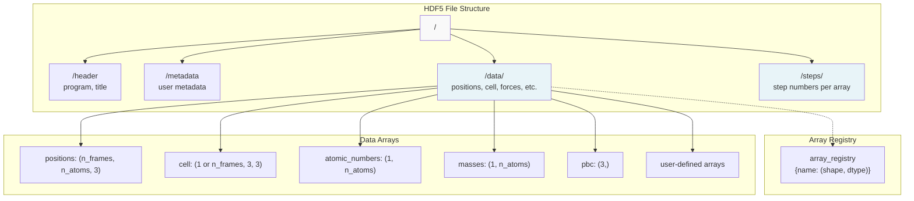
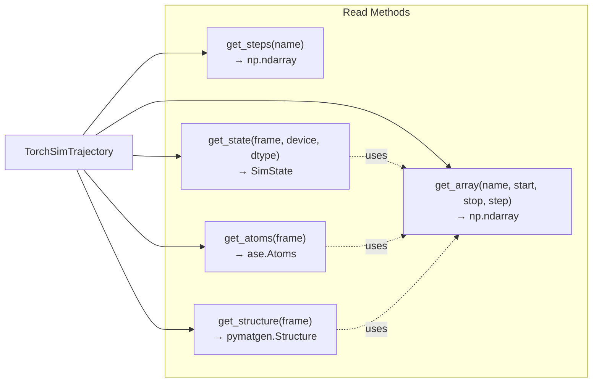
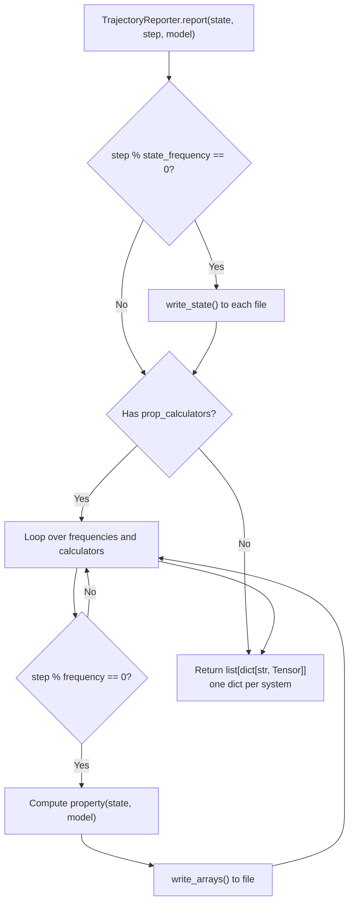
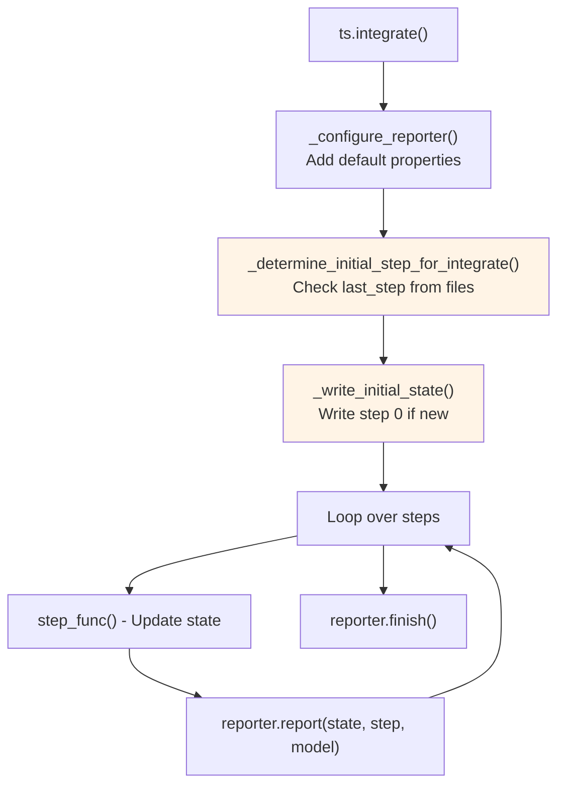
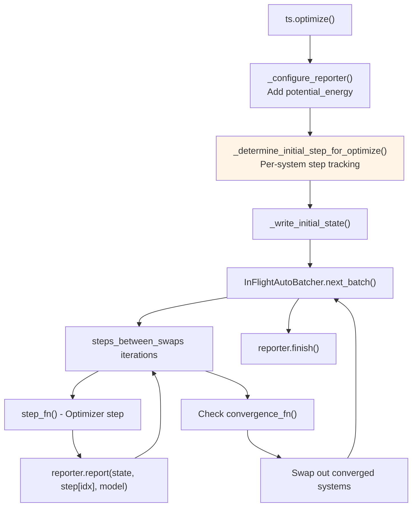
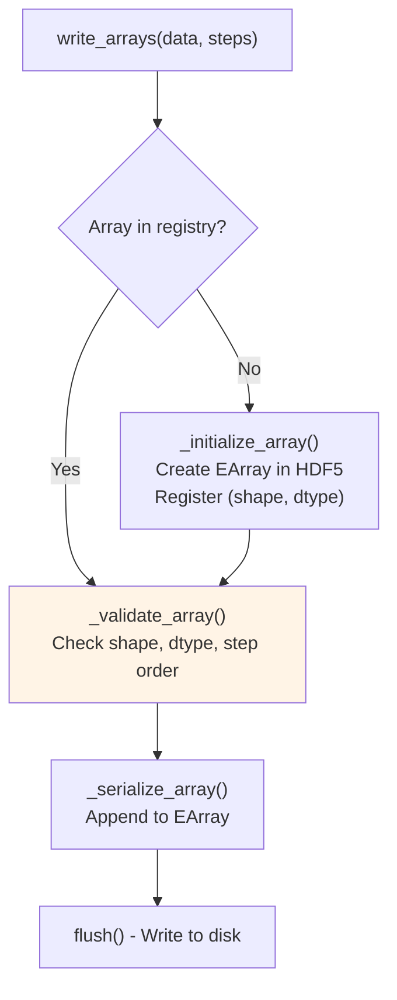
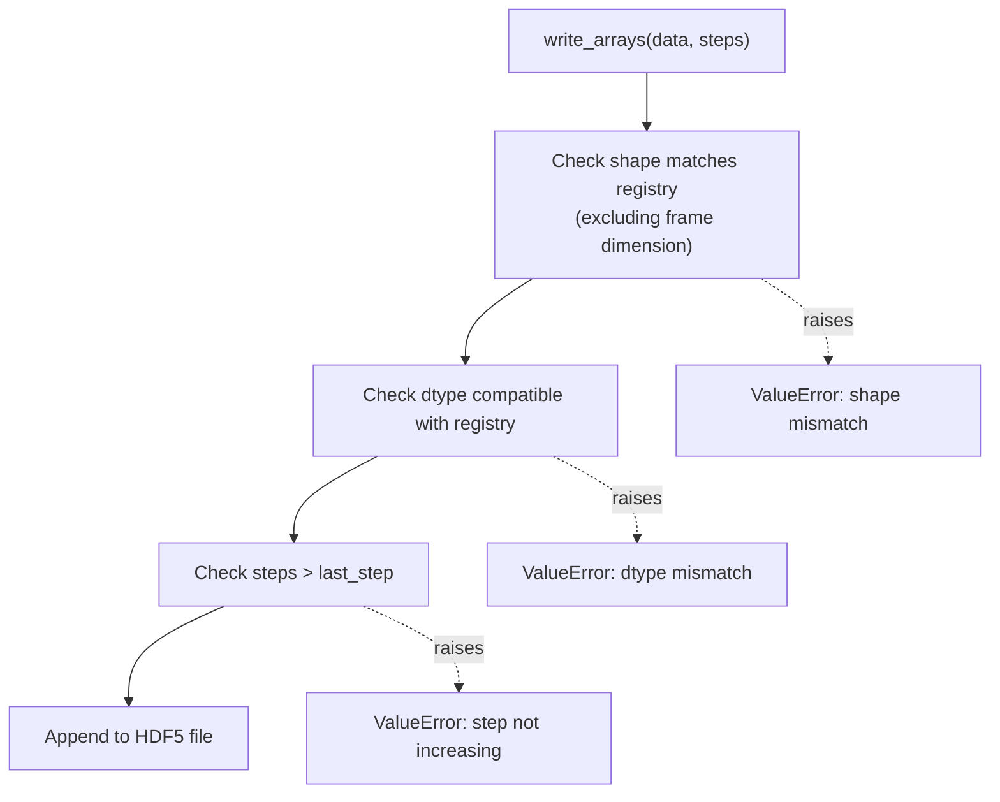

# Trajectory Management

<details>
<summary>Relevant source files</summary>

The following files were used as context for generating this wiki page:

- [tests/test_runners.py](tests/test_runners.py)
- [tests/test_trajectory.py](tests/test_trajectory.py)
- [torch_sim/runners.py](torch_sim/runners.py)
- [torch_sim/trajectory.py](torch_sim/trajectory.py)

</details>


This page covers the trajectory I/O system in torch-sim for saving and loading simulation data to/from HDF5 files. The system provides both low-level access for custom workflows and high-level integration with the `ts.integrate()`, `ts.optimize()`, and `ts.static()` runners.

For information about the runner functions themselves, see [High-Level API Functions](#3.3).

---

## Overview

The trajectory system consists of two main classes:

| Class | Purpose | Typical Usage |
|-------|---------|---------------|
| `TorchSimTrajectory` | Low-level HDF5 I/O for single trajectory files | Direct reading/writing, format conversion |
| `TrajectoryReporter` | High-level interface for multi-file trajectory logging | Used with `integrate()`, `optimize()`, `static()` |

Both classes use PyTables (HDF5) for efficient storage with optional compression. The format is designed for flexibility, allowing arbitrary user-defined properties alongside standard atomic data.

**Sources:** [torch_sim/trajectory.py:1-28]()

---

## Trajectory File Format

### HDF5 Structure



The file structure separates static data (cell, masses, atomic numbers) from dynamic data (positions, velocities). Static arrays are stored once with `steps=[0]` unless flagged as variable.

**Sources:** [torch_sim/trajectory.py:556-576](), [torch_sim/trajectory.py:577-590]()

### Data Type Management

The system maps NumPy/PyTorch dtypes to PyTables atom types with optional coercion:

| Input Type | Default Storage | With `coerce_to_float32=True` | With `coerce_to_int32=True` |
|------------|-----------------|-------------------------------|----------------------------|
| `float64` | `Float64Atom` | `Float32Atom` | `Float64Atom` |
| `float32` | `Float32Atom` | `Float32Atom` | `Float32Atom` |
| `int64` | `Int64Atom` | `Int64Atom` | `Int32Atom` |
| `int32` | `Int32Atom` | `Int32Atom` | `Int32Atom` |
| `bool` | `BoolAtom` | `BoolAtom` | `BoolAtom` |

**Sources:** [torch_sim/trajectory.py:53-65](), [torch_sim/trajectory.py:591-613]()

---

## TorchSimTrajectory: Low-Level I/O

### Initialization

```python
TorchSimTrajectory(
    filename: str | pathlib.Path,
    mode: Literal["w", "a", "r"] = "r",  # write, append, read
    compress_data: bool = True,
    coerce_to_float32: bool = True,
    coerce_to_int32: bool = False,
    metadata: dict[str, str] | None = None,
)
```

- **Mode "w"**: Creates new file, overwrites existing
- **Mode "a"**: Appends to existing file
- **Mode "r"**: Read-only access

**Sources:** [torch_sim/trajectory.py:491-555]()

### Writing Data

#### Writing States

```python
def write_state(
    state: SimState | list[SimState],
    steps: int | list[int],
    save_velocities: bool = False,
    save_forces: bool = False,
    variable_cell: bool = True,
    variable_masses: bool = False,
    variable_atomic_numbers: bool = False,
)
```

The method handles both single states and lists of states (trajectories). Static data (cell, masses, atomic numbers) is stored only once unless flagged as variable.

**Sources:** [torch_sim/trajectory.py:882-987]()

#### Writing Arbitrary Arrays

```python
def write_arrays(
    data: Mapping[str, np.ndarray | torch.Tensor],
    steps: int | list[int],
)
```

This lower-level method allows writing any named arrays. The array registry tracks shapes and dtypes for validation.

**Sources:** [torch_sim/trajectory.py:615-664]()

### Reading Data



**Key Methods:**

| Method | Returns | Purpose |
|--------|---------|---------|
| `get_array(name)` | `np.ndarray` | Raw array data for any registered property |
| `get_steps(name)` | `np.ndarray` | Step numbers for frames in an array |
| `get_state(frame)` | `SimState` | Reconstruct full SimState from frame |
| `get_atoms(frame)` | `ase.Atoms` | Convert frame to ASE Atoms object |
| `get_structure(frame)` | `pymatgen.Structure` | Convert frame to Pymatgen Structure |

**Sources:** [torch_sim/trajectory.py:797-848](), [torch_sim/trajectory.py:1104-1137](), [torch_sim/trajectory.py:1073-1102](), [torch_sim/trajectory.py:1041-1071]()

### Array Registry

The `array_registry` tracks all arrays in the file:

```python
array_registry: dict[str, tuple[tuple[int, ...], np.dtype]]
# Example: {"positions": ((10, 3), np.float32), "energy": ((), np.float64)}
```

This enables validation when appending data and provides metadata about stored arrays.

**Sources:** [torch_sim/trajectory.py:532-533](), [torch_sim/trajectory.py:577-590]()

---

## TrajectoryReporter: High-Level Interface

### Initialization and Configuration

```python
TrajectoryReporter(
    filenames: str | pathlib.Path | Sequence[str | pathlib.Path] | None,
    state_frequency: int = 100,
    prop_calculators: dict[int, dict[str, Callable]] | None = None,
    state_kwargs: dict[str, Any] | None = None,
    metadata: dict[str, str] | None = None,
    trajectory_kwargs: dict[str, Any] | None = None,
)
```

**Parameters:**

- **`filenames`**: One file per system being simulated (or `None` to compute properties without saving)
- **`state_frequency`**: Save full state every N steps (0 = never)
- **`prop_calculators`**: Map of `{frequency: {name: calculator_fn}}`
- **`state_kwargs`**: Arguments passed to `TorchSimTrajectory.write_state()`
- **`trajectory_kwargs`**: Arguments passed to `TorchSimTrajectory.__init__()`

**Sources:** [torch_sim/trajectory.py:104-162]()

### Property Calculators

Property calculators are functions that compute derived quantities from states:

```python
prop_calculators = {
    10: {  # Compute every 10 steps
        "kinetic_energy": lambda state: ts.calc_kinetic_energy(
            velocities=state.velocities, masses=state.masses
        ),
        "temperature": lambda state: state.calc_temperature(),
    },
    100: {  # Compute every 100 steps
        "max_force": ts.system_wise_max_force,
    }
}
```

Calculators can accept either `(state)` or `(state, model)` signatures. The reporter automatically adapts single-argument functions.

**Sources:** [torch_sim/trajectory.py:246-265](), [torch_sim/runners.py:34-68]()

### Reporting Workflow



The `report()` method:
1. Splits multi-system states across trajectory files
2. Writes full state if `step % state_frequency == 0`
3. Evaluates property calculators at specified frequencies
4. Returns computed properties as a list of dictionaries

**Sources:** [torch_sim/trajectory.py:267-343](), [torch_sim/trajectory.py:345-397]()

---

## Integration with Runners

### Integration in ts.integrate()



**Default properties for integrate:**
- `kinetic_energy`
- `potential_energy`
- `temperature`

**Resume behavior:** If `mode="a"` and trajectory files exist, integration resumes from the last logged step. All trajectories must have consistent `last_step` values.

**Sources:** [torch_sim/runners.py:327-333](), [torch_sim/runners.py:108-142](), [torch_sim/runners.py:228-249](), [torch_sim/runners.py:366-387]()

### Integration in ts.optimize()



**Key differences from integrate:**
- Per-system step tracking (systems converge at different rates)
- Trajectory files are reopened when systems are swapped by `InFlightAutoBatcher`
- Only `potential_energy` is logged by default

**Sources:** [torch_sim/runners.py:647-656](), [torch_sim/runners.py:145-171](), [torch_sim/runners.py:680-698]()

### Integration in ts.static()

The `static()` function performs single-point calculations and returns properties without state evolution. Trajectories are optional but useful for logging results from batch calculations.

**Default properties:**
- `potential_energy`
- `forces` (if `model.compute_forces`)
- `stress` (if `model.compute_stress`)

**Special behavior:** Sets `variable_atomic_numbers=True` and `variable_masses=True` to support heterogeneous systems.

**Sources:** [torch_sim/runners.py:774-790](), [torch_sim/runners.py:815-843]()

---

## Advanced Features

### Resume and Append Mode

Trajectories can be resumed by opening in append mode (`mode="a"`):

```python
# Initial run
reporter = TrajectoryReporter("traj.h5", state_frequency=10)
state = ts.integrate(..., n_steps=100, trajectory_reporter=reporter)

# Resume from step 100
reporter = TrajectoryReporter("traj.h5", trajectory_kwargs={"mode": "a"})
state = ts.integrate(..., n_steps=50, trajectory_reporter=reporter)
# Will log steps 101-150
```

The runners detect existing data via `last_step` and automatically continue from the correct step.

**Sources:** [torch_sim/runners.py:120-142](), [torch_sim/trajectory.py:416-425](), [torch_sim/trajectory.py:427-446]()

### Trajectory Truncation

Truncation removes frames from the end of trajectory files:

```python
# TorchSimTrajectory truncation
with TorchSimTrajectory("traj.h5", mode="a") as traj:
    traj.truncate_to_step(step=50)  # Keep frames up to step 50

# TrajectoryReporter truncation (truncates all files)
reporter = TrajectoryReporter(["traj0.h5", "traj1.h5"], ...)
reporter.truncate_to_step(step=50)
```

This is useful when resuming from inconsistent states or recovering from interrupted runs.

**Warning:** Truncation is irreversible and permanently removes data.

**Sources:** [torch_sim/trajectory.py:1220-1261](), [torch_sim/trajectory.py:220-244]()

### Reopening Trajectories

`TrajectoryReporter.reopen_trajectories()` allows dynamic switching between trajectory files:

```python
reporter = TrajectoryReporter(["sys0.h5", "sys1.h5"])

# Later, switch to different files (used by InFlightAutoBatcher)
reporter.reopen_trajectories(["sys2.h5", "sys3.h5"])
```

This is used internally by `optimize()` when systems are swapped in/out of the active batch.

**Sources:** [torch_sim/trajectory.py:176-210](), [torch_sim/runners.py:680-687]()

### Array Registry and Validation

The array registry ensures consistency when appending data:



Validation checks:
1. **Shape consistency**: New data must match registered shape (excluding frame dimension)
2. **Dtype compatibility**: New data must be convertible to registered dtype
3. **Monotonic steps**: Step numbers must be strictly increasing

**Sources:** [torch_sim/trajectory.py:615-664](), [torch_sim/trajectory.py:680-709](), [torch_sim/trajectory.py:710-755]()

---

## File I/O Patterns

### Single-System Workflow

```python
# Writing
with TorchSimTrajectory("simulation.h5", mode="w") as traj:
    for step, state in enumerate(simulation):
        traj.write_state(state, step, save_velocities=True)

# Reading
with TorchSimTrajectory("simulation.h5", mode="r") as traj:
    final_state = traj.get_state(frame=-1)
    energies = traj.get_array("potential_energy")
    steps = traj.get_steps("potential_energy")
```

**Sources:** [torch_sim/trajectory.py:13-28]()

### Multi-System Workflow

```python
states = [state1, state2, state3]
files = ["sys0.h5", "sys1.h5", "sys2.h5"]

reporter = TrajectoryReporter(
    filenames=files,
    state_frequency=10,
    prop_calculators={
        1: {"energy": lambda state: state.energy},
        10: {"max_force": ts.system_wise_max_force},
    }
)

batched_state = ts.initialize_state(states, device, dtype)
final_state = ts.integrate(
    system=batched_state,
    model=model,
    integrator=ts.Integrator.nvt_langevin,
    n_steps=1000,
    temperature=300.0,
    timestep=0.001,
    trajectory_reporter=reporter,
)
```

Each system gets its own trajectory file, split automatically by `TrajectoryReporter.report()`.

**Sources:** [torch_sim/runners.py:877-915](), [torch_sim/trajectory.py:267-343]()

### Properties Without File Output

```python
reporter = TrajectoryReporter(
    filenames=None,  # No file output
    prop_calculators={
        1: {"energy": lambda state: state.energy},
    }
)

props_list = reporter.report(state, step=0, model=model)
# props_list[i] = {"energy": tensor(...)} for system i
```

This pattern is useful for extracting properties without disk I/O.

**Sources:** [torch_sim/trajectory.py:298-299](), [torch_sim/trajectory.py:345-397]()

---

## Format Conversion

### To ASE Trajectory

```python
with TorchSimTrajectory("torch_sim.h5", mode="r") as traj:
    ase_traj = traj.write_ase_trajectory("output.traj")
    
# Read with ASE
from ase.io.trajectory import Trajectory
traj = Trajectory("output.traj", mode="r")
for atoms in traj:
    print(atoms.get_potential_energy())
```

**Sources:** [torch_sim/trajectory.py:1187-1218]()

### To Pymatgen/ASE Per-Frame

```python
with TorchSimTrajectory("torch_sim.h5", mode="r") as traj:
    # Get individual frames
    structure = traj.get_structure(frame=10)  # Pymatgen
    atoms = traj.get_atoms(frame=-1)          # ASE
    
    # Analyze with external tools
    from pymatgen.analysis.structure_matcher import StructureMatcher
    matcher = StructureMatcher()
    # ...
```

**Sources:** [torch_sim/trajectory.py:1041-1071](), [torch_sim/trajectory.py:1073-1102]()

---

## Common Patterns and Examples

### Energy Conservation Check (NVE)

```python
reporter = TrajectoryReporter(
    "nve.h5",
    state_frequency=1,
    prop_calculators={
        1: {
            "ke": lambda state: ts.calc_kinetic_energy(
                momenta=state.momenta, masses=state.masses
            ),
            "pe": lambda state: state.energy,
        }
    }
)

final_state = ts.integrate(
    system=state,
    model=model,
    integrator=ts.Integrator.nve,
    n_steps=1000,
    temperature=300.0,
    timestep=0.001,
    trajectory_reporter=reporter,
)

# Analyze conservation
with TorchSimTrajectory("nve.h5") as traj:
    ke = traj.get_array("ke")
    pe = traj.get_array("pe")
    total_energy = ke + pe
    std_energy = np.std(total_energy)
    print(f"Energy drift: {std_energy / np.mean(total_energy):.2e}")
```

**Sources:** [tests/test_runners.py:18-53]()

### Optimization with Custom Convergence Logging

```python
def log_max_force(state):
    return ts.system_wise_max_force(state)

reporter = TrajectoryReporter(
    "relax.h5",
    state_frequency=10,
    prop_calculators={
        1: {
            "energy": lambda state: state.energy,
            "max_force": log_max_force,
        }
    }
)

final_state = ts.optimize(
    system=state,
    model=model,
    optimizer=ts.Optimizer.fire,
    convergence_fn=ts.generate_force_convergence_fn(force_tol=1e-3),
    trajectory_reporter=reporter,
    max_steps=1000,
)

# Check convergence
with TorchSimTrajectory("relax.h5") as traj:
    forces = traj.get_array("max_force")
    steps = traj.get_steps("max_force")
    plt.plot(steps, forces)
```

**Sources:** [tests/test_runners.py:346-378]()

### Batched Static Calculations

```python
structures = [struct1, struct2, struct3, ...]  # Many structures

reporter = TrajectoryReporter(
    filenames=[f"struct_{i}.h5" for i in range(len(structures))],
    prop_calculators={
        1: {
            "energy": lambda state: state.energy,
            "forces": lambda state: state.forces,
        }
    }
)

props = ts.static(
    system=structures,
    model=model,
    trajectory_reporter=reporter,
    autobatcher=True,  # Batch by size for efficiency
)

# props[i]["energy"] contains energy for structures[i]
energies = [p["energy"].item() for p in props]
```

**Sources:** [tests/test_runners.py:729-835](), [torch_sim/runners.py:734-853]()

---

## Performance Considerations

### Compression

Compression is enabled by default and typically reduces file size by 2-5x with minimal performance impact:

```python
# Compressed (default)
traj = TorchSimTrajectory("data.h5", compress_data=True)

# Uncompressed (faster writes, larger files)
traj = TorchSimTrajectory("data.h5", compress_data=False)
```

**Sources:** [torch_sim/trajectory.py:523-526]()

### Data Type Coercion

Coercing float64 → float32 can halve file sizes with negligible accuracy loss for most applications:

```python
traj = TorchSimTrajectory(
    "data.h5",
    coerce_to_float32=True,  # Default: True
    coerce_to_int32=False,   # Default: False
)
```

**Sources:** [torch_sim/trajectory.py:497-499](), [tests/test_trajectory.py:147-167]()

### Logging Frequency

High-frequency logging can dominate simulation time. Use appropriate frequencies:

```python
reporter = TrajectoryReporter(
    "traj.h5",
    state_frequency=100,  # Write full state every 100 steps
    prop_calculators={
        10: {"energy": ...},      # Cheap properties: every 10 steps
        100: {"stress": ...},     # Expensive properties: every 100 steps
    }
)
```

**Sources:** [torch_sim/trajectory.py:107-109]()

---

## Error Handling and Validation

### Common Errors

| Error | Cause | Solution |
|-------|-------|----------|
| `ValueError: shape mismatch` | Array shape changed between writes | Ensure consistent n_atoms or use `variable_atomic_numbers=True` |
| `ValueError: must be greater than last recorded step` | Duplicate or decreasing step numbers | Ensure monotonically increasing steps |
| `ValueError: Cannot resume from inconsistent states` | Trajectory files have different last steps | Use `reporter.truncate_to_step()` to synchronize |
| `ValueError: Unsupported array.dtype` | Unsupported data type (e.g., float16, complex) | Convert to supported types |

**Sources:** [torch_sim/trajectory.py:710-755](), [torch_sim/runners.py:128-134](), [torch_sim/trajectory.py:369-378]()

### Validation at Write Time



**Sources:** [torch_sim/trajectory.py:710-755]()

---