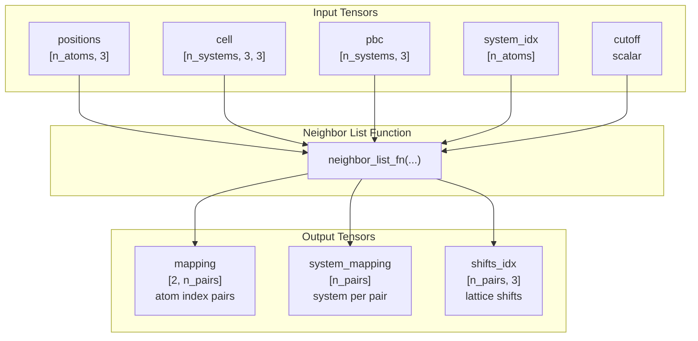
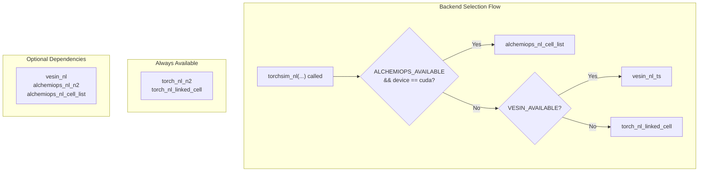
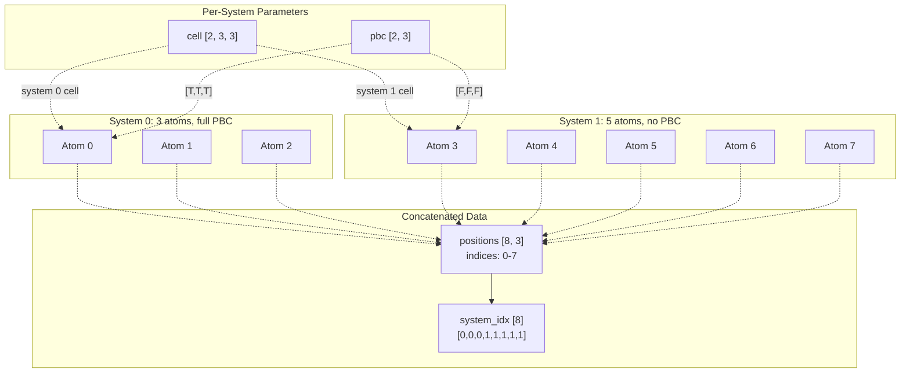
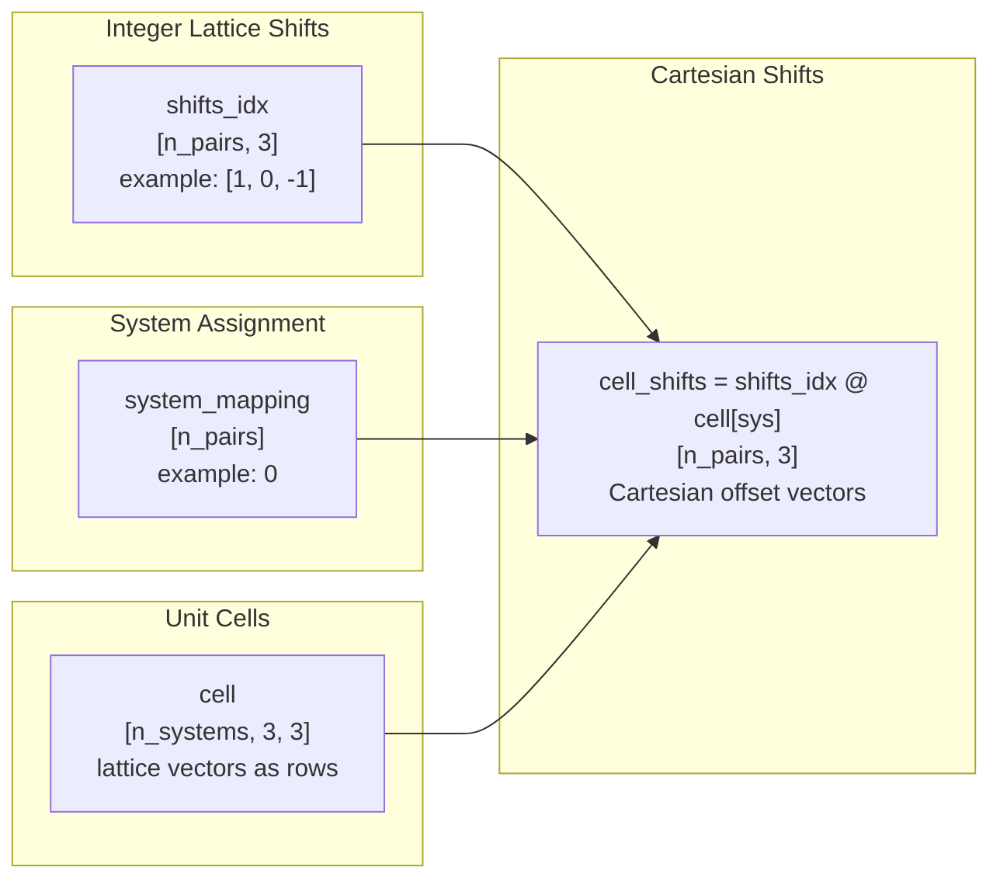
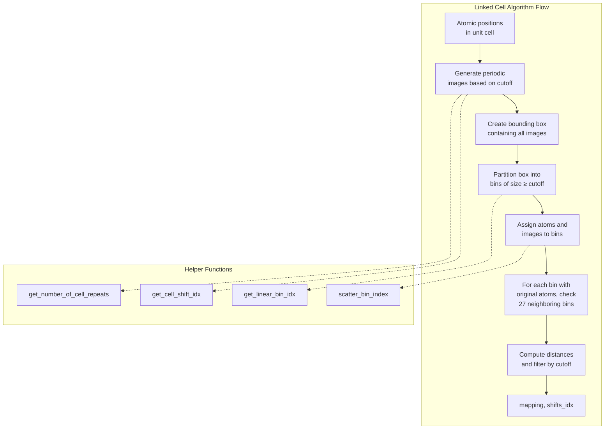

# Neighbor Lists

<details>
<summary>Relevant source files</summary>

The following files were used as context for generating this wiki page:

- [tests/test_neighbors.py](tests/test_neighbors.py)
- [tests/test_transforms.py](tests/test_transforms.py)
- [torch_sim/transforms.py](torch_sim/transforms.py)

</details>


This page documents the neighbor list implementations in torch-sim, which compute atom pairs within a cutoff distance for efficient force and energy calculations. Neighbor lists are a fundamental component used by molecular dynamics integrators and structure optimization routines to determine which atoms interact with each other.

For information about coordinate transformations and periodic boundary conditions that neighbor lists depend on, see [Coordinate Transforms and PBC](#7.4). For information about how neighbor lists are used in MD simulations, see [MD Overview and Workflow](#4.1).

## Overview

Neighbor lists identify pairs of atoms within a specified cutoff radius, accounting for periodic boundary conditions (PBC). Instead of computing all O(N²) pairwise distances during every force evaluation, neighbor lists pre-compute the relevant pairs, significantly improving performance for systems where most atoms are beyond the interaction cutoff.

In torch-sim, neighbor lists support:
- **Batched processing**: Multiple independent systems processed simultaneously
- **Mixed periodicity**: Different PBC settings per system and per dimension
- **Multiple backends**: Pure PyTorch, Vesin, and Alchemiops implementations
- **Cell shifts**: Explicit tracking of periodic image offsets

Sources: [tests/test_neighbors.py:1-551](), [torch_sim/transforms.py:569-690]()

## Unified Neighbor List API

All neighbor list implementations in torch-sim follow a common interface:

```python
mapping, system_mapping, shifts_idx = neighbor_list_fn(
    positions=positions,      # [n_atoms, 3] - atomic positions
    cell=cell,               # [n_systems, 3, 3] - unit cell matrices (row vectors)
    pbc=pbc,                 # [n_systems, 3] - PBC flags per dimension
    cutoff=cutoff,           # scalar - interaction cutoff radius
    system_idx=system_idx,   # [n_atoms] - system membership for each atom
    self_interaction=False,  # whether to include (i,i) pairs
)
```

**Return Values:**

| Tensor | Shape | Description |
|--------|-------|-------------|
| `mapping` | `[2, n_pairs]` | Pairs of global atom indices `[i, j]` within cutoff |
| `system_mapping` | `[n_pairs]` | System index for each pair |
| `shifts_idx` | `[n_pairs, 3]` | Integer lattice shifts `[nx, ny, nz]` for each pair |

**Key Properties:**
- **Global indexing**: `mapping` indices reference the concatenated `positions` tensor
- **System consistency**: `system_idx[mapping[0, k]] == system_idx[mapping[1, k]] == system_mapping[k]`
- **Cell shifts**: `shifts_idx` are integer multiples of lattice vectors, not Cartesian shifts

Sources: [tests/test_neighbors.py:160-168](), [tests/test_neighbors.py:270-279]()



Sources: [tests/test_neighbors.py:160-175]()

## Implementation Backends

torch-sim provides multiple neighbor list backends with different algorithmic complexity and hardware requirements:

### Built-in PyTorch Implementations

**`torch_nl_n2`** - Naive O(N²) Implementation

Uses `build_naive_neighborhood` to compute all pairwise distances. Suitable for small systems or when simplicity is preferred. Supports batched processing via tensor padding.

- **Complexity**: O(N²) per system
- **Memory**: O(N²) distance matrix
- **Best for**: Systems with <100 atoms, debugging, validation

**`torch_nl_linked_cell`** - Linked Cell Algorithm

Uses `build_linked_cell_neighborhood` to partition space into bins of size `cutoff`. Only checks atoms in neighboring bins, reducing complexity for sparse systems.

- **Complexity**: O(N) for dilute systems
- **Memory**: O(N) bin assignments
- **Best for**: Large periodic systems, production simulations

Sources: [tests/test_neighbors.py:131-138](), [torch_sim/transforms.py:569-690](), [torch_sim/transforms.py:970-1045]()

### Optional External Libraries

**`vesin_nl` and `vesin_nl_ts`** - Vesin Library

Python bindings to the Vesin neighbor list library. Requires `pip install torch-sim[vesin]`.

- `vesin_nl`: Standard interface, accepts float32 inputs
- `vesin_nl_ts`: TorchScript-compatible variant
- **Note**: Only available when `neighbors.VESIN_AVAILABLE == True`

**`alchemiops_nl_n2` and `alchemiops_nl_cell_list`** - Alchemiops Library

GPU-optimized neighbor lists from `nvalchemiops-toolkit-ops`. Requires CUDA/ROCm and `pip install torch-sim[alchemiops]`.

- `alchemiops_nl_n2`: GPU-accelerated N² implementation
- `alchemiops_nl_cell_list`: GPU-accelerated cell list
- **Note**: Only available when `neighbors.ALCHEMIOPS_AVAILABLE == True`

Sources: [tests/test_neighbors.py:131-138](), [tests/test_neighbors.py:282-295](), [tests/test_neighbors.py:297-310]()

### Automatic Backend Selection

**`torchsim_nl`** - Intelligent Dispatcher

Automatically selects the best available backend:
1. **Alchemiops** (if available and on CUDA)
2. **Vesin** (if available)
3. **torch_nl_linked_cell** (fallback)

**`default_batched_nl`** - Alias for Default Backend

Points to the fallback implementation (currently `torch_nl_linked_cell`).

Sources: [tests/test_neighbors.py:312-348](), [tests/test_neighbors.py:383-425]()



Sources: [tests/test_neighbors.py:350-381](), [tests/test_neighbors.py:383-425]()

## Batched Processing

Neighbor lists in torch-sim operate on batched data, processing multiple independent systems simultaneously. This is critical for GPU efficiency and high-throughput workflows.

### Batching Mechanism

Systems are concatenated into a single `positions` tensor, with `system_idx` tracking system membership:

```python
# Example: 2 systems with 3 and 5 atoms
positions = torch.cat([pos_sys0, pos_sys1])  # [8, 3]
system_idx = torch.tensor([0, 0, 0, 1, 1, 1, 1, 1])  # [8]
cell = torch.stack([cell_sys0, cell_sys1])  # [2, 3, 3]
pbc = torch.stack([pbc_sys0, pbc_sys1])      # [2, 3]

mapping, system_mapping, shifts = neighbor_list_fn(
    positions, cell, pbc, cutoff, system_idx
)
```

The returned `mapping` uses **global indices** into the concatenated `positions` tensor. The `system_mapping` tensor identifies which system each pair belongs to.

Sources: [tests/test_neighbors.py:153-175](), [tests/test_neighbors.py:177-215]()

### Mixed Periodicity Support

Each system can have independent PBC settings per dimension:

```python
# System 0: periodic in all directions
# System 1: periodic only in x and y (slab geometry)
pbc = torch.tensor([
    [True, True, True],   # system 0
    [True, True, False],  # system 1
])
```

The neighbor list implementations respect these per-system, per-dimension PBC flags. Non-periodic directions will have `shifts_idx[:, dim] == 0` for all pairs in that system.

Sources: [tests/test_neighbors.py:217-251](), [tests/test_neighbors.py:1116-1174]()



Sources: [tests/test_neighbors.py:153-160](), [tests/test_neighbors.py:1274-1309]()

## Cell Shifts and Periodic Images

For periodic systems, atoms can interact with periodic images of other atoms. The `shifts_idx` tensor contains integer lattice shift vectors that specify which periodic image participates in each pair.

### Computing Cartesian Shifts

The `compute_cell_shifts` function converts integer shifts to Cartesian coordinates:

```python
cell_shifts = transforms.compute_cell_shifts(cell, shifts_idx, system_mapping)
# cell_shifts[k] = shifts_idx[k] @ cell[system_mapping[k]]
```

This enables distance calculations that account for periodic boundaries:

```python
cell_shifts = transforms.compute_cell_shifts(cell, shifts_idx, system_mapping)
distances = transforms.compute_distances_with_cell_shifts(
    positions, mapping, cell_shifts
)
# distances[k] = ||pos[j] - pos[i] + cell_shifts[k]||
```

Sources: [tests/test_neighbors.py:170-175](), [torch_sim/transforms.py:508-534](), [torch_sim/transforms.py:468-505]()

### Lattice Shift Generation

The `get_cell_shift_idx` function generates all integer shifts needed for a given cutoff:

```python
num_repeats = get_number_of_cell_repeats(cutoff, cell, pbc)
shifts_idx = get_cell_shift_idx(num_repeats[0], dtype)
# Returns Cartesian product: [-n_x, ..., n_x] × [-n_y, ..., n_y] × [-n_z, ..., n_z]
```

The number of repeats per dimension is calculated from the reciprocal cell vectors to ensure all interactions within the cutoff are captured.

Sources: [torch_sim/transforms.py:403-435](), [torch_sim/transforms.py:438-465]()



Sources: [torch_sim/transforms.py:508-534]()

## Strict Neighbor List Filtering

The `strict_nl` function filters an existing neighbor list to only include pairs within a specified cutoff distance:

```python
new_mapping, new_system_mapping, new_shifts = neighbors.strict_nl(
    cutoff=cutoff,
    positions=positions,
    cell=cell,
    mapping=mapping,
    system_mapping=system_mapping,
    shifts_idx=shifts_idx,
)
```

This is useful when:
- Tightening the cutoff for a pre-computed neighbor list
- Verifying neighbor list correctness
- Applying distance-based filtering after initial neighbor computation

The function computes actual distances including cell shifts and removes pairs exceeding the cutoff.

Sources: [tests/test_neighbors.py:442-477]()

## Linked Cell Algorithm Details

The linked cell algorithm (`torch_sim/transforms.py:807-967`) is the most efficient built-in implementation for large periodic systems. It works by:

1. **Spatial binning**: Partition the simulation box into cubic bins of size ≥ `cutoff`
2. **Atom assignment**: Assign each atom (including periodic images) to bins based on position
3. **Neighbor search**: For each bin containing original atoms, check only the 27 neighboring bins
4. **Distance filtering**: Compute exact distances and keep pairs within `cutoff`

### Key Implementation Details

| Component | Description |
|-----------|-------------|
| `get_linear_bin_idx` | Converts 3D positions to linear bin indices |
| `scatter_bin_index` | Creates bin→atom mapping with padding for vectorization |
| `ravel_3d` / `unravel_3d` | 3D ↔ linear index conversions |

The algorithm first creates periodic images by replicating the unit cell, then bins all atoms (originals + images) into a spatial grid. This reduces the number of distance comparisons from O(N²) to O(27N) in the average case.

Sources: [torch_sim/transforms.py:807-967](), [torch_sim/transforms.py:741-764](), [torch_sim/transforms.py:767-804]()

### Batched Linked Cell Processing

The `build_linked_cell_neighborhood` wrapper [torch_sim/transforms.py:970-1045]() applies the linked cell algorithm to batched systems by:

1. Computing per-system cell repeats from `get_number_of_cell_repeats`
2. Iterating over systems and calling `linked_cell` for each
3. Adjusting indices to global positions and concatenating results

**Note**: Unlike `build_naive_neighborhood`, this currently uses a loop over systems rather than fully vectorized processing.

Sources: [torch_sim/transforms.py:970-1045](), [torch_sim/transforms.py:1089-1114]()



Sources: [torch_sim/transforms.py:807-967](), [torch_sim/transforms.py:970-1045]()

## Naive O(N²) Implementation

The `build_naive_neighborhood` function [torch_sim/transforms.py:569-690]() provides a fully vectorized O(N²) neighbor list for batched systems. While less efficient for large systems, it serves as:

- **Reference implementation** for testing other algorithms
- **Optimal choice** for small systems (<100 atoms)
- **Debugging tool** due to its simplicity

### Vectorized Batching Strategy

Uses `torch.nn.utils.rnn.pad_sequence` to pad systems to a common size `n_max`, enabling simultaneous processing:

```python
# Pad positions: [n_systems, n_max, 3]
batch_positions = pad_sequence(pos_list, batch_first=True, padding_value=0.0)

# Generate all lattice shifts: [n_shifts, 3]
lattice_shifts = _calculate_n2_lattice_shifts(cell, pbc, cutoff)

# Cartesian shifts per system: [n_systems, n_shifts, 3]
cart_shifts = torch.matmul(lattice_shifts, cell)

# All shifted positions: [n_systems, n_shifts, n_max, 3]
shifted = cart_shifts.unsqueeze(-2) + batch_positions.unsqueeze(1)

# Pairwise distances: [n_systems, n_shifts, n_max, n_max]
diff = batch_positions.unsqueeze(1).unsqueeze(3) - shifted.unsqueeze(2)
dist = torch.sqrt((diff * diff).sum(dim=-1))
```

Masking ensures:
- Padding atoms are excluded
- Non-periodic shifts are zeroed out
- Self-interactions are optionally removed

Sources: [torch_sim/transforms.py:569-690](), [torch_sim/transforms.py:537-566]()

## Testing and Validation

All neighbor list implementations are validated against ASE's `ase.neighborlist.neighbor_list` as the reference:

```python
# ASE reference
idx_i, idx_j, shifts_ref, dist_ref = neighbor_list(
    quantities="ijSd",
    a=atoms,
    cutoff=cutoff,
    self_interaction=self_interaction,
)

# torch-sim implementation
mapping, system_mapping, shifts_idx = nl_implementation(...)

# Validation: sorted distances must match
cell_shifts = transforms.compute_cell_shifts(cell, shifts_idx, system_mapping)
distances = transforms.compute_distances_with_cell_shifts(pos, mapping, cell_shifts)
np.testing.assert_allclose(np.sort(distances.numpy()), np.sort(dist_ref))
```

The test suite covers:
- Multiple cutoff radii: 1, 3, 5, 7 Å
- Self-interaction enabled/disabled
- Mixed periodic and non-periodic systems
- Various crystal structures (cubic, triclinic, rhombohedral)
- Edge cases (single atom, large atom count disparity, atoms at origin)

Sources: [tests/test_neighbors.py:128-215](), [tests/test_neighbors.py:1130-1174]()

## Performance Considerations

### Choosing an Implementation

| Scenario | Recommended Backend | Rationale |
|----------|-------------------|-----------|
| Large systems on GPU | `alchemiops_nl_cell_list` | GPU-optimized, O(N) complexity |
| Large systems on CPU | `torch_nl_linked_cell` | O(N) cell list, minimal overhead |
| Small systems (<100 atoms) | `torch_nl_n2` | Simple, overhead dominates for small N |
| Production code | `torchsim_nl` | Automatic selection based on availability |
| Debugging/validation | `torch_nl_n2` | Transparent, matches reference easily |

### Memory and Timing

The test suite [tests/test_neighbors.py:479-551]() includes performance benchmarks that measure:
- **Execution time**: Should be <0.8s on CPU for 100-atom systems
- **CPU memory**: Should be <500 MB for 100-atom systems  
- **GPU memory**: Should be <500 MB for 100-atom systems

These benchmarks help identify performance regressions and guide backend selection.

Sources: [tests/test_neighbors.py:479-551]()

### Batching Efficiency

For maximum GPU utilization:
- **Batch similar-sized systems** together to minimize padding overhead
- **Use Alchemiops** on CUDA devices for best performance
- **Avoid mixing very small and very large systems** in the same batch (e.g., 10 atoms vs. 10,000 atoms) as padding wastes memory

The `build_naive_neighborhood` function includes a note about this:
> "NOTE: due to the use of `pad_sequence`, this function is best used when all the systems being batched have a similar number of atoms as this reduces the memory overhead of the padding."

Sources: [torch_sim/transforms.py:583-587]()

## Integration with Simulation Workflow

Neighbor lists are typically not called directly by users. Instead, they are invoked automatically by:

- **Model forward passes**: MLIPs like MACE, NequIP compute message-passing graphs from neighbor lists
- **Autobatchers**: Determine batch sizes based on neighbor list memory requirements (see [Autobatching and GPU Memory Management](#7.1))
- **Classical potentials**: Lennard-Jones, Morse potentials use neighbor lists for pairwise interactions (see [Classical Potentials](#6.7))

The high-level API functions `ts.integrate()`, `ts.optimize()`, and `ts.static()` handle neighbor list construction transparently.

Sources: [tests/test_neighbors.py:1-16]()

---