# Coordinate Transforms and PBC

<details>
<summary>Relevant source files</summary>

The following files were used as context for generating this wiki page:

- [tests/test_neighbors.py](tests/test_neighbors.py)
- [tests/test_transforms.py](tests/test_transforms.py)
- [torch_sim/transforms.py](torch_sim/transforms.py)

</details>


This page documents the coordinate transformation functions and periodic boundary condition (PBC) utilities in torch-sim. These functions handle the conversion between Cartesian and fractional coordinates, enforce periodic boundaries, and compute geometric properties needed for neighbor list construction and distance calculations.

For neighbor list implementations that use these transforms, see [Neighbor Lists](#7.3). For general state management and system batching, see [SimState and Data Structures](#3.1).

---

## Coordinate Systems and Conventions

torch-sim uses two primary coordinate systems:

1. **Cartesian coordinates** - Real-space positions in Angstroms
2. **Fractional coordinates** - Positions expressed as fractions of cell vectors (range [0,1) within unit cell)

### Cell Matrix Convention

The unit cell is represented as a 3×3 matrix where **rows are lattice vectors** (row vector convention). This matches ASE's convention and differs from some other codes that use column vectors.

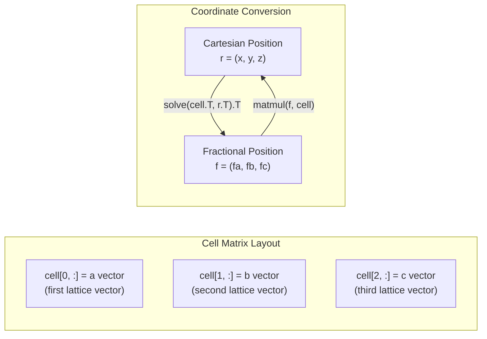

**Sources:** [torch_sim/transforms.py:16-65](), [torch_sim/transforms.py:319-380]()

### Fractional Coordinates

The `get_fractional_coordinates()` function converts Cartesian positions to fractional coordinates by solving the linear system:

**Mathematical Definition:**
```
f = cell⁻¹ · r
```

Where:
- `r` = Cartesian position (N, 3)
- `cell` = Unit cell matrix (3, 3) with lattice vectors as rows
- `f` = Fractional coordinates (N, 3)

**Implementation:**

| Function | Purpose | Shape Handling |
|----------|---------|----------------|
| `get_fractional_coordinates()` | Convert to fractional coords | Handles 2D (3,3) and 3D (1,3,3) cells |
| `wrap_positions()` | ASE-compatible wrapping | Supports `pretty_translation` and custom `center` |
| `translate_pretty()` | Minimize fractional spread | Translates to minimize coordinate magnitudes |

**Key Behavior:**
- Single-system batches (shape `(1, 3, 3)`) are automatically squeezed
- Multi-system batches raise `NotImplementedError` - use per-system calls instead
- Uses `torch.linalg.solve()` for numerical stability

**Sources:** [torch_sim/transforms.py:16-65](), [torch_sim/transforms.py:319-380](), [torch_sim/transforms.py:273-317]()

---

## Periodic Boundary Conditions

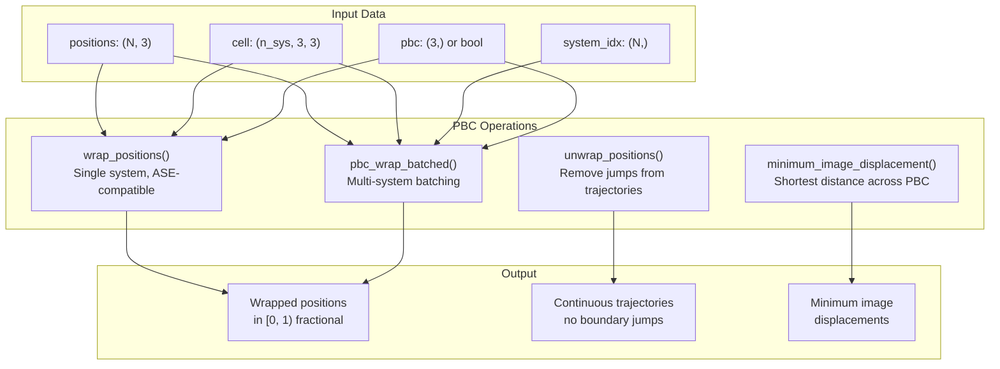

**Sources:** [torch_sim/transforms.py:114-179](), [torch_sim/transforms.py:319-380](), [torch_sim/transforms.py:181-212](), [torch_sim/transforms.py:1180-1242]()

### Wrapping Positions

**`pbc_wrap_batched()`** - Batched PBC wrapping for multiple systems:

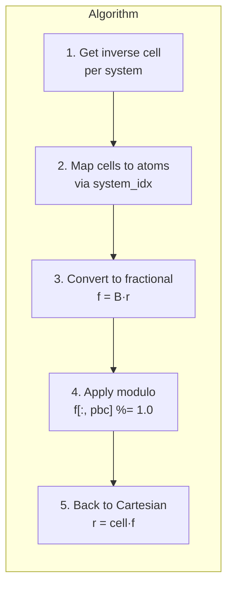

**Key Features:**
- Uses `torch.bmm()` for batched matrix multiplication
- Efficiently handles heterogeneous systems via `system_idx` indexing
- Supports per-dimension PBC control (`pbc` tensor of shape `(3,)`)
- Validates that `n_systems == cell.shape[0]`

**Sources:** [torch_sim/transforms.py:114-179]()

**`wrap_positions()`** - ASE-compatible single-system wrapping:

**Parameters:**
| Parameter | Type | Purpose |
|-----------|------|---------|
| `positions` | `(N, 3)` | Atomic positions |
| `cell` | `(3, 3)` | Unit cell matrix |
| `pbc` | `bool \| list[bool] \| Tensor` | PBC in each dimension |
| `center` | `tuple[float, float, float]` | Cell center (default: (0.5, 0.5, 0.5)) |
| `pretty_translation` | `bool` | Minimize fractional spread |
| `eps` | `float` | Edge case tolerance (default: 1e-7) |

**Sources:** [torch_sim/transforms.py:319-380]()

### Minimum Image Convention

The **minimum image convention** ensures distances are computed through the shortest periodic image:

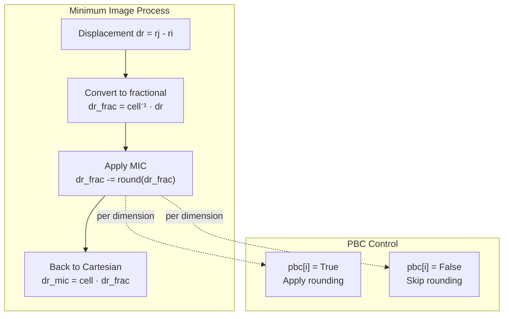

**Mathematical Definition:**
```
dr_frac = cell⁻¹ · dr
dr_frac -= round(dr_frac)  [only for periodic dimensions]
dr_mic = cell · dr_frac
```

**Functions:**
- `minimum_image_displacement()` - Direct MIC application
- `get_pair_displacements()` - Compute displacements with optional MIC

**Sources:** [torch_sim/transforms.py:181-212](), [torch_sim/transforms.py:214-271]()

### Unwrapping Trajectories

**`unwrap_positions()`** removes periodic boundary jumps from molecular dynamics trajectories:

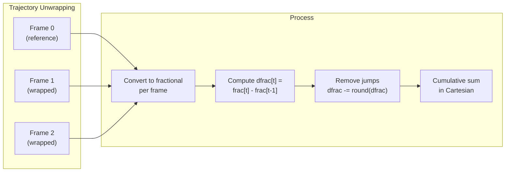

**Input/Output:**
| Tensor | Shape | Description |
|--------|-------|-------------|
| `positions` | `(T, N_tot, 3)` | Wrapped positions across T timesteps |
| `cells` | `(n_sys, 3, 3)` or `(T, n_sys, 3, 3)` | Constant or time-varying cells |
| `system_idx` | `(N_tot,)` | System assignment per atom |
| **Output** | `(T, N_tot, 3)` | Unwrapped continuous trajectories |

**Use Cases:**
- Computing mean square displacements (MSD)
- Analyzing diffusion coefficients
- Visualizing continuous trajectories without jumps

**Sources:** [torch_sim/transforms.py:1180-1242]()

---

## Cell Geometry and Repeats

### Cell Repeats for Cutoff Radius

The `get_number_of_cell_repeats()` function determines how many periodic images are needed to fully cover a cutoff distance:

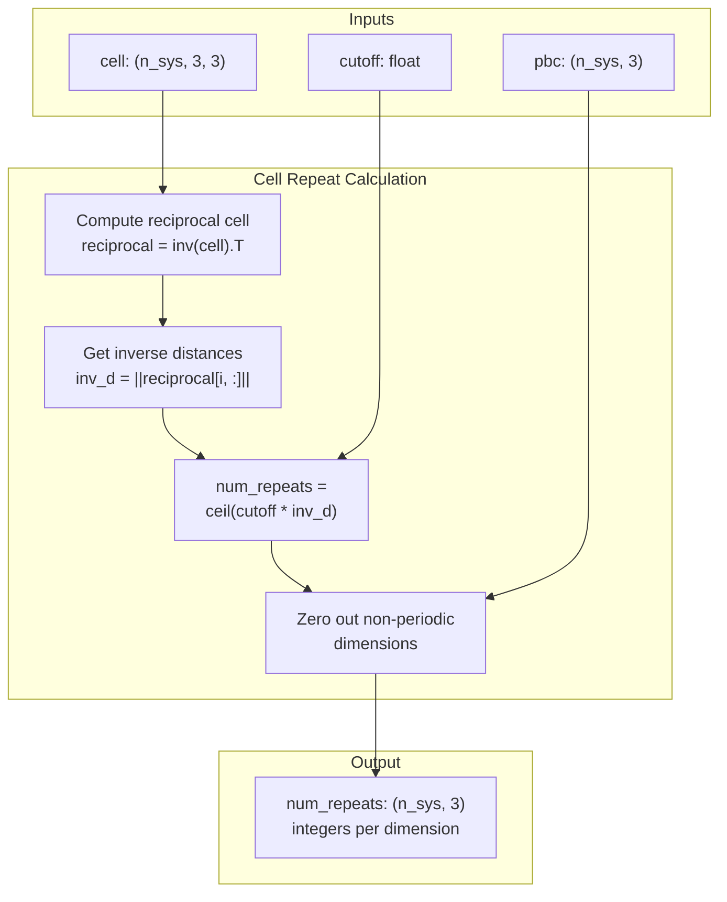

**Mathematical Basis:**
The reciprocal lattice vectors determine the face-to-face distances of the unit cell. The number of repeats in direction `i` is:
```
n_repeats[i] = ceil(cutoff / face_distance[i])
```
where `face_distance[i] = 1 / ||reciprocal_cell[i]||`

**Sources:** [torch_sim/transforms.py:403-436]()

### Cell Shift Indices

**`get_cell_shift_idx()`** generates the Cartesian product of shift indices:

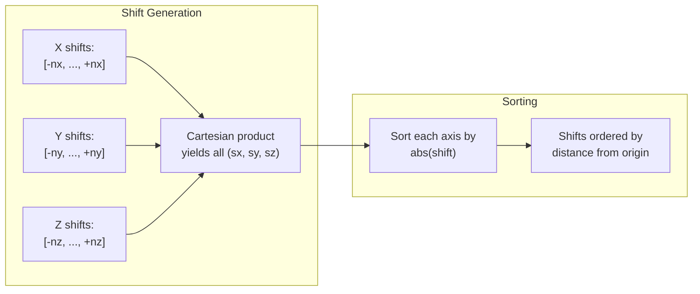

**Example:**
For `num_repeats = [1, 1, 1]`, generates 27 shifts:
```
(0,0,0), (±1,0,0), (0,±1,0), (0,0,±1), (±1,±1,0), ...
```

**Sources:** [torch_sim/transforms.py:438-466]()

### Computing Cell Shifts

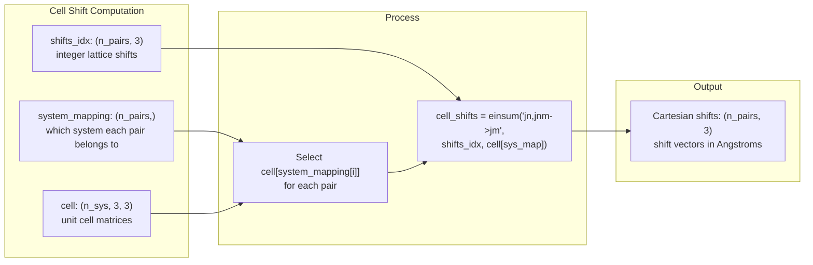

**Function:** `compute_cell_shifts()`

**Usage Pattern:**
```python
# Typical usage in neighbor lists
cell_shifts = compute_cell_shifts(cell, shifts_idx, system_mapping)
distances = compute_distances_with_cell_shifts(pos, mapping, cell_shifts)
```

**Sources:** [torch_sim/transforms.py:508-535]()

---

## Displacement and Distance Calculations

### Pair Displacements

**`get_pair_displacements()`** computes displacement vectors and distances between atom pairs:

| Mode | Description | Parameters |
|------|-------------|------------|
| **Full matrix** | All pairs N×N | `pairs=None` |
| **Specific pairs** | Specified (i,j) indices | `pairs=(i_tensor, j_tensor)` |
| **With shifts** | Explicit periodic images | `pairs + shifts` tensor |
| **MIC** | Minimum image convention | `cell + pbc` provided |

**Return Values:**
- `dr`: Displacement vectors `(n_pairs, 3)`
- `distances`: Euclidean norms `(n_pairs,)`

**Examples:**

```python
# Full distance matrix (no PBC)
dr, distances = get_pair_displacements(positions=pos, cell=None, pbc=False)

# Specific pairs with MIC
pairs = (torch.tensor([0, 1]), torch.tensor([2, 3]))
dr, dist = get_pair_displacements(positions=pos, cell=cell, pbc=True, pairs=pairs)

# Explicit periodic image
shifts = torch.tensor([[1.0, 0.0, 0.0]])  # One cell shift in +x
dr, dist = get_pair_displacements(positions=pos, cell=cell, pairs=pairs, shifts=shifts)
```

**Sources:** [torch_sim/transforms.py:214-271]()

### Distance Computation with Cell Shifts

**`compute_distances_with_cell_shifts()`** is the low-level function used by neighbor lists:

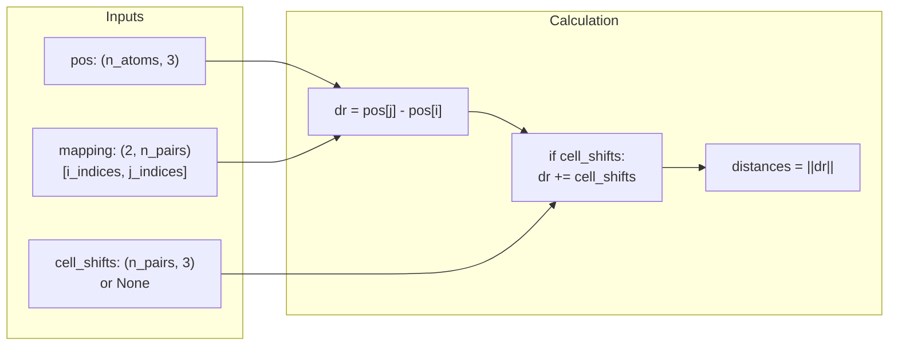

**Validation:**
- Ensures `mapping` is 2D with shape `(2, n_pairs)`
- Handles `None` cell_shifts gracefully

**Sources:** [torch_sim/transforms.py:468-506]()

---

## Supporting Utilities

### Inverse Box Transformations

**`inverse_box()`** computes inverses for scalars, vectors, or matrices:

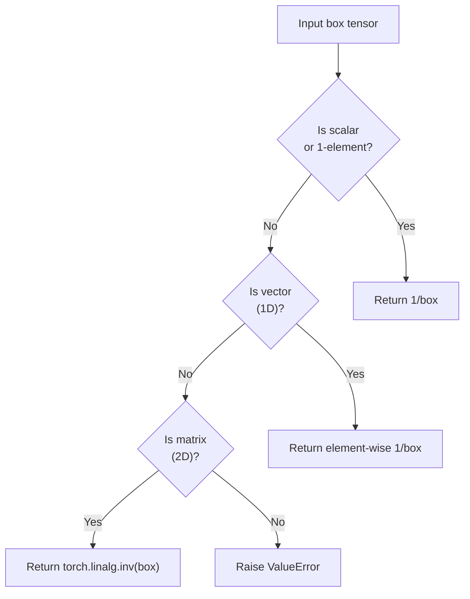

**Use Cases:**
- Converting between cell and reciprocal cell
- General affine transformation inversions
- Coordinate system changes

**Sources:** [torch_sim/transforms.py:67-112]()

### High Precision Summation

**`high_precision_sum()`** prevents numerical instability by casting to 64-bit precision during summation:

| Input dtype | Intermediate dtype | Output dtype |
|-------------|-------------------|--------------|
| `float32` | `float64` | `float32` |
| `float16` | `float64` | `float16` |
| `complex64` | `complex128` | `complex64` |
| `int32` | `int64` | `int32` |

**Parameters:**
- `x`: Input tensor
- `dim`: Dimension(s) to sum over (None = all)
- `keepdim`: Retain reduced dimensions

**When to Use:**
- Summing large numbers of values
- Computing energies over many atoms
- Gradient accumulation

**Sources:** [torch_sim/transforms.py:1108-1146]()

### Safe Masking

**`safe_mask()`** applies functions only to masked elements, avoiding numerical issues:

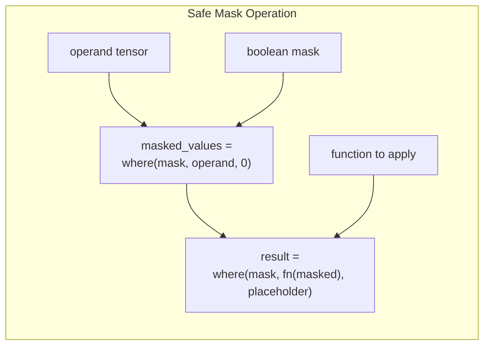

**Common Use Case:**
```python
# Safely compute log only for positive values
mask = x > 0
result = safe_mask(mask, torch.log, x, placeholder=0.0)
# Avoids log(0) or log(negative) errors
```

**Sources:** [torch_sim/transforms.py:1148-1178]()

### 3D Indexing Utilities

**Ravel/Unravel Functions** convert between 3D and linear indices:

| Function | Input → Output | Formula |
|----------|---------------|---------|
| `ravel_3d()` | `(N, 3)` → `(N,)` | `idx[2] + shape[2]*(idx[1] + shape[1]*idx[0])` |
| `unravel_3d()` | `(N,)` → `(N, 3)` | Inverse of ravel using divmod operations |

**Use Cases:**
- Linked cell algorithm bin indexing
- 3D grid flattening
- Converting between spatial and linear representations

**Sources:** [torch_sim/transforms.py:693-739]()

### Center of Mass Calculation

**`get_centers_of_mass()`** computes COM for batched systems:

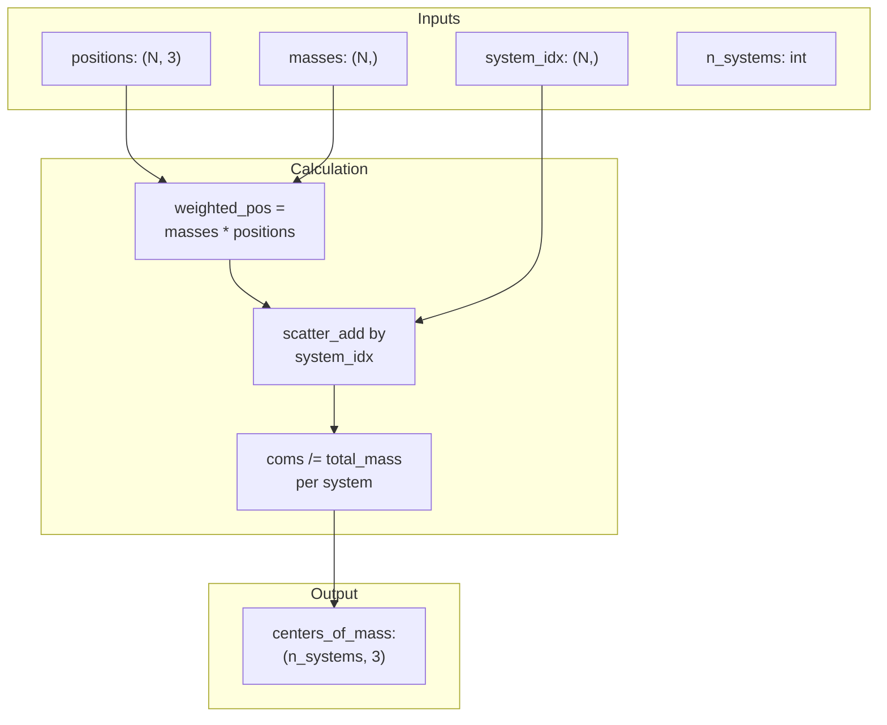

**Algorithm:**
1. Compute mass-weighted positions
2. Scatter-add by system index
3. Normalize by total system mass

**Sources:** [torch_sim/transforms.py:1244-1272]()

---

## Integration with Neighbor Lists

The coordinate transform functions are fundamental building blocks for neighbor list construction. See [Neighbor Lists](#7.3) for details on:

- `build_naive_neighborhood()` - Uses `pbc_wrap_batched()`, `compute_cell_shifts()`, and `get_number_of_cell_repeats()`
- `build_linked_cell_neighborhood()` - Uses `linked_cell()` which relies on binning and shift utilities
- All neighbor list implementations use `compute_distances_with_cell_shifts()` for final distance computation

**Testing and Validation:**

The transforms are extensively tested against ASE reference implementations:
- `test_wrap_positions_matches_ase()` - Tests all PBC combinations
- `test_pbc_wrap_batched_*()` - Tests batched operations
- `test_minimum_image_displacement()` - Validates MIC
- `test_unwrap_positions()` - Validates trajectory unwrapping with MD integrators

**Sources:** [tests/test_transforms.py:71-393](), [tests/test_transforms.py:1337-1393](), [tests/test_neighbors.py:17-61]()

---