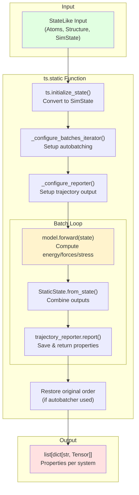
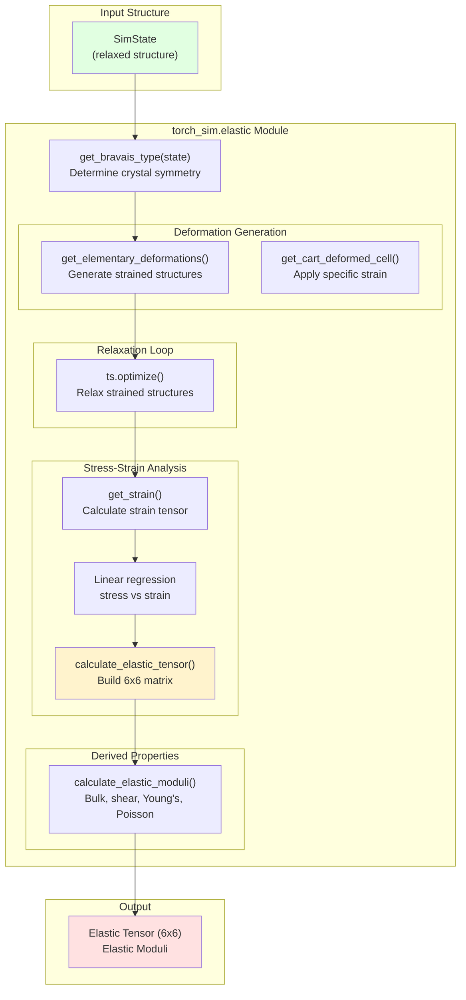
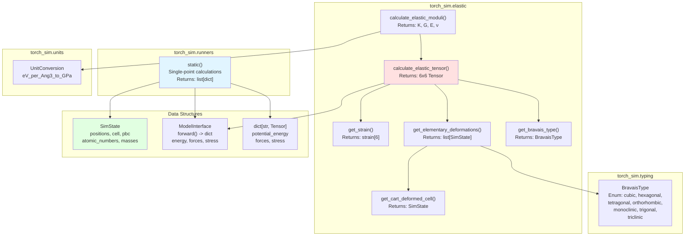

# Material Properties

<details>
<summary>Relevant source files</summary>

The following files were used as context for generating this wiki page:

- [tests/models/test_orb.py](tests/models/test_orb.py)
- [tests/models/test_sevennet.py](tests/models/test_sevennet.py)
- [tests/test_elastic.py](tests/test_elastic.py)
- [tests/test_runners.py](tests/test_runners.py)
- [tests/test_trajectory.py](tests/test_trajectory.py)
- [torch_sim/models/orb.py](torch_sim/models/orb.py)
- [torch_sim/runners.py](torch_sim/runners.py)
- [torch_sim/trajectory.py](torch_sim/trajectory.py)

</details>


This page covers the calculation of material properties from atomic structures using torch-sim. Material property calculations include single-point energy/force/stress evaluations and elastic property determinations (elastic tensors, moduli). These calculations use the same model interfaces and state representations as molecular dynamics simulations but focus on computing static or derived properties rather than time evolution.

For information about running molecular dynamics simulations, see [Molecular Dynamics](#4). For structure optimization methods, see [Structure Optimization](#5). For the core computational workflow, see [High-Level API Functions](#3.3).

## Overview of Material Property Calculations

Material property calculations in torch-sim fall into two main categories:

**Static Properties**: Single-point calculations that evaluate model outputs (energy, forces, stress) for given atomic configurations without time evolution. These are performed using `ts.static()` [torch_sim/runners.py:734-853]().

**Elastic Properties**: Derived properties that characterize mechanical response to deformation. These require systematic perturbations of the atomic structure and stress tensor evaluations. Key functions are located in the `torch_sim.elastic` module.

Both calculation types integrate seamlessly with the model interface, autobatching system, and trajectory reporting infrastructure established for dynamics simulations.

## Static Property Calculation Workflow

The `ts.static()` function provides single-point property calculations for one or more atomic structures:



**Static Calculation Process**

Sources: [torch_sim/runners.py:734-853]()

### Usage Patterns

**Basic Single-Point Calculation**

```python
import torch_sim as ts

# Single system
results = ts.static(
    system=atoms,
    model=model,
)
# Returns: [{"potential_energy": tensor, "forces": tensor, "stress": tensor}]
```

The function returns a list of dictionaries, one per system, containing the calculated properties [torch_sim/runners.py:741]().

**Batch Calculation with Autobatching**

```python
# Multiple systems with automatic memory management
results = ts.static(
    system=[atoms1, atoms2, atoms3],
    model=model,
    autobatcher=True,
)
# Returns: list of 3 property dictionaries
```

When `autobatcher=True`, `BinningAutoBatcher` groups systems by size to maximize GPU efficiency [torch_sim/runners.py:773]().

**Calculation with Trajectory Logging**

```python
reporter = ts.TrajectoryReporter(
    filenames=["system1.h5", "system2.h5"],
    prop_calculators={1: {"pe": lambda state: state.energy}},
    state_kwargs={"save_forces": True},
)

results = ts.static(
    system=[atoms1, atoms2],
    model=model,
    trajectory_reporter=reporter,
)
```

The trajectory reporter both saves results to HDF5 files and returns them in-memory [torch_sim/runners.py:787-790]().

Sources: [torch_sim/runners.py:734-853](), [tests/test_runners.py:625-694](), [tests/test_runners.py:856-874]()

### Return Value Structure

The `static()` function returns `list[dict[str, torch.Tensor]]` with one dictionary per system. Each dictionary contains:

| Key | Condition | Shape | Description |
|-----|-----------|-------|-------------|
| `potential_energy` | Always | `(1,)` | Total energy of the system |
| `forces` | `model.compute_forces=True` | `(n_atoms, 3)` | Atomic forces |
| `stress` | `model.compute_stress=True` | `(3, 3)` | Stress tensor |
| Custom properties | If `prop_calculators` provided | Varies | User-defined properties |

The properties are also written to the input state object's `energy`, `forces`, and `stress` attributes [torch_sim/runners.py:824-837]().

Sources: [torch_sim/runners.py:741-769](), [torch_sim/runners.py:823-837]()

### Integration with Optimization

Static calculations are commonly used after structure optimization to evaluate final properties:

```python
# Optimize structure
relaxed_state = ts.optimize(
    system=initial_structure,
    model=model,
    optimizer=ts.Optimizer.fire,
    max_steps=500,
)

# Calculate final properties
final_props = ts.static(
    system=relaxed_state,
    model=model,
)
```

The relaxed state retains all necessary attributes for property evaluation [tests/test_runners.py:856-874]().

Sources: [tests/test_runners.py:856-874]()

## Elastic Property Calculations

Elastic properties characterize a material's mechanical response to deformation. The `torch_sim.elastic` module provides functions for calculating elastic tensors, elastic moduli, and related quantities.



**Elastic Property Calculation Workflow**

Sources: [tests/test_elastic.py:355-411]()

### Strain and Deformation

**Strain Tensor Calculation**

The `get_strain(deformed_state, reference_state)` function computes the symmetric strain tensor from cell deformations. The strain tensor is calculated as:

ε = (u + u<sup>T</sup>) / 2

where u is the displacement gradient: u = (F - F₀)F₀<sup>-1</sup>

The function returns strain in Voigt notation: `[εxx, εyy, εzz, εyz, εxz, εxy]` [tests/test_elastic.py:28-208]().

**Deformation Generation**

The `get_elementary_deformations()` function generates systematically deformed structures for elastic tensor calculation:

```python
from torch_sim.elastic import get_elementary_deformations

deformed_states = get_elementary_deformations(
    reference_state,
    n_deform=5,                    # Number of deformation magnitudes
    max_strain_normal=0.01,        # Maximum normal strain (εxx, εyy, εzz)
    max_strain_shear=0.02,         # Maximum shear strain (εyz, εxz, εxy)
    bravais_type=BravaisType.cubic, # Crystal symmetry
)
```

The function generates deformations along crystallographically relevant axes based on the Bravais lattice type. For `BravaisType.triclinic`, all 6 independent strain components are sampled. For higher-symmetry systems, only symmetry-inequivalent strains are generated [tests/test_elastic.py:210-255]().

Sources: [tests/test_elastic.py:28-255]()

### Elastic Tensor Calculation

The `calculate_elastic_tensor()` function computes the full 6×6 elastic tensor by:

1. Generating deformed structures with `get_elementary_deformations()`
2. Relaxing atomic positions for each deformed structure (fixed cell)
3. Evaluating stress tensors for each deformed configuration
4. Performing linear regression of stress vs. strain
5. Constructing the elastic stiffness tensor C<sub>ijkl</sub>

The tensor relates stress to strain: σ = C : ε

**Example: Cubic System**

```python
from torch_sim.elastic import (
    calculate_elastic_tensor,
    calculate_elastic_moduli,
    get_bravais_type,
)
from torch_sim.units import UnitConversion

# Assume 'relaxed_state' is a fully relaxed structure
bravais_type = get_bravais_type(relaxed_state)

# Calculate elastic tensor (in eV/ų)
C = calculate_elastic_tensor(
    state=relaxed_state,
    model=model,
    bravais_type=bravais_type,
)

# Convert to GPa
C_GPa = C * UnitConversion.eV_per_Ang3_to_GPa

# Calculate elastic moduli
bulk, shear, youngs, poisson = calculate_elastic_moduli(C_GPa)
```

The elastic tensor respects the crystal symmetry specified by `bravais_type`. For example, cubic systems have only 3 independent components (C₁₁, C₁₂, C₄₄) [tests/test_elastic.py:271-352]().

Sources: [tests/test_elastic.py:355-411]()

### Bravais Lattice Types

The `BravaisType` enumeration specifies crystal symmetry classes:

| Bravais Type | Independent Components | Crystal Systems |
|--------------|------------------------|-----------------|
| `triclinic` | 21 | Triclinic |
| `monoclinic` | 13 | Monoclinic |
| `orthorhombic` | 9 | Orthorhombic |
| `tetragonal` | 6-7 | Tetragonal |
| `trigonal` | 6-7 | Rhombohedral, Trigonal |
| `hexagonal` | 5 | Hexagonal |
| `cubic` | 3 | Cubic (FCC, BCC, SC) |

The `get_bravais_type(state)` function automatically determines the lattice type from the cell parameters [tests/test_elastic.py:302-307]().

Sources: [tests/test_elastic.py:271-333]()

### Elastic Moduli

The `calculate_elastic_moduli(elastic_tensor)` function derives macroscopic elastic properties from the elastic tensor:

| Property | Symbol | Unit | Description |
|----------|--------|------|-------------|
| Bulk Modulus | K | GPa | Resistance to volumetric compression |
| Shear Modulus | G | GPa | Resistance to shear deformation |
| Young's Modulus | E | GPa | Resistance to uniaxial tension |
| Poisson's Ratio | ν | dimensionless | Lateral strain response to axial strain |

These are calculated using Voigt-Reuss-Hill averaging for polycrystalline properties [tests/test_elastic.py:387-411]().

Sources: [tests/test_elastic.py:387-411]()

## Code Entity Reference

### Key Functions and Classes



**Material Property Function Reference**

Sources: [torch_sim/runners.py:734-853](), [tests/test_elastic.py:1-412]()

### Integration with Workflow

Material property calculations integrate with the broader torch-sim workflow:

| Workflow Stage | Function | Purpose |
|----------------|----------|---------|
| Initial state | `ts.initialize_state()` | Convert input formats to `SimState` |
| Pre-relaxation | `ts.optimize()` | Relax structure to energy minimum |
| Static properties | `ts.static()` | Evaluate energy, forces, stress |
| Elastic properties | `calculate_elastic_tensor()` | Systematic deformation and fitting |
| Post-processing | `TrajectoryReporter` | Save results to HDF5 |
| Analysis | `calculate_elastic_moduli()` | Derive engineering properties |

Sources: [torch_sim/runners.py:1-853](), [tests/test_elastic.py:355-411]()

### Autobatching for Material Properties

Both static and elastic calculations support autobatching for efficient GPU utilization:

**Static Calculations**: Use `BinningAutoBatcher` to group systems by size [torch_sim/runners.py:773]().

**Elastic Calculations**: Batch deformed structures during relaxation using `ts.optimize()` with autobatching enabled.

The autobatching system automatically handles memory management and restores the original order of results [torch_sim/runners.py:847-851]().

Sources: [torch_sim/runners.py:696-853](), [tests/test_runners.py:696-835]()

## Example: Complete Elastic Property Workflow

```python
import torch_sim as ts
from torch_sim.elastic import (
    calculate_elastic_tensor,
    calculate_elastic_moduli,
    get_bravais_type,
)
from torch_sim.units import UnitConversion

# Load structure and model
atoms = bulk("Cu", "fcc", a=3.6, cubic=True)
state = ts.initialize_state(atoms, device=model.device, dtype=model.dtype)

# Relax structure to zero pressure
relaxed = ts.optimize(
    system=state,
    model=model,
    optimizer=ts.Optimizer.fire,
    convergence_fn=ts.generate_force_convergence_fn(force_tol=1e-5),
    init_kwargs={"cell_filter": ts.CellFilter.frechet, "scalar_pressure": 0.0},
)

# Determine crystal symmetry
bravais = get_bravais_type(relaxed)

# Calculate elastic tensor
C = calculate_elastic_tensor(
    state=relaxed,
    model=model,
    bravais_type=bravais,
)

# Convert to GPa and calculate moduli
C_GPa = C * UnitConversion.eV_per_Ang3_to_GPa
bulk, shear, youngs, poisson = calculate_elastic_moduli(C_GPa)

print(f"Bulk modulus: {bulk:.2f} GPa")
print(f"Shear modulus: {shear:.2f} GPa")
```

This workflow demonstrates the typical sequence: initialize → relax → calculate elastic properties [tests/test_elastic.py:355-411]().

Sources: [tests/test_elastic.py:355-411]()

---