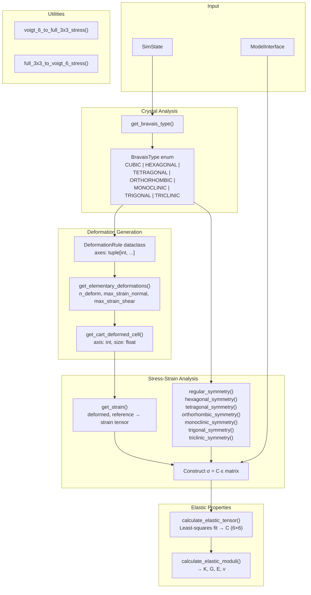
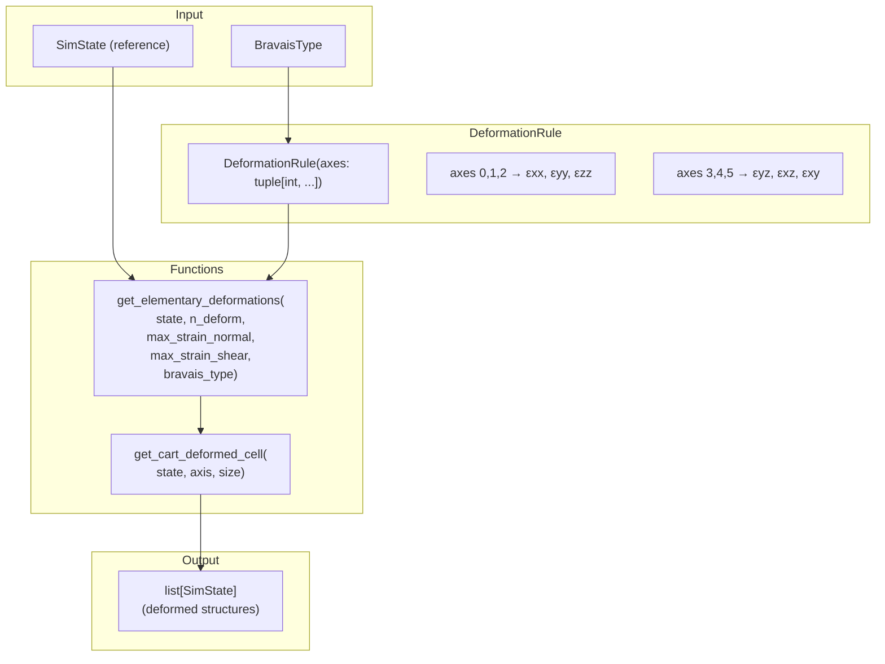
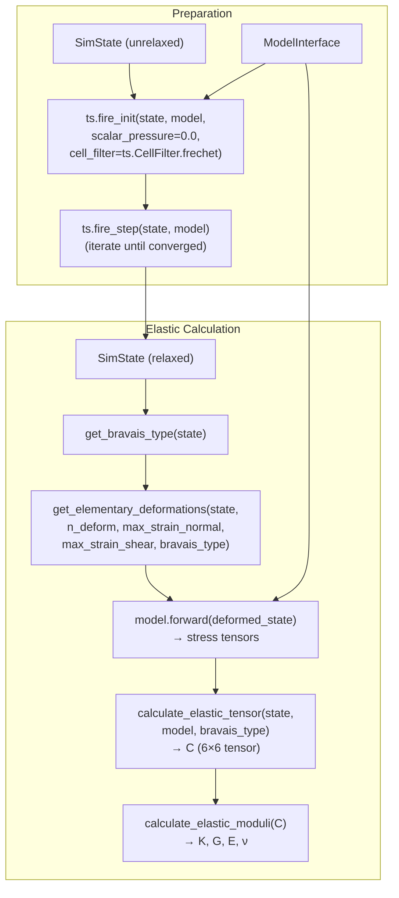

# Elastic Properties

<details>
<summary>Relevant source files</summary>

The following files were used as context for generating this wiki page:

- [tests/models/test_orb.py](tests/models/test_orb.py)
- [tests/models/test_sevennet.py](tests/models/test_sevennet.py)
- [tests/test_elastic.py](tests/test_elastic.py)
- [torch_sim/models/orb.py](torch_sim/models/orb.py)

</details>


The elastic property calculation system computes elastic tensors and elastic moduli for crystalline materials using stress-strain relationships. The system automatically detects crystal symmetries, generates appropriate deformations, and fits elastic constants from model-calculated stresses.

This module is located in [torch_sim/elastic.py:1-899]() and provides functions for Bravais lattice classification, deformation generation, strain calculation, and elastic tensor fitting.

## Overview and Architecture

The elastic property calculation system implements a complete workflow for determining the mechanical properties of crystals from first principles. It automatically detects crystal symmetries, generates appropriate deformations, and computes elastic tensors using stress-strain relationships.

### System Architecture

**Elastic Property Calculation Pipeline**



Sources: [torch_sim/elastic.py:1-899]()

### Crystal Symmetry Classification

**Independent Elastic Constants by Crystal System**

| `BravaisType` | Independent Constants | Symmetry Handler Function |
|---------------|----------------------|---------------------------|
| `CUBIC` | 3 (C₁₁, C₁₂, C₄₄) | `regular_symmetry()` |
| `HEXAGONAL` | 5 (C₁₁, C₃₃, C₁₂, C₁₃, C₄₄) | `hexagonal_symmetry()` |
| `TETRAGONAL` | 7 (C₁₁, C₃₃, C₁₂, C₁₃, C₁₆, C₄₄, C₆₆) | `tetragonal_symmetry()` |
| `ORTHORHOMBIC` | 9 | `orthorhombic_symmetry()` |
| `MONOCLINIC` | 13 | `monoclinic_symmetry()` |
| `TRIGONAL` | 7 (C₁₁, C₃₃, C₁₂, C₁₃, C₁₄, C₄₄, C₆₆) | `trigonal_symmetry()` |
| `TRICLINIC` | 21 (all components) | `triclinic_symmetry()` |

Each symmetry handler constructs a stress-strain relationship matrix encoding crystallographic constraints. The `BravaisType` enum is defined in [torch_sim/typing.py:1-50]() and symmetry handlers in [torch_sim/elastic.py:143-623]().

Sources: [torch_sim/elastic.py:51-141](), [torch_sim/elastic.py:143-623](), [torch_sim/typing.py:1-50]()

## Core Components

### Bravais Type Detection

The `get_bravais_type(state: SimState, length_tol: float = 1e-3, angle_tol: float = 1.0)` function in [torch_sim/elastic.py:51-141]() classifies crystal systems from lattice parameters without external dependencies. Classification is based on comparing lattice vectors and angles with specified tolerances.

**Crystal System Classification Rules**

| `BravaisType` | Lattice Length Relations | Lattice Angle Relations |
|---------------|--------------------------|-------------------------|
| `CUBIC` | a = b = c | α = β = γ = 90° |
| `HEXAGONAL` | a = b ≠ c | α = β = 90°, γ = 120° |
| `TETRAGONAL` | a = b ≠ c | α = β = γ = 90° |
| `ORTHORHOMBIC` | a ≠ b ≠ c | α = β = γ = 90° |
| `MONOCLINIC` | a ≠ b ≠ c | α = γ = 90°, β ≠ 90° |
| `TRIGONAL` | a = b = c | α = β = γ ≠ 90° |
| `TRICLINIC` | a ≠ b ≠ c | α ≠ β ≠ γ (no constraints) |

The function extracts lattice parameters from `state.row_vector_cell`, computes lengths and angles, and applies tolerance-based comparisons to determine the Bravais lattice type.

Sources: [torch_sim/elastic.py:51-141]()

### Deformation Generation

**Deformation Pipeline**



The `DeformationRule` dataclass [torch_sim/elastic.py:32-49]() specifies which strain axes to apply for each crystal system. The `get_elementary_deformations()` function [torch_sim/elastic.py:625-680]() generates `n_deform` strain points per axis, excluding zero strain for odd `n_deform`. Each deformation is applied by `get_cart_deformed_cell()` [torch_sim/elastic.py:682-766](), which scales cell vectors and positions appropriately.

**Deformation Axis Mapping**

| Axis | Strain Component | Deformation Type | Applied to Cell Vector |
|------|------------------|------------------|------------------------|
| 0 | εₓₓ | Normal (x) | a-axis |
| 1 | εᵧᵧ | Normal (y) | b-axis |
| 2 | εᵤᵤ | Normal (z) | c-axis |
| 3 | εᵧᵤ | Shear (yz) | b, c-axes |
| 4 | εₓᵤ | Shear (xz) | a, c-axes |
| 5 | εₓᵧ | Shear (xy) | a, b-axes |

Sources: [torch_sim/elastic.py:32-49](), [torch_sim/elastic.py:625-680](), [torch_sim/elastic.py:682-766]()

### Stress-Strain Relationship Construction

Each symmetry handler function constructs a stress-strain relationship matrix **A** such that **σ = A·c**, where **σ** is the stress vector, **c** is the vector of independent elastic constants, and **A** encodes the crystallographic symmetry constraints.

The full elastic relationship is **σᵢ = Σⱼ Cᵢⱼ εⱼ** where:
- **σ**: 6-component stress vector (Voigt notation)
- **ε**: 6-component strain vector (Voigt notation)
- **C**: 6×6 elastic stiffness tensor

**Voigt Notation Index Mapping**

| Index | Tensor Component | Physical Meaning |
|-------|------------------|------------------|
| 0 | σₓₓ, εₓₓ | Normal stress/strain (x-direction) |
| 1 | σᵧᵧ, εᵧᵧ | Normal stress/strain (y-direction) |
| 2 | σᵤᵤ, εᵤᵤ | Normal stress/strain (z-direction) |
| 3 | σᵧᵤ, εᵧᵤ | Shear stress/strain (yz-plane) |
| 4 | σₓᵤ, εₓᵤ | Shear stress/strain (xz-plane) |
| 5 | σₓᵧ, εₓᵧ | Shear stress/strain (xy-plane) |

Symmetry handler functions [torch_sim/elastic.py:143-623]() construct the **A** matrix for least-squares fitting: `torch.linalg.lstsq(A, stress_data)` → independent elastic constants.

Sources: [torch_sim/elastic.py:143-623]()

### Strain Tensor Calculation

The `get_strain(deformed_state: SimState, reference_state: SimState)` function [torch_sim/elastic.py:768-831]() computes the symmetric strain tensor in Voigt notation.

**Calculation Steps:**

1. Extract cell matrices: `M_ref = reference_state.row_vector_cell`, `M_def = deformed_state.row_vector_cell`
2. Compute displacement gradient: **u = M_ref⁻¹·(M_def - M_ref)**
3. Symmetrize to get strain tensor: **ε_tensor = (u + uᵀ)/2**
4. Convert to Voigt 6-component vector: `[εₓₓ, εᵧᵧ, εᵤᵤ, εᵧᵤ, εₓᵤ, εₓᵧ]`

The symmetric strain tensor ensures **εᵢⱼ = εⱼᵢ**, which is required for thermodynamic consistency. Tests in [tests/test_elastic.py:73-109]() verify shear strain symmetrization: for axis 3 (yz shear), `get_cart_deformed_cell()` creates `u[1,2] = shear_magnitude`, but `get_strain()` returns `ε[3] = εᵧᵤ = shear_magnitude/2` due to symmetrization.

Sources: [torch_sim/elastic.py:768-831](), [tests/test_elastic.py:73-109]()

## Stress Tensor Conversions

Conversion functions between Voigt 6-component vectors and full 3×3 stress tensors are provided in [torch_sim/elastic.py:833-899]().

### Conversion Functions

**`voigt_6_to_full_3x3_stress(stress_voigt: Tensor) -> Tensor`**

Converts 6-component Voigt stress vector `[σₓₓ, σᵧᵧ, σᵤᵤ, σᵧᵤ, σₓᵤ, σₓᵧ]` to 3×3 symmetric stress tensor. Supports arbitrary leading batch dimensions.

**`full_3x3_to_voigt_6_stress(stress_full: Tensor) -> Tensor`**

Converts 3×3 stress tensor to 6-component Voigt vector. Enforces symmetry by averaging off-diagonal components: `σᵢⱼ = (stress_full[i,j] + stress_full[j,i])/2`.

**Voigt Indexing Convention**

```
Voigt[0] → Tensor[0,0]  (σₓₓ)
Voigt[1] → Tensor[1,1]  (σᵧᵧ)
Voigt[2] → Tensor[2,2]  (σᵤᵤ)
Voigt[3] → Tensor[1,2] = Tensor[2,1]  (σᵧᵤ)
Voigt[4] → Tensor[0,2] = Tensor[2,0]  (σₓᵤ)
Voigt[5] → Tensor[0,1] = Tensor[1,0]  (σₓᵧ)
```

Both functions handle batched inputs and preserve device/dtype. These conversions are used when interfacing with models that return stress in 3×3 format but elastic tensor calculations require Voigt notation.

Sources: [torch_sim/elastic.py:833-899]()

## Workflow Integration

### Complete Elastic Property Calculation

**Typical Workflow: Relax → Deform → Fit → Moduli**



The workflow in [tests/test_elastic.py:355-411]() demonstrates:

1. **Structure relaxation**: Use FIRE optimizer with Frechet cell filter to relax positions and cell to zero pressure
2. **Symmetry detection**: `get_bravais_type()` determines crystal system
3. **Deformation generation**: `get_elementary_deformations()` creates strained structures
4. **Stress calculation**: Evaluate model on each deformed structure
5. **Tensor fitting**: `calculate_elastic_tensor()` performs least-squares fit of stress-strain data
6. **Moduli calculation**: `calculate_elastic_moduli()` computes bulk modulus K, shear modulus G, Young's modulus E, and Poisson's ratio ν

Sources: [tests/test_elastic.py:355-411]()

### Key Parameters and Controls

| Function | Parameter | Type | Default | Purpose |
|----------|-----------|------|---------|---------|
| `get_bravais_type()` | `length_tol` | `float` | `1e-3` | Relative tolerance for lattice length comparison |
| `get_bravais_type()` | `angle_tol` | `float` | `1.0` | Absolute tolerance for angle comparison (degrees) |
| `get_elementary_deformations()` | `n_deform` | `int` | `5` | Number of strain points per axis (odd excludes zero) |
| `get_elementary_deformations()` | `max_strain_normal` | `float` | `0.01` | Maximum normal strain magnitude (εₓₓ, εᵧᵧ, εᵤᵤ) |
| `get_elementary_deformations()` | `max_strain_shear` | `float` | `0.05` | Maximum shear strain magnitude (εᵧᵤ, εₓᵤ, εₓᵧ) |
| `get_elementary_deformations()` | `bravais_type` | `BravaisType \| None` | `None` | Override automatic symmetry detection |
| `get_cart_deformed_cell()` | `axis` | `int` | - | Deformation axis (0-5) |
| `get_cart_deformed_cell()` | `size` | `float` | - | Deformation magnitude |
| `calculate_elastic_tensor()` | `bravais_type` | `BravaisType \| None` | `None` | Crystal system for symmetry constraints |

**Typical Parameter Choices:**
- For accurate elastic tensors: `n_deform=7`, `max_strain_normal=0.01`, `max_strain_shear=0.05`
- For fast estimates: `n_deform=3`, `max_strain_normal=0.02`, `max_strain_shear=0.08`

Sources: [torch_sim/elastic.py:51-141](), [torch_sim/elastic.py:625-680](), [torch_sim/elastic.py:682-766]()

## Testing and Validation

The system includes comprehensive tests that validate elastic property calculations against known reference values and ensure consistency across different crystal systems.

### Test Coverage

- **Strain calculation accuracy**: Verification of symmetric strain tensor computation
- **Crystal symmetry detection**: Testing against known structures  
- **Elastic tensor symmetries**: Ensuring calculated tensors respect crystallographic constraints
- **Voigt conversions**: Validation against ASE implementations
- **Reference material properties**: Comparison with experimental values for copper

Sources: [tests/test_elastic.py:1-399](), [tests/test_voigt.py:1-188]()

---